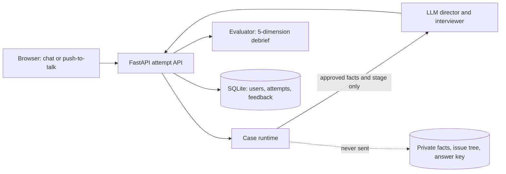

# Practice with Leo

Leo is an AI interviewer for practising consulting case interviews (McKinsey, BCG, Bain).
You pick a case, talk it through by typing or by voice, and get a written debrief scored
the way a real interviewer would score you.

Leo is not a chatbot that knows the answer and leaks it. Each case is a private world of
facts, and the server decides which facts you have earned. The model only writes Leo's
next line from the facts it has been allowed to share.

## What it does

- **69 case packages.** 12 original cases plus 57 adapted from IIM Ahmedabad,
  IIM Bangalore, IIM Calcutta and ISB casebooks. They cover profitability, operations,
  growth, pricing, market entry, M&A, turnaround, digital and public-sector cases.
- **Three interviewer personas.** *Coached*, *Realistic* and *Pressure* set how easily
  Leo gives up information and what tone he takes. A precise question still gets an
  answer from the toughest persona, and a vague one gets little from any of them.
- **Typed or spoken practice.** The practice room works as a chat. You can also turn on
  push-to-talk voice: hold the spacebar, speak, and Leo replies in streamed speech.
- **Debrief after every case.** You get a 1.0 to 5.0 score on structuring, problem
  solving, quantitative work, synthesis and communication. Each score quotes what you
  said, and the debrief adds model rewrites of your opening and close, a focused drill
  and suggested reading from the knowledge base.
- **Progress over time.** Your profile tracks scores, recurring weak areas, past
  transcripts and how far you got on each case.
- **Community cases.** Signed-in users can contribute a case they were given in a real
  interview. Leo asks about it field by field, an admin reviews the AI-drafted case, and
  approved cases join the library with optional credit to the contributor.
- **Admin console.** Admins can see transcripts and metrics for all users, re-run
  evaluations and review contributed cases.

## How it works



- **The case runtime has final say on what Leo can reveal.** It tracks the interview
  stage and each fact's release level, so the LLM can propose facts but can't reveal
  anything the runtime hasn't approved.
- **The browser never sees private case content.** The public API returns only
  candidate-safe data: unreleased facts, the issue tree and the answer key never reach
  the browser or the interviewer prompt.
- **One interview engine serves text and voice.** In voice mode, ElevenLabs only does
  speech-to-text and text-to-speech. Spoken turns go through the same runtime as typed
  ones.

## Tech stack

Python 3.11+, FastAPI, Jinja2, LangChain via OpenRouter, Pydantic, SQLite, and vanilla
JS/CSS on the frontend. Voice uses ElevenLabs Scribe and TTS. Sign-in uses Google OAuth.
The app deploys to Fly.io from the included `Dockerfile` and `fly.toml`.

## Quick start

```bash
python3 -m venv .venv
source .venv/bin/activate
pip install -e '.[dev]'          # or: uv sync
cp .env.example .env             # then fill in the keys below
make dev                         # uvicorn with reload on http://127.0.0.1:8000
```

| Variable | Needed for |
|---|---|
| `OPENROUTER_API_KEY` | Every interview turn and evaluation (required) |
| `GOOGLE_CLIENT_ID`, `GOOGLE_CLIENT_SECRET`, `OAUTH_REDIRECT_URI` | Sign-in, which the practice room requires |
| `ADMIN_EMAILS` | Access to `/admin` (nobody is an admin until it is set) |
| `VOICE_ENABLED`, `ELEVENLABS_API_KEY`, `ELEVENLABS_VOICE_ID` | Push-to-talk voice (optional) |
| `SESSION_SECRET`, `DATABASE_PATH` | Production only |

[`.env.example`](.env.example) explains each variable and its default.

For Google sign-in, create an OAuth 2.0 **Web application** client in the
[Google Cloud console](https://console.cloud.google.com/apis/credentials) and register
`http://127.0.0.1:8000/auth/google/callback` as a redirect URI.

## Tests

```bash
make test        # or: pytest
```

The suite covers the API boundary, fact release, personas, evaluation, persistence,
voice transport and the contribution flow.

## Repository layout

```
app/                FastAPI app: routes, case runtime, interviewer, evaluator, voice, accounts
  templates/        Jinja2 pages (landing, cases, practice, debrief, profile, contribute, admin)
  static/           Page scripts and styles; tokens.css is the shared design system
reservoir/          The 12 original case packages, plus the shared conversation policy
corpus/exemplars/   57 casebook-derived cases (iima, iimb, iimc, isb)
knowledge_base/     Industry primers, case-type playbooks and methodology used in debriefs
evaluation/         Scoring rubric, behaviour checklist and evaluator prompts
scripts/            Corpus builders, metadata backfill, latency benchmark, evals, DB backup
tests/              pytest suite
docs/               Design notes, setup guides and plans (see below)
```

A case package is a folder with `case.yaml` (the prompt and metadata), `facts.yaml`
(private facts with release levels) and, optionally, `issue-tree.yaml` and
`conversation-policy.yaml`.

## Documentation

| Topic | Document |
|---|---|
| Codebase tour, module by module | [docs/codebase-guide.md](docs/codebase-guide.md) |
| System design | [docs/engineering-design.md](docs/engineering-design.md) |
| Product design and brand | [docs/product-design.md](docs/product-design.md), [docs/leo-brand.md](docs/leo-brand.md) |
| How a case world is modelled | [docs/case-world-model.md](docs/case-world-model.md) |
| Evaluator design | [docs/evaluator-agent-design.md](docs/evaluator-agent-design.md) |
| Transcript and feedback data model | [docs/user-practice-data-architecture.md](docs/user-practice-data-architecture.md) |
| Case contribution and admin review | [docs/contribution-review-v3.md](docs/contribution-review-v3.md) |
| Voice setup (ElevenLabs) | [docs/elevenlabs-voice-migration-plan.md](docs/elevenlabs-voice-migration-plan.md), [docs/elevenlabs-agent-setup.md](docs/elevenlabs-agent-setup.md), [docs/elevenlabs-native-agent-setup.md](docs/elevenlabs-native-agent-setup.md) |
| Deploying to Fly.io | [docs/deployment-plan.md](docs/deployment-plan.md) |
| Roadmap and latest QA campaign | [docs/implementation-roadmap.md](docs/implementation-roadmap.md), [docs/campaign/CAMPAIGN_REPORT.md](docs/campaign/CAMPAIGN_REPORT.md) |

## Security and deployment notes

- Sign-in uses Google's authorization-code flow. The server exchanges the code, and the
  browser only ever holds an opaque, HMAC-signed, `HttpOnly` session cookie.
- An attempt belongs to the account that created it. Requests for someone else's
  attempt return `404`.
- Admin rights come from `ADMIN_EMAILS` on every request. An admin still can't see a
  case's answer key.
- Voice API keys stay on the server, and the browser gets single-use tokens that expire
  after 15 minutes.
- **SQLite allows only one writer, so run one instance.** Set `SESSION_SECRET` and keep
  the database on a persistent volume.
- **Before any public launch, add per-user rate limits.** Without them, open sign-up
  means anyone can run up OpenRouter and ElevenLabs costs.

## Status

Leo is under active development and the repository is private.
