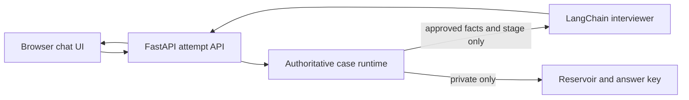

# Practice with Leo

Live website: [practicewithleo.com](https://practicewithleo.com/)

This repository contains the source code for Practice with Leo.

Leo is a web-based consulting case interviewer. The public landing page explains
his approach and presents a 12-case library; the practice room remains text-first
while the case runtime and feedback architecture mature ahead of voice.

## What is implemented

- Public landing page, catalogue filters, and a responsive browser practice room.
- Twelve original case worlds across profitability, growth, market entry, pricing,
  operations, turnaround, M&A, public sector, digital transformation, and sustainability.
- A server-side case runtime that controls stage progression and fact release.
- A generic LangChain director that extracts candidate intent and selects fact IDs through structured LLM output.
- Leo's LangChain interviewer layer converts only runtime-approved facts into the next natural-language turn.
- A candidate-safe API projection: unreleased facts and the answer key never reach the browser or the LangChain prompt.
- An end-attempt scorecard with evidence-based starter feedback.
- SQLite-backed, user-scoped practice records with canonical transcripts, versioned feedback, and idempotent browser turns, so a development reload does not lose an active interview or duplicate a retried answer.
- Google sign-in, per-candidate attempt ownership, and an admin console over every transcript and the metrics across them.

## Architecture



The runtime, rather than the model, decides which facts can be released. LangChain only turns the approved context into a natural interviewer response. This is the primary answer-leakage control.

## Run locally

```bash
python3 -m venv .venv
source .venv/bin/activate
pip install -e '.[dev]'
cp .env.example .env
uvicorn app.main:app --reload --reload-dir app --reload-dir reservoir
```

Open [http://127.0.0.1:8000](http://127.0.0.1:8000). The landing page and
candidate-safe catalogue are public; the practice room requires Google sign-in
(see [Accounts and access](#accounts-and-access)). `OPENROUTER_API_KEY` is required for interview turns:
both the director and interviewer are LLM-driven through OpenRouter. The default
is `anthropic/claude-sonnet-4.6`, with `~openai/gpt-latest` as the model-level fallback.

## Test

```bash
pytest
```

## API

| Endpoint | Auth | Purpose |
|---|---|---|
| `GET /api/cases` | public | Candidate-safe case catalogue |
| `GET /api/auth/config` | public | Whether Google sign-in is configured, and any domain restriction |
| `GET /auth/google/start` | public | Begin the Google authorization-code flow |
| `GET /auth/google/callback` | public | Complete sign-in and set the session cookie |
| `POST /auth/logout` | public | Clear the session cookie |
| `GET /api/me` | candidate | The signed-in account |
| `POST /api/attempts` | candidate | Start a case interview, owned by the caller |
| `GET /api/attempts/{id}` | owner | Read the current candidate view |
| `POST /api/attempts/{id}/turn` | owner | Submit a candidate response and get the interviewer reply |
| `POST /api/attempts/{id}/end` | owner | End the attempt and return a starter scorecard |
| `GET /api/me/practice-history` | candidate | Owned case history, completion, and latest performance summaries |
| `GET /api/me/practice-history/{id}` | owner | One owned transcript with latest and versioned feedback |
| `GET /api/me/profile` | candidate | Personal progress metrics, assessed skills, development areas, and recent cases |
| `GET /api/admin/overview` | admin | Cohort totals, stage and case mix, 14-day activity |
| `GET /api/admin/users` | admin | Per-candidate rollup of attempts and completion |
| `GET /api/admin/attempts` | admin | Every attempt, filterable by candidate |
| `GET /api/admin/attempts/{id}` | admin | One full transcript with released evidence and scorecard |

### Pages

| Page | Auth | Purpose |
|---|---|---|
| `/` | public | Landing page and case library |
| `/login` | public | Google sign-in |
| `/practice` | candidate | The interview workspace |
| `/profile` | candidate | Personal progress, feedback themes, and transcript review |
| `/admin` | admin | Transcripts and metrics across all candidates |

## Accounts and access

Sign-in is Google OAuth 2.0 using the authorization-code flow. The browser never
receives a token: the code is exchanged server side with the client secret, and
the result is an opaque session cookie signed with HMAC-SHA256, `HttpOnly` and
`SameSite=Lax`.

To enable it:

1. In the [Google Cloud console](https://console.cloud.google.com/apis/credentials),
   create an OAuth 2.0 Client ID of type **Web application**.
2. Add `http://127.0.0.1:8000/auth/google/callback` as an authorised redirect URI
   (add your deployed URL too, when there is one).
3. Put the client ID and secret in `.env` as `GOOGLE_CLIENT_ID` and
   `GOOGLE_CLIENT_SECRET`, and set `OAUTH_REDIRECT_URI` to match exactly.
4. Set `ADMIN_EMAILS` to the addresses that may open `/admin`.
5. Restart. Until step 3 is done, `/login` says so rather than failing silently.

Access rules:

- An attempt belongs to the account that created it. Another candidate asking for
  it gets `404`, not `403`, so the API never confirms that it exists.
- Administrators are derived from `ADMIN_EMAILS` on every request, so granting or
  revoking access takes effect immediately rather than at the next sign-in. With
  the variable unset, nobody is an administrator.
- `ALLOWED_EMAIL_DOMAINS` optionally restricts who may create an account at all.
- The admin transcript view shows only what the runtime actually released to the
  candidate. The answer key stays private even from an administrator.

Accounts, sessions and attempt ownership live in `app/accounts.py`, the Google
flow in `app/auth.py`, and the admin API in `app/admin.py`. None of them import
the interview API; `app/main.py` shares the store and catalogue through
`app.state`.

For an architectural tour, see [the codebase guide](docs/codebase-guide.md). The
future checker-agent, feedback-agent, and voice roadmap is in
[the implementation roadmap](docs/implementation-roadmap.md). The detailed
dual-mode ElevenLabs voice migration plan is in
[the voice migration plan](docs/elevenlabs-voice-migration-plan.md).
The exact provider-side configuration for the implemented feature-gated voice
path is in [the ElevenLabs agent setup guide](docs/elevenlabs-agent-setup.md).
The low-latency hosted-model alternative, including its guarded fact-release
tool and copy-paste workflow prompts, is in [the native ElevenLabs setup
guide](docs/elevenlabs-native-agent-setup.md).
The user-scoped transcript and feedback model is documented in
[the practice-data architecture](docs/user-practice-data-architecture.md).

## Deployment boundary

The current session store is SQLite-backed and is suitable for local development or one web instance. Before multi-instance deployment, replace it with a shared database or Redis, add rate limits, and move the API key and `SESSION_SECRET` into the host's secret manager. Set `SESSION_SECRET` explicitly in production: the generated `data/.session_secret` is per-host, so without it every instance would reject the others' cookies. In native ElevenLabs mode, the runtime releases facts only through the authenticated `get_case_facts` tool; the agent receives an ID index rather than the private case reservoir.
