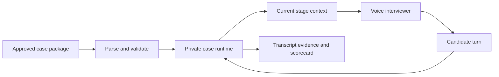

# CaseCall Corpus

This directory is the source-controlled content layer for CaseCall. It is designed
for cases that the product has a right to use, transform and present to candidates.

## What belongs here

| Location | Purpose | May contain full case text and answers? |
|---|---|---|
| `sources/` | Rights records and source catalogues | No, unless the source licence permits it |
| `templates/` | Authoring and ingestion templates | Yes, but only original template material |
| `cases/` | Case write-ups for authoring reference (not loaded by the runtime) | Yes, only for authored or licensed cases |
| `restricted-index/` | Minimal metadata for restricted references | No |
| `exemplars/` | The 57 playable casebook-derived packages (`iima`, `iimb`, `iimc`, `isb`), loaded by the runtime at startup | Yes, rewritten case packages |
| `playbooks/` | Interviewer-pattern notes distilled from source casebooks | No |

## Corpus rule

A PDF being accessible or downloadable does not by itself grant a right to copy it
into this repository, create an LLM knowledge base from it, or show it to users.
Every source must have a recorded rights decision before a case is extracted into
`cases/`.

The IIMA book supplied for this project is recorded as **permission asserted**. The
project owner has confirmed written permission for CaseCall use. Its extracted
source packages live in `iima-consult-prep-book-2025-26/`; cases should still be
normalised and quality-reviewed before the public simulator uses them. See [its
source record](sources/iima-consult-prep-book-2025-26.md).

## How an agent uses a case

CaseCall must not give an agent the entire Markdown file at the beginning of a call.
The backend parses the approved package and, on each turn, provides the interviewer
only the current stage, permitted facts, available exhibit IDs and allowed actions.

The runtime is a flexible case world, not a linear replay of source dialogue. It
uses atomic source facts, reproducible derived facts, and explicitly labelled
authored scenario facts to answer natural follow-up questions without inventing
unstored information. See the [dynamic case-world model](../docs/case-world-model.md),
the [IIMA interviewer pattern playbook](playbooks/iima-case-interviewer-pattern.md),
and the [case-world package template](templates/case-world-package-template.md).

This makes the case reproducible and prevents the agent from leaking future facts
or the final answer.

## Source transcript versus runnable case

The IIMA extraction packages preserve the source's opening, conversational route,
and approach material. They are evidence for content authors, not direct runtime
prompts. A source package becomes runnable only after it has been converted into
a case-world package with fact-release rules, milestones, authorised
augmentations, and QA for alternate candidate routes.

## Ingestion states

1. `catalogued` - source and rights status are known; no runnable content exists.
2. `permission_pending` - source owner has not yet granted the required rights.
3. `extractable` - terms permit normalisation into a case package.
4. `draft` - a case author has prepared the package; it is not available to candidates.
5. `qa` - content and interview-flow tests are running.
6. `approved` - case is available in the simulator.
7. `retired` - case is no longer selectable, but its attempt records remain traceable.

## Required pre-flight checks

Before any source becomes an approved case:

- record the owner, licence, permitted uses and attribution requirement;
- confirm that every fact, exhibit and answer key reconciles;
- run a full interview simulation, including a wrong turn and recovery;
- confirm that only stage-appropriate facts are visible to the interviewer;
- obtain reviewer sign-off for content quality and learner safety.
