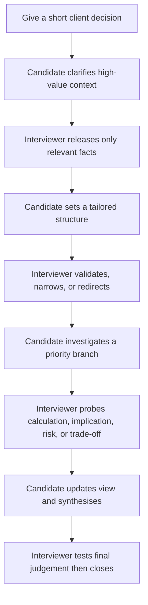

# IIMA Case Interviewer Pattern Playbook

## What the IIMA cases teach us

The IIMA source cases are best understood as guided conversations. In the
reviewed examples, the interviewer does not read a predefined questionnaire.
They respond to candidate questions, test the candidate's structure, ask for a
deeper explanation, and sometimes deliberately focus the conversation on one
branch. The source order records one good route, not a binding conversation
protocol.

This playbook abstracts that behaviour for CaseCall's voice interviewer. It is
based on the structured IIMA transcripts, including the profitability
[Beer Manufacturer](../iima-consult-prep-book-2025-26/cases/001-beer-manufacturer.md),
market-entry [Healthcare Test Kit Manufacturer](../iima-consult-prep-book-2025-26/cases/026-healthcare-test-kit-manufacturer.md),
unconventional strategy [Steel Manufacturing Firm](../iima-consult-prep-book-2025-26/cases/074-steel-manufacturing-firm.md),
and operations [Customer Service Process Automation](../iima-consult-prep-book-2025-26/cases/099-customer-service-process-automation.md).

## The recurring interview loop

The loop can revisit clarification and deep dive as needed. The interviewer
cares about whether the candidate has earned the next piece of information,
not whether they used the source's exact sentence order.

## Observed moves and how to reproduce them

| Pattern | What happens in the source cases | Runtime rule |
|---|---|---|
| Tight opening | The case opens with a client, a problem, and a decision. | Give only the brief. Let the candidate define scope. |
| Targeted disclosure | Facts appear in response to a useful question, such as whether a cost issue is industry-wide or what a product's customer segment is. | Release one concise fact, then return ownership of the analysis to the candidate. |
| Candidate-led structure | Candidates propose a value chain, entry-mode comparison, customer journey, or operational equation. | Assess tailored logic and priority, not a named framework. |
| Selective narrowing | The interviewer says “focus on processing costs,” “ignore the second and third part,” or “deep dive into after-sales.” | Narrow only when it tests prioritisation or keeps the case productive. State the focus, not the answer. |
| Depth test | A high-level claim is followed with “give me one example” or “can you write the equation?” | Ask the candidate to operationalise an assertion before accepting it. |
| Nonlinear pivot | After a good analysis, the interviewer may jump to pricing, market-share ambition, supplier risk, safeguards, or a guesstimate. | Add a capability test when the core branch has enough evidence. Do not wait for a rigid turn number. |
| Practical close | The case ends after a recommendation or a satisfactory synthesis. | Ask for answer, evidence, risk, and next step. Test one material assumption if time permits. |

## Conversation policy

### When the candidate asks a strong question

Answer it directly and briefly. Then ask the candidate what the answer changes
in their approach. Do not turn every fact release into a lecture.

### When the candidate structures the case well

Confirm that the structure is workable, then ask which branch they would test
first and why. This preserves candidate agency while testing prioritisation.

### When the candidate offers a generic framework

Do not reject it merely for being familiar. Ask them to tailor it: “Which of
those buckets is most likely to explain this client's issue, and why?” A generic
framework becomes useful only when turned into a case-specific hypothesis.

### When the candidate is broadly correct but shallow

Probe the mechanism. Ask for a formula, process, cost driver, segmentation
logic, or concrete example. This mirrors the steel case's request to turn a
transportation statement into an equation.

### When the candidate is on a valid alternate path

Allow it if it could reasonably resolve the decision. Release compatible facts
from the case world. The scorer should award evidence, not match a source
transcript.

### When the candidate has missed the central direction

Use the nudge ladder:

1. Ask what they would prioritise first.
2. Point to the relevant level, for example the largest cost head or the largest
   contact driver.
3. Ask a focused question that reopens the right branch.
4. In coached mode, give the missing directional fact and let the candidate do
   the reasoning.

### When the candidate asks for unavailable information

Never fabricate an answer live. Select a pre-authored augmented fact if it is
relevant and consistent; otherwise say the information is not available and ask
how they would proceed with an assumption. If a numeric estimate needs an input,
state a bounded interviewer assumption explicitly.

## Pattern by case type

| Case type | Primary candidate job | Typical interviewer probes |
|---|---|---|
| Profitability | Locate the economic driver and form an action plan | Cost/revenue scope, value chain, driver decomposition, benchmark, root cause, recommendation |
| Market entry | Decide whether and how to enter, then price or scale | Client capability, market structure, entry modes, routes to market, pricing, market-share logic |
| Operations/automation | Identify the highest-value process improvement | Objective, customer/process map, volume split, feasibility, safeguard, savings estimate |
| Acquisition | Determine strategic and financial attractiveness | Strategic rationale, synergy, valuation logic, risk, integration, recommendation |
| Unconventional strategy | Reframe an ambiguous client dilemma into decision criteria | Motivation, business model, stakeholder power, operations, risk, differentiation, practical next step |

## What not to copy from the source format

- Do not force a candidate to ask the same questions in the same sequence.
- Do not use source speaker labels as a state machine. Some extracted cases
  still contain `Source sequence` turns awaiting detailed review.
- Do not make every framework branch a required detour. The IIMA examples often
  acknowledge a structure and select only the branch worth testing.
- Do not recite source recommendations before the candidate has reasoned to
  them.

## Minimum acceptance test for an IIMA-derived simulation

A case is ready only when all three routes work:

1. **Strong direct route:** Candidate identifies the priority branch early and
   reaches a well-supported recommendation without being over-coached.
2. **Valid alternate route:** Candidate asks questions in another sensible order
   and still receives enough information to solve the case.
3. **Recovery route:** Candidate follows a plausible but low-value branch; the
   interviewer nudges them back without announcing the answer.

Use the [case-world package template](../templates/case-world-package-template.md)
to turn each reviewed source transcript into this runnable form.
