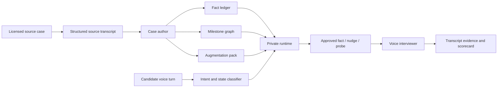
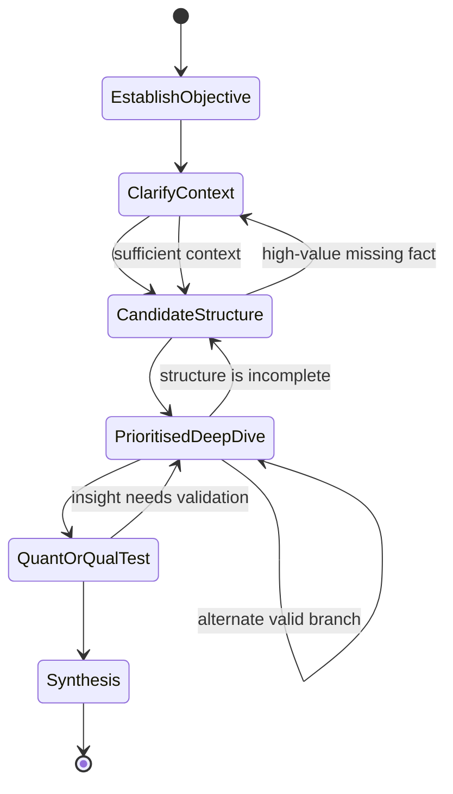

# Dynamic Case-World Model

## Purpose

An IIMA case is evidence of how an interviewer guides a candidate. It is not a
script the voice agent should repeat word for word. A live interview changes
direction based on the candidate's questions, hypotheses, calculations, and
mistakes. CaseCall therefore represents each simulation as a **case world**:

- a bounded set of case facts;
- an interviewer goal and a set of learning milestones;
- approved augmented facts that make reasonable follow-up questions answerable;
- a policy for helping the candidate without revealing the solution.

The original case flow remains a useful reference route through this world. It
does not define the only valid route.

## Non-negotiable rules

1. **Source truth is preserved.** Facts from the licensed source retain their
   wording, page reference, and provenance.
2. **Derived facts are reproducible.** A calculation or implication must name
   the facts and formula it depends on.
3. **Synthetic scenario facts are explicit.** New, plausible details may make
   the simulation richer, but they are stored as authored scenario content, not
   falsely attributed to IIMA or a real company.
4. **The world stays internally consistent.** A newly supplied number cannot
   contradict a prior response, an exhibit, a stated objective, or the answer
   key.
5. **The candidate earns information.** The interviewer releases a fact when a
   relevant question, analysis step, or planned probe warrants it. It does not
   dump future evidence or the approach sheet.
6. **Coaching is directional, not solution leakage.** A nudge tells the
   candidate what kind of issue to consider. It does not name the hidden driver
   unless the interviewer is deliberately correcting a terminal error.

## The four knowledge layers

| Layer | What it contains | Example | Candidate treatment |
|---|---|---|---|
| Source fact | A fact explicitly present in the source case | Beer client has three plants; each has 30,000-bottle capacity | May be released only at its defined trigger |
| Derived fact | A calculation or implication from disclosed facts | 3 plants × 30,000 bottles = 90,000 bottles of stated capacity | The candidate should normally calculate it; expose only when a check is justified |
| Authored scenario fact | A plausible, original detail added for a more natural simulation | Alternative equipment from a named non-Chinese supplier has a 14-month delivery lead | Valid for this simulation version, never cited as source material |
| Interviewer assumption | A temporary assumption offered to keep analysis moving | “For this estimate, assume a 4-minute average handling time.” | State it explicitly and track its use |

An augmented fact must always have a `provenance` value. This makes content
review possible and keeps source material, analysis, and original extensions
separate.

## Case-world package

Each runnable case is stored in one Markdown package using the
[case-world package template](../corpus/templates/case-world-package-template.md).
The package has six private components:

1. **World contract** — client decision, objective, time horizon, difficulty,
   and permitted simulation modes.
2. **Knowledge ledger** — atomic facts with visibility and consistency rules.
3. **Case graph** — milestones, optional branches, and what constitutes progress.
4. **Retrieval map** — question intents, matching facts, release conditions, and
   safe fallbacks.
5. **Interviewer policy** — how the agent probes, challenges, redirects, and
   closes.
6. **Evaluation map** — candidate evidence linked to the exact competency and
   milestone it supports.

The backend compiles this package into a private runtime object. The browser
never receives the answer key, unreleased facts, future exhibits, or the source
transcript.

## Fact ledger and retrieval

The unit of retrieval is an atomic fact, not a paragraph copied from a casebook.
Every fact needs an identity, an owner, a release rule, and a consistency rule.

### Question intent classes

| Candidate intent | Runtime response |
|---|---|
| Clarifies the objective, scope, timeline, customer, or product | Release the matching opening-stage fact. |
| Asks for a data cut that is relevant to the active hypothesis | Release the approved fact or exhibit, then ask for interpretation. |
| Requests a number that can be calculated from disclosed data | Ask the candidate to calculate first; confirm or correct the setup. |
| Asks a sensible question not covered by the source | Release a pre-authored scenario fact, if one exists and its reveal rule is met. |
| Proposes an unsupported assumption | Let the candidate state it; accept it only if it does not conflict with the ledger, or offer a bounded interviewer assumption. |
| Explores a low-value or premature branch | Timebox and redirect with a question that brings them back to the decision. |
| Misses a core driver after reasonable exploration | Use a one-level nudge, then a more direct probe only if needed. |

The runtime should use semantic matching to identify the intent, but must use
IDs and release conditions in the case package to decide what can actually be
said. An LLM chooses the phrasing, not the truth.

### Release policy

Facts use one of these release policies:

- `opening`: stated before or immediately after the opening brief.
- `on_targeted_question`: available when the candidate asks the relevant
  question.
- `on_hypothesis`: available after the candidate names the relevant branch and
  explains why it matters.
- `on_calculation_request`: supplied only when the candidate has set up the
  analysis.
- `interviewer_probe`: introduced by the interviewer to test a capability or
  recover the case flow.
- `never_candidate_visible`: answer-key or evaluator-only material.

## Flexible case graph

A graph is based on **milestones**, not the order of source questions. The
candidate can reach a milestone through more than one valid question sequence.

The mandatory milestones for a foundation case are:

| Milestone | What the interviewer is assessing | Minimum completion evidence |
|---|---|---|
| Establish objective | Problem definition | Candidate restates client decision, goal, and scope. |
| Clarify context | Question quality | Candidate asks the facts that materially change the analysis. |
| Candidate structure | Problem solving | Candidate proposes a tailored, prioritised issue tree or analytic plan. |
| Prioritised deep dive | Hypothesis-driven reasoning | Candidate investigates the highest-value branch and updates their view. |
| Quantitative or qualitative test | Analytical rigor | Candidate sets up and interprets a calculation, exhibit, or causal test. |
| Synthesis | Communication and judgement | Candidate gives an answer, evidence, risk, and next action. |

An author can add case-specific milestones such as `choose_entry_mode`,
`validate_customer_risk`, or `prioritise_automation`. A candidate may visit
several branches before the final synthesis; only the completion conditions and
revealed facts constrain the interviewer.

## Interviewer moves

The voice interviewer selects one move per turn after updating the case state.

| Move | Use when | Example effect |
|---|---|---|
| Answer | Candidate asks a permitted, relevant question | Releases a concise fact and asks what they would do with it. |
| Invite | Candidate has enough context to progress | “Take a minute to structure your approach.” |
| Probe | Candidate makes a promising but untested claim | “What would that look like as an equation?” |
| Challenge | Candidate conclusion relies on a weak assumption | “What would change your recommendation?” |
| Nudge | Candidate is stuck or has missed the key level of analysis | “Where in the value chain would you look first?” |
| Redirect | Candidate goes down a low-value branch | “That may matter later. Which driver is likeliest to explain the gap?” |
| Assumption | A numeric estimate needs a bounded input | Supplies a logged interviewer assumption. |
| Close | Required milestones are complete | Requests a concise final recommendation, then ends the case. |

### Nudge ladder

Use the least revealing intervention that can restore progress.

1. Ask the candidate to prioritise or restate their hypothesis.
2. Point to the relevant level of analysis, such as value chain, customer
   segment, or unit economics.
3. Ask a focused diagnostic question.
4. State the missed fact only if the mode is `coached` or the case would
   otherwise stall.

In `realistic` mode, the interviewer should normally stop at levels 1–3.

## Augmentation packs

Augmentation exists so the agent can handle natural follow-up questions that a
source case does not explicitly answer. It is content design, not live
hallucination.

| Pack | Scope | Example use |
|---|---|---|
| Industry context | Reusable factual reference with its own source and review date | Typical lab purchasing journey for a healthcare test-kit case. |
| Scenario extension | Original facts tied to one case version | Import duty, delivery lead time, or a competitor capability. |
| Calculation pack | Inputs and formulas for an optional quantitative drill | Volumes, unit costs, and a sensitivity range. |
| Perturbation pack | Controlled variant that prevents memorisation | A capacity constraint, regulatory delay, or customer churn shock. |
| Coaching pack | Approved wording for nudge and recovery paths | A prompt that directs attention to the biggest cost head. |

An augmentation must include a rationale, dependencies, visibility rule, and
consistency checks. It can extend a case but cannot rewrite its core diagnosis
without creating a separately versioned case.

## Consistency ledger

Before approving a case, validate:

- **entity consistency:** all facts refer to the same client, markets, products,
  and time period;
- **math consistency:** exhibits, estimates, and answer-key calculations
  reconcile within stated rounding rules;
- **causal consistency:** the root cause and recommendations follow from the
  available evidence;
- **release consistency:** an answer cannot rely on a fact unavailable at that
  stage;
- **provenance consistency:** every non-source detail is marked `derived`,
  `scenario`, or `assumption`;
- **conversation consistency:** after a fact has been stated on a call, it is
  immutable for that attempt.

## Converting an IIMA source case

1. Preserve the extracted source package unchanged as the audit record.
2. Turn each source statement into atomic source facts with page citations.
3. Identify the source's intended journey: opening facts, analytical branches,
   interviewer redirects, capability tests, and close condition.
4. Convert the journey into milestones and optional branches, not numbered
   turns.
5. Author any needed scenario and calculation facts. Label them clearly and add
   tests to the consistency ledger.
6. Write the interviewer prompts, nudge ladder, and evaluation evidence map.
7. Simulate at least three routes: a strong direct route, a reasonable alternate
   route, and a stuck candidate recovery route.
8. Put the package through content review before its status becomes `approved`.

For the behavioural pattern drawn from the IIMA corpus, see the
[IIMA interviewer pattern playbook](../corpus/playbooks/iima-case-interviewer-pattern.md).

## Runtime interfaces

The first implementation does not need autonomous tools. It needs a small,
deterministic service layer that the conversational model calls conceptually.

| Operation | Input | Output | Guardrail |
|---|---|---|---|
| `classify_turn` | Transcript, current milestone | Candidate intent, competency signals, confidence | Cannot release content. |
| `get_releasable_facts` | Intent, case state | Matching fact IDs | Enforces visibility and dependencies. |
| `record_disclosure` | Fact ID, turn ID | Updated attempt state | Fact becomes immutable for this attempt. |
| `select_interviewer_move` | State, signals, allowed actions | Answer, probe, nudge, redirect, or close | Must use the nudge ladder. |
| `check_calculation` | Formula, stated inputs | Correctness and tolerance | Shows reasoning, not just an answer. |
| `advance_milestone` | Candidate evidence | New state or missing evidence | Allows alternate valid paths. |
| `score_evidence` | Turn-linked evidence | Rubric observations | Cannot infer competency without a cited turn. |

## V1 boundary

V1 should author and QA a small set of cases end to end before attempting every
source case. Start with representative formats: profitability, market entry,
operations/process automation, acquisition, and unconventional strategy. The
goal is a believable conversation with dependable facts, not maximum case count.
