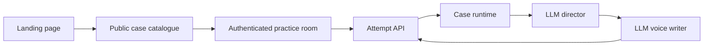

# Leo Codebase Guide

This guide explains the current application in the order a request travels
through it. It is intended to complement focused comments in the code, rather
than duplicate line-by-line implementation detail.

## Request flow

## Application modules

| Location | Responsibility | Important constraint |
|---|---|---|
| `app/main.py` | Routes, request validation, case selection, attempt ownership, and public/private HTTP boundaries. | Only candidate-safe metadata is public; an attempt belongs to the signed-in user who created it. |
| `app/case_runtime.py` | Loads case worlds, exposes the catalogue, validates phase movement, and controls fact disclosure. | The LLM can propose facts but cannot override release rules. |
| `app/interviewer.py` | Runs the structured LLM director followed by the response writer. | The writer receives only runtime-approved facts, never the hidden diagnosis or full reservoir. |
| `app/store.py` | Persists an attempt and restores it against the case ID that was recorded at creation. | A removed case is never silently replaced with another case. |
| `app/accounts.py` | Stores users and attempt ownership; signs opaque browser session cookies. | Authentication has no access to private case content. |
| `app/auth.py` | Handles Google OAuth redirects and server-side token exchange. | Browser code never receives the Google client secret or a provider token. |
| `app/admin.py` | Admin-only operational views. | Administrative access is checked through the same signed session. |

## Frontend files

| Location | Responsibility |
|---|---|
| `app/static/landing.html`, `landing.css`, `landing.js` | The public product explanation and candidate-safe case library. It fetches metadata only and creates no attempt. |
| `app/static/index.html`, `styles.css`, `app.js` | The interview workspace: transcript, timer, evidence rail, resilient turn submission, and attempt restoration. |
| `app/static/login.html` | The sign-in screen and OAuth handoff. |
| `app/static/admin.html` | The protected administration screen. |

## Case content

Every playable case lives under `reservoir/<case-name>/`.

| File | What it contains |
|---|---|
| `case.yaml` | Candidate opening, category, industry, difficulty, duration, and decision question. |
| `facts.yaml` | Private atomic business facts. Each fact has a release level that the runtime enforces. |
| `conversation-policy.yaml` | Optional case-specific interaction rules. Cases without one use `reservoir/_shared-policy.yaml`. |
| `issue-tree.yaml` | Optional private causal map. It is authoring context today and will become input to the planned checker agent. |

The 12-case library is loaded at application startup by `CaseCatalogue`. If a
case has malformed YAML, a duplicate ID, or no shared policy, startup fails
instead of publishing a partially valid library.

## Persistence

`data/casecall.db` contains three distinct concerns: attempts, users, and
attempt ownership. SQLite is appropriate for local development and one running
web instance. Before multi-instance deployment, move these records to a shared
database and retain the same ownership and case-version checks.

## Tests

`tests/test_api.py` verifies candidate-safe responses, catalogue size, selected
case startup, idempotent turns, and response punctuation. `tests/test_store.py`
verifies that a persisted attempt restores against its recorded catalogue case.

## Intentional future work

The current scorecard is a temporary phase-based heuristic. The planned
issue-tree checker and feedback evaluator will replace it with evidence-linked
observations and rubric scores. The planned voice layer will feed final
transcripts into this same attempt API rather than create a separate interview
engine.
