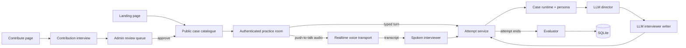

# Leo Codebase Guide

This guide explains the current application in the order a request travels
through it. It is intended to complement focused comments in the code, rather
than duplicate line-by-line implementation detail. Every module in `app/` opens
with a docstring that explains its reasoning; this guide is the map between them.

## Request flow

Typed and spoken turns share one mutation path (`app/attempt_service.py`), so
fact release, persona budgets and transcript persistence behave identically in
both. Approved community cases are registered into the same catalogue as
authored ones at startup and on approval.

## Application modules

| Location | Responsibility | Important constraint |
|---|---|---|
| `app/main.py` | FastAPI app, page routes, the attempt, voice and contribution APIs, and catalogue startup. | Only candidate-safe metadata is public; an attempt belongs to the signed-in user who created it. |
| `app/attempt_service.py` | One canonical mutation path for chat and voice interview turns. | Voice never gets its own interview engine. |
| `app/case_runtime.py` | Loads case worlds, exposes the catalogue, validates phase movement, controls fact disclosure, and holds the fallback scorecard. | The LLM can propose facts but cannot override release rules. |
| `app/case_loader.py` | Parses and validates case packages, including `case_essence`. | A malformed package fails loudly at startup. |
| `app/personas.py` | The Coached, Realistic (default) and Pressure interviewer personas: disclosure regime plus demeanour. | Release budget, precision bar and anti-stonewall floor are enforced by the runtime, not the prompt. |
| `app/interviewer.py` | Runs the structured LLM director followed by the response writer for typed turns. | The writer receives only runtime-approved facts, never the hidden diagnosis or full reservoir. |
| `app/spoken_interviewer.py` | One fused, streaming LLM call per spoken turn, plus an optional post-turn audit. | Same approved-facts boundary as `interviewer.py`. |
| `app/expressions.py` | A deliberately small arithmetic evaluator for authored case formulas. | No `eval`; only the operators a case needs. |
| `app/llm_budget.py` | Completion-token budget policy for every OpenRouter call. | One place to change limits. |
| `app/evaluator.py` | LangChain evaluator: the 1.0 to 5.0 five-dimension debrief for completed attempts. | Quotes are verified against the transcript; unassessable dimensions are excluded rather than guessed. Falls back to the runtime scorecard if the LLM fails. |
| `app/voice.py` | ElevenLabs configuration and the two Agent-based modes (`custom`, `native`). | The workspace API key never reaches the browser. |
| `app/voice_realtime.py` | Push-to-talk transport: batch speech recognition in, streamed speech out. | Browser gets single-use tokens that expire in 15 minutes. |
| `app/voice_onboarding.py` | LLM-led spoken onboarding before a case begins. | Releases no case facts. |
| `app/store.py` | Durable SQLite store for attempts, evaluations, voice sessions, case progress, contributed cases and contribution sessions. | A removed case is never silently replaced with another case. |
| `app/db.py` | Decides where the database lives (`DATABASE_PATH`) and how connections are opened. | One place for path and pragma policy. |
| `app/models.py` | Shared Pydantic domain models and schemas. | |
| `app/accounts.py` | Stores users and attempt ownership; signs opaque browser session cookies. | Authentication has no access to private case content. |
| `app/auth.py` | Handles Google OAuth redirects and server-side token exchange. | Browser code never receives the Google client secret or a provider token. |
| `app/admin.py` | Admin-only API under `/api/admin`: metrics, transcripts, re-evaluation, and the contribution review actions. | Every route depends on `require_admin`. |
| `app/contribution.py` | The question-led contribution interview: assess the answer, commit facts, select the next field, then frame the question. | Facts are saved before the next question is chosen. |
| `app/case_author.py` | The structured case draft and durable contribution state. | |
| `app/case_synthesis.py` | Turns a completed contribution into a runnable, re-skinned case package. | Regeneration always starts from the original contribution. |
| `app/case_validator.py` | The gate every contributed case must pass before a candidate can play it. | Validation errors block publication. |
| `app/case_solver.py` | Plays a contributed case headlessly to check it can actually be solved. | |
| `app/contribution_review.py` | Private admin projections and draft editing for contributed cases. | Contributor identity and the original transcript stay out of public responses. |
| `app/case_provenance.py` | Case attribution and firm labels, with explicit "not recorded" defaults for legacy cases. | Never invents missing history. |

## Frontend files

Every page is a Jinja2 template rendered by a route in `app/main.py`. There is
one shell and one design system; a page owns only what is unique to it.

| Location | Responsibility |
|---|---|
| `app/templates/base.html` | The document shell: head, fonts, stylesheet and script slots, body class. |
| `app/templates/_site_header.html`, `_footer.html` | The single site header (including the phone navigation sheet) and footer for every page except the interview room. |
| `app/templates/_practice_toolbar.html` | The interview room's session toolbar: timer, voice, end practice. A HUD, not site navigation. |
| `app/templates/_brand.html`, `_theme_toggle.html`, `_user_menu.html` | Shell pieces shared across pages. The account chip is filled server side from the request session. |
| `app/static/tokens.css`, `theme.js` | The design system: one palette with one set of dark overrides, three breakpoints (640, 900, 1200), every shared primitive, and the theme switcher. No other stylesheet may define a shell primitive. |
| `app/templates/landing.html`, `app/static/landing.css`, `landing.js` | The public product explanation and a curated case preview. It fetches metadata only and creates no attempt. |
| `app/templates/cases.html`, `app/static/cases.css`, `cases.js` | The full case library, its filters, and per-case progress. |
| `app/templates/practice.html`, `app/static/room.css`, `app.js` | The interview workspace: transcript, timer, evidence rail, resilient turn submission, and attempt restoration. |
| `app/static/voice-realtime.js`, `pcm-recorder.worklet.js` | Push-to-talk capture (an AudioWorklet recording PCM) and streamed playback for `realtime` mode. |
| `app/static/voice.js` | Browser client for the Agent-based `custom` and `native` voice modes. |
| `app/templates/debrief.html`, `app/static/debrief.css`, `debrief.js` | The post-case debrief. |
| `app/templates/profile.html`, `app/static/profile.css`, `profile.js` | Candidate progress, feedback themes, and transcript review. |
| `app/templates/contribute.html`, `app/static/contribute.css`, `contribute.js` | The case contribution interview. |
| `app/templates/admin.html`, `admin_contributions.html` and their `admin*.css` / `admin*.js` | The protected administration screens: metrics and transcripts, and the contribution review queue. |
| `app/templates/login.html`, `app/static/auth.css`, `login.js` | The sign-in screen and OAuth handoff. It renders no site navigation on purpose. |

Two rules keep the shell from drifting apart again, because it already did once:
the header markup was duplicated across seven pages and `.navbar`, `.btn` and
`.brand` were each restyled in three or four stylesheets.

1. Shared markup lives in a partial, never copied into a page.
2. Shared styling lives in `tokens.css`, never redefined in a page stylesheet.

## HTTP API

Pages: `/`, `/cases`, `/login` (public); `/practice`, `/profile`, `/contribute`,
`/attempts/{id}/debrief` (signed in); `/admin`, `/admin/contributions` (admin).
`/health` is the deploy health check.

| Area | Routes | Auth |
|---|---|---|
| Catalogue | `GET /api/cases`, `GET /api/personas` | public |
| Auth | `GET /api/auth/config`, `GET /auth/google/start`, `GET /auth/google/callback`, `POST /auth/logout`, `GET /api/me` | public / candidate |
| Attempts | `POST /api/attempts`; `GET /api/attempts/{id}`; `POST /api/attempts/{id}/turn`, `/turn/stream`, `/end`; `GET /api/attempts/{id}/evaluation` | owner |
| Progress | `GET /api/me/profile` (alias `/api/profile`), `/api/me/practice-history[/{id}]`, `/api/me/case-progress`, `/api/me/cases/{case_id}/performance`; `POST /api/cases/{case_id}/reset` | candidate / owner |
| Voice | `GET /api/voice/status`; `POST /api/attempts/{id}/voice-realtime/session`, `/voice-realtime/sockets` (realtime mode); `POST /api/attempts/{id}/voice-sessions`, `/api/voice-sessions/{id}/lifecycle/{event}`, `/transcript`, `/final-candidate-transcript` (agent modes) | owner |
| ElevenLabs callbacks | `POST /v1/chat/completions` (custom LLM), `/api/elevenlabs/case-facts` (native tool), `/api/webhooks/elevenlabs/post-call` | shared secret |
| Contributions | `POST /api/contributions`; `GET /api/contributions/{id}`; `POST /api/contributions/{id}/turn`, `/pause`, `/reset`, `/submit` | owner |
| Admin | `GET /api/admin/overview`, `/users`, `/attempts[/{id}]`; `POST /api/admin/attempts/{id}/evaluate`; `GET /api/admin/contributions[/{case_id}/{version}]`; `POST /api/admin/contributions/{case_id}/{version}/solve`, `/decide`, `/draft`, `/augment` | admin |

Another candidate's attempt returns `404`, not `403`, so the API never confirms
that it exists.

## Case content

Playable cases live under `reservoir/<case>/` (12 authored cases) and
`corpus/exemplars/{iima,iimb,iimc,isb}/<case>/` (57 casebook-derived cases).
Approved community contributions are stored in the database and registered into
the same catalogue at startup and whenever an admin approves one.

| File | What it contains |
|---|---|
| `case.yaml` | Candidate opening, category, industry, difficulty, duration, decision question, `case_essence`, and `provenance`. |
| `facts.yaml` | Private atomic business facts. Each fact has a release level that the runtime enforces. |
| `conversation-policy.yaml` | Optional case-specific interaction rules. Cases without one use `reservoir/_shared-policy.yaml`. |
| `issue-tree.yaml` | Optional private causal map, used as evaluator context. |
| `validation.md` | Authoring notes on how the case was checked. |

The 69-case library is loaded at application startup by `CaseCatalogue`. If a
case has malformed YAML, a duplicate ID, or no shared policy, startup fails
instead of publishing a partially valid library. `knowledge_base/` holds the
industry, case-type and methodology notes that debriefs link to as suggested
reading; `evaluation/` holds the rubric, behaviour checklist and evaluator prompts.

## Persistence

The SQLite database (`data/casecall.db` locally, `DATABASE_PATH` in production)
holds users and attempt ownership (`app/accounts.py`), and attempts,
evaluations, voice sessions, per-user case progress, contributed cases, case
statistics and contribution sessions (`app/store.py`). The schema is created and
migrated idempotently at startup. SQLite has one writer, so the app runs as a
single instance; see [the deployment plan](deployment-plan.md).

## Scripts

Run from the repository root with the project virtualenv.

| Script | Purpose |
|---|---|
| `scripts/backfill_case_metadata.py` | Adds schema-complete `provenance` to case manifests and stored records. Idempotent; the same backfill also runs at app startup. |
| `scripts/backup_db.sh` | Copies the production database off the Fly machine. |
| `scripts/bench_turn.py` | Measures time-to-first-speakable-sentence per model for a spoken turn. Needs `OPENROUTER_API_KEY`. |
| `scripts/e2e_voice_turn.py` | Drives one complete spoken turn without a microphone and times each stage. Needs live ElevenLabs and OpenRouter keys. |
| `scripts/eval_contribution.py` | Opt-in live evaluation of the contribution interview policy; results are kept in `docs/evals/`. |
| `scripts/build_all_exemplars.py`, `generate_*_cases.py`, `generate_exemplars.py`, `build_multi_school_corpus.py` | One-off authoring generators that produced the 57 `corpus/exemplars/` cases. They do not emit `provenance`, so rerunning them overwrites it; run `backfill_case_metadata.py` afterwards. |

## Tests

`pytest` (or `make test`) runs the suite in `tests/`: 28 files, roughly 470
tests. They cover the candidate-safe API boundary and fact release
(`test_api.py`, `test_case_*`), personas, the evaluator and debrief
(`test_evaluator*.py`, `test_debrief_*`), persistence and contention
(`test_store*.py`, `test_database_*`), auth and admin, both voice transports
(`test_voice*.py`), the contribution flow (`test_contribution*.py`), and an
end-to-end workflow (`test_e2e_workflow.py`).

## Known gaps

- No per-user rate limits on LLM or voice calls. Required before any public launch.
- SQLite limits deployment to one instance until a move to Postgres.
- The scorecard in `case_runtime.py` remains only as the evaluator's fallback. A
  fallback or incomplete report is marked provisional and the debrief says so.
  Open follow-ups are in [the QA campaign roadmap](campaign/ROADMAP.md).
