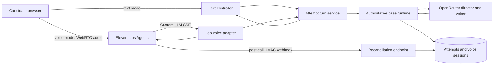

# Leo Voice Migration Plan: ElevenLabs + the Existing Case Runtime

## Decision

Add a voice mode beside the existing chat mode. Do **not** replace chat, and do
not allow an ElevenLabs-hosted agent or its native model to control case facts,
stages, or scoring.

The recommended architecture uses ElevenLabs Agents for low-latency WebRTC,
speech recognition, interruption handling, and Leo's synthesized voice. It uses
Leo's backend as the agent's Custom LLM endpoint. That endpoint calls the same
authoritative turn service used by chat. The case runtime remains the only
component permitted to disclose a fact or move a phase.

This is the safest way to add natural voice interaction without weakening the
existing answer-leakage control.

## What exists today

| Existing component | Current responsibility | Voice implication |
|---|---|---|
| `app/main.py` | Authenticated attempt start, read, submit-turn, and end routes. | Extract its turn mutation into a shared service before adding voice. |
| `app/interviewer.py` | OpenRouter director plus Leo's response writer. | Remains the case-reasoning layer. ElevenLabs must never receive unreleased facts. |
| `app/case_runtime.py` | Validates fact eligibility, phase movement, and early-turn disclosure limits. | Remains unchanged as the source of truth. |
| `app/store.py` | Persists the whole attempt and idempotent turn results in SQLite. | Extend it with voice-session metadata and timestamped event provenance. |
| `app/static/app.js` | Renders the transcript and sends text to `POST /api/attempts/{id}/turn`. | Becomes the shared transcript shell, with a chat/voice mode switch. |
| `app/accounts.py` | Google sign-in, account ownership, signed browser session. | Authorizes creation of short-lived ElevenLabs voice credentials. |

The current text endpoint is intentionally the canonical interaction contract:
it records the candidate turn, lets the LLM propose a narrow response, validates
the proposal through the runtime, persists the result, and returns the updated
candidate-safe attempt. Voice must call that same contract, not recreate it.

## Target architecture



### The hard boundary

The browser, ElevenLabs agent prompt, dynamic variables, client tools, and
post-call transcript are all untrusted inputs for case-state purposes. They may
carry a candidate's words and UX hints, but they must not be trusted to choose
facts, state transitions, attempt ownership, or a score.

The only trusted path is:

`authenticated attempt -> shared turn service -> runtime validation -> persisted result`

## Recommended ElevenLabs integration

### Use WebRTC and a private agent

Use `@elevenlabs/react` in a small React island, or use the underlying
`@elevenlabs/client` package from the existing JavaScript page if the team does
not want to migrate the frontend framework. WebRTC is the intended low-latency
voice transport. ElevenLabs' current API returns a short-lived token and a
provider `conversation_id` from `GET /v1/convai/conversation/token`; the server
must obtain it with `ELEVENLABS_API_KEY` and return only the token to the
authenticated browser. The API key never reaches browser code.

Configure the ElevenLabs agent as private. The backend should request a token
only after it verifies that the signed-in user owns the requested Leo attempt.
Use separate ElevenLabs `development`, `staging`, and `production`
environments, each with its own backend base URL and secret configuration.

### Use a Custom LLM endpoint, not native agent reasoning

Point the agent's Custom LLM configuration at Leo's public,
OpenAI-compatible `POST /v1/chat/completions` endpoint. ElevenLabs requires
streaming Server-Sent Events from this endpoint. The endpoint is not a general
chat-completions proxy. It is an adapter that:

1. resolves the provider conversation to one server-created `voice_session`;
2. extracts only the final candidate utterance from the provider transcript;
3. computes a stable `turn_id` from the provider conversation and user-turn
   event ID;
4. invokes the shared attempt turn service exactly once;
5. streams Leo's already-approved response as OpenAI-compatible SSE chunks;
6. returns no private case data beyond the approved reply.

Do not use an ElevenLabs knowledge base for case facts. Do not put the case
reservoir, answer key, issue tree, or fact ledger in the ElevenLabs prompt.
Do not use a webhook tool that asks ElevenLabs' native LLM to decide which case
fact to reveal. Either approach would duplicate or bypass the runtime.

### Agent configuration

| Setting | Plan |
|---|---|
| Voice | One selected Leo voice, tested for neutral, concise consulting delivery. Store only the `voice_id` in application configuration. |
| LLM | Custom LLM endpoint described above. The application continues to use OpenRouter inside that endpoint. |
| First message | Use the server-created `{{voice_intro}}`: a Leo welcome, case type, and hygiene guidance. The detailed authorized case opening is spoken only after the candidate indicates readiness. |
| Turn-taking | Start with provider defaults. During beta, tune silence thresholds and interruption settings against recorded consented test calls. |
| Tools | No fact-release tools. Optional client-only tools: `show_released_fact`, `set_interview_state`, and `end_voice_session`; their payloads are display hints only. |
| Webhooks | Enable post-call transcription. Enable audio delivery only after an explicit retention decision. |
| Analytics | Keep provider metrics as operational telemetry. Leo's own transcript and runtime events remain the evaluation record. |

## Product and UX plan

### Mode selection

Keep one attempt and one visible transcript. Add a segmented control in the
practice header: **Chat** and **Voice**.

- Chat remains immediately available and continues to use the existing text
  composer.
- Voice is opt-in. Its first click opens a short mic-permission sheet explaining
  that the candidate's speech is transcribed to run the interview.
- If mic permission, WebRTC setup, or ElevenLabs connection fails, the UI shows
  the reason and keeps the candidate in the same attempt with chat ready.
- A candidate can switch from voice to chat between turns. The active provider
  audio session is ended first. A candidate never has two active sessions for
  one attempt.
- The transcript displays final candidate speech and Leo's final reply using the
  same bubbles as chat. Partial speech appears only as a temporary live caption
  and is never scored or sent to the runtime.

### Voice control surface

The voice view needs only clear operational controls:

- start voice, mute/unmute, end voice, and return to chat;
- a compact state: Connecting, Leo is listening, Leo is responding, Reconnecting,
  or Chat ready;
- animated input-level indicator only while the mic is active;
- live caption with a visible "finalizing" state;
- the existing stage, facts, timer, end-practice flow, and scorecard untouched.

Do not create a second voice-only attempt page. The current text interface is
the durable workspace and the accessible fallback.

### Interruption and mixed-mode rules

1. A candidate interruption stops Leo's audio immediately at the provider layer.
2. Only a final candidate transcript can create a runtime turn. Tentative ASR
   updates cannot alter case state.
3. If a candidate changes to chat while Leo is speaking, stop the voice session
   and preserve the last final reply. Do not resubmit it.
4. A voice reconnect resumes the same attempt but starts a new provider
   conversation only after the previous session is marked disconnected.
5. If the provider returns a duplicate final transcript, the deterministic
   voice `turn_id` returns the stored result without creating a second turn.

## Backend migration sequence

### Phase 0: provider spike and contract test

**Goal:** prove the chosen ElevenLabs account, voice, region, private-agent
auth, Custom LLM request shape, and WebRTC token flow work together before
changing the production UI.

Build a developer-only endpoint and test harness that requests a WebRTC token,
starts a private agent, logs redacted request headers and event types, and
verifies that the provider conversation ID can be bound to one local session.
Confirm current ElevenLabs payload fields empirically because SDK event shapes
and agent settings evolve.

Exit criteria:

- browser receives no ElevenLabs API key;
- mic audio connects over WebRTC;
- Custom LLM endpoint receives a final candidate utterance;
- the agent speaks one known safe response;
- no private case content is present in the provider configuration or logs.

### Phase 1: create a transport-independent turn service

**Goal:** eliminate duplicate business logic before voice exists.

Create `app/attempt_service.py` with a `submit_turn(attempt_id, actor, content,
turn_id, transport, metadata)` operation. Move the body of
`submit_turn()` in `app/main.py` into this service.

The text endpoint becomes a thin request parser around the service. Add a
transport enum: `chat` and `voice`. The service must own:

- ownership and ended-attempt checks;
- text validation and input normalization;
- idempotency lookup and persistence;
- `INTERVIEWER.respond()` invocation;
- atomic save of the candidate turn, Leo reply, facts, stage, and turn result;
- candidate-safe response projection.

Exit criteria: existing chat tests remain green without behavioural change, and
new unit tests prove both transports call the same service.

### Phase 2: evolve persistence without breaking existing attempts

Keep the current serialized `messages` field readable. Add database migrations
that create a separate `voice_sessions` table rather than rewriting old
attempts in place.

Suggested fields:

| Table / field | Purpose |
|---|---|
| `voice_sessions.id` | Leo-generated opaque session ID. |
| `voice_sessions.attempt_id` | FK-like reference to the existing attempt. |
| `provider` / `agent_id` | Audit which service and agent handled audio. |
| `provider_conversation_id` | Unique ElevenLabs conversation binding. |
| `status` | `issued`, `connected`, `disconnected`, `ended`, `failed`, or `reconciled`. |
| `issued_at`, `connected_at`, `ended_at` | Reliability and latency observability. |
| `last_provider_turn_id` | Idempotency checkpoint for provider delivery. |
| `transcript_reconciled_at` | Marks successful post-call verification. |
| `attempt_turns.transport` | Add in the later normalized-event migration, not by altering historical messages. |

For V1, add immutable provider metadata to `turn_results` or an adjacent event
table: `transport`, `provider_conversation_id`, `provider_event_id`, final ASR
text, and timing fields. Do not store raw audio by default.

Exit criteria: an attempt created before the migration still loads, and a voice
session can be created, ended, and reconciled without changing the candidate
view shape used by chat.

### Phase 3: issue voice credentials

Add `POST /api/attempts/{attempt_id}/voice-sessions`.

The route:

1. requires the existing signed-in user and resolves attempt ownership;
2. rejects ended attempts and a second active voice session;
3. creates a local `voice_session` row;
4. calls ElevenLabs `GET /v1/convai/conversation/token` using server-side
   credentials and configured agent/environment;
5. stores the returned provider `conversation_id` against the local row;
6. returns the short-lived `token`, local voice-session ID, selected voice mode,
   and the candidate-safe opening display data.

Add `POST /api/voice-sessions/{id}/lifecycle/connected`, `/disconnected`, and `/ended`
for best-effort client state. All routes re-check session ownership.

Important: never accept an attempt ID, case ID, user ID, fact IDs, or a provider
conversation ID from a browser as proof of authorization. Bind the provider ID
to the local session from the backend's token response.

### Phase 4: Custom LLM voice adapter

Add `app/voice/elevenlabs_adapter.py` and an isolated FastAPI router.

Responsibilities:

- authenticate ElevenLabs to the endpoint using a provider-managed secret or
  signed request scheme, with source IP allowlisting as defence in depth;
- parse the OpenAI-compatible chat request and identify the provider
  conversation ID;
- load its local voice session and reject unknown, ended, mismatched, or stale
  conversations;
- extract the most recent final candidate utterance only;
- derive `turn_id = "voice:{provider_conversation_id}:{provider_event_id}"`;
- call `AttemptTurnService.submit_turn(..., transport="voice")`;
- translate the persisted approved reply into SSE chunks ending in `[DONE]`;
- on a retry, return the stored turn result rather than invoking the LLM again.

The adapter must not trust prior provider conversation history as the case
record. It can use it only to find the latest final utterance. The local attempt
transcript is always the source for the LLM history.

### Phase 5: frontend voice island

Keep `app/static/app.js` as the primary controller. Introduce a small isolated
voice module, initially bundled with a standard frontend build step. Do not load
the ElevenLabs SDK on the landing page or before the candidate chooses Voice.

The module should:

- request mic permission only after an explicit click;
- request a Leo voice session token from the backend;
- call `startSession({ conversationToken })` with `@elevenlabs/react` or the
  client SDK;
- mirror `onMessage` final user transcripts and final Leo replies into the
  existing transcript UI, de-duplicated by provider event ID;
- show connection, speaking, listening, mute, and error state;
- call `endSession()` before switching modes or ending the attempt;
- poll the canonical attempt after provider disconnect or use a small
  authenticated server event channel to refresh the transcript.

Do not allow `sendUserMessage()` from the voice SDK to become a parallel text
path. The existing chat composer continues to call Leo's text endpoint.

### Phase 6: reconciliation and observability

Configure an ElevenLabs `post_call_transcription` webhook for
`POST /api/webhooks/elevenlabs/post-call`.

The handler must verify the `elevenlabs-signature` HMAC before parsing the
payload. It should then:

- find the matching local session by provider conversation ID;
- store a redacted provider transcript snapshot and call timing metadata;
- compare final provider turns with canonical local turns;
- flag, but never overwrite, mismatches for review;
- mark the session reconciled;
- safely accept repeated webhook deliveries.

Enable audio webhooks only after a product decision on consent, retention,
encryption, access controls, deletion, and data-processing terms. Transcript
webhooks are enough for V1 operational verification.

## Data and security requirements

### Secrets and configuration

Add the following to `.env.example`, never to browser code:

```text
ELEVENLABS_API_KEY=
ELEVENLABS_AGENT_ID=
ELEVENLABS_ENVIRONMENT=development
ELEVENLABS_WEBHOOK_SECRET=
ELEVENLABS_SERVER_LOCATION=in-residency
VOICE_ENABLED=false
VOICE_AUDIO_RETENTION_DAYS=0
```

Use a server-side feature flag. Production should default to disabled until the
private agent, Custom LLM endpoint, webhook verification, and support playbook
have passed acceptance tests.

### Privacy and retention

- Present a mic/transcription disclosure before the first voice session.
- Store final text transcripts as the canonical learning record.
- Default to no raw audio storage in Leo and do not enable provider audio
  webhooks for the beta.
- Document the provider's data residency option selected for the deployment.
- Add a deletion job that removes local voice metadata and invokes provider
  conversation deletion where product policy requires it.
- Restrict voice-session and provider transcript visibility to the attempt owner
  and existing administrators.

### Abuse, safety, and reliability

- Rate-limit token issuance per user and active attempt.
- Bind one live voice conversation to one attempt.
- Reject any provider callback that does not match an issued local session.
- Cap candidate transcript length before forwarding it to the attempt service.
- Add timeouts and a clear fallback to chat for provider and OpenRouter errors.
- Log request IDs, provider conversation IDs, local voice-session IDs, latency,
  disconnect reasons, and cost metadata without logging secrets.

## Test and acceptance plan

### Automated tests

| Layer | Required coverage |
|---|---|
| Attempt service | Chat and voice invoke one canonical mutation path; duplicate transport turn IDs are idempotent. |
| Credential route | Owner succeeds; unauthenticated or non-owner receives no token; ended attempts and concurrent sessions fail cleanly. |
| Adapter | Unknown or mismatched provider conversations are rejected; only final transcript becomes a turn; SSE reply contains only the approved Leo reply. |
| Runtime | Voice cannot select a fact or phase the current chat runtime would reject. |
| Webhook | Invalid HMAC is rejected; duplicate delivery is harmless; reconciliation cannot overwrite the canonical transcript. |
| Frontend | Mic denial, connection failure, disconnect, interrupt, switch-to-chat, and end-attempt states all leave a usable chat composer. |

### Manual voice acceptance script

1. Start Meridian in chat, ask one question, then switch to voice. The transcript
   remains one chronological conversation.
2. Ask a narrow first voice question. Leo reveals no more than the early-turn
   policy allows.
3. Interrupt Leo mid-reply. Leo stops speaking and the next final candidate
   utterance creates exactly one turn.
4. Disconnect the network, recover, and confirm no turn is duplicated.
5. Deny microphone permission and continue the entire case in chat.
6. End practice in voice mode and confirm the same scorecard appears.
7. Inspect provider configuration and logs. No unreleased facts, diagnosis, API
   keys, or full reservoir content may be present.

### Success metrics for beta

- at least 95% of initiated voice sessions reach `connected`;
- no confirmed duplicate canonical turns;
- zero answer-leakage incidents in adversarial test cases;
- median final-candidate-speech to first Leo-audio latency measured separately
  from total reply latency;
- chat fallback remains available for 100% of provider failures;
- candidates can complete a 30-minute attempt in either mode with the same
  fact ledger and scorecard semantics.

## Rollout and rollback

1. **Internal spike:** one developer agent, one case, non-production data.
2. **Internal dogfood:** staff accounts only, `VOICE_ENABLED` allowlist, transcript
   webhook on, raw-audio retention off.
3. **Closed beta:** selected candidates, explicit consent, daily review of
   disconnects, fact-release audits, and transcript reconciliation mismatches.
4. **General release:** feature flag by account cohort, then default-on voice
   availability while chat remains present.

Rollback is a configuration change: set `VOICE_ENABLED=false`, stop issuing
tokens, and hide the voice control. Existing attempts and chat continue to work
because their code path never depends on ElevenLabs.

## Delivery order and estimates

| Milestone | Primary output | Estimate |
|---|---|---|
| 0. Integration spike | Verified token, Custom LLM, and conversation binding contract | 2 to 3 engineering days |
| 1. Canonical turn service | Transport-independent backend mutation | 1 to 2 days |
| 2. Persistence + credential route | Migrated SQLite schema and private token issuance | 2 to 3 days |
| 3. Custom LLM adapter | HMAC-protected SSE adapter with idempotency | 3 to 5 days |
| 4. Voice UI | Mic sheet, voice controls, captions, fallback | 3 to 5 days |
| 5. Reconciliation + observability | Verified webhooks, dashboards, alerts | 2 to 3 days |
| 6. Dogfood and hardening | Adversarial case tests and rollout evidence | 3 to 5 days |

## Explicit non-goals for V1

- Phone or SIP calling.
- Voice cloning, multiple Leo personalities, or candidate voice analysis.
- Raw audio replay or audio storage by default.
- A second case runtime, an ElevenLabs knowledge base for the reservoir, or
  provider-owned evaluation scores.
- Removing, hiding, or downgrading chat.

## Official ElevenLabs references

- [WebRTC conversation token API](https://elevenlabs.io/docs/api-reference/conversations/get-webrtc-token)
- [React SDK and conversation lifecycle](https://elevenlabs.io/docs/eleven-agents/libraries/react)
- [Custom LLM SSE contract](https://elevenlabs.io/docs/eleven-agents/customization/llm/custom-llm)
- [Agent WebSocket event schema](https://elevenlabs.io/docs/eleven-agents/api-reference/eleven-agents/websocket)
- [Client, webhook, MCP, and system tools](https://elevenlabs.io/docs/eleven-agents/customization/tools)
- [Post-call webhook authentication and payloads](https://elevenlabs.io/docs/eleven-agents/workflows/post-call-webhooks)
- [Environment-specific agent configuration](https://elevenlabs.io/docs/eleven-agents/integrate/environment-variables)
