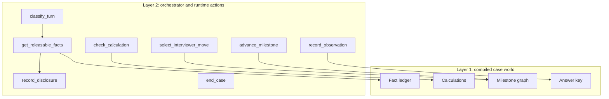
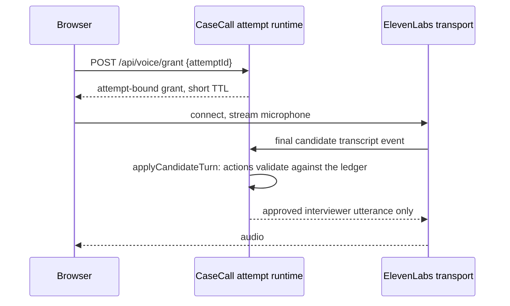

# CaseCall: Engineering Design, V1 Runtime

**Status:** In build
**Version:** 0.3
**Last updated:** 2026-08-22
**Companion documents:** [Product design](product-design.md), [Dynamic case-world model](case-world-model.md), [IIMA interviewer pattern playbook](../corpus/playbooks/iima-case-interviewer-pattern.md)

### What changed in 0.3

0.2 proposed three layers, with the six product-design tools exposed as an
ElevenLabs server-tool facade. Product design 0.2 then settled two decisions that
delete that layer:

1. **ElevenLabs is a voice transport, not an agent.** It does speech recognition,
   speech synthesis, interruption handling and transport. It does not run a case
   interviewer and does not call CaseCall actions. CaseCall owns the interviewer
   model, the canonical transcript, and every candidate-visible fact. The
   `/api/voice/tools/:tool` webhook from 0.2 is removed.
2. **The runtime action contract is internal.** The seven actions in product
   design §9.2 are called by CaseCall's own orchestrator, so there is no vendor
   tool schema shaping the internal API.

0.3 also adopts the dual state model product design §8.1 settled, and promotes the
Durable Object from "migration path" to "the design".

## 1. Two layers, not three



`classify_turn` reads and cannot release. The other six mutate attempt state and
each validates before mutating. The invariant from both design documents:
**an LLM chooses the phrasing, not the truth.**

## 2. Dual state: session lifecycle plus milestone graph

Product design §8.1 keeps both, and they answer different questions.

| | Session lifecycle machine | Case milestone graph |
|---|---|---|
| Owns | Attempt lifecycle, timer, terminal states, interviewer posture | Case progress and completion evidence |
| Scope | Global, identical for every case | Per case, authored |
| Shape | Constrained transitions, `opening` through `synthesis`, plus `debrief`, `terminated`, `partial_debrief` | A graph permitting alternate valid routes and case-specific milestones |
| Enforces | No forward skips; backward moves to clarification allowed | Entry conditions and explicit `advance_when` evidence |

`advance_milestone` requires **both** the milestone's completion evidence and a
legal lifecycle transition. That is the join between the two, and it is why a
candidate can take an unusual question order without the runtime either stalling
or leaking: the envelope is fixed, the route inside it is not.

A derived label is exposed to the UI. Nothing gates on the label.

## 3. Fact ledger and release

Every candidate-visible fact is an atomic ledger entry. Exhibits are ledger
entries carrying a table payload, not a separate content type, so there is one
release mechanism and one consistency check.

| Field | Purpose |
|---|---|
| `provenance` | `source`, `derived`, `scenario`, `interviewer_assumption`. Content review and rights depend on this |
| `releasePolicy` | `opening`, `on_targeted_question`, `on_hypothesis`, `on_calculation_request`, `interviewer_probe`, `never_candidate_visible` |
| `releaseTriggers` | Declarative matchers: what the candidate must ask or reason |
| `dependsOn` | Fact IDs that must already be disclosed |
| `candidateWording` | The exact approved sentence. The interviewer cannot paraphrase in new facts |
| `stages` | Lifecycle stages at which release is permitted |
| `table` | Optional payload that makes this fact an exhibit |

`get_releasable_facts` returns a fact only when **all** hold: the policy permits
release now, the lifecycle stage permits it, a trigger matches the turn, every
dependency is already disclosed, and the fact is not `never_candidate_visible`.

`record_disclosure` appends an immutable disclosure event **before** the fact is
spoken or displayed. Once disclosed, a fact is immutable for that attempt. That
is the conversation-consistency rule from the case-world model and the cheapest
defence against the interviewer contradicting itself.

A fact with no trigger clauses never releases. An empty matcher is an authoring
error; silently matching everything would leak.

## 4. Interviewer moves and the nudge ladder

`select_interviewer_move` picks exactly one move per turn from those the active
milestone permits: `answer`, `invite`, `probe`, `challenge`, `nudge`, `redirect`,
`assumption`, `close`. It cannot choose an answer-key fact.

The nudge ladder is enforced in code, not prompt text:

| Level | Intervention | Available in |
|---|---|---|
| 1 | Ask the candidate to prioritise or restate their hypothesis | all modes |
| 2 | Point to the relevant analytical level, not the answer | all modes |
| 3 | Ask a focused diagnostic question | all modes |
| 4 | Disclose the missed direction | `coached` only, or when the case would otherwise stall |

Each attempt tracks the highest ladder level used per milestone, so the mode cap
is a runtime check and the scorecard can report how much help was given. This is
the mechanism behind the product design rule that scores are mode-scoped.

## 5. Why text mode ships first

Text fallback is the same runtime with a typed transcript. It buys three things:

1. the whole runtime is testable with no API key, no audio and no network;
2. content authoring starts immediately, because an author can run a case end to
   end in the browser and check all three acceptance routes from the playbook;
3. it is a real product surface, and per product design §14 it may be the only
   economically viable free tier.

Voice is then a transport swap, not a rewrite.

## 6. Module layout

| Path | Responsibility |
|---|---|
| `lib/case-runtime/schema.ts` | Canonical IDs: lifecycle stages, moves, release policies, provenance, rubric dimensions, bands, modes, nudge ladder. `SCHEMA_VERSION`, `RUBRIC_VERSION` |
| `lib/case-runtime/types.ts` | `CaseWorld`, `Fact`, `Calculation`, `Milestone`, `Attempt`, `Observation`, `CandidateView`, `Scorecard` |
| `lib/case-runtime/match.ts` | Declarative matcher evaluation and number extraction |
| `lib/case-runtime/compile.ts` | Case-world Markdown package to typed `CaseWorld`, with strict validation |
| `lib/case-runtime/machine.ts` | Session lifecycle transitions and terminal destinations |
| `lib/case-runtime/ledger.ts` | Release eligibility, disclosure, immutability |
| `lib/case-runtime/milestones.ts` | Availability, entry conditions, advancement, derived label |
| `lib/case-runtime/actions.ts` | The seven runtime actions, each validating before mutating |
| `lib/case-runtime/brain.ts` | `InterviewerBrain` interface plus `RuleBasedBrain` |
| `lib/case-runtime/evaluator.ts` | Turn signals to evidence-gated observations |
| `lib/case-runtime/scoring.ts` | Observations to bands to readiness, with Not Applicable |
| `lib/case-runtime/store.ts` | `AttemptStore` interface plus in-memory implementation |
| `lib/case-runtime/runtime.ts` | `startAttempt`, `applyCandidateTurn`, `endAttempt`, projections |
| `lib/cases/registry.ts` | Loads and compiles authored packages. The only module touching raw Markdown |
| `corpus/cases/*.case.md` | Authored case-world packages |
| `app/api/**`, `app/practice/**` | HTTP surface and call workspace |

## 7. Authoring format and the compiler

Cases are authored as Markdown case-world packages, not TypeScript: content
authors are not engineers, a package is reviewable in a pull request, and the
format already exists as a reviewed template.

The compiler parses the template's deliberately small YAML subset (scalars,
quoted strings, `null`, and lists of strings) with a purpose-built strict parser
rather than a dependency. Strictness is the safety property: an unknown key, a
missing `provenance` or `release_policy`, an empty trigger set, or a dependency on
an unknown fact is a compile error. A silent mis-parse could leak a fact, so the
compiler fails loudly.

Compile-time validation implements the consistency ledger:

- every fact has provenance; every non-`source` fact has an author rationale;
- every `source` fact has a source reference;
- no fact depends on an unknown fact, and the dependency graph is acyclic;
- every calculation names inputs, a formula, an expected result and a tolerance;
- every required milestone is reachable and its `relevant_fact_ids` all exist;
- candidate-visible wording contains no answer-key language;
- a `content_hash` is computed over the compiled world and pinned on the attempt.

## 8. The turn loop

```
applyCandidateTurn(attempt, text)
  1. append the candidate turn, assign turnIndex and elapsed timestamp
  2. classify_turn            -> intents and competency signals (read only)
  3. get_releasable_facts     -> eligible fact IDs, by policy, stage, triggers, dependencies
  4. check_calculation        -> when the turn asserts a number
  5. advance_milestone        -> when advance_when evidence and a legal lifecycle transition both hold
  6. select_interviewer_move  -> one permitted move, respecting the nudge ladder cap for the mode
  7. record_disclosure        -> for every fact the move actually states, before it is spoken
  8. record_observation       -> evidence-gated, or dropped
  9. persist the event log, return a CandidateView
```

Two rules keep this honest:

- **The brain proposes, the actions decide.** A brain, rule-based or LLM, emits
  intents and a preferred move. Every fact that reaches the candidate came out of
  `get_releasable_facts` and was recorded by `record_disclosure`.
- **A refused release is a coaching opportunity.** A request for a fact that is
  not yet releasable produces a deflection or redirect the way a human
  interviewer would, plus an observation about the question's value. It is never
  an error shown to the candidate.

## 9. The bare-bones brain

`RuleBasedBrain` needs no API key and no model. It classifies with the per-case
declared matchers plus generic intent heuristics, and selects a move by the
playbook's policy.

| Intent | Signal |
|---|---|
| `clarify` | Interrogative form matching a fact's release triggers |
| `structure` | Structure vocabulary, or two or more declared structure signals in one turn |
| `hypothesis` | Hypothesis phrasing naming a branch |
| `calculation` | A numeric assertion, or a calculation's matchers |
| `interpretation` | Matches an exhibit fact's expected insight or common misread |
| `recommendation` | Answer-first phrasing, or explicit close language |
| `unclassified` | Falls through to a stage-appropriate probe |

Its job is to prove the runtime, the gating and the scorecard, and to be the
fixture the route tests run against. An LLM classifier replaces it behind the
same interface and the tests keep working. That is the point of the interface.

## 10. Session boundary and storage

**The design is one Durable Object per attempt.** It receives every final
candidate turn before the interviewer responds, serialises state-changing events,
holds the compiled case world for the active milestone resident in memory so the
turn does not pay a storage round trip, and returns only the approved interviewer
utterance to the voice transport.

> **SUPERSEDED.** The paragraphs below describe a Cloudflare Workers and
> Durable Objects deployment with `worker/index.ts`, `vite.config.ts` and
> `.openai/hosting.json`. None of those exist in this repository, which is a
> FastAPI application with SQLite and Jinja templates. They are kept only as
> a record of an earlier direction. For how this actually deploys, see
> [deployment-plan.md](deployment-plan.md).

**The bare-bones build uses an in-process `Map` behind `AttemptStore`.**
`.openai/hosting.json` declares `d1: null` and no Durable Object binding, and the
runtime does not need either to prove itself in text mode, where requests from one
browser are already sequential. The limitation is real: isolates can be evicted
and do not share memory.

The DO wrap is mechanical rather than a rewrite because `applyCandidateTurn` is
already a single serialised entry point taking an attempt and returning a new
attempt. Promoting it means declaring the binding in `.openai/hosting.json` and
`vite.config.ts`, exporting a DO class from `worker/index.ts`, and moving the
`AttemptStore` calls inside it. No runtime logic changes.

## 11. HTTP surface

JSON in, JSON out. Candidate-facing responses never carry answer-key material,
enforced by a `CandidateView` projection rather than discipline at each call site,
and asserted by a test.

| Method and path | Purpose |
|---|---|
| `GET /api/cases` | Catalogue. Metadata only: no brief, no facts, no answer key |
| `POST /api/attempts` | Start. Body `caseId`, `mode`, `durationMinutes`. Returns attempt ID and candidate view |
| `GET /api/attempts/:id` | Current candidate view |
| `POST /api/attempts/:id/turn` | Submit a candidate turn. Returns interviewer reply, newly released facts, updated view |
| `PUT /api/attempts/:id/scratchpad` | Replace scratchpad blocks, each with `shared` |
| `POST /api/attempts/:id/end` | End. Returns the scorecard, full or partial |
| `POST /api/voice/grant` | Mint a short-lived, attempt-bound voice grant. 501 until credentials exist |

There is no provider webhook. The voice transport adapter calls the same
`applyCandidateTurn` with a final transcript event and speaks the returned
utterance, so voice and text share one code path.

Uniform error shape `{ error: { code, message } }`, because the browser and the
transport adapter both branch on the code.

## 12. ElevenLabs integration

Scaffolded, not activated. Two variables, neither in the repo:

| Variable | Purpose |
|---|---|
| `ELEVENLABS_API_KEY` | Server-side only. Never sent to the browser |
| `ELEVENLABS_VOICE_ID` | The synthesis voice |

Local development reads these from `.dev.vars`, which is gitignored. Until they
are set, `POST /api/voice/grant` returns 501 naming the missing variable and the
UI stays in text mode without erroring. That is the intended degraded state.



Because CaseCall composes every utterance, the provider is swappable and cannot
leak a fact: it never receives the case world, the answer key, or the undisclosed
ledger.

**Needed to switch voice on:** the API key, the voice ID, and confirmation of
which ElevenLabs product surface to use, since the requirement is a transport that
emits final transcript events and speaks supplied text rather than an autonomous
conversational agent.

## 13. Security boundaries

- The answer key never enters a payload bound for a browser or a provider.
  `CandidateView` is a projection, asserted by a test.
- The interviewer's context is assembled by the actions, not the brain, so a
  prompt-injected brain still cannot read an undisclosed fact.
- Provider keys live in Worker env only. The browser gets an attempt-bound grant.
- Rate limit per attempt and per user: voice minutes are a direct cost.

## 14. Evaluation harness

Three layers, all runnable without an API key.

1. **Unit tests** on the ledger, milestone advancement, lifecycle transitions and
   the nudge-ladder caps.
2. **Compile-time validation per package**, the section 7 consistency ledger run
   as a test over every authored case.
3. **Three-route fixtures per case**, the playbook's minimum acceptance test as
   code: a strong direct route, a valid alternate route, and a stuck-recovery
   route. Each replays a scripted candidate and asserts milestones reached, that
   no fact leaked early, and the resulting scorecard.

## 15. Build order

| Step | Deliverable | State |
|---|---|---|
| 1 | Canonical schema, types, matcher, lifecycle machine | Done |
| 2 | Package compiler with strict validation | Done |
| 3 | Ledger, milestones, seven runtime actions | Done |
| 4 | Rule-based brain, evaluator, scoring | Done |
| 5 | One authored case-world package (`corpus/cases/meridian-cold-chain.case.md`) | Done |
| 6 | HTTP surface, text mode end to end | Done |
| 7 | Call workspace UI at `/practice` | Done |
| 8 | Unit, validation, three-route and API smoke tests | Done, 21 passing |
| 9 | Voice grant endpoint | Scaffolded, 501 until credentials |
| 10 | Durable Object session boundary | Not started |
| 11 | LLM brain and evaluator behind the same interfaces | Not started |
| 12 | Scorecard UI polish, attempt history, next-drill routing | Partial: scorecard renders, no history |

### What the first build run found

Three bugs worth recording, because two were the exact failure class the design
exists to prevent:

1. **A fact was spoken without being recorded as disclosed.** The runtime inferred
   disclosure from `move === "answer"`, but a milestone's `allowed_moves`
   silently downgraded the answer move to a probe, so the utterance still carried
   the fact wording while the ledger recorded nothing. Fixed by having the move
   selection return the facts it states, and by exempting the answer branch from
   `allowed_moves`: answering with a fact the ledger already ruled releasable is
   always legal.
2. **The nudge ladder could be switched off by content.** Same downgrade path meant
   a milestone that omitted `nudge` from `allowed_moves` disabled the ladder
   entirely, so a stuck candidate was never unstuck. The ladder is now a runtime
   mechanism bounded only by the mode cap.
3. **A declarative statement was answered with "I do not have that."** Any turn
   that merely mentioned a gated metric produced a refusal. Refusals are now
   spoken only when the candidate actually asked a question.

The general lesson for the LLM brain in step 11: anything that governs what
information reaches the candidate belongs in the runtime, and `allowed_moves`
should only shape how the interviewer probes.
