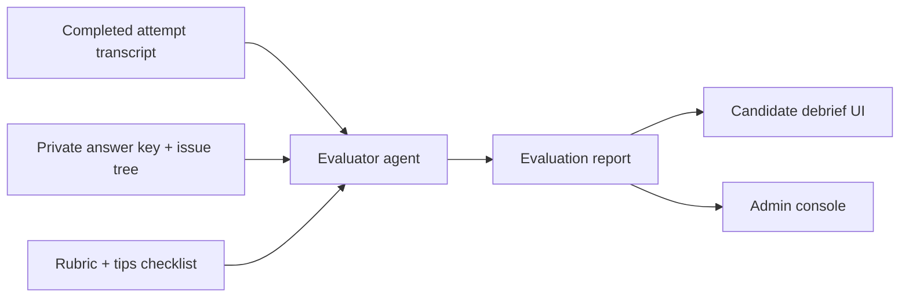

# Evaluator Agent Architecture

## Purpose

This document specifies the Evaluator Agent: an independent post-attempt service
that reads a completed interview transcript and produces an evidence-based
evaluation report. It replaces the temporary phase-count heuristic in
`InterviewSession.scorecard()` described in
[the implementation roadmap](implementation-roadmap.md) under "Feedback
evaluator", and it is designed to run without touching the live interview loop.

The report covers four scored dimensions plus a behavioural checklist:

1. **Structuring** - whether the candidate's structures are MECE at every level
   of decomposition, especially when the problem gets harder.
2. **Problem solving** - how quickly and directly the candidate reaches the core
   of the problem.
3. **Communication** - information density per turn; penalising filler,
   repetition, and circling.
4. **Quantitative ability** - speed and accuracy on mathematical work. This
   dimension is scaffolded now and fully activated when cases gain math content.

Plus an indexed **Tips and Tricks Checklist**: a versioned list of recommended
behaviours that the agent marks as demonstrated, missed, or not applicable in
this attempt, so the candidate knows exactly what to do differently next time.

---

## Foundations: what MECE means (and what the agent must detect)

MECE stands for **Mutually Exclusive, Collectively Exhaustive**, a
decomposition principle popularised by Barbara Minto at McKinsey as part of the
Pyramid Principle. It governs how a problem is split into parts:

- **Mutually exclusive (no overlaps).** Every item belongs to exactly one
  bucket at a given level. Splitting "revenue decline" into "price drop" and
  "customer attrition" fails this test because attrition affects both volume
  and price. A clean split is "volume change" versus "price change": each
  revenue rupee maps to exactly one branch.
- **Collectively exhaustive (no gaps).** The buckets together cover everything
  that matters. If a profit tree contains revenue and costs but omits one-time
  write-offs, it has a gap. Test: could a true cause exist that fits no branch?
  If yes, the split is incomplete.

Four standard violations the evaluator must recognise:

| Violation | Example |
|---|---|
| Overlap | Listing "marketing" under both fixed costs and discretionary spend |
| Gap | Revenue and cost branches with no room for one-off items |
| Mixed hierarchy levels | "Revenue" (a formula component) listed beside "logistics costs" (a sub-component of costs) |
| Irrelevant branches | A market-entry structure containing an employee-morale bucket |

Structures that are MECE by construction are preferred and the agent should
credit them: cuts by **formula** (profit = revenue - cost; revenue = price x
volume), by **components/segments** (product lines, geographies, channels), by
**process steps**, and by **exhaustive segmentation along one dimension with a
catch-all**.

Two calibration notes that keep the agent honest:

- MECE is necessary but not sufficient. A perfectly clean generic template
  scores lower than a clean structure tailored to the case. Tailoring is judged
  jointly by the structuring and problem-solving dimensions.
- Perfection is not expected. Under interview conditions, prioritising mutual
  exclusivity and case relevance matters more than theoretical completeness.
  Bands should reflect that.

---

## Position in the architecture



Non-negotiable boundaries inherited from the roadmap:

1. The evaluator runs **after** an attempt ends (or on explicit request for an
   in-progress read-only preview). It never writes interviewer turns, never
   mutates session state, and cannot release facts.
2. It receives the **private** answer key and issue tree as scoring context.
   Its **output** must never quote unreleased facts, the hidden diagnosis, or
   issue-tree branches the candidate did not reach. Every citation in the
   report points at something the candidate actually said or a released fact.
3. All judgements come from structured LLM output validated against typed
   schemas. No keyword routing, no regex scoring.
4. Every score, flag, and checklist verdict cites transcript evidence (message
   indexes) and the rubric criterion it maps to. An opinion without evidence is
   not feedback.

---

## Module design

### Location and shape

One new module, `app/evaluator.py`, plus one content directory,
`evaluation/`, kept deliberately separate from the interview path:

```
app/
  evaluator.py          # LangChain evaluator agent: tools, planning loop, report schema
evaluation/
  rubric.yaml           # dimension definitions, band anchors, weights
  checklist.yaml        # the indexed tips-and-tricks catalogue
  prompts/              # versioned prompt templates (planner, graders, checklist)
tests/
  test_evaluator.py     # tool behaviour, schema validation, leakage tests, evidence-link tests
```

Independence rules:

- The evaluator imports only from `app.case_runtime` (for types) and reads the
  store through injected dependencies. It shares nothing mutable with
  `app/interviewer.py`.
- `app/main.py` calls it only from the `/end` flow and a new read endpoint. The
  admin router calls it for re-evaluation. Neither imports its internals.

### Inputs

| Input | Source | Notes |
|---|---|---|
| Full message transcript | `InterviewSession.messages` | Includes phase timeline reconstructed from director decisions |
| Released facts with timestamps | `InterviewSession.disclosed_ids` | When each fact entered the conversation |
| Case metadata | `CaseWorld.catalogue_item()` | Category, difficulty, skills tested |
| Private answer key and issue tree | `reservoir/<case>/issue-tree.yaml` + case objective | Scoring reference only; never echoed to output |
| Rubric | `evaluation/rubric.yaml` | Versioned band anchors |
| Checklist | `evaluation/checklist.yaml` | Versioned behaviour index |

### Output: the evaluation report

A single typed object, stored alongside the attempt and rendered by the UI:

```python
class Citation(BaseModel):
    message_index: int          # index into the attempt transcript
    quote: str                  # short verbatim excerpt from the candidate

class DimensionScore(BaseModel):
    name: str                   # structuring | problem_solving | communication | quantitative
    score: float                # 0-10
    band: str                   # e.g. "Strong" | "Solid" | "Developing" | "Weak"
    evidence: list[Citation]    # at least one per claim
    observations: list[str]     # specific behaviours observed
    improvements: list[str]     # what to do differently, tied to evidence
    confidence: str             # high | medium | low (e.g. low when math absent)

class ChecklistItem(BaseModel):
    id: str                     # stable id like "structure.state-before-decompose"
    title: str
    status: Literal["demonstrated", "missed", "not_applicable"]
    evidence: list[Citation]    # required when demonstrated
    note: str                   # required when missed: the exact corrective action

class EvaluationReport(BaseModel):
    attempt_id: str
    dimensions: list[DimensionScore]
    checklist: list[ChecklistItem]
    headline_strengths: list[str]
    priority_improvements: list[str]   # max three, ranked
    next_drill: str                    # one concrete practice exercise
    evaluator_version: str             # prompt+rubric+model versions, for reproducibility
```

---

## Agentic evaluation design

The evaluator is a **LangChain agent, not a rule engine**. There is no fixed
six-pass pipeline and no code that scores anything. Instead, an LLM planner
decides what evidence it needs, pulls it through tools, reasons over it, and
emits the final report as one validated structured output. The analysis
objectives of the earlier pipeline sketch (segmentation, MECE audit,
path-to-crux, communication density, quantitative audit, checklist
verification) become *evaluation guidance in the agent's system prompt*, not
code steps. The agent chooses how thoroughly to pursue each based on what it
finds in this specific attempt.

### Model stack

Identical provider setup to `app/interviewer.py`: `ChatOpenRouter` via
`langchain-openrouter`, default `anthropic/claude-sonnet-4.6` with the
configured fallback chain. Two bindings:

| Role | Binding | Temperature | Notes |
|---|---|---|---|
| Planner / analyst | `bind_tools(...)` with the tool schemas | 0 | Decides which evidence to gather and in what order |
| Report writer | `with_structured_output(EvaluationReport)` | 0 | Produces the final typed report once analysis is complete |

Temperature 0 on both roles keeps grading stable across re-evaluations.

### Agent tools

Tools are the only way the agent touches attempt data. Each returns plain,
typed data; none of them score or judge:

| Tool | Returns | Boundary note |
|---|---|---|
| `read_messages(from_index, to_index)` | Transcript slice with role, phase, turn numbers | Bounded window size prevents context blow-ups on long attempts |
| `get_released_facts()` | Released facts with the turn each was disclosed at | Candidate-visible data only |
| `get_case_context()` | Case metadata: category, difficulty, skills tested, objective | No hidden content |
| `compare_to_answer_key(claim)` | For one candidate claim: whether the private answer key agrees, partially agrees, or contradicts, plus which issue-tree branch it maps to | The tool's *verdict* may enter the report; the answer-key text itself never does |
| `get_checklist()` | Checklist items with titles and detection guidance | Detection markers are hints for the agent, not match patterns |
| `verify_citation(message_index, quote)` | Whether the quote appears verbatim in that message | Self-check the agent should run before finalising |

### The loop

1. **Plan.** The planner receives the case metadata, rubric summary, checklist
   summary, and transcript length, then states its evaluation plan (which
   episodes to inspect, what to compare against the answer key).
2. **Investigate.** The agent calls tools in whatever order its findings
   justify: reading message windows around structures presented, checking
   candidate claims against the answer key, pulling disclosure timelines.
   Typical runs make five to fifteen tool calls; hard limits cap the loop.
3. **Grade.** Working from gathered evidence and rubric band anchors, the
   agent forms per-dimension judgements with citations, resolves checklist
   items, and drafts strengths, improvements, and a next drill.
4. **Self-audit.** Before emitting, the agent verifies every citation with
   `verify_citation`, re-checks its own MECE verdicts against the four
   violation classes, and confirms no unreleased-fact wording leaked into any
   field.
5. **Emit.** One `with_structured_output` call produces `EvaluationReport`.
   Schema failure retries once; persistent failure degrades affected fields to
   low-confidence placeholders rather than fabrications.

### What stays deterministic (and why)

Validation is code; judgement is not. Three cheap deterministic checks run
*after* the agent finishes, mirroring the house rule that the LLM proposes and
the runtime validates:

1. Citation check: every `(message_index, quote)` must resolve verbatim.
2. Leakage scan: no unreleased fact content or issue-tree label string may
   appear anywhere in the report.
3. Version stamping: model, prompt, rubric, and checklist versions recorded.

These checks can reject a report and trigger one bounded retry. They never
alter scores or write feedback text.

---

## The tips and tricks index (`evaluation/checklist.yaml`)

You will supply the actual list. The format is designed so entries are pure
data; adding one requires no code change:

```yaml
schema_version: checklist-v1
items:
  - id: structure.restate-objective-first
    title: Restate the objective and time horizon before structuring
    applies_to_phases: [clarification]
    detection:
      markers:
        - candidate paraphrases the decision question
        - candidate confirms metric or scope before proposing a tree
      counter_markers:
        - candidate requests data before confirming the objective
    severity: medium
  - id: structure.hypothesis-before-data
    title: State a hypothesis before requesting evidence
    applies_to_phases: [drill_down]
    detection:
      markers:
        - candidate names a suspected driver and asks for its value
      counter_markers:
        - candidate asks "can you give me the breakdown" with no hypothesis
    severity: high
```

Rules the index follows:

- IDs are stable forever; reports reference items by ID so historical
  evaluations stay interpretable after edits.
- `severity` drives whether a miss enters `priority_improvements`.
- Items can be case-type scoped later (for example, quant drills only apply to
  cases with exhibits).

---

## Rubric and scoring model (`evaluation/rubric.yaml`)

- Four dimensions, each scored 0-10 with written band anchors
  ("Developing", "Solid", "Strong", "Exceptional") so the same words mean the
  same thing across attempts and candidates.
- Weights default to structuring 0.35, problem solving 0.30, communication
  0.20, quantitative 0.15; quantitative weight redistributes proportionally
  when the dimension is not applicable, and the overall score states which
  dimensions were actually assessed.
- Band anchors describe observable behaviour, not adjectives: a Strong
  structuring anchor reads "every split at every level is defensibly non-
  overlapping, complete for this case, mostly MECE-by-construction, and
  tailors to the client's specific situation".

---

## API surface

| Endpoint | Auth | Purpose |
|---|---|---|
| `POST /api/attempts/{id}/end` | owner | Unchanged externally; now also triggers evaluation and includes the report in the response |
| `GET /api/attempts/{id}/evaluation` | owner | Fetch or lazily generate the report for a finished attempt |
| `POST /api/admin/attempts/{id}/evaluate` | admin | Re-run evaluation with current rubric/prompt versions |

Storage: reports persist in a new SQLite table `evaluations (attempt_id PRIMARY
KEY, report_json, created_at, evaluator_version)`. Re-evaluation inserts a new
row keyed by version rather than overwriting history.

---

## Failure modes and mitigations

| Risk | Mitigation |
|---|---|
| Model hallucinates quotes | The agent self-verifies with `verify_citation`, and a deterministic post-check re-verifies every citation before the report is accepted; mismatch triggers one bounded retry |
| Agent skips a dimension or checklist section | Report schema requires all four dimensions and all checklist IDs, so omission fails validation rather than passing silently |
| Answer-key leakage into the report | Post-generation leakage scan: report text is compared against unreleased fact contents and issue-tree labels; hits block publication |
| Runaway agent loop | Hard caps on tool calls and total tokens; on cap the agent must emit its best-effort report with low confidence on unexamined areas |
| Non-MECE evaluation itself (inconsistent grades) | Band anchors are behavioural; temperature 0 for both roles; the self-audit step re-checks MECE verdicts against the four violation classes |
| Long transcripts exceeding context | `read_messages` returns bounded windows; the planner chooses which windows matter instead of ingesting everything |
| Quant dimension graded on nothing | Explicit `not_applicable` path with confidence downgrade; excluded from weighted total with disclosure |
| Prompt or rubric drift making scores incomparable | Every report stamps evaluator, rubric, prompt, and model versions; admin view groups by version |

---

## Test plan

- Tool tests: each tool returns correct typed data, enforces its bounds, and
  exposes no private content beyond the answer-key comparison verdict.
- Schema tests: the final output validates against `EvaluationReport`;
  malformed output retries then degrades to low-confidence placeholders
  instead of crashing.
- Leakage tests: fixture attempts where the candidate never reached the true
  diagnosis must produce reports containing zero unreleased-fact strings.
- Evidence tests: every citation resolves to a real message index and verbatim
  substring.
- Calibration fixtures: replay the authored QA transcripts (strong path,
  plausible wrong path, stuck path, premature synthesis from the roadmap QA
  pack) and assert band directions, not exact scores.
- Loop-boundedness: adversarial fixtures cannot push the agent past tool-call
  or token caps.
- Idempotence: evaluating the same finished attempt twice with the same
  versions yields equivalent scores (temperature 0), with any variance
  confined to phrasing.

---

## Delivery phases

| Phase | Outcome | Gate |
|---|---|---|
| 1. Contracts | Pydantic models, rubric/checklist YAML schemas, storage table | Schemas reviewed and frozen for v1 |
| 2. Tools + agent core | Tool set, planner loop, structured-output writer live behind `/end`; structuring + checklist in scope via system-prompt guidance | Leakage, evidence, and loop-bound tests green on Meridian fixtures |
| 3. Full report | All four dimensions graded, weighted overall score, admin re-evaluation endpoint | QA-transcript calibration matches expected band directions |
| 4. Math activation | Cases gain quantitative facts/exhibits; quantitative dimension becomes fully weighted | At least one quant case passes end-to-end calibration |

Phase 2 alone already retires the heuristic `scorecard()`: agentic grading of
structuring plus checklist verification delivers most of the learning value
while full-dimension calibration matures.
