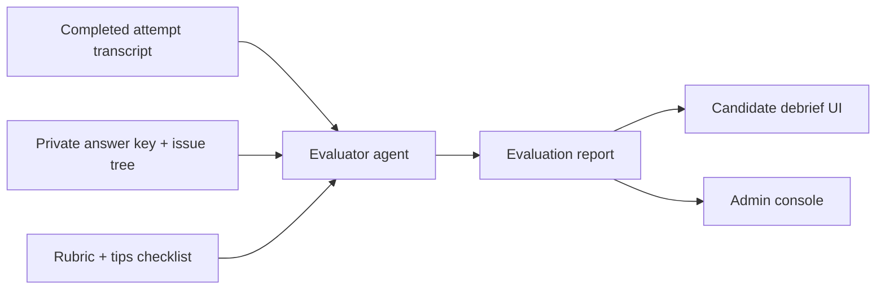

# Evaluator Agent Architecture

## Purpose

This document specifies the Evaluator Agent: an independent post-attempt service
that reads a completed interview transcript and produces an evidence-based
evaluation report. It replaces the temporary phase-count heuristic in
`InterviewSession.scorecard()` described in
[the implementation roadmap](implementation-roadmap.md) under "Feedback
evaluator", and it is designed to run without touching the live interview loop.

The report covers four scored dimensions plus a behavioural checklist:

1. **Structuring** - whether the candidate's structures are MECE at every level
   of decomposition, especially when the problem gets harder.
2. **Problem solving** - how quickly and directly the candidate reaches the core
   of the problem.
3. **Communication** - information density per turn; penalising filler,
   repetition, and circling.
4. **Quantitative ability** - speed and accuracy on mathematical work. This
   dimension is scaffolded now and fully activated when cases gain math content.

Plus an indexed **Tips and Tricks Checklist**: a versioned list of recommended
behaviours that the agent marks as demonstrated, missed, or not applicable in
this attempt, so the candidate knows exactly what to do differently next time.

---

## Foundations: what MECE means (and what the agent must detect)

MECE stands for **Mutually Exclusive, Collectively Exhaustive**, a
decomposition principle popularised by Barbara Minto at McKinsey as part of the
Pyramid Principle. It governs how a problem is split into parts:

- **Mutually exclusive (no overlaps).** Every item belongs to exactly one
  bucket at a given level. Splitting "revenue decline" into "price drop" and
  "customer attrition" fails this test because attrition affects both volume
  and price. A clean split is "volume change" versus "price change": each
  revenue rupee maps to exactly one branch.
- **Collectively exhaustive (no gaps).** The buckets together cover everything
  that matters. If a profit tree contains revenue and costs but omits one-time
  write-offs, it has a gap. Test: could a true cause exist that fits no branch?
  If yes, the split is incomplete.

Four standard violations the evaluator must recognise:

| Violation | Example |
|---|---|
| Overlap | Listing "marketing" under both fixed costs and discretionary spend |
| Gap | Revenue and cost branches with no room for one-off items |
| Mixed hierarchy levels | "Revenue" (a formula component) listed beside "logistics costs" (a sub-component of costs) |
| Irrelevant branches | A market-entry structure containing an employee-morale bucket |

Structures that are MECE by construction are preferred and the agent should
credit them: cuts by **formula** (profit = revenue - cost; revenue = price x
volume), by **components/segments** (product lines, geographies, channels), by
**process steps**, and by **exhaustive segmentation along one dimension with a
catch-all**.

Two calibration notes that keep the agent honest:

- MECE is necessary but not sufficient. A perfectly clean generic template
  scores lower than a clean structure tailored to the case. Tailoring is judged
  jointly by the structuring and problem-solving dimensions.
- Perfection is not expected. Under interview conditions, prioritising mutual
  exclusivity and case relevance matters more than theoretical completeness.
  Bands should reflect that.

---

## Position in the architecture



Non-negotiable boundaries inherited from the roadmap:

1. The evaluator runs **after** an attempt ends (or on explicit request for an
   in-progress read-only preview). It never writes interviewer turns, never
   mutates session state, and cannot release facts.
2. It receives the **private** answer key and issue tree as scoring context.
   Its **output** must never quote unreleased facts, the hidden diagnosis, or
   issue-tree branches the candidate did not reach. Every citation in the
   report points at something the candidate actually said or a released fact.
3. All judgements come from structured LLM output validated against typed
   schemas. No keyword routing, no regex scoring.
4. Every score, flag, and checklist verdict cites transcript evidence (message
   indexes) and the rubric criterion it maps to. An opinion without evidence is
   not feedback.

---

## Module design

### Location and shape

One new module, `app/evaluator.py`, plus one content directory,
`evaluation/`, kept deliberately separate from the interview path:

```
app/
  evaluator.py          # orchestrator: loads context, runs passes, validates output
evaluation/
  rubric.yaml           # dimension definitions, band anchors, weights
  checklist.yaml        # the indexed tips-and-tricks catalogue
  prompts/              # prompt templates for each analysis pass (versioned files)
tests/
  test_evaluator.py     # schema validation, leakage tests, evidence-link tests
```

Independence rules:

- The evaluator imports only from `app.case_runtime` (for types) and reads the
  store through injected dependencies. It shares nothing mutable with
  `app/interviewer.py`.
- `app/main.py` calls it only from the `/end` flow and a new read endpoint. The
  admin router calls it for re-evaluation. Neither imports its internals.

### Inputs

| Input | Source | Notes |
|---|---|---|
| Full message transcript | `InterviewSession.messages` | Includes phase timeline reconstructed from director decisions |
| Released facts with timestamps | `InterviewSession.disclosed_ids` | When each fact entered the conversation |
| Case metadata | `CaseWorld.catalogue_item()` | Category, difficulty, skills tested |
| Private answer key and issue tree | `reservoir/<case>/issue-tree.yaml` + case objective | Scoring reference only; never echoed to output |
| Rubric | `evaluation/rubric.yaml` | Versioned band anchors |
| Checklist | `evaluation/checklist.yaml` | Versioned behaviour index |

### Output: the evaluation report

A single typed object, stored alongside the attempt and rendered by the UI:

```python
class Citation(BaseModel):
    message_index: int          # index into the attempt transcript
    quote: str                  # short verbatim excerpt from the candidate

class DimensionScore(BaseModel):
    name: str                   # structuring | problem_solving | communication | quantitative
    score: float                # 0-10
    band: str                   # e.g. "Strong" | "Solid" | "Developing" | "Weak"
    evidence: list[Citation]    # at least one per claim
    observations: list[str]     # specific behaviours observed
    improvements: list[str]     # what to do differently, tied to evidence
    confidence: str             # high | medium | low (e.g. low when math absent)

class ChecklistItem(BaseModel):
    id: str                     # stable id like "structure.state-before-decompose"
    title: str
    status: Literal["demonstrated", "missed", "not_applicable"]
    evidence: list[Citation]    # required when demonstrated
    note: str                   # required when missed: the exact corrective action

class EvaluationReport(BaseModel):
    attempt_id: str
    dimensions: list[DimensionScore]
    checklist: list[ChecklistItem]
    headline_strengths: list[str]
    priority_improvements: list[str]   # max three, ranked
    next_drill: str                    # one concrete practice exercise
    evaluator_version: str             # prompt+rubric+model versions, for reproducibility
```

---

## Analysis pipeline

The evaluator runs five sequential passes. Each pass produces structured output
validated against a pydantic schema; invalid output retries once, then the pass
reports `low` confidence rather than fabricating.

### Pass 1: Segmentation

Reconstruct the interview's arc before judging anything. Segment the
transcript into episodes: clarification, structure presentation, branch
investigations, synthesis. Attach the phase, disclosed facts, and turn numbers.
This gives later passes their unit of analysis and lets the report say things
like "the candidate reached the margin-driver hypothesis in turn 6".

### Pass 2: Structure extraction and MECE audit

For every episode where the candidate presents or extends a structure:

1. Extract the implied tree: root question, branches, sub-branches, as
   structured JSON with message citations.
2. Audit each split against the four violation classes (overlap, gap, mixed
   hierarchy, irrelevance), using the private issue tree as the reference for
   exhaustiveness on this specific case.
3. Record whether the cut was MECE-by-construction (formula, components,
   process, single-dimension segmentation) or an ad hoc bucket list.
4. Track *progression*: does MECE quality hold, improve, or collapse as the
   case gets harder and deeper?

Output feeds both the structuring dimension and the checklist items about
stating a structure before diving in.

### Pass 3: Path-to-crux analysis

Measures problem-solving velocity:

- Identify the case's crux (from the private answer key) and locate the first
  turn where the candidate engages it substantively.
- Compute efficiency signals: turns spent on preamble versus investigation;
  dead-end branches explored and abandoned; whether hypotheses were stated
  before requesting data; whether the candidate updated direction when evidence
  contradicted them.
- Normalise against case length and difficulty so a hard case does not
  mechanically produce a low score.

This pass also detects the negative pattern explicitly requested: if reaching
the core took disproportionately many messages relative to the case's
expected path, problem-solving bands drop and the observation says so plainly.

### Pass 4: Communication density audit

Per candidate message, estimate information density using structured LLM
judgement over features such as:

- New-information ratio versus restatement of known facts.
- Answer-first framing (top-down: conclusion then support) versus rambling.
- Repetition across consecutive turns; circling back to closed topics.
- Precision of language: named drivers, numbers, and segments versus vague
  qualifiers ("a lot", "probably significant").

Aggregate into a communication score with representative good and bad excerpts
cited verbatim.

### Pass 5: Quantitative audit (forward-compatible)

Activated fully when cases carry math facts and exhibits. Until then the pass
still runs and reports honestly:

- Detect any arithmetic, estimation, or sanity-check the candidate performed;
  grade accuracy and speed (turns taken to reach a figure once the inputs were
  available).
- Grade unit discipline and order-of-magnitude sense where present.
- If the attempt contained no quantitative work, emit score 0 with
  `confidence: low` and `not_applicable`-style messaging rather than inventing
  a judgement.

### Pass 6: Checklist verification

Load `evaluation/checklist.yaml`. Each entry carries detection guidance:
observable markers, the episode types where it would appear, and
counter-indicators. For each item the agent decides `demonstrated`,
`missed`, or `not_applicable`, citing messages for demonstrations and writing a
specific corrective action for misses. Missed items that were genuinely
relevant to this case surface in `priority_improvements`.

### Final assembly

A deterministic (non-LLM) assembly step combines pass outputs into the report:
applies rubric weights, ranks strengths and improvements, picks one next drill
matched to the weakest dimension, stamps all versions. Determinism here keeps
scores reproducible from identical pass outputs.

---

## The tips and tricks index (`evaluation/checklist.yaml`)

You will supply the actual list. The format is designed so entries are pure
data; adding one requires no code change:

```yaml
schema_version: checklist-v1
items:
  - id: structure.restate-objective-first
    title: Restate the objective and time horizon before structuring
    applies_to_phases: [clarification]
    detection:
      markers:
        - candidate paraphrases the decision question
        - candidate confirms metric or scope before proposing a tree
      counter_markers:
        - candidate requests data before confirming the objective
    severity: medium
  - id: structure.hypothesis-before-data
    title: State a hypothesis before requesting evidence
    applies_to_phases: [drill_down]
    detection:
      markers:
        - candidate names a suspected driver and asks for its value
      counter_markers:
        - candidate asks "can you give me the breakdown" with no hypothesis
    severity: high
```

Rules the index follows:

- IDs are stable forever; reports reference items by ID so historical
  evaluations stay interpretable after edits.
- `severity` drives whether a miss enters `priority_improvements`.
- Items can be case-type scoped later (for example, quant drills only apply to
  cases with exhibits).

---

## Rubric and scoring model (`evaluation/rubric.yaml`)

- Four dimensions, each scored 0-10 with written band anchors
  ("Developing", "Solid", "Strong", "Exceptional") so the same words mean the
  same thing across attempts and candidates.
- Weights default to structuring 0.35, problem solving 0.30, communication
  0.20, quantitative 0.15; quantitative weight redistributes proportionally
  when the dimension is not applicable, and the overall score states which
  dimensions were actually assessed.
- Band anchors describe observable behaviour, not adjectives: a Strong
  structuring anchor reads "every split at every level is defensibly non-
  overlapping, complete for this case, mostly MECE-by-construction, and
  tailors to the client's specific situation".

---

## API surface

| Endpoint | Auth | Purpose |
|---|---|---|
| `POST /api/attempts/{id}/end` | owner | Unchanged externally; now also triggers evaluation and includes the report in the response |
| `GET /api/attempts/{id}/evaluation` | owner | Fetch or lazily generate the report for a finished attempt |
| `POST /api/admin/attempts/{id}/evaluate` | admin | Re-run evaluation with current rubric/prompt versions |

Storage: reports persist in a new SQLite table `evaluations (attempt_id PRIMARY
KEY, report_json, created_at, evaluator_version)`. Re-evaluation inserts a new
row keyed by version rather than overwriting history.

---

## Failure modes and mitigations

| Risk | Mitigation |
|---|---|
| Model hallucinates quotes | Assembly step verifies every citation string appears in the referenced message; mismatch rejects the report |
| Answer-key leakage into the report | Post-generation leakage scan: report text is compared against unreleased fact contents and issue-tree labels; hits block publication |
| Non-MECE evaluation itself (inconsistent grades) | Band anchors are behavioural; temperature 0 for grading passes; two-pass self-check where the grader re-audits its own MECE verdicts against the four violation classes |
| Long transcripts exceeding context | Pass 1 segments first; passes 2-6 consume only relevant episodes, not the whole transcript |
| Quant dimension graded on nothing | Explicit `not_applicable` path with confidence downgrade; excluded from weighted total with disclosure |
| Prompt or rubric drift making scores incomparable | Every report stamps evaluator, rubric, prompt, and model versions; admin view groups by version |

---

## Test plan

- Schema tests: every pass output validates; malformed output retries then
  degrades to low confidence instead of crashing.
- Leakage tests: fixture attempts where the candidate never reached the true
  diagnosis must produce reports containing zero unreleased-fact strings.
- Evidence tests: every citation resolves to a real message index and verbatim
  substring.
- Calibration fixtures: replay the authored QA transcripts (strong path,
  plausible wrong path, stuck path, premature synthesis from the roadmap QA
  pack) and assert band directions, not exact scores.
- Idempotence: evaluating the same finished attempt twice with the same
  versions yields the same assembled report given identical pass outputs.

---

## Delivery phases

| Phase | Outcome | Gate |
|---|---|---|
| 1. Contracts | Pydantic models, rubric/checklist YAML schemas, storage table | Schemas reviewed and frozen for v1 |
| 2. Pipeline | Passes 1, 2, 6 live; structuring + checklist report behind the existing `/end` call | Leakage and evidence tests green on Meridian fixtures |
| 3. Full report | Passes 3, 4, 5 live; weighted overall score; admin re-evaluation | QA-transcript calibration matches expected band directions |
| 4. Math activation | Cases gain quantitative facts/exhibits; pass 5 becomes fully weighted | At least one quant case passes end-to-end calibration |

Phase 2 alone already retires the heuristic `scorecard()`: the checklist plus
MECE audit deliver most of the learning value while later passes mature.
