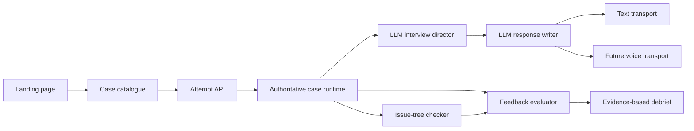

# Leo Implementation Roadmap

> **Partly historical.** Written when the library had 12 cases. The evaluator (Phase 4), voice (Phases 5-6) and Google sign-in have since shipped, and the library now has 69 cases. Current open work is in [campaign/ROADMAP.md](campaign/ROADMAP.md).

## Purpose and boundary

This document began as a planning-only roadmap. The landing page, multi-case
catalogue boundary, and first 12 case worlds are now implemented; the remaining
phases still describe future work.

The next release should turn Leo from a single text-mode prototype into a
case-practice product with a public landing page, a 12-case launch library, and
an evaluation architecture that will later support voice without duplicating the
interview logic.

Planning assumption: the 12-case library includes Meridian Cold Chain plus 11
new original or licensed cases. If the intended scope is 10 to 12 *additional*
cases, use the same authoring standard for those extra cases after this launch
set has passed QA.

## Verified current state

| Area | Current evidence | Implication |
|---|---|---|
| Product surface | The root route serves the live interview workspace directly. | Add a separate marketing landing page and retain the workspace as a distinct practice route. |
| Case library | `reservoir/` contains only `meridian-cold-chain/`. | A case registry and 11 additional playable reservoirs are required. |
| Runtime | `app/main.py` creates one global `WORLD`; `/api/cases` returns one item; attempt start accepts only that ID. | Multi-case selection is not implemented yet. |
| Interview logic | `app/interviewer.py` uses an LLM director and an LLM voice writer; `app/case_runtime.py` validates fact release and phase movement. | Preserve this trust boundary when adding agents and voice. |
| Evaluation | `InterviewSession.scorecard()` derives fixed bands from stage and released-fact counts. | Replace with evidence-based evaluator output before claiming high-quality feedback. |
| Content model | Meridian has fact, issue-tree, and policy files, while the runtime currently loads only case metadata, facts, and phase policy. | Define a compiled case contract before authoring the full library. |
| Documentation | Product and engineering design describe milestones, nudges, and ElevenLabs, but the runnable implementation uses phases and LLM generation. | Consolidate terminology and mark future design as future. |

## Product architecture target

### Non-negotiable boundaries

1. The case runtime remains the authority for fact eligibility, case state, and
   candidate-safe data. No agent can reveal a fact that the runtime rejects.
2. The interview director, issue-tree checker, and feedback evaluator use
   structured LLM outputs. They do not use keyword search or hard-coded response
   paths.
3. The response writer always generates a fresh response from approved context.
   Case data is source material, not a dialogue template.
4. Every score and piece of feedback must cite transcript evidence and a case
   rubric criterion. A model opinion without evidence is not candidate feedback.
5. Text and voice use the same attempt API and event history. Voice is a
   transport adapter, not a second interview runtime.

## Landing page plan

### Goal

Explain what Leo is, make the product feel credible, and take a visitor to
case selection in one primary action.

### Page sections

1. **Hero:** “Practise consulting cases with an interviewer that follows your
   reasoning.” One primary action: “Start a practice case.”
2. **How it works:** select a case, talk through the reasoning, receive
   evidence-based feedback. Make clear that text is available now and voice is
   forthcoming.
3. **What makes it different:** case-specific facts, candidate-led paths,
   dynamic LLM conversation, and feedback tied to actual moments in the attempt.
4. **Case library preview:** show categories, industries, difficulty, duration,
   and skills tested. Do not expose answers or diagnostic facts.
5. **Practice modes:** realistic, coached, and pressure, with the differences
   expressed as behaviour rather than fixed response scripts.
6. **Trust and privacy:** clarify that cases are original or licensed and that
   voice recording is not enabled until a voice consent and retention policy
   exists.
7. **Final action:** start practice or browse cases.

### Landing page acceptance checks

- A visitor reaches the catalogue without an active attempt being created.
- The page is responsive, accessible by keyboard, and has one clear primary
  action at every viewport size.
- No private case facts, answer keys, provider keys, or evaluation instructions
  are sent to the browser.
- Marketing claims match implemented capability. Voice is described as planned
  until the voice phase passes its quality gate.

## 12-case launch library

Each case is an original or licensed case world, not a lightly renamed public
case. Every source must have a rights record before authoring begins.

| # | Working title | Case type | Industry | Core skill |
|---|---|---|---|---|
| 1 | Meridian Cold Chain | Profitability | Temperature-controlled logistics | Segment economics |
| 2 | Harvest Table | Profitability | Quick-service restaurants | Store-level economics |
| 3 | Northstar Bank | Growth strategy | Retail banking | Customer-segment prioritisation |
| 4 | Aster Diagnostics | Market entry | Healthcare services | Market sizing and entry mode |
| 5 | SunPeak Solar | Pricing | Distributed energy | Willingness-to-pay and unit economics |
| 6 | MetroLink Mobility | Operations | Urban transit | Capacity, demand, and service trade-offs |
| 7 | Loom & Leaf | Turnaround | Apparel retail | Inventory and channel economics |
| 8 | ClearCart | Growth strategy | E-commerce marketplace | Cohort and retention diagnosis |
| 9 | Forge Components | M&A | Industrial manufacturing | Synergies and deal logic |
| 10 | BlueCurrent Water | Public sector strategy | Water utility | Stakeholder and implementation design |
| 11 | Orbit Learning | Digital transformation | Education | Product, adoption, and rollout plan |
| 12 | TerraBuild Materials | Sustainability strategy | Construction materials | Decarbonisation economics |

### Required content for every case

| Content component | Minimum standard |
|---|---|
| Candidate briefing | Client, decision, metric, scope, and time horizon, with no answer leakage. |
| Private fact ledger | 18 to 30 atomic facts, with provenance, dependencies, release levels, and candidate-safe wording. |
| Exhibits | One to three structured exhibits where the learning objective requires quantitative reasoning. |
| Issue tree | Causal map, at least two valid routes, bounded detours, hidden diagnosis, and recommendation links. |
| Answer key | Diagnosis, supporting evidence, alternative valid paths, recommendations, risks, and implementation next steps. |
| Rubric | Observable criteria for clarification, structure, analysis, judgement, and synthesis. |
| QA pack | Strong path, plausible wrong path, stuck path, and premature-synthesis transcript tests. |
| Rights record | Original or licensed status, source reference, attribution requirement, and approver. |

### Content workflow

1. Select the case objective and learning skill mix, avoiding duplicate case
   mechanics across the 12 cases.
2. Create a private business world and reconcile all numbers before writing
   candidate-visible wording.
3. Build the issue tree and three valid solution routes.
4. Convert the world into atomic facts and exhibits with release constraints.
5. Run an LLM simulation and two human content reviews.
6. Compile the approved case into the runtime format and run leakage tests.
7. Publish to the catalogue only after content and interaction QA both pass.

## Future agent design

### 1. Interview director

Already present in basic form. It interprets the candidate’s newest turn and
transcript, selects an allowed conversational move and proposes fact IDs. The
runtime validates the selection before anything is spoken.

### 2. Issue-tree checker

Purpose: build a structured, inspectable view of the candidate’s reasoning.

Input: transcript, current case phase, approved facts, and the private case
issue tree. Output: structured claims, hypotheses, evidence used, unsupported
assumptions, branch coverage, confidence, and recommended runtime action. It
does not write the interviewer reply and cannot release facts.

Use it to recognise progress through alternate valid routes, detect a repeated
dead end, and pass evidence to the evaluator.

### 3. Feedback evaluator

Purpose: create the final debrief from evidence, not from phase completion.

Input: completed event history, issue-tree-checker observations, case rubric,
and final recommendation. Output: rubric scores, transcript citations,
strengths, high-value improvements, one next drill, and uncertainty labels.
The candidate sees only this output, never the private answer key or hidden
reasoning chain.

### 4. Quality and safety checks

Before a turn is committed, validate structured model outputs against typed
schemas, case facts, permitted phases, and maximum disclosure limits. Log model,
prompt, case, and rubric versions so feedback can be reproduced and reviewed.

## Voice-first transition and pruning plan

### Keep

- The authoritative fact-release runtime.
- The attempt API as the single conversation boundary.
- SQLite only as local-development persistence until multi-user hosting begins.
- The text interface as a development, accessibility, and fallback transport.

### Replace before voice launch

- The fixed `scorecard()` heuristic with the evidence-based feedback evaluator.
- Global single-case state with a registry that resolves each attempt’s case and
  version.
- UI assumptions that an interviewer response is always a chat message, so
  partial speech transcripts and interruptions can be represented.

### Remove or archive after migration

- Generated `app/__pycache__/`, `tests/__pycache__/`, and `casecall.egg-info/`
  directories should not be source-managed.
- The legacy Meridian source package should not contain runtime dialogue,
  keyword triggers, or recovery text. Keep it only as authored source evidence,
  or archive it after the canonical reservoir has a complete source reference.
- Overlapping design text that describes old nudge ladders or a milestone runtime
  should be consolidated into one current architecture document.

## Code clarity and comment plan

Comments should explain intent, trust boundaries, and non-obvious constraints,
not repeat what a line of Python or JavaScript already says.

| Area | Documentation work before implementation |
|---|---|
| `app/main.py` | Explain application construction, request-to-attempt lifecycle, idempotency, and why provider errors are mapped to candidate-safe HTTP errors. |
| `app/case_runtime.py` | Document the case-loading contract, candidate-safe projection, disclosure validation, and why the runtime overrides LLM proposals. |
| `app/interviewer.py` | Document the two-model flow, private/public context boundaries, structured-output validation, retry behaviour, and response-style constraints. |
| `app/store.py` | Explain serialization compatibility, transaction assumptions, and why SQLite is limited to one instance. |
| `app/static/app.js` | Group and comment state ownership, API recovery, rendering, attempt restoration, timer lifecycle, and accessibility updates. |
| `app/static/index.html` and `styles.css` | Use section markers and component-level rationale. Remove decorative or duplicated comments. |
| `tests/` | Name test cases after behaviour and document the security or regression risk each protects. |
| `docs/` | Publish one current architecture guide, one content-authoring guide, and this roadmap. Mark superseded documents clearly rather than leaving conflicting contracts. |

## Delivery roadmap

| Phase | Outcome | Dependencies | Exit gate | Rough effort |
|---|---|---|---|---|
| 0. Planning and cleanup | Freeze the canonical architecture, case schema, content rubric, and documentation map. | None | One approved source of truth; legacy/dead inventory agreed. | Completed |
| 1. Catalogue and landing | Public landing page plus multi-case catalogue and selection flow. | Phase 0 | Landing does not create attempts; selection starts the chosen versioned case. | Implemented, pending visual QA |
| 2. Content compiler and case registry | Load and validate multiple reservoirs, with versioned case metadata. | Phase 0 | A malformed case is rejected before it reaches the catalogue. | Implemented for YAML reservoirs |
| 3. Launch case library | Author, review, and QA the 11 new case worlds plus Meridian upgrade. | Phase 2 | 12 cases pass leakage, alternate-path, and human-review gates. | Authored; interaction and human-review QA pending |
| 4. Reasoning and feedback agents | Add the issue-tree checker, observation event log, evaluator, and evidence-based debrief. | Phases 2 and 3 | Every score cites a candidate turn and a rubric criterion. | 2 to 3 weeks |
| 5. Voice readiness | Add transcript events, interruption-safe turn state, latency metrics, and consent/retention design. | Phase 4 | Text and voice produce equivalent approved runtime actions. | 1 to 2 weeks |
| 6. Voice launch | Add the selected voice provider as a transport adapter and retain text fallback. | Phase 5 | Realistic interruption, reconnect, privacy, and latency tests pass. | 2 to 3 weeks |
| 7. Prune and harden | Remove legacy paths, consolidate docs, add authentication, shared persistence, observability, and rate limits. | Phase 6 | Production readiness checklist and rollback plan pass. | 1 to 2 weeks |

## Sequencing rationale

The content compiler and registry precede bulk authoring because writing 11 more
cases against a moving schema would create expensive rework. The checker and
evaluator precede voice because voice can only improve interaction quality after
the product can assess reasoning reliably. Voice remains last because it is a
transport and latency problem, not the source of learning value.

## Definition of done for the planned release

1. A visitor can understand Leo and select one of 12 cases from a landing
   page without exposing private case data.
2. All 12 cases have complete, rights-cleared, versioned case worlds and pass
   content, leakage, and alternate-path QA.
3. The interviewer, issue-tree checker, and evaluator have separate typed
   contracts and a runtime-enforced data boundary.
4. Final feedback is evidence-linked and reviewer-auditable.
5. The text experience remains a supported fallback while voice uses the same
   backend attempt contract.
6. Generated artifacts and superseded runtime concepts have been removed or
   explicitly archived, and the codebase has current explanatory comments.
