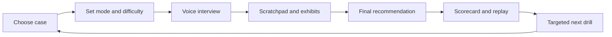
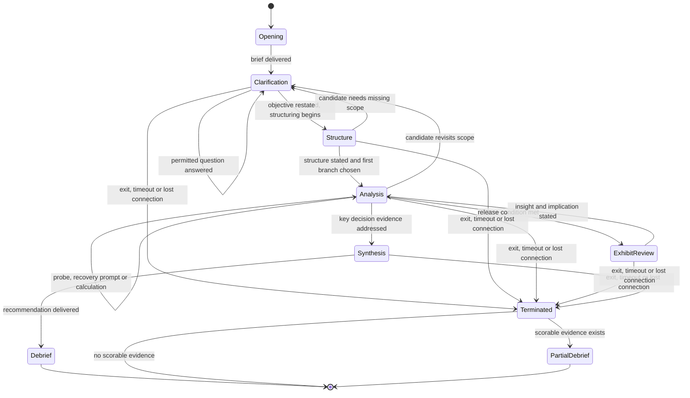
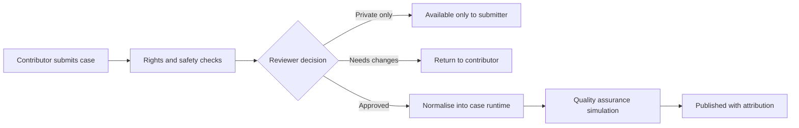

# CaseCall: Product Design Document

**Status:** Proposed
**Version:** 0.2
**Last updated:** 2026-08-22
**Audience:** Product, design, engineering, content operations, and early testers
**Companion document:** [Engineering design for the V1 runtime](engineering-design.md)

### Changes in 0.2

Applied after a design review of 0.1. The review found four blocking gaps and a
set of internal contradictions. This version:

1. adds a unit-economics section, because the product's unit is a 15 to 45 minute
   realtime voice session and 0.1 had no cost model (§14);
2. makes the stage and rubric schema canonical in code rather than restating it
   in prose, since 0.1 specified 7 stages and 7 dimensions while the authoring
   template implemented 4 and 4 (§8, §10, `lib/case-runtime/schema.ts`);
3. defines the evaluator as a named component and adds version pinning to every
   attempt, so scores are reproducible and comparable over time (§9.0, §11.2);
4. resolves the mode, duration, scratchpad, N/A-dimension and terminal-state
   contradictions (§6, §7, §8.1, §10.1);
5. adds accented-ASR accuracy, scoring fairness, adversarial extraction and
   India DPDP compliance as first-class risks with gates (§10.3, §17);
6. moves settled questions out of Open decisions and puts effort and owners on
   the roadmap (§14, §15).

## 1. Product in one sentence

CaseCall is a realistic, voice-first case interview simulator where candidates practise a full consulting case with an AI interviewer that controls the case flow, probes their reasoning, releases data at the right time, and gives evidence-based feedback afterward.

The product is not a framework tutor that chats about cases. It is an interviewer-led practice call.

## 2. Problem

Case interview preparation has three persistent failures:

1. **Practice partners are scarce.** Candidates need repeated live practice, but coordinating an experienced partner is slow and inconsistent.
2. **Static casebooks do not simulate the interaction.** They expose the answer path too early and cannot respond to a candidate's actual reasoning.
3. **Feedback is vague.** "Be more structured" does not identify the exact moment a candidate missed a clarification, made an unsupported assumption, or failed to synthesize.

Candidates need a realistic opponent: one that listens, challenges, withholds information until it is earned, and explains exactly how to improve.

## 3. Product thesis

Voice is necessary but not sufficient. A convincing interviewer requires three things working together:

| Capability | What the candidate experiences | What makes it credible |
|---|---|---|
| Voice conversation | A natural back-and-forth without constant clicking | Fast turn-taking, interruption handling, concise spoken prompts |
| Case runtime | The case unfolds as it would with a human interviewer | Facts and exhibits are released only at the appropriate point |
| Evidence-based feedback | Clear coaching after the case | Scoring ties back to timestamped candidate behaviour, not generic model opinion |

The durable advantage is the structured case runtime and the learning data it produces. The voice provider is replaceable infrastructure.

### 3.1 Why this is defensible, and where it is not

Stated plainly, because 0.1 asserted the moat without testing it.

- **Not defensible:** the state machine itself. A competent team rebuilds the
  runtime in weeks once it has structured content.
- **Defensible with work:** the structured, rights-clean case library. Turning a
  case into a gated, QA-passed runtime package is expert authoring work, not
  extraction, and it does not get cheaper with scale until authoring tooling
  exists.
- **Defensible over time:** attempt-level learning data linked to rubric
  outcomes, which no casebook publisher has and which improves both case
  authoring and scoring calibration.
- **The real competitive question:** why an incumbent casebook publisher or a
  peer-practice marketplace cannot add this in a quarter. The honest answer is
  that they can add the voice layer easily and the gated content layer slowly.
  Speed on authoring tooling is the strategy. A named competitor scan is an
  open item in §15.

## 4. Target users

### Primary V1 user: MBA and undergraduate consulting candidate in India

- Preparing for MBB, Big Four, boutique consulting, or corporate strategy interviews.
- Knows basic frameworks but lacks high-frequency live practice.
- Wants an interviewer who is demanding but not demoralising.
- Is comfortable speaking in English, often with Indian business context and placement-style cases.

This is a decision, not an open question. It sets the ASR accuracy bar in §10.3
and the compliance regime in §11.4.

### Secondary users

- Global MBB applicants who want deliberate practice between peer sessions.
- Consulting clubs that want a standard practice library and aggregate learner signals.
- Coaches who want to assign drills and inspect performance evidence.

### Non-users in V1

- Candidates seeking a full interview-prep course from zero.
- Recruiters making hiring decisions.
- Users needing a phone-number-based outbound calling product.

## 5. Product principles

1. **Interviewer first.** The agent asks the next useful question. It does not lecture unless the simulation has ended.
2. **Earn information.** The candidate receives facts, data and exhibits only when their questions or reasoning warrant them.
3. **Judge the reasoning, not the vocabulary.** A bespoke, correct structure should score well even if it is not labelled "profitability framework."
4. **One live thread.** The user should never wonder whether they are talking to a tutor, looking at a solution, or advancing a workflow.
5. **Feedback must be replayable.** Every score needs a short explanation, one or more concrete moments from the call, and the exact case, rubric, prompt and model versions that produced it.
6. **Protect source material.** Content provenance and use rights are first-class product data, not a later legal clean-up.
7. **Leak prevention is structural.** The answer key is not in the interviewer's context and not on the record the client fetches. Discipline is not a control.

## 6. Core experience

### 6.1 End-to-end journey



### 6.2 Case selection

The candidate selects:

- Case type: profitability, market entry, growth, pricing, operations, investment/PE.
- Difficulty: foundation, interview-ready, advanced.
- Mode: coached, realistic, or pressure.
- Duration: one of the durations the case itself declares.

**Duration is a property of the case, not a free choice.** A case package declares
which durations it supports and which stages compress at each one. A 30-minute
case is not a truncated 45-minute case; the stage budget and the exhibit set
differ, and the rubric marks unreached dimensions Not Applicable rather than
scoring them low. Offering a duration a case has not been authored and QA'd for
is how a runtime leaks or stalls.

**V1 selector reduction.** 6 case types times 3 difficulties times 3 modes times
3 durations is 162 combinations. V1 ships 12 to 20 cases. The selection screen
therefore exposes case type and difficulty as filters, mode and duration as
per-case options, and shows honest coverage: how many cases exist in the chosen
cell and which the candidate has already attempted. Empty cells are shown as
empty rather than hidden.

The selection screen shows the category, supported durations, skills tested and whether the case contains quantitative work or exhibits. It does **not** show the client, answer, key insight or case source text.

### 6.3 Pre-call room

Before the call, the candidate sees:

- Microphone check and transcript preference.
- A one-line expectation: "You can ask clarifying questions, take a moment to structure, and talk through your thinking."
- A timer that starts only once the interviewer begins the case.
- A private scratchpad, plus a **Share with interviewer** control on each note block.

**Scratchpad visibility is explicit.** The evaluator always reads the scratchpad,
because written setup is the main evidence for the Quantitative work dimension.
The interviewer reads a note block only when the candidate shares it. This
resolves the 0.1 contradiction in which the interviewer was required to challenge
calculation errors it could not see: unshared written arithmetic is scored by the
evaluator after the call, and challenged live only when spoken or shared. The UI
states this in one line so the candidate is never guessing.

### 6.4 Live interviewer call

The interviewer begins with a 45- to 90-second case opening, then stops. During the call, the candidate can speak naturally or use text fallback.

The interviewer's job is to:

- answer only permitted clarifying questions;
- ask for a structure after a reasonable clarification window;
- test the candidate's prioritisation, not merely their ability to list buckets;
- introduce calculations and exhibits in context;
- challenge unsupported statements, unclear conclusions, and any calculation the candidate has spoken aloud or shared from the scratchpad;
- avoid revealing the answer or coaching extensively before the final debrief.

The candidate's live workspace has five stable areas:

| Area | Purpose |
|---|---|
| Call status | Mic, connection, interviewer speaking/listening state, elapsed time |
| Conversation | Live transcript with speaker labels and timestamps |
| Scratchpad | Free-form notes, assumptions and calculations, with per-block sharing |
| Exhibit tray | Facts, tables and charts released during the case |
| Controls | Mute, end call, request technical help, text fallback |

### 6.5 Final recommendation and debrief

The interviewer asks for a final answer in a consistent format: recommendation, supporting reasons, risks and next step. Only after the candidate has completed it does the tone shift from interviewer to coach.

The scorecard contains:

- overall readiness band, computed only over dimensions applicable to the attempt;
- a band and evidence statement per applicable dimension, and an explicit **Not Applicable** for the rest;
- three strongest moments;
- one or two highest-leverage gaps;
- a replay transcript with marked coaching moments;
- the recommended next drill;
- an optional concise exemplar approach, hidden until after the candidate's first attempt;
- the case, rubric, prompt and model versions used, so the score can be reproduced.

**Not Applicable policy.** A dimension is Not Applicable when the case declares no
material for it (a qualitative case has no Quantitative work dimension) or when
the attempt ended before the stage that produces its evidence. Not Applicable is
never averaged in and never shown as a low band. A readiness band is withheld
entirely when fewer than four dimensions are applicable, and the scorecard says
why.

### 6.6 Incomplete attempts

Roughly 30% of started mocks are not expected to reach synthesis (§13). Those
attempts get a **partial debrief**, not silence: the applicable dimensions scored
so far, the stage the attempt stopped at, the reason (candidate exit, timeout,
disconnect), and a next drill. An attempt with no scorable observation gets a
short "nothing to score yet" screen and no band. The runtime has explicit
terminal states for this (§8.1).

## 7. Interview modes

| Mode | Interviewer behaviour | Best for |
|---|---|---|
| Coached | Allows one nudge per stage and explains it after the candidate responds | Early learners |
| Realistic | Neutral, concise, and representative of a standard interview | Core practice |
| Pressure | Uses tighter timing, deliberate challenges and limited rescue | Interview-ready candidates |

**Mode changes pacing, rescue and the amount of information released. It does not
change the answer key or the rubric.** This corrects 0.1, which claimed mode did
not change information released while also letting coached mode surface a
corrected calculation.

Consequences, stated rather than implied:

- Every score is **mode-scoped**. A band earned in coached mode is not comparable
  to the same band in realistic mode, and the scorecard labels the mode.
- Readiness bands are only ever quoted against **realistic** mode. Coached and
  pressure attempts show dimension bands and a note that readiness is measured in
  realistic mode.
- The attempt record stores `mode`, and every nudge and rescue is an event in the
  log, so a reviewer can see exactly how much help was given.

## 8. Case interview runtime

### 8.1 Why a state machine is required

A general language model with a PDF in its prompt will leak facts, jump ahead, and reward plausible prose. CaseCall instead runs every attempt through a session state machine and every case through a compiled milestone graph. The session machine owns lifecycle, timer and terminal states; the case world owns facts, permissible questions, exhibit release rules and milestone completion. A global stage is not a fixed source-question sequence.



The interviewer can remain in a state, ask a recovery question, move backward to
clarification, or advance only through explicit runtime actions. It cannot invent
a new material fact. Within the analysis envelope, the compiled case graph allows
alternate valid branches and case-specific milestones; it does not force the
source case's numbered question order.

### 8.2 Standard stages

**The canonical definition lives in `lib/case-runtime/schema.ts`.** That module
exports the stage IDs, the rubric dimension IDs, the band scale and the legal
transitions, with a `SCHEMA_VERSION`. The authoring template, the runtime, the
evaluator and the scorecard all import it. Prose in this document is a summary and
loses to the code if they disagree. This closes the 0.1 gap in which the document
described 7 stages and 7 dimensions while the authoring template implemented 4 and
4, and the template frontmatter used a third vocabulary.

| Stage ID | Candidate goal | Interviewer behaviour | Typical evidence of progress |
|---|---|---|---|
| `opening` | Understand the client and objective | Delivers a concise brief; waits | Candidate restates objective |
| `clarification` | Define scope and decision criterion | Answers permitted question classes | Candidate identifies key unknowns |
| `structure` | Lay out a tailored approach | Gives quiet thinking time; tests priority | Logical issue tree and first hypothesis |
| `analysis` | Test the most important drivers | Supplies allowed data; probes reasoning | Calculations, insights, interim conclusion |
| `exhibit_review` | Interpret new information | Releases chart/table; asks "what does this tell you?" | Correct reading and decision implication |
| `synthesis` | Recommend a path | Requires answer-first close | Recommendation, reasons, risks, next step |
| `debrief` | Learn from the attempt | Explains rubric outcomes | Candidate selects next drill |
| `terminated` | n/a | Stops cleanly, preserves evidence | Reason code recorded |
| `partial_debrief` | Salvage learning from a short attempt | Explains what was scorable | Candidate selects next drill |

## 9. AI interviewer design

### 9.0 Components

0.1 referred to "latest evaluator observations" without ever defining an
evaluator. There are four components, with deliberately different context:

| Component | Sees | Does not see | Cadence |
|---|---|---|---|
| **Runtime** (authoritative) | Everything: case package, answer key, stage, event log | n/a | Every turn, server-side |
| **Interviewer** (language + voice) | Persona, mode, current stage and objective, permitted facts, permitted actions, recent verbatim turns, running summary, shared scratchpad blocks | Answer key, future facts, unreleased exhibits, raw source text, other users' data | Every candidate turn |
| **Evaluator** | Full transcript, full scratchpad, event log, answer key, rubric | Nothing withheld; it runs server-side only and never emits text to the candidate mid-call | Streamed per turn for observations, plus one consolidation pass at the end |
| **Scorecard assembler** | Observations, event log, version pins | Raw model reasoning | Once, at end of attempt |

The evaluator streams `record_observation` calls during the call so the scorecard
is mostly assembled by the time the candidate finishes. That is what makes the
sub-10-second feedback target in §13 achievable, and it is now stated rather than
assumed. The interviewer receives only the evaluator's short observations, never
its reasoning or the answer key it used.

**Running summary risk.** Compressing a 30-minute case loses early assumptions
that matter later. The runtime therefore keeps a structured, append-only
`commitments` list (stated assumptions, chosen branches, numbers the candidate
asserted) outside the free-text summary, and always passes it verbatim.

### 9.1 Context supplied on each turn

The interviewer model receives only:

- interviewer persona and mode;
- active case stage and its objective;
- permitted facts and permitted next actions;
- candidate transcript summary, the structured commitments list, and recent verbatim turns;
- latest evaluator observations, as short strings;
- release status for exhibits;
- scratchpad blocks the candidate has explicitly shared;
- a strict instruction to ask one question at a time.

It does **not** receive the full solution, future facts, raw source material, provider secrets, or unrestricted database access.

### 9.2 Runtime action contract

The CaseCall interviewer orchestrator uses structured runtime actions. A voice
provider does not call these actions and cannot independently control the case.
The runtime validates every action before it mutates attempt state.

| Runtime action | Purpose | Guardrail |
|---|---|---|
| `get_releasable_facts` | Find facts relevant to the candidate’s intent | Returns IDs only when the case-world dependency and release rules are met |
| `record_disclosure` | Release an approved factual response or exhibit | Appends an immutable disclosure event before the fact is spoken or displayed |
| `select_interviewer_move` | Choose answer, invite, probe, challenge, nudge, redirect or close | Uses the active milestone, mode and nudge ladder; it cannot choose an answer-key fact |
| `advance_milestone` | Record progress through a case-specific graph | Requires the milestone’s explicit completion evidence as well as a legal lifecycle transition |
| `check_calculation` | Compare a candidate setup with case truth | Returns a probe by default. In coached mode it may return corrected setup only from released inputs |
| `record_observation` | Capture scoring evidence | Rejected without canonical dimension ID, transcript/scratchpad anchor, observed behaviour and next action |
| `end_case` | Move to final synthesis, debrief or partial debrief | Available only after required decision work or from a terminal state |

`check_calculation` is the action whose output varies most by mode, which is
consistent with §7: coached mode releases more rescue information, and the score
is mode-scoped as a result.

### 9.3 Voice layer

Use ElevenLabs initially as a voice transport for speech recognition, expressive
speech, interruption handling and browser call transport. CaseCall owns the
canonical transcript, the interviewer model, case state, scoring, and every
candidate-visible fact. The selected ElevenLabs integration must surface final
candidate transcript events to CaseCall and speak CaseCall-authored replies; it
must not run an independent case-interviewer agent. See the
[ElevenLabs Agents overview](https://elevenlabs.io/docs/eleven-agents/overview).

The voice experience must support:

- browser microphone and text fallback;
- pause tolerance while a candidate structures;
- interruption without losing the active state;
- reconnection that restores transcript and elapsed time;
- privacy notice and explicit recording/transcript consent;
- a neutral voice with adjustable speaking speed, not a theatrical "consultant" character.

**Integration boundary.** A CaseCall Durable Object receives every final
candidate turn before the interviewer responds, serialises state-changing events,
and returns only the approved interviewer utterance to the voice transport. The
browser never holds the provider API key; it receives a short-lived,
attempt-bound voice grant from CaseCall's backend. Contract detail is in the
[engineering design](engineering-design.md).

**Text fallback is not a degraded mode.** It is the same runtime with a typed
transcript, it ships first, and it is the harness used for automated runtime
tests. Voice is a transport added on top.

## 10. Scoring and feedback design

### 10.1 Rubric

Each dimension uses four behavioural bands: **Developing, Competent, Strong, Outstanding**, plus **Not Applicable**. The final report can map bands to a numeric score internally, but the candidate sees the band and the evidence.

Canonical IDs and applicability rules live in `lib/case-runtime/schema.ts`.

| Dimension ID | What is measured | Applicable when |
|---|---|---|
| `problem_definition` | Restates the objective, scope, decision maker and success metric | Always |
| `clarification` | Asks high-value questions before building an approach | Always |
| `structure` | Produces a tailored, complete, prioritised approach | Always |
| `quantitative` | Sets up calculations cleanly, calculates accurately, sanity-checks results | Case declares at least one calculation |
| `business_judgement` | Forms hypotheses, identifies material drivers and makes trade-offs | Always |
| `data_interpretation` | Reads exhibits correctly and links findings to the decision | Case declares at least one exhibit |
| `synthesis` | Gives an answer-first conclusion, concise support, risks and next steps | Attempt reached `synthesis` |

A qualitative case with no numbers and no exhibit is scored on five dimensions,
and the scorecard says so. This is common in real casebooks and 0.1 had no
handling for it.

### 10.2 Evidence requirements

A score is valid only when it has:

1. the canonical rubric dimension ID;
2. a transcript anchor (turn index plus timestamp) or a scratchpad block ID;
3. the observed behaviour;
4. the expected behaviour for the stage;
5. a specific next practice action.

The runtime rejects an observation that is missing any of these, so an
unevidenced score cannot reach a scorecard.

Example: "At 08:42, you began your profitability tree with revenue and costs, but did not state whether profit fell because of price, volume or mix. In the next profitability drill, open with the profit equation and name the three revenue drivers before you list costs."

### 10.3 Calibration and fairness

Before external launch, expert human raters score a shared set of attempts.
Compare model and human scores by dimension, investigate disagreement, and change
the rubric or prompt before using results for progression. V1 scores are coaching
signals, never hiring recommendations.

**Stratify the calibration set.** Aggregate agreement can hide differential
scoring, and this product tells people how ready they are. The calibration set
must be stratified and reported by:

- first-language and accent group, with Indian English as the primary cohort;
- speaking rate and disfluency level;
- gender;
- text fallback versus voice.

Ship gate: no dimension may show a systematic band gap between cohorts that
survives review, and `synthesis` is the dimension to watch because it rewards
spoken communication.

**ASR accuracy gate.** Scoring validity is bounded by transcription quality. Before
voice scoring is trusted, measure word error rate on a held-out set of
Indian-accented English case audio, including code-mixed speech and
numbers-heavy passages, which is where errors are most costly. Publish the number
internally and re-measure on every provider or model change. If WER on
numbers-heavy passages exceeds the agreed threshold, the `quantitative` dimension
is scored from the scratchpad only.

## 11. Content system and rights

### 11.1 Source register

Every source receives an immutable record with:

- title, author, publisher, URL and acquisition date;
- content type: original, licensed, public-domain, Creative Commons, user-submitted, or restricted reference;
- allowed uses: link only, private reference, transform, publish, train/evaluate;
- attribution requirement and expiry/review date;
- reviewer, review date and approval status;
- for anything not authored in-house, an attached permission artefact, not an assertion that one exists.

Access to a casebook or a web-hosted PDF is not evidence of a right to copy it into a commercial product. V1 must begin with platform-authored cases, explicitly licensed material, and content for which permission is confirmed **and attached**.

A source whose permission is asserted but not attached is `restricted_reference`:
it may inform in-house authoring and may not be extracted, normalised, prompted
with, or shown to a candidate. Extraction is gated in code by
`rights_status`, not by convention.

### 11.2 Normalised case model

```text
Case
  id, version, content_hash, title, category, difficulty, supported_durations[]
  source_id, rights_status, lifecycle_stage_ids[], declares_calculations, declares_exhibits
  client_brief, decision_question          # candidate-visible
CaseWorld                                  # private compiled content package
  case_id, facts[], milestone_graph, retrieval_map, augmentation_packs[]
  fact provenance, dependencies, release policy and consistency constraints
CaseAnswerKey                              # separate record, separate access path
  case_id, case_version, diagnosis, alternative_paths[], expected_calculations[]
  recommendations[]
CaseMilestone
  id, case_id, objective, entry_conditions, advance_when, next_milestones[]
  relevant_fact_ids[], permitted_moves[], rubric_targets[]
Exhibit
  id, case_id, title, visual_asset, data_table, release_condition
  expected_insights, common_misreads
RubricCriterion
  id, competency, behavioural_bands, evidence_requirements, applicability_rule
  schema_version
Attempt
  id, user_id, case_id, case_version, mode, duration_minutes
  rubric_version, prompt_version, model_id, voice_provider_session_id
  transcript, scratchpad_blocks[], event_log[], terminal_state, terminal_reason
  scores, feedback
Observation
  id, attempt_id, dimension_id, band, transcript_anchor, scratchpad_block_id
  observed, expected, next_action, source (evaluator | runtime)
ConsentRecord
  id, user_id, attempt_id, notice_version, recording_consent, transcript_consent
  granted_at, withdrawn_at, retention_until
```

Four changes from 0.1 worth calling out:

1. **The answer key is a separate record on a separate access path.** In 0.1 it was
   a `hidden_answer` column on the row the client fetches. Leak prevention is now
   structural.
2. **Every attempt pins its versions.** Without `case_version`, `rubric_version`,
   `prompt_version` and `model_id`, the replay requirement in §16 and the
   longitudinal metric in §13 are both unachievable, and a prompt tweak silently
   invalidates history.
3. **`Observation` and `ConsentRecord` are entities.** 0.1 had `record_observation`
   creating something with nowhere to live, and a `consent_flags` bag with no
   notice version or retention date.
4. **The case world is a graph, not a script.** `CaseWorld` records atomic facts,
   provenance and milestone gates, so a candidate can follow a valid alternate
   path without the runtime fabricating information or replaying source turns.

### 11.3 V2 contributor flywheel

Users can submit an original or permitted case through a workflow that asks for provenance, author/owner, sharing permission, attribution preference and a declaration that they have the right to share it.



Automated checks can flag personal data, missing figures, contradictory maths and duplicate text. They cannot determine copyright permission by themselves; a reviewer makes the final publication decision.

### 11.4 Personal data and compliance

The product records identifiable voice, which is personal data, from a primarily
India-based user base that includes undergraduates. 0.1 covered this with a
`consent_flags` field and a deletion requirement. V1 needs:

- **Notice and consent** under India's DPDP Act 2023, versioned, with the notice
  text stored per consent record, and separate consent for audio retention versus
  transcript retention;
- **Retention limits** with a default: audio deleted after the scorecard is
  generated unless the user opts in to keep it, transcripts retained while the
  account exists, both overridable by the user;
- **Data-principal rights**: access, correction, erasure, and withdrawal of
  consent, with erasure propagating to the voice provider;
- **Minors**: a stated age floor and a check, because verifiable parental consent
  for users under 18 is not something V1 should attempt;
- **Processor terms** with the voice and model providers, including a no-training
  commitment on customer audio, plus a recorded data-residency position.

## 12. V1 scope

### In scope

- Web-based English voice call with text fallback, both driven by the same runtime.
- 12-20 rights-cleared cases across six major case families, authored in-house or explicitly licensed with attached permission.
- One interviewer voice and three behaviour modes.
- Case state machine, transcript, scratchpad with per-block sharing, and exhibit tray.
- Post-call scorecard with evidence-linked feedback, N/A handling, and version pins.
- Partial debrief for incomplete attempts.
- Candidate history and next-drill recommendation, which requires sign-in.
- Internal content-review workflow and source register with attached permissions.

### Explicitly out of scope

- Phone calling, outbound calling, or voice cloning.
- Community publishing, public leaderboards or peer matching.
- Recruiter assessment or candidate ranking for employment decisions.
- Unreviewed ingestion of PDFs, casebooks or scraped content.
- Personalised curriculum beyond simple next-drill recommendations.
- Languages other than English.

## 13. Success metrics

### Product health

- ≥70% of started mocks reach synthesis, **paired with** a counter-metric so the
  target cannot be met by making cases easier: median exhibit-misread rate and
  band dispersion must not fall alongside it.
- Median scorecard render under 10 seconds, achieved by streaming evaluator
  observations during the call rather than generating the scorecard from scratch
  at the end (§9.0).
- Turn latency against an explicit per-hop budget (§13.1), measured p50 and p90.
- <2% of sessions lose their transcript or case state after a reconnect.

### 13.1 Turn latency budget

0.1 asserted a p90 of 1.5s from end-of-turn to first interviewer audio without
allocating it, while also putting a backend validation round trip in the critical
path. The budget, to be confirmed against measurement in the Prototype phase:

| Hop | p90 target |
|---|---|
| End-of-turn detection and final transcript | 250 ms |
| CaseCall authentication, idempotency and runtime guard | 150 ms |
| Interviewer model first token | 400 ms |
| Text to speech first byte | 350 ms |
| Transport and buffer | 350 ms |
| **Total** | **1500 ms** |

Design consequence: every final candidate turn passes through CaseCall, but the
case-world facts for the active milestone are already compiled and resident in the
attempt object. This avoids a second provider-to-backend tool hop. If measurement
shows the budget cannot hold, keep the short acknowledgement in the voice layer
and reduce the interviewer context to active facts, commitments and recent turns;
never bypass state validation to save latency.

### Learning value

- ≥40% of users who complete a first case complete a second within seven days.
- ≥60% rate feedback "specific enough to act on", **paired with** the behavioural
  counter-metric: share of users who attempt the recommended next drill.
- Improvement measured on a **pre-registered dimension**, chosen before the first
  attempt, on a matched second case. 0.1 measured change in each user's weakest
  dimension, which regression to the mean makes improve on average even if the
  product does nothing.
- Human and AI rubric ratings reach the agreed calibration and fairness
  thresholds (§10.3) before any score is positioned as readiness assessment.

### Unit economics

- Cost per completed attempt, by duration, tracked from day one (§14).
- Gross margin per attempt at the chosen price point stays positive at the free-tier limit.
- Voice minutes per completed attempt, which is the cost driver and also the abuse surface.

### Content quality

- 100% of published cases have a rights status, an attached permission artefact where not authored in-house, and a named reviewer.
- 100% of cases pass fact consistency and full-flow simulation checks.
- Every published case has at least one exhibit or a scored decision fork that tests judgment beyond generic framework recall.

## 14. Unit economics

The product's unit is a 15 to 45 minute realtime voice session, which makes cost
per attempt the number that decides the business model. 0.1 left the business
model open (§15) without ever computing it. The model below is parameterised; the
rates marked *assumed* must be replaced with quoted rates before pricing is set.

| Cost line | Driver | Notes |
|---|---|---|
| Voice conversation minutes | Wall-clock call duration | Dominant line. Billed per minute by the agent provider |
| Interviewer model tokens | Turns times context size | Context is stage-scoped and small by design |
| Evaluator model tokens | Turns times transcript growth | Streamed per turn; the consolidation pass is one larger call |
| Speech to text | Included in agent minutes, or separate if unbundled | Confirm which |
| Storage and egress | Audio and transcript retention | Cut sharply by the default audio deletion policy in §11.4 |
| Human QA amortised | Reviewer hours per case, divided by attempts per case | Falls as a case is reused; the reason case reuse matters commercially |

Worked shape, with assumed rates, to be replaced:

```
cost_per_attempt
  = duration_minutes * voice_rate_per_minute            # assumed dominant
  + interviewer_turns * interviewer_cost_per_turn
  + evaluator_turns   * evaluator_cost_per_turn + consolidation_cost
  + storage_cost
```

Decisions this model must produce before launch:

1. Whether a free tier can include any voice minutes, or whether the free tier is
   text-fallback only. Text fallback removes the dominant cost line, which is a
   strong argument for shipping it as a real product surface rather than a
   degraded one.
2. The default duration offered. A 45-minute full case may be a paid-only surface.
3. A per-user monthly minute cap, which is both a margin control and the abuse
   control in §17.
4. Whether the price is per mock, subscription, or club licence, which §15 can
   only answer once the cost per attempt is measured.

Instrumentation requirement: every attempt records voice minutes, token counts
per component, and the provider session ID, so cost per attempt is a measured
number and not an estimate.

## 15. Delivery roadmap

Dates are relative to project start. Effort is the estimate that matters, because
content authoring, not engineering, is the critical path.

| Phase | Outcome | Exit condition | Owner | Rough effort |
|---|---|---|---|---|
| Discovery | Confirm audience, content rights route and design assumptions | 10 candidate interviews; rights register with attached permissions for initial sources; named competitor scan | Product | 2 weeks |
| Prototype | Test whether the live call feels natural, and measure the latency budget | Five manually operated simulations with failure modes documented; measured per-hop latency against §13.1; measured cost per attempt | Product plus 1 engineer | 2 weeks |
| Runtime spine | Text-mode runtime working end to end on one authored case | State machine, tool contract, evidence-gated observations, scorecard, all covered by automated tests | 1 engineer | 2 weeks |
| Voice layer | Same runtime driven by voice | ElevenLabs transport delivers final transcript events to a CaseCall-owned attempt runtime; interruption, reconnect and latency contract tests pass | 1 engineer | 1 to 2 weeks |
| Content build | 12-20 approved cases | Each case passes §17 acceptance; authoring tooling reduces per-case time | 1 author plus 1 reviewer | 6 to 10 weeks, the critical path |
| V1 internal beta | Credible full mocks | Calibration and fairness gates in §10.3 passed | All | 2 weeks |
| V1.5 coaching | Improve repeated learning | Adaptive drill recommendation and replay moments validated with beta users | All | 3 weeks |
| V2 community | Make content compound safely | Submission, rights consent, review, versioning and attribution live | All | Not scoped |

**The content estimate is the risk.** Authoring one gated, QA-passed case from
scratch is expert work measured in hours, not minutes, and a source transcript is
a starting point rather than a shortcut: it carries no release conditions, no
recovery prompts, no tolerances and no rubric targets. Treat 12 to 20 cases as 6
to 10 weeks of authoring and invest early in tooling that reduces it.

## 16. Open product decisions

Reduced from 0.1, which listed five open decisions while deciding three of them
elsewhere in the document. Initial market is decided in §4, score presentation in
§6.5, and user identity in §12.

1. **Case content strategy:** commission original authors, license a focused partner corpus, or combine both. Gated on the Discovery rights register.
2. **Business model:** pay per mock, subscription, consulting-club licence, or freemium. Gated on measured cost per attempt (§14).
3. **Free-tier surface:** text-fallback only, or a small voice-minute allowance.
4. **Competitive positioning:** which named alternatives the product is sold against, and on which axis.

## 17. V1 acceptance criteria

A V1 case is ready for beta when:

- its source rights are recorded, approved, and the permission artefact is attached;
- the full case can be run end to end without exposing future facts;
- every factual answer, exhibit and calculation reconciles with the answer key;
- the interviewer handles at least the top ten expected candidate paths;
- an adversarial pass fails to extract the answer key or the source text through prompt injection;
- a candidate can finish by voice or text fallback;
- the scorecard includes evidence for every scored dimension and marks the rest Not Applicable;
- an internal reviewer can replay the attempt and reproduce the stage transitions from the pinned versions;
- the user can delete their attempt, transcript and audio, and the deletion propagates to the voice provider.

## 18. Risks and mitigations

| Risk | Mitigation |
|---|---|
| The agent leaks a solution | Stage-scoped context; answer key on a separate access path; backend validates all releases; adversarial pass in §17 |
| Voice latency breaks realism | Per-hop budget in §13.1; short interviewer turns; skip the tool round trip on continuation turns; measure from the Prototype phase |
| Weak feedback damages trust | Evidence-gated observations that the runtime rejects when incomplete; human-rater calibration |
| ASR errors corrupt scores, especially on Indian-accented and numbers-heavy speech | Measured WER gate in §10.3; score `quantitative` from the scratchpad when the gate fails; text fallback always available |
| Scoring is differentially harsh on some cohorts | Stratified calibration set and a ship gate in §10.3 |
| Copyright dispute over source material | Rights register with attached permission; `restricted_reference` state gated in code; launch on in-house and licensed content only |
| Personal-data exposure or non-compliance | §11.4: versioned notice, separate audio consent, default audio deletion, propagating erasure, age floor, processor terms |
| Adversarial extraction or minute-burning abuse | Per-user minute cap (§14), rate limits, and the §17 adversarial pass. Abuse here is a direct cost, not just a content risk |
| Candidate feels judged by a black box | Show rubric, transcript evidence, mode scoping, and a concrete practice action |
| Cases become repetitive | Honest coverage display in §6.2; varied decision trees rather than industry skins; track outcomes per case |
| Content authoring is slower than planned | It is on the critical path in §15; invest in authoring tooling early; text-mode runtime lets authoring start before voice lands |

## 19. Next artefact

The engineering design for the V1 runtime is in
[engineering-design.md](engineering-design.md): API contracts, data storage,
event model, voice-provider integration, prompt and tool schemas, security
boundaries and the evaluation harness.
