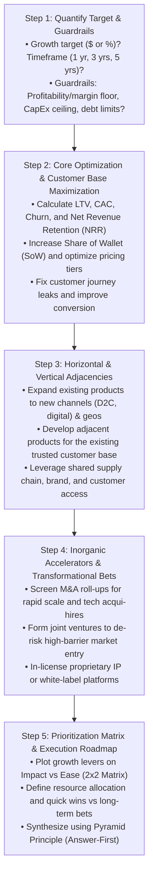
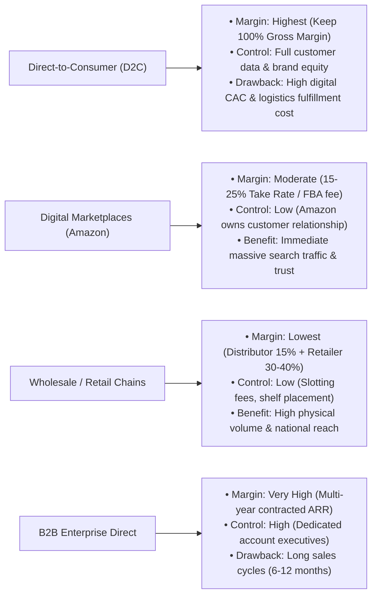
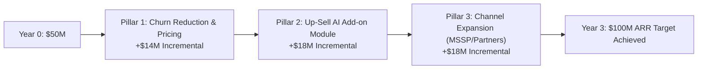

# Growth Strategy & Scale Optimization Case Playbook

## 1. Executive Summary & Diagnostic Philosophy

Growth strategy cases ask candidates to help a client expand revenue, capture market share, or scale into new horizons. Top-tier consulting firms (McKinsey, BCG, Bain) assess whether a candidate can design a **value-accretive growth agenda** rather than merely listing unprioritized revenue ideas.

The governing equation for sustainable commercial growth is:

$$\text{Revenue Growth } (\Delta R) = \Delta \text{Organic Revenue} + \Delta \text{Inorganic Revenue}$$

Where Organic Revenue is deconstructed through customer unit dynamics:

$$\text{Organic Revenue} = \left[ N_{\text{existing}} \times (1 - \text{Churn}) \times \text{ARPU}_{\text{expanded}} \right] + \left[ N_{\text{new acquired}} \times \text{ARPU}_{\text{initial}} \right]$$

### The Three Diagnostic Commandments
1. **Always protect and optimize the core before pursuing risky diversification.** Bain's *Profit from the Core* methodology shows that 80%+ of sustainable growth comes from maximizing the core business rather than launching speculative new ventures.
2. **Growth must exceed the Cost of Capital ($ROIC > WACC$).** Unprofitable growth ("buying revenue" at negative unit economics or high CAC) destroys enterprise value.
3. **Structure using the Casing-Adapted Ansoff Matrix.** Segment ideas into (1) Existing Products in Existing Markets (Penetration), (2) New Products for Existing Customers (Cross-sell/Adjacency), (3) Existing Products to New Markets/Channels (Expansion), and (4) New Products in New Markets (Diversification).

---

## 2. Master Growth Strategy Issue Tree

The following MECE issue tree deconstructs corporate growth into organic engines and inorganic accelerators.

```mermaid
graph TD
    Root["Growth Strategy: Deliver $X Target Growth"] --> Org["1. Organic Growth"]
    Root --> Inorg["2. Inorganic Growth"]

    Org --> Core["A. Existing Markets & Core (Penetration)"]
    Org --> NewProd["B. New Products / Services (Product Dev)"]
    Org --> NewMkt["C. New Markets & Channels (Market Dev)"]
    Org --> Divers["D. Unrelated Diversification"]

    Core --> Retain["Churn Reduction & Retention"]
    Core --> UpSell["Up-sell, Cross-sell & Share of Wallet (SoW)"]
    Core --> PricingOpt["Price Realization & Tiered Monetization"]
    Core --> WinShare["Customer Acquisition & Competitor Steal"]

    NewProd --> LineExt["Product Line Extensions & Flanker SKUs"]
    NewProd --> Adjacent["Adjacent Value-Added Services (e.g., SaaS + Services)"]
    NewProd --> PremiumTier["Premium / Enterprise Tier Creation"]
    NewProd --> Bundling["Multi-Product Bundling & Ecosystems"]

    NewMkt --> GeoExp["Geographic Expansion (Domestic & International)"]
    NewMkt --> SegExp["New Customer Segments (e.g., B2C to B2B / SMB to Enterprise)"]
    NewMkt --> ChanExp["Channel Expansion (D2C, Amazon, Distributor Network)"]

    Divers --> VertInteg["Vertical Integration (Backward / Forward)"]
    Divers --> WhiteSpace["New Unrelated Market Incubation"]

    Inorg --> MA["Mergers & Acquisitions (Target Acquisition)"]
    Inorg --> JV["Joint Ventures & Strategic Alliances"]
    Inorg --> Minority["Minority Stakes & Corporate Venture Capital"]
    Inorg --> LicensingIn["In-Licensing & IP Franchising"]
```



---

## 3. Step-by-Step Diagnostic Workflow



---

## 4. Deep-Dive Sub-Modules & Formulations

### 4.1. The Ansoff Matrix in Consulting Casing

| Quadrant | Strategy | Typical Levers | Risk Profile | Expected Horizon |
|---|---|---|:---:|:---:|
| **Existing Markets $\times$ Existing Products** | **Market Penetration** | • Steal competitor share via targeted marketing<br/>• Increase purchase frequency (loyalty programs)<br/>• Reduce churn rate & increase basket size | Lowest | 0–12 months |
| **Existing Markets $\times$ New Products** | **Product Development** | • Add complementary SKUs (e.g., Apple launching Watch)<br/>• Introduce premium "Pro" or budget "Lite" tiers<br/>• Develop maintenance/aftermarket subscriptions | Medium | 1–2 years |
| **New Markets $\times$ Existing Products** | **Market Development** | • Geographic expansion (new cities/countries)<br/>• Pivot to B2B enterprise sales<br/>• Open digital direct-to-consumer (D2C) channels | Medium | 1–3 years |
| **New Markets $\times$ New Products** | **Diversification** | • Build or buy unrelated businesses<br/>• Full vertical integration (e.g., battery plant for EV) | Highest | 3–5+ years |

---

### 4.2. Customer Unit Economics & Growth Formulas

$$\text{Customer Lifetime Value (LTV)} = \frac{\text{Average Revenue Per User (ARPU)} \times \text{Gross Margin (\%)}}{\text{Customer Churn Rate}}$$

$$\text{Customer Acquisition Cost (CAC)} = \frac{\text{Total Sales \& Marketing Spend in Period}}{\text{Total New Customers Acquired in Period}}$$

$$\text{LTV : CAC Ratio} \ge 3.0 \quad (\text{Benchmark: } < 1.0 = \text{Value Destroying}, > 5.0 = \text{Under-investing in Growth})$$

$$\text{CAC Payback Period (Months)} = \frac{\text{CAC}}{\text{Monthly ARPU} \times \text{Gross Margin (\%)}} \le 12 \text{ Months}$$

$$\text{Net Revenue Retention (NRR)} = \frac{\text{Starting ARR} + \text{Expansion ARR} - \text{Contraction ARR} - \text{Churned ARR}}{\text{Starting ARR}} \times 100\%$$

$$\text{Share of Wallet (SoW)} = \frac{\text{Client's Spend with Our Company}}{\text{Client's Total Annual Category Budget}}$$

---

### 4.3. Channel Expansion Strategy (Omnichannel Trade-Offs)



---

## 5. Probing Questions Protocol & Diagnostic Traps

### High-Signal vs Low-Signal Questions

| Stage | Weak / Generic Question ❌ | Top 1% MBB Probing Question ✅ |
|---|---|---|
| **Clarification** | "How much do they want to grow?" | "What is the quantified growth target (e.g., $50M incremental revenue), over what time horizon (e.g., 3 years), and are there explicit profitability or CapEx constraints?" |
| **Core Base** | "Are sales doing well?" | "What is our current customer retention rate and Share of Wallet among top accounts, and what proportion of historical growth came from existing accounts vs new logos?" |
| **Capacity** | "Can we make more products?" | "Is our manufacturing and distribution infrastructure currently operating at full capacity utilization, or do we have available headroom to scale volume without major CapEx?" |
| **Competition** | "Who is growing faster?" | "Are we losing market share to specific competitors, and what are the primary customer churn reasons (e.g., pricing, feature gap, delivery lead times)?" |

---

## 6. Quantitative Walkthrough: Multi-Pillar Growth Bridge ($50M to $100M in 3 Years)

### Case Scenario: CloudShield Cybersecurity
CloudShield currently generates **$50M ARR**. The Board has mandated reaching **$100M ARR within 3 years (+100% growth / ~26% CAGR)** while maintaining a minimum **20% EBITDA margin**.

#### Current Baseline Metrics:
* **Customer Base:** 500 Enterprise accounts.
* **Average Selling Price (ARPU):** $100,000 / year.
* **Annual Churn Rate:** 10% (50 accounts lost / year = $5M revenue lost).
* **Current New Customer Acquisition:** 100 new accounts / year at $100k = +$10M gross new ARR.
* **Net Organic Growth at Status Quo:** $+\$10\text{M (new)} - \$5\text{M (churn)} = +\$5\text{M/year}$ ($10\%$ growth $\rightarrow$ reaches only $\$65\text{M}$ in 3 years $\rightarrow$ **$35M Growth Gap**).

#### Formulating a 3-Pillar Growth Bridge:



#### Step-by-Step Mathematical Modeling:

```
1. Pillar 1: Churn Reduction + Price Optimization (Core Penetration)
   • Churn Reduction: Reduce churn from 10% to 5% via customer success squads.
     Saves 25 enterprise accounts/year = +$2.5M/yr saved × 3 yrs = +$7.5M cumulative.
   • Price Tiering: Implement 5% annual price escalation on renewed contracts.
     $50M base × 5% × 3 yrs (compounded) = +$6.5M.
   • Total Pillar 1 Contribution = $7.5M + $6.5M = +$14.0M ARR.

2. Pillar 2: Launch AI Threat Detection Add-on (Product Development / Cross-Sell)
   • Cross-sell new module at $30,000/year to existing enterprise customer base.
   • Penetration target: 40% of 600 active accounts by Year 3 = 240 accounts.
   • Total Pillar 2 Contribution = 240 accounts × $30,000 = +$7.2M ARR in Yr 2, scaling to +$18.0M ARR by Yr 3 (including new accounts).

3. Pillar 3: Managed Security Service Provider (MSSP) Channel (Market Development)
   • Partner with 10 regional IT distributors / MSSPs to target mid-market firms ($25k package).
   • Volume: 240 mid-market clients/yr × $25k = $6.0M/yr × 3 yrs scaling = +$18.0M ARR by Year 3.

Growth Bridge Reconciliation:
• Baseline Projected Year 3 ARR (Status Quo): $65.0M
• Additional Growth Levers:
  + Pillar 1 (Retention & Pricing):    +$14.0M
  + Pillar 2 (AI Cross-sell Module):   +$18.0M
  + Pillar 3 (MSSP Channel Expansion): +$18.0M
  - Overlap / Execution Haircut (25%): -$15.0M
• Final Projected Year 3 ARR: $65.0M + $50.0M - $15.0M = $100.0M ARR.
```

---

## 7. Golden Interview Dialogue & Synthesis

### Candidate Opening & Structure

> **Interviewer:** "Our client is a European activewear brand with €200M in revenue, primarily sold through department stores. Sales growth has flattened to 2% annually. The board wants a roadmap to double revenue to €400M within 4 years. How would you approach this?"
>
> **Candidate:** "Doubling revenue from €200M to €400M in 4 years requires an 18.9% CAGR—a major acceleration from their current 2% baseline. To structure an actionable, risk-adjusted growth roadmap, I will evaluate opportunities across four sequential horizons:
> 
> 1. **Core Optimization & Wholesale Channel Productivity:** Maximizing revenue from current department store accounts by improving sell-through rates, optimizing visual merchandising, and pruning underperforming SKUs to lift same-store sales.
> 2. **Direct-to-Consumer (D2C) & Omnichannel Expansion:** Building an e-commerce D2C engine and flagship experience stores to capture full retail gross margin (60–70% vs 35% wholesale) and establish direct consumer relationships.
> 3. **Product Category Adjacencies & Line Extensions:** Leveraging our brand equity to enter fast-growing adjacent categories such as athleisure footwear, yoga accessories, or technical outerwear.
> 4. **Geographic & Channel Development (International & Marketplace):** Entering high-growth European and Middle Eastern markets via third-party digital platforms (Zalando, ASOS) and localized distributor partnerships.
>
> To prioritize, I'd like to look first at their current channel mix and gross margin profile across product categories."

---

### Executive Synthesis (Pyramid Principle Recommendation)

> **Candidate Final Recommendation:**
>
> "The Board should approve a **three-pillar growth roadmap to reach €410M in revenue by Year 4 (+€210M incremental ARR)** while expanding EBITDA margin from 12% to 16.5%:
>
> 1. **Scale D2C E-Commerce & App Ecosystem (+€110M):** Transition from pure wholesale to an omnichannel model by scaling a high-converting digital storefront and launching a mobile loyalty app, lifting D2C from 5% to 35% of total revenue mix.
> 2. **Enter Technical Running Footwear (+€60M):** Partner with an established contract manufacturer to launch a high-performance running shoe line, targeting a 4% market share in our primary European markets.
> 3. **Optimize Wholesale Productivity & International Distribution (+€40M):** Expand into the UK and Nordic markets via premium retail partnerships while introducing automated inventory replenishment with existing department stores to cut stock-outs by 50%.
>
> **Key Execution Risks & Mitigations:**
> * *Channel Conflict with Department Stores:* Avoid cannibalizing wholesale partners by offering exclusive colors/styles in department stores while reserving performance technical collections for D2C.
> * *High Digital Customer Acquisition Cost (CAC):* Focus on organic community-driven marketing (run clubs, fitness influencer ambassadors) to keep CAC:LTV below 1:3.5.
>
> **Next Steps (First 60 Days):** Recruit a VP of Digital/D2C, greenlight the footwear technical prototype, and initiate digital platform RFP."

---

## 8. Common Pitfalls & Landmines Matrix

| Pitfall / Landmine | Why Candidates Fail | How Top 1% MBB Candidates Execute |
|---|---|---|
| **Unconstrained Brainstorming** | Listing 20 random ideas (e.g., "sell in China", "launch makeup", "do metaverse") without strategic rationale. | Anchor in the Ansoff Matrix; evaluate ideas against Core Competency, CapEx, and Ease vs Impact. |
| **Ignoring Channel Conflict** | Proposing an aggressive D2C price cut that causes traditional retail partners to delist the brand. | Explicitly design channel differentiation (exclusive SKUs, differentiated price points, co-marketing). |
| **Overlooking Churn Dynamics** | Pouring all marketing dollars into acquiring new customers while the leaky bucket (churn) drains the business. | Always analyze Retention and Net Revenue Retention (NRR) before pouring capital into top-of-funnel acquisition. |
| **Forgetting Capacity Constraints** | Proposing a 5x volume increase without checking factory floor space, supply chain lead times, or working capital. | Always verify plant capacity utilization and supply chain scalability before recommending volume jumps. |
| **Un-sized Growth Levers** | Presenting recommendations without attributing specific dollar targets to each pillar. | Construct a quantified Growth Bridge showing exactly how each lever adds up to the client's growth target. |
