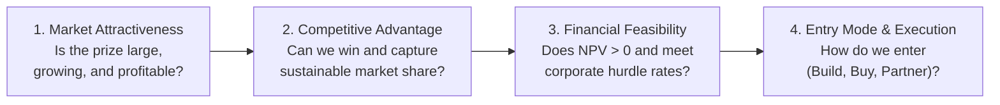
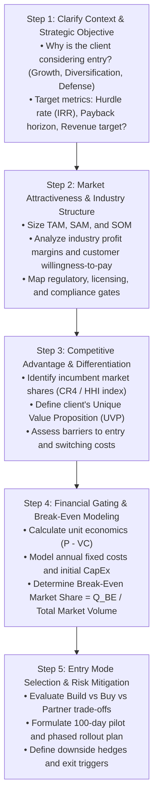
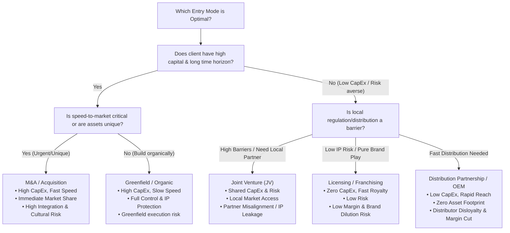

# Market Entry Strategy & Opportunity Assessment Playbook

## 1. Executive Summary & Diagnostic Philosophy

Market entry cases test a candidate's ability to evaluate whether a company should expand into a new geography, product vertical, or customer segment, and if so, determine the optimal business model, entry mode, and rollout timeline.

A complete market entry evaluation answers four fundamental gating questions in sequence:



### The Three Diagnostic Commandments
1. **Never evaluate entry modes before validating market attractiveness and competitive feasibility.** Selecting between M&A or Greenfield is meaningless if the underlying market has negative unit economics or insurmountable regulatory barriers.
2. **Always calculate the 'Break-Even Market Share'.** The ultimate test of feasibility in an MBB interview is calculating what percentage of the total market the client must capture to break even, and stress-testing whether that share is commercially realistic against entrenched incumbents.
3. **Account for competitor reaction functions.** Incumbents will not remain passive. Your entry strategy must anticipate whether incumbents will trigger a price war, lock up distribution contracts, or launch flanker brands.

---

## 2. Master Market Entry Issue Tree

The following MECE issue tree details the four core pillars required to build an MBB-caliber market entry case structure.

```mermaid
graph TD
    Root["Market Entry Decision: Enter vs Do Not Enter"] --> Mkt["1. Market Attractiveness"]
    Root --> Comp["2. Competitive Dynamics & Moats"]
    Root --> Fit["3. Capabilities & Strategic Fit"]
    Root --> Econ["4. Financial & Economic Feasibility"]
    Root --> Mode["5. Entry Mode & Implementation"]

    Mkt --> Size["Market Size & Sizing Layers (TAM / SAM / SOM)"]
    Mkt --> Growth["Historical & Forecast Growth (CAGR)"]
    Mkt --> ProfitPool["Industry Profitability & Margin Pool"]
    Mkt --> Macro["Macro & Demographic Tailwinds"]
    Mkt --> Reg["Regulatory, FDI, & Tariff Environment"]

    Comp --> Structure["Market Structure (Monopoly, Oligopoly, Fragmented)"]
    Comp --> Incumbents["Incumbent Strengths (Brand, Moats, Scale)"]
    Comp --> Barriers["Barriers to Entry (CapEx, IP, Network Effects)"]
    Comp --> Reaction["Competitor Retaliation (Price War, Exclusive Contracts)"]

    Fit --> CoreComp["Core Competency & Product Transferability"]
    Fit --> Brand["Brand Equity & Local Consumer Perception"]
    Fit --> Channel["Distribution & Supply Chain Synergy"]
    Fit --> Org["Organizational Bandwidth & Talent"]

    Econ --> Capex["Initial Capital Investment (CapEx)"]
    Econ --> Opex["Operating Economics & Unit Contribution"]
    Econ --> BEMktShare["Break-Even Market Share (%)"]
    Econ --> Returns["NPV, IRR, & Payback Period"]

    Mode --> Build["Greenfield (Build / Organic)"]
    Mode --> Buy["M&A / Acquisition (Inorganic)"]
    Mode --> Partner["Joint Venture / Consortium"]
    Mode --> License["Licensing / Franchising / White-Label"]
    Mode --> Dist["Third-Party Distribution / OEM"]
```



---

## 3. Step-by-Step Diagnostic Workflow



---

## 4. Deep-Dive Sub-Modules & Formulations

### 4.1. Market Sizing & Attractiveness Metrics

$$\text{TAM (Total Addressable Market)} = \text{Total Potential Customers in Geography} \times \text{Usage Frequency} \times \text{Average Selling Price (ASP)}$$

$$\text{SAM (Serviceable Addressable Market)} = \text{TAM} \times \text{Target Segment Share (\%)} \times \text{Geographic / Channel Reach (\%)} $$

$$\text{SOM (Serviceable Obtainable Market)} = \text{SAM} \times \text{Realistic Target Market Share (\%)}$$

$$\text{CAGR (Compound Annual Growth Rate)} = \left( \frac{\text{Market Size}_{t+n}}{\text{Market Size}_t} \right)^{\frac{1}{n}} - 1$$

$$\text{Industry Profit Pool} = \sum_{j=1}^{m} \left( \text{Revenue}_j \times \text{EBITDA Margin}_j \right)$$

* *Key Takeaway:* A high-growth TAM is not attractive if the industry profit pool is concentrated entirely in the hands of entrenched suppliers (e.g., airline manufacturing) or if price erosion outpaces volume growth.

---

### 4.2. Competitive Dynamics & Moats (Porter's Five Forces in Casing)

| Force | Case Assessment Lens | Red Flags (Do Not Enter) |
|---|---|---|
| **Rivalry Among Existing Competitors** | • Top-4 Concentration Ratio ($CR_4 > 80\%$ vs Fragmented)<br/>• Price competition intensity<br/>• Industry exit barriers | High fixed costs + low product differentiation $\rightarrow$ destructive price wars. |
| **Threat of New Entrants** | • Capital requirements (CapEx)<br/>• Economies of scale & learning curve<br/>• Intellectual property / patents | Zero barriers allow rapid copycats, driving margins to zero. |
| **Bargaining Power of Suppliers** | • Supplier concentration<br/>• Availability of substitute raw materials<br/>• Switching costs between suppliers | Single-source supplier holds critical IP or commodity bottleneck. |
| **Bargaining Power of Buyers** | • Customer concentration (e.g., Walmart, Apple)<br/>• Buyer price sensitivity & switching costs<br/>• Backward integration threat | A few large buyers demand deep margin concessions. |
| **Threat of Substitutes** | • Relative price-performance of substitutes<br/>• Customer propensity to substitute | Tech disruption or regulatory ban renders category obsolete. |

---

### 4.3. Financial & Economic Feasibility Formulations

$$\text{Net Present Value (NPV)} = \sum_{t=1}^{T} \frac{\text{Free Cash Flow}_t}{(1 + r)^t} - \text{Initial CapEx}$$

$$\text{Payback Period} = \frac{\text{Initial CapEx}}{\text{Annual Net Operating Cash Flow}}$$

$$\text{Break-Even Volume } (Q_{\text{BE}}) = \frac{\text{Annual Fixed Operating Costs} + \text{Annualized CapEx Depreciation}}{P - \text{Variable Cost per Unit}}$$

$$\text{Break-Even Market Share } (\text{MS}_{\text{BE}}) = \frac{Q_{\text{BE}}}{\text{Total Addressable Market Volume in Units}}$$

* *The 5% Rule of Thumb:* If the required Break-Even Market Share in Year 1 is $> 15\text{–}20\%$ in an established, non-growing oligopoly, the entry strategy is commercially unviable unless backed by transformational technological disruption or massive M&A.

---

### 4.4. Entry Mode Evaluation Framework



#### Entry Mode Trade-off Matrix

| Entry Mode | Speed to Market | Capital Requirement | Control & Governance | Risk Level | Margin Retention | Primary Failure Mode |
|---|:---:|:---:|:---:|:---:|:---:|---|
| **Greenfield (Organic)** | Slow (2–4 yrs) | High | Full (100%) | High | Maximum | Permitting delays, lack of local brand awareness |
| **M&A (Acquisition)** | Fast (6–12 mos) | Highest | Full (100%) | Medium-High | High | Overpayment / post-merger integration failure |
| **Joint Venture (JV)** | Moderate (1–2 yrs)| Shared | Shared (50/50) | Medium | Moderate | Governance deadlock, IP theft, strategy divergence |
| **Licensing / Franchise**| Very Fast (<6 mos) | Lowest | Low | Lowest | Low (Royalty) | Brand dilution, franchisee quality violations |
| **Distribution / 3PL** | Immediate (<3 mos)| Negligible | Very Low | Low | Low-Moderate | Distributor prioritizes competitor products |

---

## 5. Probing Questions Protocol & Diagnostic Traps

### High-Signal vs Low-Signal Questions

| Stage | Weak / Generic Question ❌ | Top 1% MBB Probing Question ✅ |
|---|---|---|
| **Clarification** | "Why do they want to enter this market?" | "What is the client's primary objective—is it hitting a specific revenue/profit target (e.g., $100M in 3 years), achieving a strategic moat, or establishing a defensive hedge against a competitor?" |
| **Market Size** | "How big is the market?" | "What is the current TAM in dollar and volume terms, and how has the market grown over the past 3-5 years across premium vs mass segments?" |
| **Competition** | "Who are the competitors?" | "What is the market concentration among the top 3 incumbents, and do they compete primarily on price, proprietary technology, or exclusive distribution agreements?" |
| **Financials** | "What are the costs?" | "What are the anticipated unit economics in the new market—specifically price per unit, variable production/landing cost, and the required upfront CapEx and annual fixed overhead?" |

---

## 6. Quantitative Walkthrough: Greenfield vs. M&A vs. JV Decision

### Case Scenario: BioHealth Global (US Pharma Entering Brazil)
BioHealth produces a specialized injectable biologic for diabetes.
* **Brazilian TAM:** $500\text{M}$ annually, growing at $12\%$ CAGR.
* **Pricing & Economics:** Selling price = $\$100$ per vial. Variable manufacturing + import landing cost = $\$40$ per vial (Unit Contribution = $\$60$).
* **Corporate Hurdle:** Minimum 3-year cumulative operating profit of $\$30\text{M}$ to justify entry.

#### Evaluating Three Entry Options:

```
Option A: Greenfield (Build Local Subsidiary & Sales Force)
• Upfront CapEx: $20M
• Annual Fixed Costs (Overhead + Regulatory Compliance): $10M/yr
• Projected Market Share: Year 1: 2% ($10M rev = 100k units)
                         Year 2: 6% ($30M rev = 300k units)
                         Year 3: 12% ($60M rev = 600k units)

Option B: Acquisition of Local Player (Farmaco Brazil)
• Acquisition Cost: $45M upfront
• Farmaco Current Volume: 400k units/yr (8% market share)
• With BioHealth Product: Volume grows to 500k (Yr 1), 600k (Yr 2), 700k (Yr 3)
• Annual Fixed Costs of acquired entity: $12M/yr

Option C: 50/50 Joint Venture with Established Distributor (RedeMed)
• Upfront CapEx: $5M (shared investment)
• Annual Fixed Costs: $4M/yr
• Profit Sharing: 50% of Net Operating Profit to BioHealth
• Projected Volume: 300k units (Yr 1), 500k units (Yr 2), 600k units (Yr 3)
```

#### Step-by-Step Financial Arithmetic:

```
1. Option A (Greenfield):
   • Year 1 Contribution: 100k × $60 = $6.0M. Net = $6.0M - $10M = -$4.0M
   • Year 2 Contribution: 300k × $60 = $18.0M. Net = $18.0M - $10M = +$8.0M
   • Year 3 Contribution: 600k × $60 = $36.0M. Net = $36.0M - $10M = +$26.0M
   • 3-Year Cumulative Operating Profit = (-$4.0M) + $8.0M + $26.0M = +$30.0M
   • Net Cash Flow after $20M CapEx = $30.0M - $20.0M = +$10.0M.

2. Option B (Acquisition):
   • Year 1 Contribution: 500k × $60 = $30.0M. Net = $30.0M - $12M = +$18.0M
   • Year 2 Contribution: 600k × $60 = $36.0M. Net = $36.0M - $12M = +$24.0M
   • Year 3 Contribution: 700k × $60 = $42.0M. Net = $42.0M - $12M = +$30.0M
   • 3-Year Cumulative Operating Profit = $18.0M + $24.0M + $30.0M = +$72.0M
   • Net Cash Flow after $45M Acquisition = $72.0M - $45.0M = +$27.0M.

3. Option C (Joint Venture):
   • Year 1 Gross Profit: (300k × $60) - $4M = $18M - $4M = $14M. BioHealth 50% Share = $7.0M
   • Year 2 Gross Profit: (500k × $60) - $4M = $30M - $4M = $26M. BioHealth 50% Share = $13.0M
   • Year 3 Gross Profit: (600k × $60) - $4M = $36M - $4M = $32M. BioHealth 50% Share = $16.0M
   • 3-Year Cumulative Operating Profit = $7.0M + $13.0M + $16.0M = +$36.0M
   • Net Cash Flow after $5M CapEx = $36.0M - $5.0M = +$31.0M.
```

#### Analytical Synthesis:
* **Option C (Joint Venture)** yields the highest 3-year Net Cash Flow ($31.0M) and lowest downside risk ($5M CapEx vs $45M for M&A).
* **Option B (M&A)** generates the highest absolute operating profit ($72M), but requires a $45M cash outlay and carries ANVISA regulatory integration risk.
* **Recommendation:** Enter via **Joint Venture with RedeMed**, with a contractual buyout clause at Year 4 once regulatory approval and distributor footprint are secured.

---

## 7. Golden Interview Dialogue & Synthesis

### Candidate Opening & Structure

> **Interviewer:** "Our client is a German premium coffee machine manufacturer. They want to know whether they should enter the Indian consumer market and how."
>
> **Candidate:** "To advise the CEO on whether and how to enter the Indian market, I will evaluate the opportunity across four structured pillars:
> 
> 1. **Market Attractiveness & Addressable Prize:** I will size the addressable market for premium espresso machines in India, examining the growth CAGR, price points, and whether the target demographic (upper-middle class urban households / specialty cafes) is large enough to support our business model.
> 2. **Competitive Landscape & Moats:** I will assess current incumbents (e.g., De'Longhi, Nespresso, Philips), their pricing, customer brand loyalty, and after-sales service networks, to determine our client's unique value proposition.
> 3. **Financial Viability & Unit Economics:** I will calculate our landing cost in India—factoring in import customs duties (often 30–40% on luxury appliances), distribution margins, and marketing CAC—to determine our break-even unit volume and market share.
> 4. **Optimal Entry Mode & Go-to-Market:** If the numbers work, I will compare an organic direct subsidiary vs an exclusive partnership with a luxury retail conglomerate (e.g., Tata CliQ Luxury / Reliance Brands) to balance speed-to-market against margin retention.
>
> To begin, do we have an estimate of the current premium coffee machine market size in India?"

---

### Executive Synthesis (Answer-First Recommendation)

> **Candidate Final Recommendation:**
>
> "The CEO should **enter the Indian market via an exclusive distribution partnership with a premium luxury retailer**, targeting **€18M in revenue and €3.2M in operating profit by Year 3**:
>
> 1. **Attractive, Under-Penetrated Niche:** The premium coffee machine segment in India is €85M, growing at 22% CAGR, driven by rapid urbanization and specialty coffee consumption.
> 2. **Clear Competitive Differentiation:** Incumbents are split between low-end pod machines and commercial-grade barista systems. Our bean-to-cup automation fills an unserved €600–€1,200 sweet spot with a 38% contribution margin.
> 3. **Asset-Light Entry Mode (Exclusive Master Distribution):** Partnering with a top-tier retail conglomerate avoids €12M in upfront store CapEx, circumvents 35% foreign direct investment (FDI) single-brand retail compliance hurdles, and leverages their existing 120-city service and logistics infrastructure.
>
> **Key Risks & Mitigations:**
> * *High Import Tariffs (33% Customs Duty):* Explore Semi-Knocked-Down (SKD) local assembly in Year 3 to reduce duties by 15 percentage points.
> * *Water Hardness / Machine Breakdown:* Hard water in major Indian metros causes rapid boiler scaling. Mitigate by bundling a proprietary water-softening filter cartridge with every machine sold.
>
> **Next Steps:** Finalize commercial terms with the top two distributor candidates and run a 100-machine pilot in Mumbai and Delhi within 90 days."

---

## 8. Common Pitfalls & Landmines Matrix

| Pitfall / Landmine | Why Candidates Fail | How Top 1% MBB Candidates Execute |
|---|---|---|
| **The TAM Illusion** | Assuming 1.4B people in India or 330M in the US will all buy the client's $1,000 product. | Strictly funnel from TAM down to SAM (affordability + interest) and SOM (realistic accessible volume). |
| **Ignoring Import Duties & Taxes** | Assuming gross margin in the home market ($60\%) transfers directly to the target market. | Always ask: "Are there import tariffs, customs duties, local VAT/GST, or local content requirements?" |
| **Treating Greenfield as the Default** | Proposing building factories and retail stores from scratch without considering speed or local regulations. | Benchmark Build vs Buy vs Partner on CapEx, time-to-market, risk, and regulatory barriers. |
| **Omitting Competitor Reaction** | Assuming incumbents with 70% market share will passively let a new entrant take customers. | Explicitly model incumbent response: "If we price at a 20% discount, will the incumbent trigger a price war?" |
| **Forgetting Exit Strategy** | Creating an entry plan without defining failure triggers or capital downside protection. | Include clear milestone gates (e.g., "If 3% market share is not achieved by Month 18, trigger exit/sale"). |
