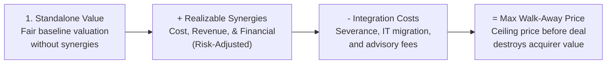
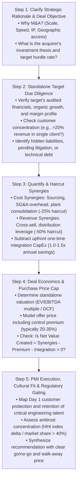
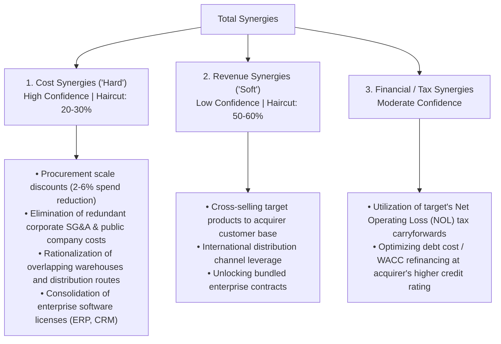

# Mergers & Acquisitions (M&A) Due Diligence Playbook

## 1. Executive Summary & Diagnostic Philosophy

Mergers and Acquisitions (M&A) cases test a candidate's ability to evaluate whether acquiring or merging with a target company creates sustainable shareholder value. Management consulting studies (McKinsey, BCG, Bain) consistently show that **60% to 75% of M&A transactions fail to create economic value**, primarily due to overpayment (the "Winner's Curse"), overestimation of synergies, and botched post-merger integration (PMI).

The core economic condition for value creation in M&A is:

$$\text{Value Created for Acquirer} = \text{PV}(\text{Realizable Net Synergies}) - \text{Acquisition Premium} - \text{Integration Costs} > 0$$

$$\text{Maximum Walk-Away Purchase Price} = \text{Standalone Target Value} + \text{PV}(\text{Realizable Net Synergies}) - \text{Integration Costs}$$



### The Three Diagnostic Commandments
1. **Never evaluate synergies before validating standalone target health.** An acquisition target with hidden debt, customer concentration, or declining core organic sales will drag down the acquirer regardless of synergy models.
2. **Apply realistic execution haircuts to synergies.** In top-tier casing, never assume 100% synergy realization. Apply a **20–30% haircut to hard cost synergies** and a **50–60% haircut to soft revenue synergies**.
3. **Always factor in one-time integration CapEx.** Achieving $10M in annual operational savings typically requires $10M–$15M in upfront severance, IT migration, and contract termination costs (typically 1.0x–1.5x of annual steady-state cost synergies).

---

## 2. Master M&A Issue Tree

The following MECE issue tree deconstructs M&A cases across strategic fit, standalone target due diligence, synergy valuation, deal economics, and integration execution.

```mermaid
graph TD
    Root["M&A Decision: Acquire Target vs Walk Away"] --> Strat["1. Strategic Rationale & Fit"]
    Root --> Target["2. Standalone Target Attractiveness"]
    Root --> Synergies["3. Synergy Valuation & Haircuts"]
    Root --> DealEcon["4. Valuation & Deal Economics"]
    Root --> PMI["5. Post-Merger Integration & Risks"]

    Strat --> Horiz["Scale / Horizontal (Market Share & Consolidation)"]
    Strat --> Vert["Scope / Vertical (Supply Chain & Margin Capture)"]
    Strat --> TechAcq["Capability / IP / Acqui-hire (Technology & Talent)"]
    Strat --> GeoChan["Geographic & Channel Access (New Markets)"]

    Target --> Financials["Financial Health (Revenue Growth, EBITDA %, Free Cash Flow)"]
    Target --> CustBase["Customer Quality (Retention, Churn, Concentration Risk)"]
    Target --> Assets["Asset Quality & IP (Patent Portfolio, Capacity, Tech Debt)"]
    Target --> Mgmt["Management Team & Culture Retention"]

    Synergies --> CostSyn["Cost Synergies (Hard Synergies - High Certainty)"]
    Synergies --> RevSyn["Revenue Synergies (Soft Synergies - Low Certainty)"]
    Synergies --> FinSyn["Financial / Tax Synergies (Capital Structure & Tax Shields)"]

    CostSyn --> ProcScale["Procurement & Sourcing Scale Discounts"]
    CostSyn --> SGACut["SG&A & Corporate Headcount Rationalization"]
    CostSyn --> Footprint["Manufacturing & Real Estate Consolidation"]
    CostSyn --> ITRation["IT Systems & Software License Merging"]

    RevSyn --> CrossSell["Cross-Selling Products to Combined Customer Base"]
    RevSyn --> BundlingPricing["Bundling & Value Pricing Leverage"]
    RevSyn --> NewGeo["Access to Acquirer's Global Distribution Network"]

    DealEcon --> StandaloneVal["Standalone Valuation (DCF, EV/EBITDA, P/E)"]
    DealEcon --> Premium["Acquisition Premium Paid (% Over Market Cap)"]
    DealEcon --> Financing["Financing Structure (Cash vs Debt vs Stock)"]
    DealEcon --> ROICWACC["ROIC vs WACC & EPS Accretion / Dilution"]

    PMI --> Day100["Day 1 & Day 100 Operational Integration Plan"]
    PMI --> OrgCulture["Cultural Integration & Key Talent Retention"]
    PMI --> ITMigration["IT, ERP & Systems Integration Complexity"]
    PMI --> Regulatory["Antitrust Scrutiny & Regulatory Remedy (FTC/DOJ/EC/CCI)"]
```



---

## 3. Step-by-Step Diagnostic Workflow



---

## 4. Deep-Dive Sub-Modules & Formulations

### 4.1. Valuation Methodologies & Deal Metrics

$$\text{Enterprise Value (EV)} = \text{Market Capitalization} + \text{Total Debt} + \text{Preferred Equity} + \text{Minority Interest} - \text{Cash \& Cash Equivalents}$$

$$\text{EV / EBITDA Multiple} = \frac{\text{Enterprise Value}}{\text{Trailing 12-Month EBITDA}}$$

$$\text{Price / Earnings (P/E) Multiple} = \frac{\text{Market Price per Share}}{\text{Earnings per Share (EPS)}}$$

$$\text{Acquisition Premium (\%)} = \frac{\text{Offer Price per Share} - \text{Current Undisturbed Share Price}}{\text{Current Undisturbed Share Price}} \times 100\%$$

* *Standard Multiples Benchmarks:* Mature industrial manufacturing: 6x–10x EV/EBITDA; Healthcare/Pharma: 12x–18x EV/EBITDA; High-Growth SaaS: 8x–15x EV/Revenue.

---

### 4.2. Synergy Breakdown & Haircut Architecture



#### The Net Present Value of Synergies Equation:

$$\text{PV}(\text{Synergies}) = \sum_{t=1}^{\infty} \frac{\text{Annual Post-Tax Net Synergies}_t}{(1 + \text{WACC})^t} - \text{One-Time Integration CapEx}$$

$$\text{In Perpetuity (Steady State)}: \text{PV}(\text{Synergies}) = \frac{\text{Annual Cost Synergies} \times (1 - \text{Tax Rate})}{\text{WACC}} - \text{Integration Costs}$$

---

### 4.3. Post-Merger Integration (PMI) Governance

| PMI Horizon | Focus Area | Critical Deliverables & Key Milestones |
|---|---|---|
| **Pre-Close / Day 0** | Clean Team & Planning | • Establish Integration Management Office (IMO)<br/>• Set up Clean Team for proprietary pricing & customer data analysis |
| **Day 1** | Stability & Continuity | • Seamless payroll & benefits continuity<br/>• Customer communication: Zero disruption guarantee<br/>• Key talent golden handcuffs / retention bonus execution |
| **Day 1 to 100** | Value Capture | • Consolidate combined procurement RFPs (quick-win savings)<br/>• Merge sales territories to eliminate internal commission disputes<br/>• Unified branding & product portfolio roadmaps |
| **Year 1 to 2** | Long-Term Transformation | • IT/ERP migration and single database cutover<br/>• Plant and supply chain physical consolidation<br/>• Unified corporate culture and performance management |

---

### 4.4. Antitrust & Regulatory Scrutiny Framework

Regulators (DOJ/FTC in the US, European Commission in the EU, CCI in India) evaluate M&A under antitrust law to prevent anti-competitive monopoly creation:

$$\text{Herfindahl-Hirschman Index (HHI)} = \sum_{i=1}^{n} s_i^2$$

Where $s_i$ is the market share percentage of firm $i$.
* **Unconcentrated Market:** $\text{HHI} < 1,500$.
* **Moderately Concentrated:** $1,500 \le \text{HHI} \le 2,500$.
* **Highly Concentrated:** $\text{HHI} > 2,500$.
* *Antitrust Red Flag:* If a merger in a highly concentrated market increases HHI by **$> 100\text{–}200$ points**, or if combined market share exceeds **40%**, regulators will likely block the deal or demand substantial structural remedies (e.g., divestiture of overlapping business units).

---

## 5. Probing Questions Protocol & Diagnostic Traps

### High-Signal vs Low-Signal Questions

| Stage | Weak / Generic Question ❌ | Top 1% MBB Probing Question ✅ |
|---|---|---|
| **Strategic Intent** | "Why do they want to buy them?" | "What is the primary investment thesis: is this an in-market scale consolidation to capture cost synergies, or a capability/geographic play to enter new customer verticals?" |
| **Valuation** | "How much are they paying?" | "What is the target's standalone EBITDA, the proposed transaction multiple/premium, and how does that compare to historical trading and precedent transaction multiples?" |
| **Synergy Reality** | "Will there be synergies?" | "What specific cost and revenue synergies have been quantified, what execution haircuts are assumed, and what are the estimated one-time integration costs required to achieve them?" |
| **PMI & Culture** | "Will the employees get along?" | "What are the primary operational risks during integration—specifically IT/ERP system migration, key executive retention, and overlap in customer sales territories?" |

---

## 6. Quantitative Walkthrough: Buy-Side Deal Valuation & Synergy Model

### Case Scenario: Titan Industrial Robotics acquiring Apex Automation
* **Acquirer (Titan):** Global robotics OEM ($2B revenue, 15% EBITDA margin).
* **Target (Apex):** High-growth industrial automation software firm ($100M revenue, 20% EBITDA margin = $20M EBITDA).
* **Deal Terms:**
  * Target Undisturbed Standalone Value = **$200M** (10.0x EV/EBITDA).
  * Target Board demands a **30% Acquisition Premium** $\rightarrow$ Offer Price = **$260M** (Premium = **$60M**).
  * Discount Rate / WACC = **10%**. Corporate Tax Rate = **25%**.

#### Synergy Estimation & Haircuts:
1. **Cost Synergies (Estimated at $10M/year pre-tax):**
   * Redundant corporate SG&A ($4M) + Procurement discounts on hardware components ($6M).
   * Consulting Haircut: Apply **20% risk haircut** $\rightarrow$ Realizable Cost Synergies = $10\text{M} \times 0.80 = \mathbf{\$8.0M/\text{year}}$.
   * After-Tax Annual Cost Synergy = $\$8.0\text{M} \times (1 - 0.25) = \mathbf{\$6.0M/\text{year}}$.
2. **Revenue Synergies (Estimated at $20M incremental revenue at 25% contribution margin = $5M gross profit):**
   * Cross-selling Apex software to Titan's 1,200 enterprise manufacturing clients.
   * Consulting Haircut: Apply **50% risk haircut** $\rightarrow$ Realizable Pre-Tax Revenue Profit = $\$5\text{M} \times 0.50 = \mathbf{\$2.5M/\text{year}}$.
   * After-Tax Annual Revenue Synergy = $\$2.5\text{M} \times (1 - 0.25) = \mathbf{\$1.875M/\text{year}}$.
3. **Total Annual After-Tax Net Synergies:**
   * $\text{Total} = \$6.0\text{M} + \$1.875\text{M} = \mathbf{\$7.875M/\text{year}}$ in steady-state perpetuity.
4. **Upfront Integration Costs:**
   * One-time IT migration and severance cost = **$12.0M** (paid at Year 0).

#### Mathematical Deal Valuation:

```
1. Calculate Present Value (PV) of Realizable Net Synergies:
   PV(Synergies) = (Annual After-Tax Synergies / WACC) - Integration CapEx
   PV(Synergies) = ($7.875M / 0.10) - $12.0M
   PV(Synergies) = $78.75M - $12.0M = $66.75M.

2. Calculate Net Value Created for Acquirer:
   Net Value Created = PV(Synergies) - Acquisition Premium Paid
   Net Value Created = $66.75M - $60.00M = +$6.75M.

3. Maximum Walk-Away Purchase Price:
   Max Price = Standalone Target Value + PV(Synergies)
   Max Price = $200.0M + $66.75M = $266.75M.
```

#### Analytical Synthesis:
* At an offer price of **$260M**, the acquisition is **value-accretive (+ $6.75M in net value created)** even after rigorous risk haircuts.
* However, the margin of safety is narrow ($6.75M buffer). If integration costs exceed $18.75M or cost synergies fall below $7.0M/yr, the deal destroys shareholder value.
* **Negotiation recommendation:** Counter-offer at **$240M** (20% premium) and set $266.75M as the hard walk-away ceiling.

---

## 7. Golden Interview Dialogue & Synthesis

### Candidate Opening & Structure

> **Interviewer:** "Our client is a large US healthcare system with $5B in revenue. They are considering acquiring a regional network of 12 urgent care clinics for $150M. The CEO wants to know if they should proceed with the acquisition."
>
> **Candidate:** "To evaluate whether our client should acquire this urgent care clinic network for $150M, I will structure my due diligence across four critical dimensions:
> 
> 1. **Strategic Rationale & Network Fit:** I will evaluate how acquiring these 12 urgent care clinics supports our client's broader healthcare strategy—specifically as an outpatient referral funnel to feed high-margin complex surgeries and diagnostic imaging into our core tertiary hospitals.
> 2. **Target Standalone Financial Health:** I will analyze the target's standalone historical revenue growth, patient volume per clinic, payer mix (Commercial vs Medicare/Medicaid), and underlying EBITDA margin to ensure the business is viable on its own merits.
> 3. **Synergy Valuation & Integration CapEx:** I will quantify hard operational cost synergies (centralized billing, physician scheduling, consolidated medical supply procurement) and revenue synergies (improved commercial insurer reimbursement rates under our large health system master contracts), applying realistic execution haircuts and subtracting one-time EHR IT integration costs.
> 4. **Deal Economics, Regulatory & PMI Risks:** I will compare the $150M asking price against discounted cash flows and precedent clinic transactions, while assessing FTC healthcare antitrust scrutiny and physician retention risks.
>
> To begin, what is the target clinic network's current annual revenue and EBITDA?"

---

### Executive Synthesis (Pyramid Principle Recommendation)

> **Candidate Final Recommendation:**
>
> "The CEO should **proceed with the acquisition of the urgent care network, but negotiate the purchase price down from $150M to $132M**, capturing **$28M in net present value for the health system**:
>
> 1. **High Strategic Value as Inpatient Feeder:** The 12 clinics serve 180,000 annual patients and will direct an estimated 3,500 high-margin specialty referrals annually to our core hospital network, generating $14M in incremental downstream hospital contribution.
> 2. **Immediate Insurer Rate Uplift ($6M Annual Revenue Synergy):** Urgent care visits currently reimbursed at $110/visit under the target's contracts will re-price to $145/visit under our health system's tier-1 commercial payer master contracts (+32% rate uplift on Day 1).
> 3. **Manageable Cost Synergies & Integration:** We identified $3.5M in annual overhead savings by migrating the clinics to our centralized billing and telemedicine platforms, offset by an $8M upfront Epic EHR integration investment.
>
> **Key Deal Risks & Mitigations:**
> * *Physician Flight:* Urgent care physicians may leave post-acquisition. *Mitigation:* Allocate $4M of the purchase price into a 3-year deferred retention pool for lead clinicians.
> * *FTC Market Concentration:* In two sub-markets, our combined primary care share will exceed 42%. *Mitigation:* Proactively offer to divest two overlapping clinic locations if required by regulators.
>
> **Next Steps:** Complete Phase II financial and legal audit, submit revised $132M offer, and stand up the Joint Integration Office."

---

## 8. Common Pitfalls & Landmines Matrix

| Pitfall / Landmine | Why Candidates Fail | How Top 1% MBB Candidates Execute |
|---|---|---|
| **Ignoring the Premium** | Calculating $20M in synergies and concluding the deal is great, forgetting the buyer paid a $40M premium. | Always subtract the Acquisition Premium and Integration Costs from the PV of Synergies. |
| **Treating All Synergies Equally** | Assuming soft revenue cross-selling is as certain as cutting duplicated CEO salaries. | Apply a strict 20–30% haircut to cost synergies and a 50–60% haircut to revenue synergies. |
| **Overlooking One-Time CapEx** | Assuming cost synergies are free without factoring in severance, lease break fees, and IT integration. | Always model upfront integration costs as 1.0x to 1.5x of annual steady-state cost savings. |
| **Ignoring Cultural & Talent Flight** | Assuming acquired key engineers and sales reps will automatically stay post-deal. | Include key talent retention agreements (golden handcuffs) and cultural integration plans in PMI. |
| **Forgetting Antitrust Gating** | Recommending a mega-merger between #1 and #2 in an oligopoly without evaluating regulatory blockage. | Check HHI index delta and market share concentration thresholds (e.g., >35–40% share triggers scrutiny). |
