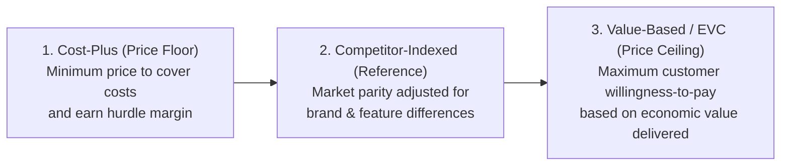
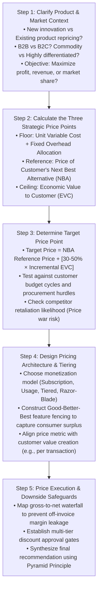
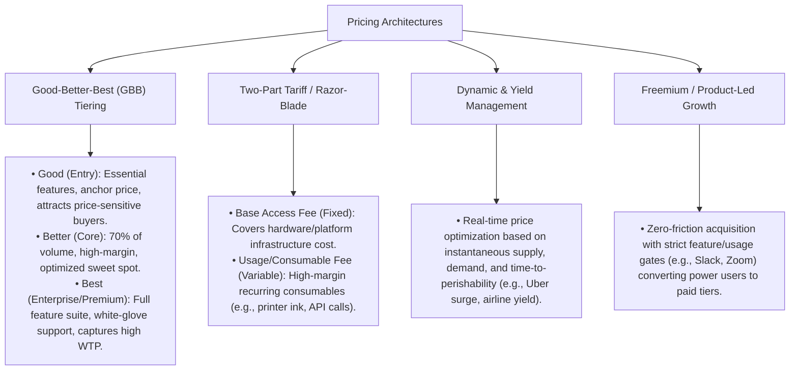

# Pricing Strategy & Monetization Optimization Playbook

## 1. Executive Summary & Diagnostic Philosophy

Pricing is the single most powerful lever of corporate profitability. Studies across McKinsey, BCG, and Simon-Kucher demonstrate that a **1% improvement in price realization yields an 8% to 11% increase in operating profit**—more than 3x the impact of a 1% increase in sales volume and 4x the impact of a 1% reduction in fixed costs.



### The Three Diagnostic Commandments
1. **Always establish the Floor, Reference, and Ceiling.** In any pricing case, calculate (1) the Cost-Plus Floor (lowest tolerable price), (2) the Competitor Benchmark (market reference), and (3) the Economic Value to Customer / EVC (theoretical ceiling). The optimal price always sits between Reference and Ceiling.
2. **Never price based on Cost-Plus when significant customer value is created.** Cost-plus pricing leaves massive consumer surplus on the table and commoditizes proprietary innovation.
3. **Capture a defined share of Economic Value.** Standard consulting practice targets capturing **30% to 50% of the incremental Economic Value to Customer (EVC)**, leaving 50% to 70% as an economic surplus incentive for the customer to adopt.

---

## 2. Master Pricing Strategy Issue Tree

The following MECE issue tree details the strategic pillars, monetization models, and price realization controls required for an MBB case interview.

```mermaid
graph TD
    Root["Pricing Strategy: Determine Optimal Price ($P*)"] --> Pillars["1. The Three Pricing Pillars"]
    Root --> Architecture["2. Pricing Architecture & Models"]
    Root --> Elasticity["3. Elasticity & Margin Trade-offs"]
    Root --> Execution["4. Price Execution & Governance"]

    Pillars --> CostPlus["A. Cost-Plus (Price Floor)"]
    Pillars --> CompIndex["B. Competitor-Indexed (Market Reference)"]
    Pillars --> ValueBased["C. Value-Based / EVC (Price Ceiling)"]

    CostPlus --> UnitVC["Variable Cost per Unit (Marginal Floor)"]
    CostPlus --> AllocatedFC["Fully Absorbed Fixed Overhead"]
    CostPlus --> HurdleMarkup["Target Margin / Cost of Capital Markup"]

    CompIndex --> DirectComp["Direct Substitute Pricing (Head-to-Head)"]
    CompIndex --> IndirectComp["Indirect / Cross-Category Substitutes"]
    CompIndex --> IndexFactor["Premium / Discount Indexing (% Delta)"]

    ValueBased --> RefValue["Reference Price (Next Best Alternative)"]
    ValueBased --> PosDiff["Positive Differentiation (Cost Saved / Rev Gained)"]
    ValueBased --> NegDiff["Negative Differentiation (Switching / Learning Cost)"]
    ValueBased --> SharingRatio["Value Sharing Ratio (α = 30-50% capture)"]

    Architecture --> Tiering["Tiered Packaging (Good-Better-Best)"]
    Architecture --> Dynamic["Dynamic & Surge Pricing (Yield Management)"]
    Architecture --> Freemium["Freemium & Land-and-Expand"]
    Architecture --> TwoPart["Two-Part Tariffs (Base Fee + Usage / Razor-Blade)"]
    Architecture --> Bundling["Pure vs Mixed Bundling"]

    Elasticity --> ElasticityCoeff["Price Elasticity Coefficient (ε)"]
    Elasticity --> BreakevenVolume["Breakeven Volume Delta Formula"]
    Elasticity --> WTPMethods["Willingness-to-Pay (Van Westendorp / Conjoint)"]

    Execution --> Waterfall["Pocket Price Waterfall (Gross to Net)"]
    Execution --> DiscountAuth["Discount Authorization Matrix"]
    Execution --> ContractIndex["Inflation & Commodity Indexation Clauses"]
```



---

## 3. Step-by-Step Diagnostic Workflow



---

## 4. Deep-Dive Sub-Modules & Formulations

### 4.1. The 3 Strategic Pricing Pillars Formulation

#### Pillar 1: Cost-Plus Pricing (The Floor)
$$P_{\text{Floor}} = \text{Variable Cost per Unit (VC)} + \frac{\text{Fixed Overhead Allocation}}{Q_{\text{projected}}} + \text{Target Profit Margin}$$

* *Use Case:* Government cost-plus procurement, heavy customized manufacturing, baseline solvency check.
* *Limitation:* Ignores customer willingness-to-pay and competitor dynamics.

#### Pillar 2: Competitor-Indexed Pricing (Market Reference)
$$P_{\text{Indexed}} = P_{\text{Competitor Reference}} \times (1 + \Delta_{\text{Brand/Feature Adjustment}})$$

* *Use Case:* Crowded, mature markets with close substitutes (e.g., consumer electronics, retail gas, airlines).
* *Limitation:* Can spark a destructive race-to-the-bottom price war if differentiation is not recognized by buyers.

#### Pillar 3: Economic Value to Customer / EVC (The Ceiling)
$$\text{EVC} = \text{Price of Next Best Alternative (NBA)} + \sum \text{Positive Value Drivers} - \sum \text{Negative Value Drivers}$$

$$P^* = P_{\text{NBA}} + \alpha \times \left( \text{EVC} - P_{\text{NBA}} \right) \quad \text{where } \alpha \in [0.30, 0.50]$$

Where:
* **Positive Value Drivers:** Direct cost savings generated, incremental revenue unlocked, downtime eliminated, labor hours saved.
* **Negative Value Drivers:** Switching costs, training/onboarding costs, integration software licenses, risk premium.
* **$\alpha$ (Capture Rate):** The percentage of net economic value captured by the vendor (typically 30%–50% in B2B).

---

### 4.2. Price Elasticity & Margin Trade-Off Mathematics

$$\text{Price Elasticity of Demand } (\epsilon) = \frac{\% \Delta Q}{\% \Delta P} = \frac{\Delta Q / Q}{\Delta P / P} = \frac{\partial Q}{\partial P} \times \frac{P}{Q}$$

$$\text{Lerner Index (Profit-Maximizing Price)}: \frac{P^* - \text{MC}}{P^*} = -\frac{1}{\epsilon} \implies P^* = \text{MC} \times \left( \frac{\epsilon}{1 + \epsilon} \right)$$

#### Break-Even Volume Delta on Price Changes:
When price is changed by $x\% = \frac{\Delta P}{P}$, what is the maximum volume loss $(\% \Delta Q)$ tolerable before total profit declines?

$$\% \Delta Q_{\text{Breakeven}} = -\frac{\% \Delta P}{\text{Gross Margin \%} + \% \Delta P}$$

* *Example:* If a company has a **40% Gross Margin** and implements a **+10% price increase**:
  $$\% \Delta Q_{\text{Breakeven}} = -\frac{10\%}{40\% + 10\%} = -\frac{10\%}{50\%} = -20\%$$
  * *Insight:* The company can lose up to **20% of unit volume** and still make more total gross profit. If volume drops by only 8%, the price increase is massively profit-accretive.

---

### 4.3. Pricing Architectures & Feature Fencing



---

### 4.4. Willingness-to-Pay (WTP) Measurement Tools

1. **Van Westendorp Price Sensitivity Meter (PSM):**
   * Asks 4 survey questions: (1) At what price is it *Too Cheap* (doubt quality)? (2) *Cheap/Bargain*? (3) *Expensive* (would consider)? (4) *Too Expensive* (unacceptable)?
   * The intersection of curves establishes the **Point of Marginal Cheapness (PMC)**, **Optimal Price Point (OPP)**, and **Point of Marginal Expensiveness (PME)**.
2. **Gabor-Granger Technique:**
   * Directly asks respondents purchase probability across a sequential ladder of price points to map the demand curve.
3. **Conjoint Analysis:**
   * Statistically isolates the implicit monetary value (part-worth utility) of individual product features and brand attributes through trade-off choices.

---

## 5. Probing Questions Protocol & Diagnostic Traps

### High-Signal vs Low-Signal Questions

| Stage | Weak / Generic Question ❌ | Top 1% MBB Probing Question ✅ |
|---|---|---|
| **Clarification** | "How much does it cost to make?" | "What is the primary corporate goal for this pricing decision: maximizing short-term gross margin dollars, driving market share penetration, or establishing a premium brand anchor?" |
| **Next Best Alternative** | "What do competitors charge?" | "What is the customer's Next Best Alternative (NBA)—whether an incumbent competitor product or an internal manual process—and what is its total annual cost of ownership?" |
| **Value Quantification** | "Do customers like the product?" | "In economic terms, what quantifiable benefits does our product deliver to the customer over the NBA—specifically in labor cost savings, revenue uplift, defect reduction, or throughput speed?" |
| **Price Metric** | "Is it a monthly subscription?" | "What is the optimal price metric that scales directly with the customer's perceived value (e.g., per user, per gigabyte, per transaction, or percentage of cost savings)?" |

---

## 6. Quantitative Walkthrough: B2B MedTech Innovation (EVC Modeling)

### Case Scenario: PulseTech SurgiSeal
PulseTech has developed **SurgiSeal**, a patented surgical sealant used in cardiovascular surgery that replaces traditional sutures and manual compression.

#### Customer Economics (Hospital Operating Room):
* **Next Best Alternative (NBA):** Traditional Fibrin Sealant + Sutures costing **$300 per surgical procedure**.
* **Direct Value Drivers of SurgiSeal:**
  1. *Operating Room (OR) Time Saved:* SurgiSeal seals in 2 minutes vs 12 minutes for NBA (10 minutes saved per surgery). Hospital OR cost = **$60 per minute** $\rightarrow$ Savings = $10 \text{ min} \times \$60/\text{min} = \mathbf{\$600}$.
  2. *Post-Operative Bleeding Complications:* Complication rate drops from 5% to 1% (4% reduction). Cost to treat a bleeding complication = $5,000 $\rightarrow$ Expected Savings per surgery = $4\% \times \$5,000 = \mathbf{\$200}$.
  3. *ICU Length of Stay:* Reduces average ICU stay by 0.5 days. Hospital ICU cost = $2,000/day $\rightarrow$ Savings = $0.5 \times \$2,000 = \mathbf{\$1,000}$.
* **Negative Value Drivers (Switching Costs):**
  * Requires specialized applicator tool and staff certification amortized at **$100 per surgery**.
* **PulseTech Internal Unit Production Cost:** **$80 per unit**.

#### Step-by-Step EVC Calculation:

```
1. Calculate Total Economic Value to Customer (EVC):
   EVC = NBA Price + Positive Differentials - Negative Differentials
   EVC = $300 (NBA) + [$600 (OR Time) + $200 (Complications) + $1,000 (ICU)] - $100 (Switching)
   EVC = $300 + $1,800 - $100 = $2,000 per surgery.

2. Incremental Value Delivered over NBA:
   ΔValue = EVC - NBA Price = $2,000 - $300 = $1,700 of net new economic value created per surgery.

3. Setting Target Price (Value Sharing):
   • If PulseTech captures α = 40% of the incremental value:
     Price* = NBA Price + (40% × ΔValue)
     Price* = $300 + (0.40 × $1,700) = $300 + $680 = $980 per unit.
   • Hospital Incentive: Hospital captures $1,020 (60%) in net savings per surgery.

4. Profit Margin Analysis for PulseTech:
   • Unit Production Cost = $80
   • Selling Price = $980
   • Gross Margin per Unit = $980 - $80 = $900 per unit (91.8% Gross Margin).
   • (Note: A naive Cost-Plus 50% markup would have priced SurgiSeal at $120, destroying $860 per unit in EBITDA).
```

---

## 7. Golden Interview Dialogue & Synthesis

### Candidate Opening & Structure

> **Interviewer:** "Our client has invented an industrial IoT sensor that detects bearing failure in wind turbines 30 days before catastrophic breakdown. How should they price this device?"
>
> **Candidate:** "To establish the optimal pricing strategy for this industrial IoT solution, I will structure my approach around the three fundamental pricing pillars, followed by pricing architecture and execution:
> 
> 1. **Economic Value to Customer / EVC (The Price Ceiling):** I will quantify the net economic benefit created for a wind farm operator. This includes avoiding catastrophic turbine failure (crane rental, replacement gearbox, lost power generation revenue) minus any sensor installation and maintenance costs.
> 2. **Competitor & Alternative Reference (The Benchmark):** I will assess what wind farm operators currently spend on alternative solutions—such as manual monthly vibration inspections or standard OEM warranty monitoring packages.
> 3. **Cost-Plus & Margin Floor:** I will calculate our unit bill-of-materials and cloud data hosting costs to ensure our minimum gross margin hurdle is cleared.
> 4. **Monetization Metric & Architecture:** Given this is an IoT solution with hardware and ongoing predictive analytics, I will evaluate whether to price as a high upfront CapEx sensor sale or an annual 'Hardware-as-a-Service' (HaaS) predictive maintenance subscription.
>
> Let's begin by quantifying the economic cost of a catastrophic wind turbine failure for the wind farm operator."

---

### Executive Synthesis (Pyramid Principle Recommendation)

> **Candidate Final Recommendation:**
>
> "The client should price the IoT bearing monitoring system as an **annual subscription of $4,800 per turbine per year**, capturing **$14.4M in high-margin ARR across their target 3,000-turbine initial pipeline**:
>
> 1. **Massive Value Creation ($16,000 Annual Savings per Turbine):** An unexpected gearbox failure costs $120,000 and occurs once every 5 years on average ($24,000 annualized risk). Early 30-day detection cuts repair costs to $8,000, creating $16,000 in net annual risk reduction per turbine.
> 2. **30% Value Sharing Captures $4,800 / Year:** Pricing at $4,800/yr delivers a 3.3x ROI to the wind farm operator ($11,200 net savings retained per turbine) while securing an 85% gross margin for our client over our $720/year sensor and cloud cost.
> 3. **Hardware-as-a-Service (HaaS) Lowers Adoption Friction:** Eliminating upfront sensor hardware fees and charging purely as an operational subscription (OpEx) bypasses complex wind farm capital budget approval committees and accelerates closing cycles by 6 months.
>
> **Key Implementation Risks & Mitigations:**
> * *False Alarm Liability:* If the sensor gives a false alarm, the client could face operator pushback. *Mitigation:* Include a contractual service level agreement (SLA) with a 98% accuracy guarantee and a free 60-day trial on 10 turbines.
>
> **Next Steps:** Finalize commercial contract templates with standard OpEx subscription language and initiate the 10-turbine pilot with our lead utility customer."

---

## 8. Common Pitfalls & Landmines Matrix

| Pitfall / Landmine | Why Candidates Fail | How Top 1% MBB Candidates Execute |
|---|---|---|
| **Defaulting to Cost-Plus** | Immediately adding 20% or 30% to unit cost without assessing value created. | Always evaluate Economic Value to Customer (EVC) first for differentiated products. |
| **Giving Away 100% of Value** | Pricing equal to total EVC, leaving zero surplus for the customer to adopt. | Use the 30%–50% value capture rule of thumb to provide a compelling customer ROI. |
| **Ignoring the Price Metric** | Assuming pricing is always a static one-off dollar fee per widget. | Evaluate recurring subscriptions, usage-based metrics, two-part tariffs, and risk-sharing models. |
| **Confusing Margin with Elasticity** | Assuming high gross margin means prices should be raised without checking elasticity $\epsilon$. | Explicitly calculate the break-even volume loss before recommending a price increase. |
| **Ignoring Channel Discounts** | Forgetting that distributors, retailers, and sales reps give discounts that erode pocket price. | Construct a Pocket Price Waterfall (Gross List Price $\rightarrow$ Realized Net Pocket Margin). |
