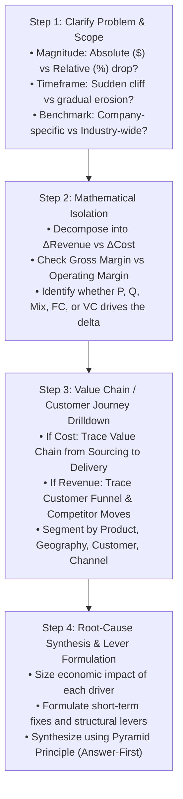

# Profitability & Margin Optimization Case Playbook

## 1. Executive Summary & Diagnostic Philosophy

Profitability cases represent over 40% of all MBB management consulting case interviews. At their core, profitability problems require diagnosing why a firm's bottom line is deteriorating (or failing to match benchmarks) and structuring actionable, high-impact levers to reverse the trend.

The fundamental governing identity of profitability is:

$$\text{Profit } (\Pi) = \text{Revenue } (R) - \text{Total Cost } (TC)$$

$$\text{Profit Margin } (\%) = \frac{R - TC}{R} = 1 - \frac{TC}{R}$$

$$\text{Return on Invested Capital } (\text{ROIC}) = \frac{\text{NOPAT}}{\text{Invested Capital}} = \left( \frac{\text{NOPAT}}{\text{Revenue}} \right) \times \left( \frac{\text{Revenue}}{\text{Invested Capital}} \right) = \text{Operating Margin} \times \text{Capital Turnover}$$

### The Three Diagnostic Commandments
1. **Never jump to solutions before isolating the root-cause driver.** MBB evaluators penalize candidates who suggest "cutting marketing" or "raising prices" before proving whether the issue is price, volume, product mix, fixed costs, or variable unit costs.
2. **Segment early and isolate mathematically.** Blended averages lie. A company's revenue and margin can decline even when individual product margins are healthy due to unfavorable product mix shifts or channel cannibalization.
3. **Distinguish internal operational failure from external market headwinds.** Always isolate whether the margin compression is company-specific (market share loss, cost blowouts) or industry-wide (regulatory shocks, raw material spikes, macroeconomic demand contraction).

---

## 2. Master Profitability Issue Tree

The following MECE issue tree illustrates the complete diagnostic architecture for breaking down profit deterioration across revenue and cost dimensions.

```mermaid
graph TD
    Root["Profit Decline (ΔΠ < 0)"] --> Rev["Revenue Decline (ΔR < 0)"]
    Root --> Cost["Cost Increase (ΔTC > 0)"]

    Rev --> Price["Price Dynamic (ΔP)"]
    Rev --> Vol["Volume Dynamic (ΔQ)"]
    Rev --> Mix["Product / Channel Mix Shift"]

    Price --> ListPrice["List Price Cuts / Discounting"]
    Price --> PromoDeductions["Trade Spend / Rebates / Allowances"]
    Price --> CustWTP["Customer Willingness-to-Pay Erosion"]

    Vol --> ExtVol["External Market Size (TAM Shrinkage)"]
    Vol --> CompVol["Market Share Loss (Competitor Win-Rate)"]
    Vol --> Bottleneck["Internal Capacity / Supply Bottleneck"]

    Mix --> ProdMix["Shift to Lower-Margin SKUs (Down-trading)"]
    Mix --> ChanMix["Shift to High-Cost / Low-Net-Price Channels"]
    Mix --> Cannib["Cannibalization by New Product Launch"]

    Cost --> Fixed["Fixed Costs (FC)"]
    Cost --> Variable["Variable Costs (VC)"]
    Cost --> ValueChain["Value Chain Decomposition"]

    Fixed --> CapexDepr["PP&E / Depreciation / Leasehold"]
    Fixed --> Overhead["SG&A, Corporate Salaries & IT"]
    Fixed --> FixedUtil["Capacity Under-utilization (FC per unit spike)"]

    Variable --> DirectMat["Raw Materials & Direct Sourcing (Cost/Kg)"]
    Variable --> DirectLabor["Direct Labor (Wage Rate × Hours/Unit)"]
    Variable --> FreightDist["Freight, Logistics & Packaging"]
    Variable --> ScrapYield["Scrap Rate, Yield Loss & Rework"]

    ValueChain --> RND["R&D & Product Design"]
    ValueChain --> Inbound["Inbound Logistics & Sourcing"]
    ValueChain --> MfgOps["Manufacturing & Operations"]
    ValueChain --> Outbound["Outbound Logistics & Distribution"]
    ValueChain --> SalesMktg["Sales, Channel & Marketing"]
    ValueChain --> AfterSales["Customer Service & Warranty"]
```

---

## 3. Step-by-Step Diagnostic Workflow

A structured diagnostic workflow ensures that no analytical steps are skipped.

### Phase 1: Clarification & Scoping Questions
* **Quantification:** "By how much have profits declined over what time horizon, and what is our target margin or profit restoration target?"
* **P&L Layer:** "Has the decline manifested at the Gross Margin level (COGS), Operating Margin level (SG&A/distribution), or Net Margin level (tax, interest, one-off charges)?"
* **Industry Benchmark:** "Are competitors experiencing similar margin contraction, or are peers holding margins stable while our client loses profitability?"

### Phase 2: Isolating Revenue vs Cost Drivers
* Deconstruct: $\Delta \Pi = \Delta R - \Delta TC$.
* If Revenue is flat or up while Profit is down, the issue is purely cost inflation or negative mix shift.
* If Cost is flat while Profit is down, the issue is price realization or unit volume drop.
* If both Revenue and Cost are deteriorating, isolate which contributes the larger percentage of the EBITDA compression.

---

## 4. Revenue Diagnostics Deep-Dive

Revenue is decomposed into multi-dimensional drivers:

$$R = \sum_{i=1}^{n} P_i \times Q_i$$

Where $i$ represents individual product SKUs, customer tiers, or distribution channels.

### 4.1. Price vs. Volume Decomposition
* **Price Realization Waterfall:**
  $$\text{Realized Net Price} = \text{List Price} - \text{Off-Invoice Discounts} - \text{Rebates / Cash Discounts} - \text{Freight Allowances} - \text{Returns / Scrap Credits}$$
  * *Diagnostic check:* Did list prices drop, or did customer discounting / promotional intensity surge?
* **Volume Drivers ($Q$):**
  $$Q = \text{Total Market Size (TAM)} \times \text{Market Share (\%)} = \text{TAM} \times \left( \frac{\text{Awareness} \times \text{Consideration} \times \text{Availability} \times \text{Conversion}}{\text{Total Industry Demand}} \right)$$
  * *Market Contraction:* Macro recession, demographic change, regulatory restriction, substitute products.
  * *Market Share Loss:* Competitor new launch, lower competitive pricing, distribution loss (out-of-stock / delisting), product quality degradation.
  * *Capacity Bottlenecks:* Plant downtime, supply chain shortages, labor strikes, logistics truck unavailability.

### 4.2. Product & Channel Mix Shifts (The Simpson's Paradox of Casing)
A classic MBB interview trap occurs when average revenue per unit or gross margin declines despite individual product prices and costs remaining constant.

$$\bar{M} = \sum_{i=1}^{n} w_i \times m_i \quad \text{where } w_i = \frac{Q_i}{\sum Q_k}, \quad m_i = \frac{P_i - VC_i}{P_i}$$

* If $w_{\text{economy}}$ rises from 20% to 60% while $w_{\text{premium}}$ falls from 80% to 40%, the weighted average margin $\bar{M}$ drops severely even if $m_{\text{premium}}$ and $m_{\text{economy}}$ are unchanged.
* **Cannibalization Analysis:** When launching a lower-priced product or opening an online direct-to-consumer (D2C) channel:
  $$\text{Net Revenue Impact} = \left( Q_{\text{new}} \times P_{\text{new}} \right) - \left( c \times Q_{\text{new}} \times P_{\text{old}} \right)$$
  where $c \in [0, 1]$ is the cannibalization rate (fraction of new product sales stolen from the high-margin existing product).

---

## 5. Cost Diagnostics Deep-Dive

To analyze costs with MBB rigor, use two complementary frameworks: **Fixed vs. Variable (Economic/Financial lens)** and **The Value Chain (Operational lens)**.

### 5.1. Fixed vs Variable & Operating Leverage

$$\text{Total Cost} = \text{Fixed Costs (FC)} + \left( \text{Variable Cost per Unit (VC)} \times Q \right)$$

$$\text{Average Cost per Unit (AC)} = \frac{\text{FC}}{Q} + \text{VC}$$

$$\text{Break-even Volume } (Q_{\text{BE}}) = \frac{\text{FC}}{P - \text{VC}} = \frac{\text{FC}}{\text{Unit Contribution Margin}}$$

$$\text{Degree of Operating Leverage (DOL)} = \frac{\% \Delta \text{EBIT}}{\% \Delta \text{Revenue}} = \frac{Q(P - \text{VC})}{Q(P - \text{VC}) - \text{FC}} = \frac{\text{Total Contribution}}{\text{EBIT}}$$

* **High Operating Leverage (High FC, Low VC):** (Airlines, Software, Telecom, Steel, Hotels). A minor 5% drop in volume causes a catastrophic 40%+ drop in EBIT because fixed costs cannot be shed quickly. Average unit cost spikes as fixed overhead is absorbed over fewer units.
* **Low Operating Leverage (Low FC, High VC):** (Retail, Trading, Contract Manufacturing). Costs vary directly with volume; margin percentage remains relatively resilient to volume swings.

### 5.2. Value Chain Cost Decomposition (Operational Drilldown)

| Value Chain Stage | Cost Drivers | Diagnostic Metrics & Levers |
|---|---|---|
| **R&D & Design** | • Product complexity • Number of unique parts/SKUs • Engineering headcount | • Design-to-Value (DtV) • Component standardization • SKU rationalization |
| **Procurement & Sourcing** | • Raw material price index • Supplier concentration • Purchase order lot sizes | • Price vs Consumption variance: $\Delta \text{Spend} = (\Delta P \times Q) + (P \times \Delta Q)$ • Competitive supplier bidding • Hedging raw materials |
| **Manufacturing & Operations** | • Direct labor productivity • Machine uptime / OEE • Scrap & rework rate • Energy / utility consumption | • $\text{OEE} = \text{Availability} \times \text{Performance} \times \text{Quality}$ • Line automation & shift re-balancing • Predictive maintenance |
| **Outbound Logistics** | • Freight cost per ton-km • Fleet capacity utilization • Warehouse rent & storage density • Empty backhaul miles | • Route optimization & multi-drop scheduling • Milk-run consolidation • 3PL contract renegotiation |
| **Sales & Marketing** | • Customer Acquisition Cost (CAC) • Channel commissions & trade spend • Sales rep quota attainment | • CAC-to-LTV ratio • Shift spend to digital / high-ROI channels • Performance-linked distributor incentives |
| **G&A / Overhead** | • Corporate SG&A headcount • IT licenses & ERP maintenance • Legal, compliance, facilities | • Zero-Based Budgeting (ZBB) • Shared services centralization / BPO • Real estate footprint rationalization |

---

## 6. Probing Questions Protocol & Information Traps

### High-Signal vs Low-Signal Questions

| Stage | Weak / Generic Question ❌ | Top 1% MBB Probing Question ✅ |
|---|---|---|
| **Clarification** | "Can you tell me about the company's costs?" | "Has the profitability decline been driven by a drop in gross revenue, an increase in COGS, or higher operating SG&A expenses?" |
| **Benchmarking** | "Are other companies losing money too?" | "How does our client's margin trajectory over the past 24 months compare against direct competitors in the same geography?" |
| **Revenue** | "Did price or volume drop?" | "Breaking down our revenue into price, volume, and product mix: have we seen price concessions, lower unit volumes, or a shift toward lower-margin SKUs?" |
| **Cost** | "What are the company's fixed costs?" | "Looking at our manufacturing cost per unit, how much of the increase stems from raw material input price inflation versus operational efficiency losses such as machine downtime or scrap rate increases?" |

### Common Information Traps to Avoid
1. **The Averages Trap:** "Revenue per unit is down 10%, so we must have cut prices." *(False: List prices may be unchanged, but the mix shifted from 80% Premium SKUs to 80% Economy SKUs).*
2. **The Capacity Absorption Trap:** "Variable cost per unit increased from $10 to $15." *(False: Check if the interviewer included allocated fixed plant overhead in the 'unit cost'. When volume drops, allocated fixed cost per unit rises even if true marginal cost is flat).*
3. **The Supplier Blame Trap:** "Raw material spend rose 20%, so suppliers raised prices." *(False: Raw material market price may have fallen 5%, but factory scrap/defect rates jumped 25%, causing higher material consumption).*

---

## 7. Quantitative Walkthrough: Multi-Product Margin Compression

### Case Scenario: Apex Consumer Appliances
Apex manufactures two types of Blenders: **Pro Series** and **Home Series**. Over the last 2 years, total profit dropped from **$18.0M to $10.8M (-40%)**, despite total unit volume increasing from **1,000,000 units to 1,200,000 units (+20%)**.

#### Historical Performance (Year 1):
* **Pro Series:** 600,000 units (60% mix). Price = $120. Unit Cost = $90 (Unit Contribution = $30).
  * Segment Profit = $600\text{k} \times \$30 = \$18.0\text{M}$.
* **Home Series:** 400,000 units (40% mix). Price = $50. Unit Cost = $50 (Unit Contribution = $0).
  * Segment Profit = $400\text{k} \times \$0 = \$0.0\text{M}$.
* **Total Profit:** $\$18.0\text{M} + \$0 = \$18.0\text{M}$. Total Revenue = $(600\text{k} \times 120) + (400\text{k} \times 50) = \$72\text{M} + \$20\text{M} = \$92\text{M}$. Blended Margin = $19.57\%$.

#### Current Performance (Year 2):
* Total Volume = 1,200,000 units.
* **Mix Shift:** Pro Series dropped to 300,000 units (25% mix). Home Series surged to 900,000 units (75% mix).
* Prices and unit variable costs remained unchanged ($P_{\text{Pro}}=\$120, VC_{\text{Pro}}=\$90; P_{\text{Home}}=\$50, VC_{\text{Home}}=\$50$).
* Fixed Overhead increased by $1.8M due to warehouse expansion for Home Series inventory.

#### Margin Decomposition Math:
1. **Contribution from Pro Series:** $300,000 \times (\$120 - \$90) = \$9.0\text{M}$ (Drop of $\$9.0\text{M}$).
2. **Contribution from Home Series:** $900,000 \times (\$50 - \$50) = \$0.0\text{M}$ (Zero contribution despite 500k extra units).
3. **Total Gross Contribution:** $\$9.0\text{M}$.
4. **Incremental Fixed Costs:** $-\$1.8\text{M}$.
5. **Year 2 Net Profit:** $\$9.0\text{M} - \$1.8\text{M} = \$7.2\text{M}$ (or $\$10.8\text{M}$ before overhead).

#### Strategic Insight:
The 40% profit collapse is 100% explained by:
- **Unfavorable Mix Shift / Cannibalization:** Consumers down-traded from Pro to Home, destroying $9.0M in gross contribution.
- **Fixed Cost Drag:** Expanding warehousing to store zero-margin Home Series units added $1.8M in deadweight cost.
- **Action Plan:** Redesign Home Series bill of materials (target $40 unit cost to achieve 20% margin), re-position Pro Series with exclusive features, and introduce price tiering.

---

## 8. Golden Interview Dialogue & Synthesis

### Candidate Opening & Structure (Top 1% MBB Performance)

> **Interviewer:** "Our client is a national bakery chain with 500 stores. Over the past 18 months, EBITDA has fallen from 15% to 8%, while sales have grown 5%. The CEO wants to know what is driving this compression and how to fix it."
>
> **Candidate:** "This is a classic margin compression problem where top-line revenue growth is decoupling from bottom-line profitability. To diagnose the root cause and deliver a turnaround plan, I will structure my analysis into three consecutive pillars:
> 
> 1. **P&L Margin Layer Isolation:** I will break down our P&L into Gross Margin (ingredient costs, bakery labor, spoilage) versus Operating Overhead (store rent, store labor, logistics, marketing). I want to see exactly which cost head grew faster than our 5% revenue.
> 2. **Revenue & Product Mix Breakdown:** Even with 5% revenue growth, I will investigate whether our product mix has shifted from high-margin specialty artisanal breads to low-margin standard sandwich loaves, or if discounting has eroded our gross price realization.
> 3. **Value Chain & Store-Level Operational Drivers:** Once we identify the troubled cost or product bucket, I will trace the physical operations—from flour/butter procurement and centralized baking to daily store logistics, unsold product waste (shrinkage), and hourly store staffing models.
>
> Before diving into the tree, could you clarify whether this 7-percentage-point EBITDA margin drop is an industry-wide headwind due to commodity prices (e.g., wheat/dairy), or specific to our client's store network?"

---

### Executive Synthesis (Pyramid Principle Recommendation)

> **Candidate Final Recommendation:**
>
> "The CEO should execute a **three-pillar margin recovery plan to restore EBITDA margin from 8% back to 14.5% within 12 months**, generating **$26M in annualized EBITDA improvement**:
>
> 1. **Eliminate Store-Level Food Waste ($14M EBITDA impact):** Daily unsold pastry waste has risen from 4% to 11% due to static over-baking. Implement dynamic, weather-and-traffic-adjusted daily batch baking algorithms to reduce shrinkage back to 4.5%.
> 2. **Renegotiate Dairy & Flour Procurement Contracts ($8M EBITDA impact):** Centralize regional flour and dairy purchasing across the 500 stores under 12-month fixed-volume contracts, capturing a 6% supplier volume discount.
> 3. **Rebalance Product & Merchandising Mix ($4M EBITDA impact):** Bundle low-margin sandwich loaves with high-margin coffee and pastries at peak morning hours to lift average ticket gross margin from 42% to 48%.
>
> **Key Implementation Risks & Mitigations:**
> * *Stock-out risk:* Under-baking during morning rush hours could hurt customer retention. *Mitigation:* Maintain safety stock of par-baked items that can be finished in-store within 8 minutes.
> * *Supplier pushback:* Commodity index collars should be used in procurement contracts to protect suppliers against extreme wheat price spikes.
>
> **Next Steps (First 30 Days):** Pilot the dynamic batch baking system in 25 high-traffic urban stores and initiate RFPs for centralized grain procurement."

---

## 9. Common Pitfalls & Landmines Matrix

| Pitfall / Landmine | Why Candidates Fail | How Top 1% MBB Candidates Execute |
|---|---|---|
| **Premature Cost Cutting** | Suggesting laying off staff or cutting marketing in turn 1 before diagnosing where costs escalated. | Systematically decompose the P&L and isolate unit economics before suggesting any remediation. |
| **Ignoring Product Mix** | Assuming stable unit economics across the portfolio and missing down-trading/cannibalization. | Always ask: "Has the revenue contribution by product tier or customer segment changed over the period?" |
| **Confusing Fixed vs Variable Allocation** | Treating fully-allocated fixed overhead as variable cost, leading to false unit cost conclusions. | Isolate pure variable cash costs ($/unit) from allocated corporate/plant overhead depreciation. |
| **Missing External Benchmarks** | Diagnosing an internal operational failure when wheat/oil prices rose 40% across the global industry. | Ask within the first 2 minutes if the margin drop is company-specific or sector-wide. |
| **Unprioritized Recommendations** | Listing 15 generic brainstorming ideas without sizing their dollar impact or implementation difficulty. | Group recommendations into 2–3 high-leverage themes with quantified EBITDA impact and risk mitigations. |
