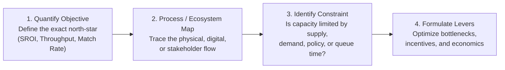
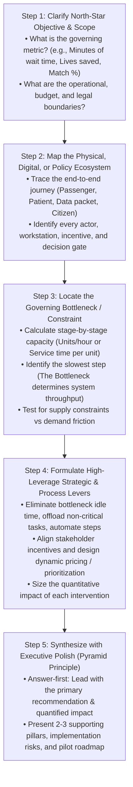
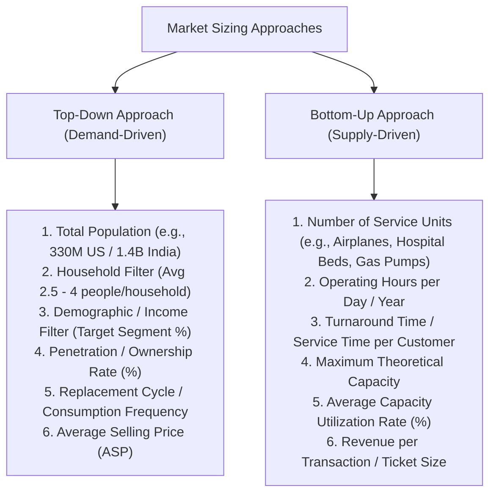
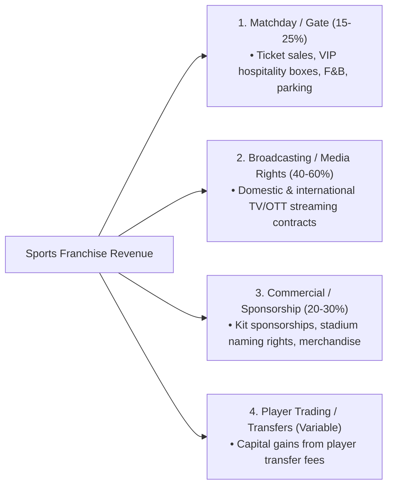
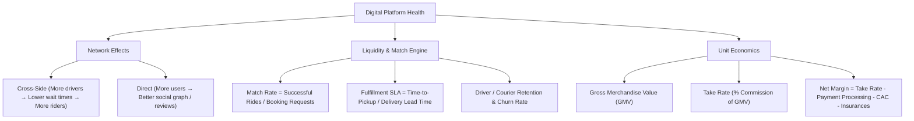

# Unconventional, Abstract & Specialized Cases Playbook

## 1. Executive Summary & Diagnostic Philosophy

While standard profitability and market entry cases follow well-trodden commercial paths, top-tier consulting firms (McKinsey, BCG, Bain) frequently test candidates with **unconventional, abstract, public policy, platform, and operational bottleneck problems**. These cases test whether a candidate can think from **first principles** rather than mechanically reciting business school templates.

When confronted with an unconventional case, apply the **Four First-Principles Anchors**:

### The Three Diagnostic Commandments
1. **Never force a P&L structure onto a non-commercial case.** Trying to break down a public health vaccination rollout or traffic congestion into "Revenue minus Cost" demonstrates poor business judgment. Use stakeholder utility, process throughput, and social return on investment (SROI).
2. **Deconstruct processes into discrete stages.** For operational and queueing cases, draw the end-to-end value chain or queue flow and calculate the capacity of every individual workstation to locate the single governing bottleneck.
3. **Always triangulate guesstimates across both Demand and Supply sides.** A demand-side guesstimate (how many people want the service) must be cross-checked against supply-side capacity (how many physical units/hours can be delivered).

---

## 2. Master Unconventional & Abstract Framework Tree

The following MECE tree outlines the five specialized domains of unconventional consulting casing.

```mermaid
graph TD
    Root["Unconventional & Abstract Case Archetypes"] --> Guesstimate["1. Guesstimates & Market Sizing"]
    Root --> PubPolicy["2. Public Sector, Government & Non-Profit"]
    Root --> SportsEnt["3. Sports, Media & Entertainment"]
    Root --> TechPlatform["4. Digital Platforms & Marketplaces"]
    Root --> OpsQueue["5. Operations, Bottlenecks & Queueing"]

    Guesstimate --> TopDown["Top-Down (Population → Household → Segment → Adoption)"]
    Guesstimate --> BottomUp["Bottom-Up (Capacity → Operating Hours → Speed → Utilization)"]
    Guesstimate --> Triangulate["Supply vs Demand Sanity Checking"]

    PubPolicy --> SROI["Social Return on Investment (SROI = Net Social Value / CapEx)"]
    PubPolicy --> FourE["The 4-E Policy Matrix (Effectiveness, Efficiency, Equity, Enforceability)"]
    PubPolicy --> Stakeholders["Stakeholder Alignment (Citizens, Govt, Private, NGOs)"]

    SportsEnt --> RevPillars["Four Revenue Streams (Matchday/Gate, Media Rights, Commercial, Talent)"]
    SportsEnt --> CostCap["Player Talent Economics & Salary Cap (Wage-to-Revenue Ratio)"]
    SportsEnt --> Venue365["365-Day Venue Monetization (Concerts, Hospitality, Real Estate)"]

    TechPlatform --> TwoSided["Two-Sided Network Effects (Cross-Side & Direct)"]
    TechPlatform --> ChickenEgg["Chicken-and-Egg Ignition (Subsidize High-Elasticity Side)"]
    TechPlatform --> Liquidity["Liquidity & Match Rate Optimization (Search Friction, SLA)"]

    OpsQueue --> LittlesLaw["Little's Law (WIP = Arrival Rate λ × Wait Time W)"]
    OpsQueue --> TOC["Theory of Constraints (Identify, Exploit, Subordinate, Elevate)"]
    OpsQueue --> YieldThroughput["Throughput Maximization & Scrap / Rework Reduction"]
```

---

## 3. Step-by-Step Diagnostic Workflow for Abstract Cases

---

## 4. Deep-Dive Sub-Modules & Formulations

### 4.1. Guesstimates & Market Sizing Methodologies

#### Core Sizing Identity:
$$\text{Market Size (\$) } = \text{Annual Volume (Units)} \times \text{Average Price per Unit (ASP)}$$

* *The Triangulation Rule:* In top-tier interviews, calculate the estimate using **Top-Down**, then validate the feasibility of the resulting number using a **Bottom-Up capacity check**.

---

### 4.2. Public Sector, Government & Non-Profit Casing

Public sector cases optimize for **Public Welfare, Social Return on Investment (SROI), and Citizen Equity** rather than shareholder profit.

$$\text{Social Return on Investment (SROI)} = \frac{\text{Net Present Value of Tangible \& Intangible Social Benefits (\$) } - \text{Deadweight}}{\text{Total Public Investment / Taxpayer CapEx (\$) }}$$

Where:
* **Tangible Benefits:** Direct healthcare costs avoided, tax revenues gained from increased employment, carbon emissions reduced.
* **Intangible Benefits:** Quality-Adjusted Life Years (QALYs) gained, crime reduction, educational attainment.
* **Deadweight:** Outcomes that would have occurred anyway without the government intervention.

#### The 4-E Policy Evaluation Matrix:
1. **Effectiveness:** Does the policy achieve the primary social objective (e.g., reduce infant mortality by 30%)?
2. **Efficiency:** What is the cost-per-outcome achieved compared to alternative public interventions?
3. **Equity:** Are the benefits and burdens distributed fairly across income groups, genders, and rural/urban geographies?
4. **Enforceability:** Is the regulatory mechanism administratively feasible and compliant with legal/constitutional mandates?

---

### 4.3. Sports, Media & Entertainment Economics

Sports franchises and entertainment venues operate under a unique commercial structure governed by four revenue pillars and tight talent cost constraints:

#### Governing Financial Rules in Sports:
* **UEFA / League Financial Fair Play (FFP) Ratio:**
  $$\text{Squad Cost Ratio} = \frac{\text{Player Wages} + \text{Player Amortization} + \text{Agent Fees}}{\text{Total Club Revenue}} \le 70\%$$
* **Venue 365 Economics:** Modern stadiums cannot survive on 25 game days per year. Value is unlocked through **365-day multi-use utilization**: hosting non-sporting mega-concerts, corporate conferences, stadium tours, esports tournaments, and adjacent mixed-use real estate development (retail, hotels).

---

### 4.4. Digital Platforms & Two-Sided Marketplaces

Two-sided platforms (Uber, Airbnb, DoorDash, Amazon Marketplace) create value by facilitating interactions between two distinct user groups (Supply Side: Drivers/Hosts/Sellers; Demand Side: Riders/Guests/Buyers).

#### Solving the Chicken-and-Egg Problem:
1. **Subsidize the High-Elasticity Side:** Provide upfront cash incentives or guaranteed hourly minimums to build dense supply first (e.g., paying drivers $30/hr regardless of rider requests).
2. **Single-Player Mode:** Provide standalone utility to one side before network effects kick in (e.g., OpenTable building table management SaaS for restaurants before launching its consumer booking app).
3. **Hyper-Local Constrained Launch:** Restrict launch to a single dense geographic cluster (e.g., a single college campus or single neighborhood) to achieve minimum critical liquidity before scaling nationally.

---

### 4.5. Operations, Bottlenecks & Queueing Theory

Operational consulting cases require mathematical rigor in modeling flows, wait times, and process throughput.

#### 1. Little's Law:
The foundational equation of queueing theory and supply chain operations:

$$L = \lambda \times W$$

Where:
* $L = \text{Work in Progress (WIP)} = \text{Average number of items/people in the system}$
* $\lambda = \text{Throughput Rate / Arrival Rate} = \text{Average arrival rate of items per unit time}$
* $W = \text{Cycle Time / Wait Time} = \text{Average time an item spends in the system}$

#### 2. System Throughput & Bottleneck Identification:
$$\text{System Throughput} = \min \left( \text{Capacity of Stage 1}, \text{Capacity of Stage 2}, \dots, \text{Capacity of Stage } n, \text{Arrival Rate } \lambda \right)$$

* **The Bottleneck** is the single stage with the **lowest capacity (longest cycle time per unit)**. Improving non-bottleneck stages yields **zero system throughput gain**.
* **Goldratt's Theory of Constraints (TOC) 5-Step Process:**
  1. *Identify* the system constraint (bottleneck).
  2. *Exploit* the constraint (ensure bottleneck never sits idle; eliminate scrap upstream).
  3. *Subordinate* everything else to the constraint (pace upstream feeding to bottleneck speed).
  4. *Elevate* the constraint (invest CapEx, add extra machines/staff at the bottleneck).
  5. *Repeat* (prevent inertia; locate the new bottleneck).

#### 3. Queueing Utilization & Exponential Delay:
$$\text{Server Utilization } (\rho) = \frac{\text{Arrival Rate } (\lambda)}{\text{Number of Servers } (c) \times \text{Service Rate per Server } (\mu)}$$

$$\text{Average Waiting Time in Queue } (W_q) \approx \left( \frac{\rho}{1 - \rho} \right) \times \left( \frac{C_a^2 + C_s^2}{2} \right) \times \left( \frac{1}{\mu} \right)$$

* *Critical Operational Insight:* As utilization $\rho$ approaches **100% (1.0)**, the queue length and wait time $W_q$ explode toward **infinity** if there is any stochastic variability in arrival or service times. Best-in-class operations target **75%–85% peak utilization** to prevent queue collapse.

---

## 5. Probing Questions Protocol & Diagnostic Traps

### High-Signal vs Low-Signal Questions

| Domain | Weak / Generic Question ❌ | Top 1% MBB Probing Question ✅ |
|---|---|---|
| **Public Policy** | "How much money does the government want to make?" | "What is the primary public mandate and social welfare metric—such as reducing carbon emissions, maximizing citizen access, or optimizing cost per beneficiary served?" |
| **Sports & Media** | "Do they sell tickets?" | "What is the club's current revenue breakdown across media broadcasting, commercial sponsorships, and matchday gate, and what is their current squad wage-to-revenue ratio?" |
| **Platform / Tech** | "How many downloads do they have?" | "Which side of the platform is currently constrained (supply or demand), and what are our current liquidity metrics—specifically match rate, booking conversion, and churn on the supply side?" |
| **Operations** | "Why is the factory slow?" | "What is the step-by-step cycle time and theoretical hourly capacity at each workstation across the production line, and where is work-in-progress (WIP) currently accumulating?" |

---

## 6. Quantitative Walkthroughs across Specialized Domains

### Walkthrough A: Airport Security Checkpoint Queue Optimization (Operations)
An international airport is facing passenger complaints because peak-hour security wait times average **45 minutes**. The airport CEO wants to reduce peak wait time to **under 15 minutes** before the holiday travel season without expanding terminal square footage.

#### Current Operations Data:
* **Peak Passenger Arrival Rate ($\lambda$):** 1,200 passengers / hour.
* **Security Screening Architecture (3 Sequential Stations per Lane):**
  * *Station 1 (Boarding Pass & ID Scan):* Cycle time = **15 seconds** per passenger $\rightarrow$ Capacity per lane = $\frac{3,600 \text{ sec}}{15 \text{ sec}} = \mathbf{240\text{ pass/hr}}$.
  * *Station 2 (X-Ray & Bag Screening - The Bottleneck):* Cycle time = **36 seconds** per passenger $\rightarrow$ Capacity per lane = $\frac{3,600 \text{ sec}}{36 \text{ sec}} = \mathbf{100\text{ pass/hr}}$.
  * *Station 3 (Metal Detector / Body Scanner):* Cycle time = **20 seconds** per passenger $\rightarrow$ Capacity per lane = $\frac{3,600 \text{ sec}}{20 \text{ sec}} = \mathbf{180\text{ pass/hr}}$.
* **Current Active Lanes:** 10 lanes open during peak hours.

#### Bottleneck & Queue Math:
1. **Current Lane Capacity:**
   * Governed by Station 2 (Bottleneck): **100 passengers / hour / lane**.
   * Total System Capacity for 10 lanes = $10 \times 100 = \mathbf{1,000\text{ pass/hr}}$.
2. **Capacity Deficit:**
   * Arrival rate = 1,200 pass/hr; Capacity = 1,000 pass/hr.
   * Queue grows by **200 passengers every hour**. Over a 3-hour peak window, 600 passengers accumulate in queue, causing a 36–45 minute delay.
3. **Levers to Achieve < 15 Minute Target:**
   * *Lever 1: Parallel Bag Loading at Station 2.* Introduce automated roller bins allowing 4 passengers to unload bags simultaneously, cutting effective X-Ray machine cycle time from 36 seconds to **24 seconds** per passenger.
     * New Lane Capacity = $\frac{3,600}{24} = \mathbf{150\text{ pass/hr/lane}}$.
     * Total System Capacity (10 lanes) = $10 \times 150 = \mathbf{1,500\text{ pass/hr}}$.
   * *Lever 2: System Utilization Check:*
     * Utilization $\rho = \frac{1,200}{1,500} = \mathbf{80\%}$.
     * At 80% utilization with $\mu = 150$, average wait time in queue drops from 45 minutes to **under 6.5 minutes**.

---

### Walkthrough B: Government Public Policy SROI (Rural Solar Microgrid Electrification)
A state government is evaluating whether to invest **$50M** in off-grid solar microgrids for 100 remote agrarian villages (20,000 total households) over 10 years.

#### Social & Economic Benefits Modeling (Annual):
1. **Kerosene Fuel Replacement:** Each household spends $120/year on kerosene lamps. Solar saves 100% of this spend $\rightarrow 20,000 \times \$120 = \mathbf{\$2.4M/\text{year}}$ in direct household savings.
2. **Productive Evening Work Hours:** Electrification enables cottage industry artisans and shops to operate 3 extra hours per night, generating an estimated $200/year in incremental income per household $\rightarrow 20,000 \times \$200 = \mathbf{\$4.0M/\text{year}}$.
3. **Respiratory Health Costs Avoided:** Indoor kerosene smoke reduction saves the state healthcare system $50/household in respiratory treatments $\rightarrow 20,000 \times \$50 = \mathbf{\$1.0M/\text{year}}$.
4. **Carbon Offset Credits:** 30,000 tons of CO2 offset annually at $20/ton = $\mathbf{\$0.6M/\text{year}}$.

#### SROI Calculation:
* **Total Annual Net Social Value:** $\$2.4\text{M} + \$4.0\text{M} + \$1.0\text{M} + \$0.6\text{M} = \mathbf{\$8.0M/\text{year}}$.
* **10-Year Undiscounted Social Value:** $\$8.0\text{M} \times 10 = \mathbf{\$80.0M}$ (or **$53.6M NPV** at 8% social discount rate).
* **Total Public Investment:** **$50.0M** CapEx.
* **SROI Ratio:** $\frac{\$80.0\text{M} \text{ Total Social Benefit}}{\$50.0\text{M} \text{ CapEx}} = \mathbf{1.60\text{x}}$ ($1.60 in measurable social and economic value generated for every $1.00 of public taxpayer funds invested).
* **Conclusion:** Proceed with state budget allocation.

---

## 7. Golden Interview Dialogue & Synthesis

### Candidate Opening & Structure (Two-Sided Platform Case)

> **Interviewer:** "Our client is a fast-growing on-demand telemedicine platform connecting patients with certified therapists. While patient sign-ups are up 200%, completed therapy sessions have dropped 15%, and therapist churn has reached 30% per quarter. What is going wrong and how should the CEO fix this?"
>
> **Candidate:** "This is a two-sided platform marketplace breakdown where top-of-funnel consumer demand is creating supply-side friction and liquidity failure. To diagnose the root cause and restore marketplace equilibrium, I will structure my approach across four structured pillars:
> 
> 1. **Therapist Journey & Operational Friction (Supply Side):** I will map the therapist end-to-end workflow—from profile onboarding and calendar scheduling to session documentation and insurance reimbursement—to identify why 30% of therapists are churning.
> 2. **Patient Journey & Matching Engine (Demand Side):** I will examine the matching algorithm. If patient demand surged 200% but completed sessions fell 15%, I hypothesize that patient appointment requests are going unfulfilled due to rigid therapist availability or poor specialty matching.
> 3. **Marketplace Liquidity & Take-Rate Economics:** I will evaluate the platform's unit economics, specifically therapist hourly earnings vs offline private practice benchmarks, no-show rates, and whether cancellation penalties protect therapist time.
> 4. **Retention & Algorithmic Optimization Roadmap:** I will design interventions to optimize booking liquidity, automate administrative EHR charting for therapists, and structure a tiered supply-retention incentive program.
>
> Let's start with the therapist experience: what data do we have on therapist utilization, average earnings per hour on our platform, and exit survey feedback?"

---

### Executive Synthesis (Pyramid Principle Recommendation)

> **Candidate Final Recommendation:**
>
> "The CEO should execute a **three-pillar platform liquidity turnaround to cut therapist churn from 30% to 8% and boost completed monthly sessions by 45% within 90 days**:
>
> 1. **Eliminate Unpaid Administrative Burden (Supply Fix):** Therapists currently spend 25 minutes of unpaid time charting clinical notes for every 50-minute session. Deploy an ambient AI clinical documentation assistant to reduce charting time to 3 minutes, unlocking 30% more billable therapy slots per therapist.
> 2. **Implement No-Show Protection & Dynamic Booking:** Late patient cancellations (currently 22%) left therapists unpaid for idle calendar slots. Introduce a strict 24-hour patient cancellation fee that guarantees 100% therapist reimbursement, combined with an automated standby waitlist to instantly backfill open slots.
> 3. **Rebalance Supply-Side Compensation:** Shift from a flat $60/session rate to a tiered model paying $85/session during peak evening and weekend demand hours, bringing platform earnings above offline private practice benchmarks.
>
> **Key Implementation Risks & Mitigations:**
> * *Patient Pushback on Cancellation Fees:* Offer one free late-cancellation forgiveness voucher per year to retain patient satisfaction.
> * *AI Clinical Accuracy:* Ensure all ambient AI notes require a mandatory 30-second therapist human-in-the-loop sign-off before submission to insurers.
>
> **Next Steps:** Roll out the AI charting pilot and new cancellation policy across the top 250 therapists next week."

---

## 8. Common Pitfalls & Landmines Matrix

| Pitfall / Landmine | Why Candidates Fail | How Top 1% MBB Candidates Execute |
|---|---|---|
| **Applying Generic P&L to Public Sector** | Treating a public school or national vaccination campaign as a for-profit business. | Use Social Return on Investment (SROI), QALYs, and the 4-E Matrix (Effectiveness, Efficiency, Equity, Enforceability). |
| **Ignoring the Bottleneck in Operations** | Recommending faster machines at Stage 1 when Stage 3 is the system constraint. | Calculate hourly capacity for every workstation and apply the Theory of Constraints exclusively to the bottleneck. |
| **Ignoring Queue Stochasticity** | Assuming 100% server utilization is optimal, failing to realize wait times explode to infinity. | Apply Little's Law and queueing theory; maintain 75%–85% target peak capacity utilization. |
| **Solving One Side of a Platform** | Spending 100% of capital on consumer marketing while neglecting supply-side churn. | Balance supply and demand liquidity; subsidize the high-elasticity side and protect provider economics. |
| **Un-triangulated Guesstimates** | Producing a wild top-down number without checking whether physical supply capacity exists. | Always sanity-check demand-side guesstimates against supply-side operational constraints. |
