# Aviation & Airlines Industry Dossier

## 1. Industry Overview & Macro Dynamics

The commercial aviation industry is characterized by high capital intensity, extreme operational leverage, cyclical demand, high commodity exposure (jet fuel), intense regulatory oversight, and historically thin aggregate operating margins (typically 2% to 6% globally over a multi-decade cycle). It serves as a classic MBB case setting for profitability turnaround, capacity and fleet optimization, revenue management/pricing, and route evaluation.

```
                    ┌──────────────────────────────────────────────────┐
                    │           MACRO DRIVERS OF AIRLINE ROI           │
                    └────────────────────────┬─────────────────────────┘
                                             │
         ┌───────────────────┬───────────────┴───────────────┬───────────────────┐
         ▼                   ▼                               ▼                   ▼
┌─────────────────┐ ┌─────────────────┐             ┌─────────────────┐ ┌─────────────────┐
│ GDP Growth &    │ │ Fuel Price & FX │             │ Infrastructure  │ │ Geopolitical &  │
│ Disposable      │ │ Volatility      │             │ & Slot Scarcity │ │ Regulatory      │
│ Income (2x GDP) │ │ (30-45% Costs)  │             │ (Hub Congestion)│ │ Policies (Bilateral)
└─────────────────┘ └─────────────────┘             └─────────────────┘ └─────────────────┘
```

### Global Context
- **Cyclicality & Elasticity**: Air travel demand generally tracks global GDP with an income elasticity multiplier of $1.5\times$ to $2.0\times$ in emerging markets and $1.0\times$ to $1.2\times$ in mature markets.
- **Business Model Archetypes**:
  1. **Full-Service Network Carriers (FSNC / FSC)**: Multi-cabin (First, Business, Premium Economy, Economy), hub-and-spoke network, integrated loyalty programs, global alliances (Star Alliance, Oneworld, SkyTeam), interline/codeshare agreements, bundled ticketing, belly cargo operations.
  2. **Low-Cost Carriers (LCC)**: Point-to-point routes, single aircraft family (e.g., Airbus A320 or Boeing 737), high-density single-cabin seating, high aircraft utilization ($11\text{--}14\text{ block hours/day}$), rapid turnaround times ($25\text{--}35\text{ minutes}$), secondary airport usage where viable, unbundled ancillary pricing.
  3. **Ultra-Low-Cost Carriers (ULCC)**: Hyper-unbundled base fares, maximum cabin density, non-reclining light seats, high baggage fees, extreme ancillary reliance ($40\%+$ of total revenue).
  4. **Regional / Commuter Carriers**: Turboprops (ATR 72, Dash 8) or regional jets (Embraer E-Jets) connecting Tier-2/Tier-3 spokes to major hubs under government subsidy or capacity purchase agreements (CPAs).
  5. **Dedicated Freight / Cargo Carriers**: Pure freighters (Boeing 747F, 777F, A330F) driven by global trade velocity, high-value electronics, pharmaceuticals, and e-commerce supply chains.

### India & Emerging Markets Context
- **Structural Growth**: India is the 3rd largest domestic aviation market globally, driven by rising disposable incomes, low domestic air penetration ($<0.15$ annual domestic trips per capita vs $>2.0$ in the US), and aggressive infrastructure expansion (UDAN regional connectivity scheme, greenfield airport buildouts like Navi Mumbai, Noida/Jewar).
- **Oligopolistic Consolidation**: Shift from fragmented, hyper-competitive capacity wars to disciplined market structures (e.g., IndiGo commanding $\sim 60\text{--}63\%$ domestic market share; Air India Group including Air India, Air India Express, and Vistara capturing $\sim 26\text{--}28\%$).
- **Structural Cost Headwinds**:
  - **Aviation Turbine Fuel (ATF) Taxation**: In India, state VAT on ATF historically ranged from $4\%$ to $30\%$, alongside central excise duties, making fuel $38\text{--}45\%$ of operating costs versus $25\text{--}32\%$ for global peers.
  - **Currency Mismatch**: Indian and emerging market airlines earn passenger revenues primarily in local currency (INR, BRL, IDR) while $\sim 65\text{--}70\%$ of their cost base is USD-denominated or USD-linked (aircraft lease rentals, jet fuel, engine maintenance, insurance, overflight navigation fees). Currency depreciation hits airline margins immediately.

---

## 2. Complete End-to-End Value Chain & Margin Capture

A classic MBB strategic insight is that the aviation value chain exhibits an extreme "smile curve" of economic returns. Almost every participant in the aviation ecosystem captures higher returns on invested capital (ROIC) than the airlines themselves.

```
┌────────────────────────────────────────────────────────────────────────────────────────┐
│                          AVIATION VALUE CHAIN & PROFIT POOLS                           │
└────────────────────────────────────────────────────────────────────────────────────────┘

 [Aircraft OEMs]  ──►  [Aircraft Lessors]  ──►  [Airports & ANSPs]  ──►  [Airlines]  ──►  [Distribution / OTAs]
  Airbus, Boeing       AerCap, Air Lease        GMR, Adani, AAI,         IndiGo, Air      Amadeus, Sabre, MMT,
  (Duopoly)            SMBC, Avolon             Heathrow, Changi         India, Emirates  Expedia, Booking
 ────────────────────────────────────────────────────────────────────────────────────────────────────────
  EBITDA: 12-16%       EBITDA: 80-90%           EBITDA: 50-65%           EBITDA: 8-15%    EBITDA: 25-40%
  ROIC: 10-14%         ROIC: 7-10%              ROIC: 10-16%             ROIC: 2-6%       ROIC: 20-35%
  Moat: Tech/IP,       Moat: Capital scale,     Moat: Natural geographic Moat: Weak,      Moat: Network effects,
  Duopoly orders       Cheap financing          monopoly, Regulated aero hyper-price-comp API lock-ins
```

### Value Chain Steps & Economic Mechanics
1. **Aircraft & Engine OEMs (Airbus, Boeing; CFM, Pratt & Whitney, GE, Rolls-Royce)**:
   - **Characteristics**: Duopoly market structure with massive multi-billion-dollar R&D barriers and multi-year order backlogs (8–10 years).
   - **Margin Capture**: OEMs capture solid margins on airframes, but engine manufacturers capture extraordinary margins on long-term aftermarket maintenance contracts (Power-by-the-Hour / Flight Hour Services agreements).
2. **Aircraft Lessors (AerCap, Avolon, Air Lease Corporation, SMBC Aviation Capital)**:
   - **Characteristics**: Own $>50\%$ of the world's commercial aircraft fleet. They place bulk speculative orders with OEMs at massive discounts ($40\text{--}55\%$ off list price) and lease them to airlines on 6-to-12-year operating leases.
   - **Margin Capture**: High, predictable returns based on the spread between their institutional cost of debt and the lease rate factor ($0.7\%\text{--}1.0\%$ of aircraft market value per month).
3. **Airports & Air Navigation Service Providers (ANSPs)**:
   - **Characteristics**: Local geographic natural monopolies. Aeronautical revenues (landing, parking, passenger service fees, aerobridge fees) are often regulated under a hybrid-till or single-till framework with guaranteed Return on Equity ($14\text{--}16\%$).
   - **Non-Aeronautical Upside**: Duty-free retail, food & beverage concessions, car parking, real estate, and advertising capture high-margin ($60\text{--}80\%$ contribution margin) spend from captive passengers.
4. **Commercial Airlines (The Core Operating Bottleneck)**:
   - **Characteristics**: Fragmented competition, high fixed costs, perishable inventory (an unsold seat when the aircraft door closes has zero salvage value), high unionization in legacy carriers, and zero pricing power during overcapacity phases.
   - **Margin Capture**: Historically the lowest in the chain; during downturns, industry economic profits are heavily negative.
5. **Ground Handling & Maintenance, Repair & Overhaul (MRO)**:
   - **Characteristics**: Ramp handling, baggage handling, passenger check-in, line maintenance, and heavy C/D airframe/engine checks.
   - **Margin Capture**: MRO providers (Lufthansa Technik, ST Engineering, AAR) capture $8\text{--}14\%$ EBIT margins due to technical certifications, specialized tooling, and FAA/EASA regulatory moats.
6. **Global Distribution Systems (GDS) & Online Travel Agencies (OTAs)**:
   - **Characteristics**: GDS providers (Amadeus, Sabre, Travelport) charge booking segment fees to airlines ($3\text{--}$6 per segment). OTAs (MakeMyTrip, Booking.com, Expedia) charge commissions ($5\text{--}12\%$) and cross-sell high-margin travel insurance and hotel accommodation.
   - **Margin Capture**: Asset-light, high-ROIC software and network businesses.

---

## 3. Revenue Models & Monetization Mechanics

Airline revenues are decomposed into three distinct streams: Passenger Base Fares, Ancillary Revenues, and Belly Cargo.

```
┌────────────────────────────────────────────────────────────────────────────────────────┐
│                               TOTAL AIRLINE REVENUE                                    │
└──────────────────────────────────────────┬─────────────────────────────────────────────┘
                                           │
         ┌─────────────────────────────────┼─────────────────────────────────┐
         ▼                                 ▼                                 ▼
┌───────────────────────────────┐ ┌───────────────────────────────┐ ┌───────────────────────────────┐
│     Passenger Base Fares      │ │      Ancillary Revenues       │ │      Belly Cargo & Mail       │
│  - Dynamic Yield Management   │ │  - Unbundled Travel Services  │ │  - Freight Rates per kg       │
│  - Cabin Class Segmentation   │ │  - Financial / Loyalty Points │ │  - High-Value Express Cargo   │
│  - Booking Curve Optimization │ │  - Onboard Merchandising      │ │  - Directional Load Balancing │
└───────────────────────────────┘ └───────────────────────────────┘ └───────────────────────────────┘
```

### 1. Passenger Base Fare & Dynamic Revenue Management
- **Yield Management Logic**: Airlines maximize total flight revenue by segmenting price-sensitive leisure travelers (who book weeks in advance and are flexible on dates) from price-insensitive, schedule-sensitive corporate/business travelers (who book close to departure).
- **Booking Curves & Fare Buckets**:
  - The aircraft cabin is allocated into distinct booking classes (fare buckets: Y, B, M, H, Q, etc.).
  - Algorithms dynamically open and close fare buckets based on historical pickup pace, days-to-departure (D-30, D-14, D-7, D-1), competitor pricing, day of week, and seasonality.
- **Overbooking Optimization**: Airlines calculate expected no-show rates ($3\text{--}8\%$) using Poisson/Binomial distributions and intentionally overbook flights up to the point where the marginal revenue of selling an extra ticket equals the expected cost of denied boarding compensation (involuntary DB vouchers, hotel accommodation, customer churn).

### 2. Ancillary Revenue Monetization
For modern LCCs and ULCCs, ancillary revenue represents $20\text{--}45\%$ of total revenue and often accounts for more than $100\%$ of net operating profits.
- **Unbundled Flight Add-ons**:
  - **Seat Selection**: Extra legroom (Row 1, Emergency exits), front-of-cabin seats, window/aisle premiums ($65\text{--}80\%$ gross margin).
  - **Baggage Fees**: Checked baggage fees, excess weight per kg, carry-on fees for ULCCs (Spirit, Ryanair).
  - **Flexibility & Change Penalties**: Date change fees, cancellation deductions, "free cancellation" add-on insurance.
  - **Priority Services**: Priority check-in, priority security lane, fast-track baggage handling, airport lounge access pass.
- **Onboard Retail & Catering**: Buy-on-board hot meals, snacks, beverages, duty-free sales ($40\text{--}60\%$ margin).
- **Frequent Flyer Program (FFP) & Financial Products**:
  - **Co-Branded Credit Cards**: Airlines sell loyalty miles directly to banks (e.g., Delta selling miles to American Express for $ billions in pure cash flow).
  - **Travel Insurance & Rental Cars**: Third-party commissions ($20\text{--}35\%$ cut) integrated into the booking checkout funnel.

### 3. Cargo & Mail (Belly Freight)
- Passenger aircraft carry cargo pallets in their lower deck (belly hold) alongside passenger luggage.
- **Marginal Cost Dynamics**: Because the flight is already scheduled, passenger fuel and crew costs are already committed. The incremental cost of carrying belly cargo is primarily the marginal burn of carrying additional weight (typically $0.03\text{--}0.05\text{ kg of fuel per kg of cargo per 1,000 km}$). Belly cargo yields contribute directly to flight operating margin.

---

## 4. Detailed Unit Economics & Contribution Margin Breakdown

To master airline casing, one must understand flight-level and seat-level unit economics.

### Representative Flight P&L
**Parameters**:
- **Aircraft**: Airbus A320 Neo (180 seats, single-class LCC configuration)
- **Route**: Delhi (DEL) to Mumbai (BOM) — Distance: $1,200\text{ km}$
- **Available Seat Kilometers (ASK)**: $180\text{ seats} \times 1,200\text{ km} = 216,000\text{ ASK}$
- **Passenger Load Factor (PLF)**: $85\%$ (153 passengers on board)
- **Revenue Passenger Kilometers (RPK)**: $153 \times 1,200 = 183,600\text{ RPK}$
- **Average Passenger Base Fare**: ₹5,000 (~$60.20)
- **Average Ancillary Revenue per Pax**: ₹600 (~$7.20)
- **Belly Cargo Carried**: 1.5 metric tonnes at ₹50/kg = ₹75,000 (~$903)

```
┌────────────────────────────────────────────────────────────────────────────────────────┐
│                 REPRESENTATIVE FLIGHT P&L (A320neo, 1,200 km, 85% PLF)                 │
├──────────────────────────────────────┬─────────────┬──────────────┬────────────────────┤
│ Financial Line Item                  │ Amount (₹)  │ Per Pax (₹)  │ Unit Metric        │
├──────────────────────────────────────┼─────────────┼──────────────┼────────────────────┤
│ **Gross Passenger Ticket Revenue**   │  7,65,000   │    5,000     │ 4.17 ₹/RPK         │
│ **Ancillary Revenue**                │    91,800   │      600     │ 0.50 ₹/RPK         │
│ **Belly Cargo Revenue**              │    75,000   │      490     │ 0.41 ₹/RPK         │
├──────────────────────────────────────┼─────────────┼──────────────┼────────────────────┤
│ **TOTAL FLIGHT REVENUE**             │  9,31,800   │    6,090     │ **4.31 ₹/RASK**    │
├──────────────────────────────────────┼─────────────┼──────────────┼────────────────────┤
│ **Operating Expenses (CASK Items)**  │             │              │                    │
│ 1. Aviation Turbine Fuel (ATF)       │  3,10,000   │    2,026     │ 1.44 ₹/CASK (37%)  │
│ 2. Aircraft Lease Rental & Reserves  │  1,60,000   │    1,046     │ 0.74 ₹/CASK (19%)  │
│ 3. Airport Landing, Parking & Aero   │    85,000   │      556     │ 0.39 ₹/CASK (10%)  │
│ 4. En-route Route Navigation (RNFC)  │    32,000   │      209     │ 0.15 ₹/CASK (4%)   │
│ 5. Flight & Cabin Crew (Salary/PerD) │    65,000   │      425     │ 0.30 ₹/CASK (8%)   │
│ 6. Line Maintenance & Engineering    │    48,000   │      314     │ 0.22 ₹/CASK (6%)   │
│ 7. Ground Handling & Ramp Services   │    38,000   │      248     │ 0.18 ₹/CASK (5%)   │
│ 8. Passenger Catering & Service      │    18,000   │      118     │ 0.08 ₹/CASK (2%)   │
│ 9. Distribution, GDS & Credit Card   │    28,000   │      183     │ 0.13 ₹/CASK (3%)   │
│ 10. Corporate SG&A, Insurance & Tech │    52,000   │      340     │ 0.24 ₹/CASK (6%)   │
├──────────────────────────────────────┼─────────────┼──────────────┼────────────────────┤
│ **TOTAL FLIGHT OPERATING COST**      │  8,36,000   │    5,465     │ **3.87 ₹/CASK**    │
├──────────────────────────────────────┼─────────────┼──────────────┼────────────────────┤
│ **NET FLIGHT OPERATING PROFIT**      │  **95,800** │    **625**   │ **+0.44 ₹ (Spread)**│
│ **Operating Margin (%)**             │   **10.3%** │              │                    │
└──────────────────────────────────────┴─────────────┴──────────────┴────────────────────┘
```

### Unit Economic Analysis
- **RASK**: $\frac{₹9,31,800}{216,000\text{ ASK}} = ₹4.31\text{ per ASK}$
- **CASK**: $\frac{₹8,36,000}{216,000\text{ ASK}} = ₹3.87\text{ per ASK}$
- **RASK - CASK Spread**: $+₹0.44\text{ per ASK}$. This positive spread of ₹0.44 across 216,000 ASKs yields the flight profit of ₹95,800.
- **Breakeven Load Factor Calculation**:
  - Net Yield per Passenger (Base + Ancillary) $= \frac{₹8,56,800}{183,600\text{ RPK}} = ₹4.67\text{ per RPK}$.
  - Flight costs net of cargo $= ₹8,36,000 - ₹75,000 = ₹7,61,000$.
  - Required RPK for breakeven $= \frac{₹7,61,000}{₹4.67} = 162,955\text{ RPK}$.
  - **Breakeven Load Factor** $= \frac{162,955}{216,000} = \mathbf{75.4\%}$ (136 passengers).
  - *Implication*: Operating at an $85\%$ PLF yields solid profitability, but a dip to $72\%$ flips this flight into an operating loss.

---

## 5. Comprehensive Cost Structure

Airlines operate on strict layers of cost variability depending on the decision horizon.

```
┌────────────────────────────────────────────────────────────────────────────────────────┐
│                        AIRLINE COST STRUCTURE & VARIABILITY                            │
└────────────────────────────────────────────────────────────────────────────────────────┘

 [Airline Level / Fixed Overhead] ──► [Flight Level / Semi-Fixed]  ──► [Passenger Level / Variable]
  - Aircraft Dry Leases & Depr.        - Aviation Fuel Burn (Trip)      - In-flight Catering & Water
  - Headquarters SG&A, IT Systems      - Flight & Cabin Crew Time       - Passenger Security/Handling
  - Flight Simulator Training          - Airport Landing & Parking      - Credit Card Merchant (1.5-2.5%)
  - Base Insurance & Hangar Lease      - En-Route Navigation (RNFC)     - Baggage Handling Surcharges
  (Zero variance with flights)         (Zero variance with pax count)   (Directly variable with pax)
```

### Cost Breakdown Table

| Cost Category | % of Total Cost | Cost Behavior | Key Operational & Strategic Drivers |
|---|---|---|---|
| **Aviation Turbine Fuel (ATF)** | $30\%\text{--}45\%$ | Variable per flight hours & stage length | Crude oil price (Brent/WTI), crack spread (jet fuel premium over crude), engine fuel efficiency (Neo vs Ceo: $-15\%$), flight routing, aircraft weight, single-engine taxiing. |
| **Aircraft Ownership & Leases** | $15\%\text{--}22\%$ | Fixed monthly / Semi-fixed per fleet | Dry lease rates, interest rates (SOFR), OEM delivery discounts, aircraft age, maintenance reserve provisions. |
| **Airport & Navigation Fees** | $10\%\text{--}15\%$ | Fixed per flight / variable with MTOW | Maximum Takeoff Weight (MTOW), airport tier/congestion level, peak-hour slot premiums, distance in sovereign airspace. |
| **Personnel (Pilots & Crew)** | $8\%\text{--}14\%$ | Semi-variable with block hours & flying roster | Pilot salary scales, union contracts, maximum duty time regulations (DGCA/FAA FDTL), crew layover hotels, deadheading costs. |
| **Maintenance & Engineering** | $7\%\text{--}12\%$ | Semi-variable with flight cycles and flight hours | Engine shop visits (every 5,000–8,000 cycles), C-checks (every 2 years), D-checks (heavy structural overhaul every 6–10 years), spare parts inventory. |
| **Ground Handling & Ramp** | $4\%\text{--}7\%$ | Fixed per turnaround | Third-party handling contract rates, baggage handling systems, pushback tugs, de-icing services. |
| **Distribution & Marketing** | $3\%\text{--}6\%$ | Variable with booking channel | Direct web/app share vs GDS/OTA booking share, credit card interchange, branding campaigns. |
| **General, Admin & Corporate** | $4\%\text{--}7\%$ | Fixed overhead | Executive salaries, legal, regulatory compliance, enterprise software (ERP, crew scheduling). |

### Fuel Hedging Dynamics
- **Mechanisms**: Airlines hedge jet fuel using financial derivatives based on Brent crude, Gasoil, or Jet Kerosene:
  - *Call Options / Collars*: Establish a ceiling price while sacrificing downside or paying an option premium.
  - *Swaps / Forwards*: Lock in a fixed price per barrel for $3\text{--}18\text{ months}$ forward.
- **Strategic Implications**:
  - In a surging oil market, hedged carriers (e.g., Southwest Airlines in the 2000s) enjoy massive cost advantages.
  - In a collapsing oil market, heavily hedged carriers suffer huge mark-to-market derivative losses while unhedged rivals lower fares and capture volume.

### Aircraft Financing & Leasing Models

```
┌────────────────────────────────────────────────────────────────────────────────────────┐
│                             AIRCRAFT ACQUISITION MODELS                                │
├────────────────────────┬───────────────────────────────────────────────────────────────┤
│ Model                  │ Structural Mechanism & Strategic Trade-off                    │
├────────────────────────┼───────────────────────────────────────────────────────────────┤
│ **Direct Purchase /**  │ • Airline purchases aircraft directly from OEM using debt/cash. │
│ **Finance Lease**      │ • *Pros*: Full residual value upside, lowest long-term cash   │
│                        │   cost if balance sheet is strong.                            │
│                        │ • *Cons*: Heavy debt on balance sheet, massive capex,         │
│                        │   technological obsolescence and remarketing risk.            │
├────────────────────────┼───────────────────────────────────────────────────────────────┤
│ **Dry Lease**          │ • Lessor provides *aircraft only*. Airline provides flight    │
│ **(Standard Operating)**│  crew, cabin crew, maintenance, fuel, insurance.             │
│                        │ • Standard 6-to-12-year lease duration.                       │
│                        │ • *Pros*: Fleet flexibility, no residual asset value risk.    │
├────────────────────────┼───────────────────────────────────────────────────────────────┤
│ **Wet Lease / ACMI**   │ • Lessor provides **A**ircraft, **C**rew, **M**aintenance, and  │
│                        │   **I**nsurance. Airline only pays for fuel, airport, & nav.  │
│                        │ • Short-term emergency or seasonal capacity (1 to 12 months). │
│                        │ • *Pros*: Immediate capacity, no long-term commitment.        │
│                        │ • *Cons*: Extremely expensive ($2\times\text{ to }3\times$ cost │
│                        │   per block hour vs dry lease).                               │
├────────────────────────┼───────────────────────────────────────────────────────────────┤
│ **Sale-and-Leaseback** │ • Airline orders planes from OEM with bulk discounts, takes   │
│ **(SLB)**              │   delivery, and immediately sells the plane to a lessor for   │
│                        │   full market value, leasing it back on dry lease.            │
│                        │ • *Pros*: Generates massive immediate upfront cash liquidity  │
│                        │   and monetizes orderbook OEM discount margins.               │
└────────────────────────┴───────────────────────────────────────────────────────────────┘
```

---

## 6. Essential KPI Formulas & Benchmark Ranges

```
┌────────────────────────────────────────────────────────────────────────────────────────┐
│                              CORE AIRLINE KPI FORMULAS                                 │
└────────────────────────────────────────────────────────────────────────────────────────┘

      [ASK] = Total Seats × Distance Flown (km)
      [RPK] = Revenue Passengers × Distance Flown (km)
      [PLF] = RPK / ASK = Total Passengers / Total Seats
      [Yield] = Passenger Ticket Revenue / RPK
      [PRASK] = Passenger Revenue / ASK = Yield × PLF
      [RASK] = Total Revenue (Pax + Ancillary + Cargo) / ASK
      [CASK] = Total Operating Expenses / ASK
      [CASK ex-Fuel] = (Total Operating Expenses - Fuel Cost) / ASK
      [Breakeven PLF] = CASK / Passenger Yield
      [Aircraft Utilization] = Total Block Hours Flown / Total Active Fleet Count
```

### Mathematical Formulations & Mathematical Invariants

1. **Available Seat Kilometers (ASK)**:
   $$\text{ASK} = \sum_{i=1}^{N} \left( \text{Seats}_i \times \text{Distance}_i \right)$$
   *Where $N$ is the total number of flight segments operated in the period.*

2. **Revenue Passenger Kilometers (RPK)**:
   $$\text{RPK} = \sum_{i=1}^{N} \left( \text{Passengers}_i \times \text{Distance}_i \right)$$

3. **Passenger Load Factor (PLF)**:
   $$\text{PLF} = \frac{\text{RPK}}{\text{ASK}} = \frac{\sum (\text{Pax}_i \times \text{Dist}_i)}{\sum (\text{Seats}_i \times \text{Dist}_i)}$$

4. **Passenger Yield ($Y$)**:
   $$Y = \frac{\text{Passenger Fare Revenue}}{\text{RPK}}$$

5. **Passenger RASK ($\text{PRASK}$)**:
   $$\text{PRASK} = \frac{\text{Passenger Fare Revenue}}{\text{ASK}} = \text{Yield} \times \text{PLF}$$

6. **Total Revenue per Available Seat Kilometer ($\text{RASK}$)**:
   $$\text{RASK} = \frac{\text{Total Operating Revenue}}{\text{ASK}} = \text{PRASK} + \text{Ancillary RASK} + \text{Cargo RASK}$$

7. **Cost per Available Seat Kilometer ($\text{CASK}$)**:
   $$\text{CASK} = \frac{\text{Total Operating Expenses}}{\text{ASK}}$$

8. **CASK ex-Fuel**:
   $$\text{CASK}_{\text{ex-fuel}} = \frac{\text{Operating Expenses} - \text{Aviation Fuel Expense}}{\text{ASK}}$$
   *Critical for benchmarking operational efficiency independent of exogenous crude oil price swings.*

9. **Stage-Length Normalized CASK**:
   Airlines flying longer average sector lengths will naturally report lower CASK because fixed takeoff, climb, landing, and airport handling costs are spread across more kilometers. To compare two airlines accurately:
   $$\text{Normalized CASK} = \text{CASK}_{\text{reported}} \times \sqrt{\frac{\text{Stage Length}_{\text{actual}}}{\text{Stage Length}_{\text{benchmark}}}}$$

10. **Breakeven Passenger Load Factor**:
    $$\text{Breakeven PLF} = \frac{\text{CASK} - \text{Ancillary RASK} - \text{Cargo RASK}}{\text{Passenger Yield}}$$

### Industry KPI Benchmark Ranges

| Metric | Full-Service Carrier (FSC) | Low-Cost Carrier (LCC) | Ultra-Low-Cost Carrier (ULCC) |
|---|---|---|---|
| **Passenger Load Factor (PLF)** | $78\%\text{--}83\%$ | $84\%\text{--}89\%$ | $88\%\text{--}93\%$ |
| **Aircraft Utilization** | $8.5\text{--}10.5\text{ hrs/day}$ | $11.0\text{--}13.0\text{ hrs/day}$ | $12.5\text{--}14.5\text{ hrs/day}$ |
| **Turnaround Time (TAT - Narrowbody)** | $45\text{--}60\text{ mins}$ | $25\text{--}35\text{ mins}$ | $20\text{--}30\text{ mins}$ |
| **Ancillary Revenue % of Total** | $8\%\text{--}15\%$ | $18\%\text{--}28\%$ | $35\%\text{--}50\%$ |
| **CASK ex-Fuel (USD equivalent)** | $\$0.065\text{--}\$0.090$ | $\$0.038\text{--}\$0.052$ | $\$0.028\text{--}\$0.038$ |
| **Fleet Commonality** | Mixed (Wide + Narrow) | Single family (e.g. A320) | Ultra-standardized |
| **Direct Web/App Bookings %** | $30\%\text{--}50\%$ | $65\%\text{--}85\%$ | $85\%\text{--}95\%$ |

---

## 7. Typical Case Scenarios & Diagnostic Issue Trees

### Issue Tree 1: Airline Profitability Diagnostic (Root Cause Investigation)

```mermaid
flowchart TD
    A[Airline Profit Margin Decline] --> B[RASK Decline - Revenue Contraction]
    A --> C[CASK Expansion - Cost Inflation]
    
    B --> B1[Yield Compression - Price Drop]
    B --> B2[Passenger Load Factor PLF Decline]
    B --> B3[Ancillary Revenue Deterioration]
    B --> B4[Cargo Revenue Decline]
    
    B1 --> B1a[Industry Overcapacity / Price Wars]
    B1 --> B1b[Adverse Cabin Mix Shift Business to Economy]
    B1 --> B1c[Inefficient Dynamic Pricing Algorithms]
    
    B2 --> B2a[Suboptimal Network Scheduling / Bad Timings]
    B2 --> B2b[Route Cannibalization / Unprofitable Spoke Expansion]
    B2 --> B2c[Brand Deterioration / Poor On-Time Performance OTP]
    
    B3 --> B3a[Drop in Conversion of Seat / Baggage Add-ons]
    B3 --> B3b[Underperforming Co-branded Card Partnerships]
    
    C --> C1[Fuel Cost Surge]
    C --> C2[Non-Fuel Operational CASK Inflation]
    
    C1 --> C1a[Crude Oil Price Spike & Crack Spread]
    C1 --> C1b[Inefficient Older Aircraft Fleet e.g. Ceo vs Neo]
    C1 --> C1c[Expiring Favorable Fuel Hedges]
    
    C2 --> C2a[Aircraft Lease & Financing Cost Escalation]
    C2 --> C2b[Drop in Aircraft Utilization Low Block Hours]
    C2 --> C2c[Airport Aero Charge & Ground Handling Hikes]
    C2 --> C2d[Crew Overtime, Pilot Shortages & FDTL Inefficiencies]
    C2 --> C2e[Maintenance Cost Spikes Supply Chain AOG Delays]
```



### Issue Tree 2: Route Profitability & New Route Launch Evaluation

```mermaid
flowchart TD
    Root[Evaluate Launch of New Route City A to City B] --> Dem[1. Market Demand & Market Size]
    Root --> Comp[2. Competitive Dynamics & Slot Access]
    Root --> Net[3. Operational & Network Fit]
    Root --> Econ[4. Financial Feasibility & Route P&L]

    Dem --> Dem1[Total Origin-Destination O&D Traffic Volume]
    Dem --> Dem2[Customer Segmentation Corporate vs Leisure Mix]
    Dem --> Dem3[Seasonality Peaks vs Off-Peak Valley Quarters]

    Comp --> Comp1[Existing Direct Non-Stop Competitor Capacity]
    Comp --> Comp2[Connecting Flight Alternatives Hub Competitors]
    Comp --> Comp3[Airport Slot Availability Peak Morning/Evening Slots]

    Net --> Net1[Fleet Match Gauge Narrowbody vs Widebody vs Turboprop]
    Net --> Net2[Aircraft Turnaround & Block Hour Utilization Fit]
    Net --> Net3[Network Flow & Connecting Feed to Existing Hubs]

    Econ --> Econ1[Projected RASK Base Yield + Ancillary + Belly Cargo]
    Econ --> Econ2[Route CASK Fuel + Airport Landing + Nav + Crew]
    Econ --> Econ3[Breakeven Load Factor vs Expected Steady-State PLF]
    Econ --> Econ4[Payback on Station Setup & Route Marketing Capex]
```



### Typical Case Archetypes in Consulting Interviews
1. **The Classic Turnaround**: A full-service legacy airline is bleeding cash post-deregulation.
   - *Diagnostic Focus*: Deconstruct CASK into fuel, crew, maintenance, and ownership. Identify fleet fragmentation, excessive business-class capacity on leisure routes, and inefficient hub-and-spoke banking.
   - *Strategic Solutions*: Retire older aircraft types, densify cabins, renegotiate vendor contracts, transition loss-making regional routes to LCC subsidiaries, unbundle ancillary charges.
2. **New Aircraft Fleet Renewal**: Evaluating whether an airline should replace 50 older Boeing 737-800s with 50 new 737 MAX 8 or A320neos.
   - *Trade-off Analysis*: Higher monthly dry lease rental expense (+20–30%) versus fuel burn reduction (-15%), maintenance reserve savings (-25%), extended range (new city pairs), and passenger preference.
3. **Turnaround Time (TAT) Optimization (Operations Case)**:
   - *Problem*: An LCC has seen its average turnaround time slip from 28 minutes to 45 minutes, reducing daily aircraft utilization from 12.5 block hours to 10.2 block hours.
   - *Root Cause Analysis*: Process mapping of critical path on ground: deplaning, cabin cleaning, fueling (cannot fuel while passengers boarding without fire truck on standby), catering load, baggage offloading/onloading, boarding queue congestion.

---

## 8. Common Pitfalls & Candidate "Landmines"

1. **Equating High Load Factor with Profitability**:
   - *The Landmine*: A candidate observes a $92\%$ load factor and concludes the route is healthy.
   - *The Reality*: An airline can easily achieve $95\%$ load factor by selling seats below marginal cost (dumping seats at ₹1,999 when marginal passenger cost + allocated flight cost requires ₹3,500). Always analyze **Yield** alongside **Load Factor** (Yield $\times$ PLF = PRASK).
2. **Comparing CASK Across Airlines Without Stage-Length Normalization**:
   - *The Landmine*: Comparing an airline flying an average sector of $2,000\text{ km}$ to an airline flying $600\text{ km}$ and concluding the first airline is more operationally efficient because its CASK is lower.
   - *The Reality*: Takeoff fuel burn, landing fees, and passenger boarding costs are fixed per flight; dividing them over $2,000\text{ km}$ automatically produces a lower CASK. Stage-length normalization is mandatory.
3. **Ignoring Currency Mismatch (USD Costs vs Local Currency Revenues)**:
   - *The Landmine*: Projecting domestic revenue growth of $10\%$ in INR and assuming operating profit will expand by $10\%$, ignoring an $8\%$ INR/USD depreciation that inflates $65\%$ of the cost base (fuel, lease, maintenance).
4. **Treating All Unsold Seats as Pure Lost Profit Without Ancillary Context**:
   - *The Landmine*: Proposing to slash last-minute ticket prices to $0 to fill every seat.
   - *The Reality*: Slashing prices at D-1 trains business travelers to wait until the last minute, cannibalizing the highest-yield segment of the booking curve.
5. **Overlooking Turnaround Time (TAT) as a Fixed-Cost Amortization Lever**:
   - *The Landmine*: Focusing exclusively on cutting catering costs or pilot wages to reduce CASK.
   - *The Reality*: Shaving 15 minutes off ground turnarounds across a fleet of 100 aircraft creates enough productive block hours to operate 40 additional daily flights with **zero incremental aircraft lease capex**, dramatically diluting fixed CASK.
6. **Confusing Dry Lease with Wet Lease (ACMI)**:
   - *The Landmine*: Recommending an airline wet-lease 20 aircraft for 5 years to expand capacity.
   - *The Reality*: Wet leasing is a high-cost, short-term stopgap used only for unexpected maintenance grounding (AOG) or seasonal surges. Long-term expansion must rely on direct purchases, sale-and-leasebacks, or dry leases.
