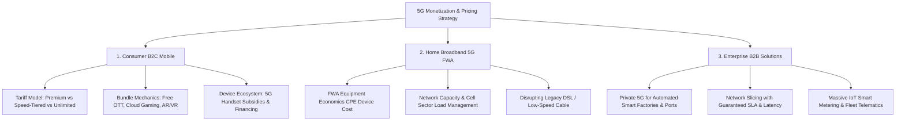

# Telecom & Media Industry Dossier

## 1. Industry Overview & Macro Dynamics

The telecommunications and media industry provides mission-critical digital connectivity and entertainment infrastructure. It is characterized by immense upfront capital expenditure (spectrum auctions and network equipment rollouts), multi-year asset lifecycles, extreme economies of scale, heavy regulatory intervention, and zero marginal cost for incremental data transmission once network capacity is deployed.

```
                    ┌──────────────────────────────────────────────────┐
                    │          MACRO DRIVERS OF TELECOM ROI            │
                    └────────────────────────┬─────────────────────────┘
                                             │
         ┌───────────────────┬───────────────┴───────────────┬───────────────────┐
         ▼                   ▼                               ▼                   ▼
┌─────────────────┐ ┌─────────────────┐             ┌─────────────────┐ ┌─────────────────┐
│ Spectrum Capex  │ │ Data Consumption│             │ Market Structure│ │ OTT Streaming & │
│ & License Fees  │ │ Growth (20+ GB/ │             │ Consolidation   │ │ Media Bundling  │
│ (20-Year Liab.) │ │ sub/month)      │             │ (2-3 Oligopoly) │ │ (ARPU Driver)   │
└─────────────────┘ └─────────────────┘             └─────────────────┘ └─────────────────┘
```

### Global Context
- **Infrastructure Upgrade Cycles**: The industry operates on roughly 10-year generational cycles ($2\text{G} \rightarrow 3\text{G} \rightarrow 4\text{G} \rightarrow 5\text{G} \rightarrow 6\text{G}$). Each transition requires massive upfront capital intensity ($18\%\text{--}25\%$ Capex/Sales ratio) for spectrum acquisition, radio access network (RAN) upgrades, and fiber backhaul.
- **Voice-to-Data Paradigm Shift**: Voice and SMS have been completely commoditized into VoIP / IP data packets (VoLTE, VoNR). Telcos are now high-throughput "dumb pipes" battling to capture software, cloud, and media value.
- **Market Structure**: Most global markets have consolidated into 3 to 4 major Mobile Network Operators (MNOs) due to the immense scale needed to cover spectrum costs and network operating expenses.

### India & Emerging Markets Context
- **Hyper-Consolidation & Price War Aftermath**: The Indian market transitioned from a hyper-fragmented battlefield of 12+ operators in 2012 to a stable private duopoly (Reliance Jio $\sim 40\text{--}42\%$ subscriber share; Bharti Airtel $\sim 33\text{--}35\%$), alongside a struggling third private operator (Vodafone Idea $\sim 18\text{--}20\%$) and state-owned BSNL.
- **Data Explosion at Lowest Global Tariffs**:
  - India exhibits the world's highest monthly data consumption per user ($\sim 20\text{--}26\text{ GB/month}$), driven by 4G/5G mobile penetration and cheap smartphones.
  - Data tariffs are among the lowest globally ($\sim \$0.12\text{--}\$0.18\text{ per GB}$ vs $\$3.00\text{--}\$6.00\text{ in the US/EU}$).
- **Prepaid vs Postpaid Asymmetry**: Emerging markets are $>90\%$ prepaid (recharge validity packs of 28, 56, or 84 days) versus $>75\%$ postpaid contract subscriptions in developed Western markets.
- **Regulatory Burden (AGR Dues & Spectrum Debt)**: Indian telcos have historically operated under heavy statutory obligations: Adjusted Gross Revenue (AGR) revenue-sharing fees ($8\%$ license fee $+ 3\text{--}5\%$ Spectrum Usage Charges) and multi-billion-dollar deferred spectrum auction payment liabilities.

---

## 2. Complete End-to-End Value Chain & Margin Capture

The telecom and digital media ecosystem spans upstream spectrum allocation down to digital consumer platforms.

```
┌────────────────────────────────────────────────────────────────────────────────────────┐
│                        TELECOM & MEDIA VALUE CHAIN & PROFIT POOLS                      │
└────────────────────────────────────────────────────────────────────────────────────────┘

 [Govt / Regulators] ──► [Network Vendors] ──► [Tower / FiberCos] ──► [MNOs] ──► [OTT / Media & B2B]
  DoT, FCC, TRAI          Ericsson, Nokia,      Indus Towers,          Jio,      Netflix, YouTube,
  (Spectrum Lic.)         Huawei, Samsung       American Tower         Airtel    Enterprises, SMEs
 ─────────────────────────────────────────────────────────────────────────────────────────────────
  Auction Fees: 100%     EBITDA: 12-16%        EBITDA: 50-60%         EBITDA:   EBITDA: 20-35%
  Sovereign Monop.       ROIC: 14-20%          ROIC: 12-16%           40-52%    ROIC: 18-30%
  Extracts economic      Moat: R&D, 3GPP       Moat: Real estate,     ROIC:     Moat: Exclusive IP,
  rent via auctions      patents, scale        tenancy contracts      6-10%     Content algorithms
```

### Value Chain Segments & Economics
1. **Regulators & Spectrum Licensing (DoT / FCC / Ofcom)**:
   - Governments auction exclusive rights to radio frequency bands ($700\text{ MHz}, 800\text{ MHz}, 1800\text{ MHz}, 2100\text{ MHz}, 3.5\text{ GHz}, 26\text{ GHz mmWave}$).
   - **Economic Impact**: Captures massive upfront economic rent; licenses typically last 20 years.
2. **Network Equipment Vendors (Ericsson, Nokia, Huawei, Samsung, ZTE)**:
   - Develop and manufacture baseband units, radios, antennas (MIMO), routers, and core cloud packet network software.
   - **Margin Capture**: High gross margins ($40\text{--}45\%$) on proprietary hardware/software, yielding $12\text{--}16\%$ EBITDA margins.
3. **Passive Infrastructure & TowerCos (Indus Towers, American Tower, Crown Castle)**:
   - Own real estate, physical steel towers, shelters, backup power (diesel generators, batteries, solar), and climate control.
   - **Margin Capture**: Highly profitable utility business. A tower with 1 tenant generates $\sim 20\%$ EBITDA margin; with 2.2 tenants (sharing the same physical asset), EBITDA margins exceed $55\text{--}60\%$ with $14\text{--}18\%$ ROIC.
4. **Mobile Network Operators (MNOs / Telcos)**:
   - Integrate spectrum, active radio gear, backhaul fiber, customer care, retail distribution, and brand.
   - **Margin Capture**: High headline EBITDA margins ($40\text{--}52\%$), but heavy annual depreciation and amortization (D&A) from spectrum licenses and network gear drags net ROIC down to $6\text{--}10\%$.
5. **Digital Media, OTT & Content Platforms (Netflix, Disney+, YouTube, Spotify)**:
   - Leverage the telco's high-speed data pipe to deliver streaming video, audio, gaming, and cloud services directly to subscribers.
   - **Dynamic**: OTT apps historically cannibalized telco SMS and voice revenues; telcos now partner with OTTs by bundling subscriptions to drive data consumption and ARPU upselling.

---

## 3. Revenue Models & Monetization Mechanics

Telco revenue is decomposed across consumer mobile, fixed broadband, and enterprise enterprise services.

```
┌────────────────────────────────────────────────────────────────────────────────────────┐
│                                TOTAL TELCO REVENUE                                     │
└──────────────────────────────────────────┬─────────────────────────────────────────────┘
                                           │
         ┌─────────────────────────────────┼─────────────────────────────────┐
         ▼                                 ▼                                 ▼
┌───────────────────────────────┐ ┌───────────────────────────────┐ ┌───────────────────────────────┐
│     Consumer Mobile (B2C)     │ │    Home Broadband / FTTH      │ │     Enterprise & B2B (B2B)    │
│  - Prepaid Daily Bundles      │ │  - High-Speed Fiber Plans     │ │  - Dedicated Leased Lines     │
│  - Postpaid Family Plans      │ │  - Fixed Wireless Access FWA  │ │  - Cloud, SD-WAN & IoT        │
│  - Data Add-ons & Roaming     │ │  - Smart Home & Connected TV  │ │  - CPaaS (SMS OTP, APIs)      │
└───────────────────────────────┘ └───────────────────────────────┘ └───────────────────────────────┘
```

### 1. Consumer Mobile Monetization Mechanics
- **Prepaid Daily Data Bucket Architecture**:
  - The dominant emerging market model: Users purchase an 84-day or 28-day validity pack providing $1.5\text{ GB/day}$ or $2.0\text{ GB/day}$ alongside unlimited voice.
  - *Monetization Logic*: Unused daily quota expires at midnight (no rollover), eliminating peak network hoarders and establishing predictable cash inflows.
- **Minimum Recharge & SIM Consolidation**:
  - In multi-SIM markets, low-income users historically kept secondary incoming-only SIMs at zero monthly spend. Telcos introduced mandatory minimum monthly recharges (e.g., ₹99–₹155 per month) to force inactive users to either monetize or churn, dramatically optimizing network spectrum efficiency.
- **Postpaid Family Plans & Tiering**:
  - 3–5x higher ARPU than prepaid. Telcos offer multi-SIM pooled data allowances, free international roaming packs, device financing, and bundled OTT premium subscriptions (Netflix, Prime, Hotstar) to create high switching costs and near-zero churn ($<1\%/\text{month}$).

### 2. Fixed Broadband (FTTH) & 5G Fixed Wireless Access (FWA)
- **FTTH (Fiber-to-the-Home)**: Gigabit fiber connections providing $100\text{--}1,000\text{ Mbps}$ uncapped data to households. High ARPU ($₹500\text{--}₹1,500/\text{month}$), $>5\text{-year}$ subscriber stickiness.
- **5G FWA (Fixed Wireless Access)**: Bypasses the high cost and physical delay of digging fiber trenches by placing a 5G wireless CPE receiver at the customer's window connected to a 5G macro cell tower. Accelerates home broadband penetration in suburban and rural areas.

### 3. Enterprise B2B & Wholesale (High-Margin Growth Engine)
- **Connectivity**: MPLS, SD-WAN, National Long Distance (NLD), International Private Leased Circuits (IPLC).
- **CPaaS (Communications Platform as a Service)**: Application-to-person (A2P) SMS delivery for banking OTPs, two-factor authentication, and enterprise WhatsApp API messaging ($60\text{--}70\%$ gross margin).
- **Private 5G Networks & IoT**: Dedicated cellular network slices with ultra-low latency for automated manufacturing plants, mining sites, smart utility grids, and seaport logistics.

---

## 4. Detailed Unit Economics & Contribution Margin Breakdown

To evaluate telecom profitability, we analyze a representative monthly P&L for an operational circle of **1,000,000 active mobile subscribers**.

### Monthly Circle P&L (1 Million Subscribers)
**Assumptions**:
- **Subscriber Base**: 1,000,000 active users (88% Prepaid, 12% Postpaid)
- **Blended ARPU**: ₹210 (~$2.53) per subscriber per month
- **Monthly Gross Revenue**: $1,000,000 \times ₹210 = ₹21,00,00,000$ (₹21.0 Crore)
- **Average Data Usage**: $22\text{ GB/sub/month}$; **Monthly Voice Usage**: $900\text{ mins/sub/month}$

```
┌────────────────────────────────────────────────────────────────────────────────────────┐
│             MONTHLY SUBSCRIBER UNIT ECONOMICS (1,000,000 SUBSCRIBER CIRCLE)            │
├──────────────────────────────────────┬─────────────┬──────────────┬────────────────────┤
│ Financial Line Item                  │ Amount (₹)  │ Per Sub (₹)  │ % of Revenue       │
├──────────────────────────────────────┼─────────────┼──────────────┼────────────────────┤
│ **Gross Service Revenue**            │ 21,00,00,000│    210.00    │ 100.0%             │
├──────────────────────────────────────┼─────────────┼──────────────┼────────────────────┤
│ **Direct Network & Regulatory Costs**│             │              │                    │
│ 1. License Fee & Spectrum Dues (AGR) │  2,10,00,000│     21.00    │ 10.0% (Statutory)  │
│ 2. Tower Rental & Passive Lease      │  4,20,00,000│     42.00    │ 20.0% (TowerCos)   │
│ 3. Diesel & Grid Power at Towers     │  2,10,00,000│     21.00    │ 10.0% (Energy)     │
│ 4. Fiber Backhaul & IP Bandwidth     │  1,05,00,000│     10.50    │  5.0% (Transit)    │
│ 5. Network Field Operations & Maint. │    84,00,000│      8.40    │  4.0% (O&M)        │
├──────────────────────────────────────┼─────────────┼──────────────┼────────────────────┤
│ **Total Direct Network Costs**       │ 10,29,00,000│    102.90    │ 49.0%              │
├──────────────────────────────────────┼─────────────┼──────────────┼────────────────────┤
│ **GROSS CONTRIBUTION MARGIN**        │ 10,71,00,000│    107.10    │ **51.0%**          │
├──────────────────────────────────────┼─────────────┼──────────────┼────────────────────┤
│ **Sales, Service & Operating Opex**  │             │              │                    │
│ 6. Channel Commissions & Retail Marg.│  1,05,00,000│     10.50    │  5.0%              │
│ 7. Customer Care, Billing & IT Core  │    84,00,000│      8.40    │  4.0%              │
│ 8. Marketing, Branding & Media       │    63,00,000│      6.30    │  3.0%              │
│ 9. General & Admin Overhead (SG&A)   │    84,00,000│      8.40    │  4.0%              │
├──────────────────────────────────────┼─────────────┼──────────────┼────────────────────┤
│ **EBITDA**                           │  7,35,00,000│     73.50    │ **35.0%**          │
├──────────────────────────────────────┼─────────────┼──────────────┼────────────────────┤
│ **Capital Charges (D&A & Interest)** │             │              │                    │
│ 10. Spectrum License Amortization    │  2,52,00,000│     25.20    │ 12.0%              │
│ 11. Network Equipment Depreciation   │  2,31,00,000│     23.10    │ 11.0%              │
│ 12. Interest on Spectrum/Bank Debt   │  1,47,00,000│     14.70    │  7.0%              │
├──────────────────────────────────────┼─────────────┼──────────────┼────────────────────┤
│ **NET PROFIT BEFORE TAX (PBT)**      │  **1,05,00,000**│ **10.50**  │  **5.0%**          │
└──────────────────────────────────────┴─────────────┴──────────────┴────────────────────┘
```

### Unit Economic Takeaways
- **High Operational Leverage**: Direct marginal cost of sending 1 additional GB of data to an existing subscriber on an uncongested cell site is virtually ₹0.
- **The ARPU Tipping Point**:
  - At ₹210 ARPU, the circle produces ₹73.50 EBITDA/sub and ₹10.50 PBT/sub.
  - If a tariff hike raises ARPU by ₹30 to ₹240 ($+14.3\%$), almost $85\%$ of that incremental revenue drops straight to EBITDA (net of the $10\%$ AGR/license fee and $5\%$ retail commission), expanding PBT per sub from ₹10.50 to ₹36.00 ($+243\%$ profit expansion).

---

## 5. Comprehensive Cost Structure

```
┌────────────────────────────────────────────────────────────────────────────────────────┐
│                        TELCO COST STRUCTURE BREAKDOWN                                  │
└────────────────────────────────────────────────────────────────────────────────────────┘

 [Fixed Spectrum & Core Capex] ──► [Network Operating Costs] ──► [Subscriber-Variable Costs]
  - Spectrum Auction Amortization   - Tower Site Leases (Monthly) - SIM Card & e-KYC Verification
  - 5G Core & IMS Cloud Software    - Power & Fuel (Grid/Diesel)  - Dealer Activation Commissions
  - Fiber Trenching & Backhaul      - Fiber Leases & Microwave    - Customer Care Handling Time
  - Submarine Cable Capacity        - Field Engineering & Spares  - Billing Invoicing & Bad Debt
  (Committed for 10-20 years)       (Fixed per cell site active)  (Directly scales with gross adds)
```

### Cost Breakdown Table

| Cost Category | % of Total Cost | Behavior | Strategic Levers & Management Practices |
|---|---|---|---|
| **Tower Leases & Energy** | $25\%\text{--}35\%$ | Semi-fixed per cell site | Tenancy sharing negotiations, swapping diesel generators for lithium-ion battery banks and solar power, sleep-mode software on antennas during off-peak hours (midnight–6 AM). |
| **D&A (Spectrum & Radio Gear)** | $20\%\text{--}30\%$ | Fixed non-cash accounting charge | Maximizing spectrum spectral efficiency (MIMO, carrier aggregation), extending asset life through software-defined RAN (OpenRAN). |
| **Regulatory & License Fees (AGR)** | $8\%\text{--}12\%$ | Variable (% of Adjusted Gross Revenue) | Legal structuring of non-telecom income (digital ads, enterprise software) outside the AGR perimeter where permitted. |
| **Finance Costs & Debt Service** | $7\%\text{--}15\%$ | Fixed contractual | Refinancing high-cost spectrum debt via low-coupon dollar bonds or domestic commercial paper, equity rights issues. |
| **Subscriber Acquisition & Retention (SAC/SRC)** | $5\%\text{--}10\%$ | Variable with Gross Adds & Churn | Shifting acquisition to digital channels (e-SIM, self-onboarding app) vs physical retail mom-and-pop stores; reducing churn. |
| **Bandwidth & IP Transit** | $3\%\text{--}6\%$ | Semi-variable with traffic volume | Content Delivery Network (CDN) edge caching (peering with Google, Meta, Netflix at local data centers) to avoid expensive transit. |
| **Corporate SG&A & IT** | $5\%\text{--}8\%$ | Fixed overhead | Cloud migration of billing (BSS/OSS), AI-driven automated chatbot resolution for customer care inquiries. |

### Tower Infrastructure & Tenancy Operating Leverage

```
┌────────────────────────────────────────────────────────────────────────────────────────┐
│                 TOWERCO TENANCY RATIO & OPERATING LEVERAGE DYNAMICS                    │
├─────────────────────────┬───────────────────┬───────────────────┬──────────────────────┤
│ Metric                  │ 1 Tenant / Tower  │ 1.5 Tenants/Tower │ 2.2 Tenants / Tower  │
├─────────────────────────┼───────────────────┼───────────────────┼──────────────────────┤
│ Monthly Tower Rent Rec. │ ₹35,000           │ ₹52,500           │ ₹77,000              │
│ Ground Rent to Landlord │ ₹12,000           │ ₹12,000           │ ₹12,000 (Fixed)      │
│ Security, O&M, Insurance│ ₹10,000           │ ₹11,500           │ ₹13,000 (Minor incr.)│
├─────────────────────────┼───────────────────┼───────────────────┼──────────────────────┤
│ **Tower Gross Margin**  │ **₹13,000 (37%)** │ **₹29,000 (55%)** │ **₹52,000 (67.5%)**  │
│ **EBITDA Margin (%)**   │ **~22%**          │ **~42%**          │ **~60%**             │
│ **Return on Capital**   │ **4.5%**          │ **11.0%**         │ **18.5%**            │
└─────────────────────────┴───────────────────┴───────────────────┴──────────────────────┘
```
*Takeaway*: Tower companies achieve massive profit inflections as the **tenancy ratio** climbs from 1.0 to 2.0+, since ground rent and tower structural capex are largely fixed.

---

## 6. Essential KPI Formulas & Benchmark Ranges

```
┌────────────────────────────────────────────────────────────────────────────────────────┐
│                               CORE TELECOM KPI FORMULAS                                │
└────────────────────────────────────────────────────────────────────────────────────────┘

      [ARPU] = Total Service Revenue in Period / Average Active Subscribers
      [Monthly Churn Rate %] = (Subscribers Lost in Month / Opening Subscribers) × 100
      [Customer Lifetime (Months)] = 1 / Monthly Churn Rate
      [Customer Lifetime Value (CLTV)] = (ARPU × Gross Margin %) / Monthly Churn Rate
      [Subscriber Acquisition Cost (SAC)] = Total Acquisition Costs / Gross Additions
      [CAC Payback Period] = SAC / (ARPU × Contribution Margin %)
      [Tower Tenancy Ratio] = Total Tenant Contracts across Network / Total Physical Towers
      [Active Subscriber Ratio (VLR %)] = Peak Active Users on VLR / Total HLR Sub Base
      [Capital Intensity %] = Total Annual Capex / Total Operating Revenue
```

### Mathematical Formulations

1. **Average Revenue Per User (ARPU)**:
   $$\text{ARPU} = \frac{\text{Total Service Revenue in Period } t}{\frac{1}{2} \left( \text{Subscribers}_{\text{start}} + \text{Subscribers}_{\text{end}} \right)}$$

2. **Monthly Churn Rate ($\text{Churn}$)**:
   $$\text{Churn Rate} = \frac{\text{Subscribers Disconnected in Month}}{\text{Opening Subscriber Base}} \times 100$$

3. **Net Subscriber Additions**:
   $$\text{Net Adds} = \text{Gross Additions} - \text{Churned Subscribers}$$

4. **Subscriber Acquisition Cost (SAC)**:
   $$\text{SAC} = \frac{\text{Retailer Commissions} + \text{SIM Card Printing} + \text{e-KYC Costs} + \text{Acquisition Marketing}}{\text{Gross Additions}}$$

5. **Customer Lifetime Value (CLTV)**:
   $$\text{CLTV} = \sum_{t=1}^{\infty} \frac{\text{ARPU} \times \text{Gross Margin } \%}{(1 + r)^t} \approx \frac{\text{ARPU} \times \text{Gross Margin } \%}{\text{Monthly Churn Rate}}$$
   *Where $r$ is the monthly discount rate.*

6. **CAC Payback Period (in Months)**:
   $$\text{Payback Period} = \frac{\text{SAC}}{\text{ARPU} \times \text{Gross Contribution Margin } \%}$$

7. **Tower Tenancy Ratio**:
   $$\text{Tenancy Ratio} = \frac{\sum_{i=1}^{T} \text{Tenants on Tower}_i}{T}$$
   *Where $T$ is the total physical tower count.*

8. **VLR (Visitor Location Register) Active Ratio**:
   $$\text{VLR Ratio} = \frac{\text{Active Connected SIMs on VLR}}{\text{Total Registered SIMs on HLR (Home Location Register)}} \times 100$$

### Industry Benchmark Ranges

| Metric | Emerging Markets (e.g., India) | Developed Markets (US / EU) | Enterprise / FTTH |
|---|---|---|---|
| **Blended ARPU (USD)** | $\$2.20\text{--}\$3.50$ | $\$35.00\text{--}\$65.00$ | $\$8.00\text{--}\$20.00$ (FTTH) |
| **Monthly Churn Rate (Prepaid)** | $1.8\%\text{--}3.5\%$ | $1.5\%\text{--}2.5\%$ | $0.8\%\text{--}1.5\%$ |
| **Monthly Churn Rate (Postpaid)** | $0.8\%\text{--}1.4\%$ | $0.6\%\text{--}1.1\%$ | $0.5\%\text{--}0.9\%$ |
| **EBITDA Margin (%)** | $40\%\text{--}52\%$ | $35\%\text{--}45\%$ | $50\%\text{--}60\%$ |
| **Capital Intensity (Capex/Sales)** | $18\%\text{--}28\%$ (5G cycle) | $14\%\text{--}18\%$ | $25\%\text{--}35\%$ |
| **Tower Tenancy Ratio** | $1.4\times\text{--}1.8\times$ | $1.8\times\text{--}2.5\times$ | N/A |
| **Data Usage per Sub/Month** | $20\text{--}28\text{ GB}$ | $12\text{--}20\text{ GB}$ | $200\text{--}450\text{ GB}$ |
| **VLR Active User Ratio** | $85\%\text{--}94\%$ | $95\%\text{--}98\%$ | $99\%+$ |

---

## 7. Typical Case Scenarios & Diagnostic Issue Trees

### Issue Tree 1: Telco ARPU Expansion & Profitability Turnaround

```mermaid
flowchart TD
    A[Increase Telco Operating Profit] --> B[Expand Total Revenue]
    A --> C[Optimize Operating & Capital Costs]
    
    B --> B1[ARPU Growth Initiatives]
    B --> B2[Subscriber Base Quality & Net Adds]
    B --> B3[Non-Mobile Revenue Expansion]
    
    B1 --> B1a[Headline Tariff Revisions 10-15% Pack Hikes]
    B1 --> B1b[Prepaid-to-Postpaid Upgrade Migrations]
    B1 --> B1c[Data Tier Stepping 1.5GB to 2.5GB/day]
    B1 --> B1d[OTT Streaming & Gaming Content Add-ons]
    
    B2 --> B2a[Reduce High-Value Postpaid Churn]
    B2 --> B2b[Targeted Competitor MNP Port-ins]
    B2 --> B2c[Clean Inactive SIMs Minimum Recharge Floor]
    
    B3 --> B3a[5G FWA & FTTH Home Broadband Penetration]
    B3 --> B3b[B2B CPaaS OTP & WhatsApp APIs]
    B3 --> B3c[Enterprise Cloud, SD-WAN & Private 5G]
    
    C --> C1[Network Operating Expense Reductions]
    C --> C2[Sales & Channel Cost Optimization]
    C --> C3[Regulatory & Finance Cost Mitigation]
    
    C1 --> C1a[Diesel-to-Solar/Lithium Tower Conversions]
    C1 --> C1b[AI-Driven Antenna Sleep Modes in Off-Peak Hours]
    C1 --> C1c[Local CDN Edge Caching to Cut IP Transit]
    
    C2 --> C2a[Digital e-SIM & Self-Serve App Onboarding]
    C2 --> C2b[AI Chatbot Customer Care Automation]
    
    C3 --> C3a[Spectrum Debt Refinancing at Lower Interest]
    C3 --> C3b[Tower Tenancy Renegotiations]
```



### Issue Tree 2: 5G Network Pricing & Monetization Strategy



### Typical Case Archetypes in Consulting Interviews
1. **5G Tariff Launch & Pricing (e.g., IIMA Case 040)**:
   - *Problem*: A major telco has invested billions in 5G spectrum and infrastructure and must decide how to price 5G plans.
   - *Analysis*: Value-based pricing vs cost-plus vs competitor parity. Assess consumer willingness to pay (speed alone has low incremental WTP, but unlimited data or bundled 4K OTT content commands ₹50–₹100/month premium). Calculate spectrum capex payback period under various adoption curves.
2. **Postpaid Subscriber Churn Reduction**:
   - *Problem*: High-value postpaid segment ($10\%$ of base, $30\%$ of revenue) is seeing monthly churn rise from $0.9\%$ to $1.8\%$.
   - *Diagnostic*: Use cohort analysis to pinpoint triggers: network drop-call rates at specific micro-locations, competitor family bundle promotions, or poor customer service turnaround.
   - *Solutions*: Proactive retention algorithms (detecting declining usage before port-out request), family plan pooling, priority 5G network slicing.
3. **TowerCo Tenancy Growth & Profitability**:
   - *Problem*: A tower company is facing margin compression as one of its three main telco tenants merges or goes bankrupt.
   - *Analysis*: Fixed cost deleveraging when tenancy ratio drops from 1.9 to 1.3. Evaluate alternative revenue streams: EV charging stations at tower bases, small cells on street furniture for 5G, edge micro-data centers.

---

## 8. Common Pitfalls & Candidate "Landmines"

1. **Confusing Reported SIM Count with Active (VLR) Subscribers**:
   - *The Landmine*: Assuming an operator with 100M registered SIMs is collecting ARPU from 100M users.
   - *The Reality*: Always check the **VLR Active Ratio**. In multi-SIM markets, 10–20% of registered SIMs may be dormant, zero-ARPU, or spam accounts. Real economics rely on active paying subscribers.
2. **Assuming 5G Commands an Automatic Price Premium**:
   - *The Landmine*: Projecting that launching 5G allows a telco to charge 50% more for mobile data across the entire customer base.
   - *The Reality*: Mobile consumers view speed improvements as standard table stakes. Monetization happens via higher data allowances (encouraging heavier consumption), 5G Fixed Wireless Access (FWA) home broadband, and enterprise private network SLAs.
3. **Ignoring the Massive D&A and Interest Burdens in Profitability Cases**:
   - *The Landmine*: Looking only at a healthy $45\%$ EBITDA margin and concluding the telco is generating enormous cash windfalls.
   - *The Reality*: Spectrum amortization, network equipment depreciation, and interest on multi-billion-dollar spectrum liabilities often consume $>35\%$ of revenue, leaving net profit margins in single digits.
4. **Treating Mobile Data Costs as Linearly Variable per GB**:
   - *The Landmine*: Calculating network cost as ₹5 per GB and multiplying by total GBs.
   - *The Reality*: Telecom costs are almost entirely fixed infrastructure (towers, radios, spectrum, fiber). Data cost is a function of peak network capacity and cell site utilization. Transmitting 1 extra GB during off-peak hours has a marginal cost of zero.
5. **Overlooking the Tenancy Ratio in Infrastructure & Tower Deals**:
   - *The Landmine*: Evaluating a tower portfolio purely on the number of physical towers.
   - *The Reality*: A portfolio of 10,000 towers with a 2.2 tenancy ratio is worth exponentially more than 15,000 towers with a 1.1 tenancy ratio due to fixed ground rent operating leverage.
