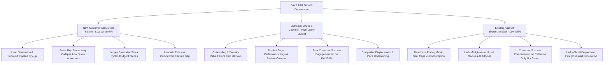

# SaaS & B2B Tech Industry Dossier

## 1. Industry Overview & Macro Dynamics

The Software-as-a-Service (SaaS) and enterprise B2B tech industry is defined by multi-tenant cloud software delivery, recurring subscription revenue, high gross margins ($70\%\text{--}85\%$), high upfront customer acquisition costs (CAC), and compounding cohort economics. It is one of the most frequently tested modern industry models in MBB interviews, spanning growth strategy, customer retention/churn turnarounds, pricing architecture, and sales-force productivity.

```
                    ┌──────────────────────────────────────────────────┐
                    │            CORE DRIVERS OF SAAS VALUE            │
                    └────────────────────────┬─────────────────────────┘
                                             │
         ┌───────────────────┬───────────────┴───────────────┬───────────────────┐
         ▼                   ▼                               ▼                   ▼
┌─────────────────┐ ┌─────────────────┐             ┌─────────────────┐ ┌─────────────────┐
│ Net Revenue     │ │ Customer Acq.   │             │ Gross Margins   │ │ The Rule of 40  │
│ Retention (NRR) │ │ Payback Period  │             │ (75-85% Hosting │ │ (Growth % +     │
│ (>110-130%)     │ │ (<12-18 Months) │             │ & Support COGS) │ │ FCF Margin %)   │
└─────────────────┘ └─────────────────┘             └─────────────────┘ └─────────────────┘
```

### Global Context
- **Shift from Perpetual Licenses to Cloud Subscriptions**: Transition from on-premise software with large upfront capital outlays and $18\text{--}22\%$ annual maintenance contracts (e.g., legacy SAP/Oracle) to cloud-native, multi-tenant subscription software charged monthly or annually per seat, compute unit, or workflow.
- **The "Rule of 40" Paradigm**: In the low-interest-rate era, SaaS companies were valued purely on revenue growth ("growth at all costs"). In modern macro environments, valuation multiples track the **Rule of 40** (the principle that a healthy SaaS company’s year-over-year revenue growth rate plus its free cash flow margin should exceed $40\%$).
- **Generative AI & Workflow Evolution**: Incumbents and startups are evolving from static seat-based software tools into AI-native agentic workflows, shifting pricing toward outcome-based and consumption-based models.

### Go-To-Market (GTM) Archetypes
1. **Product-Led Growth (PLG)**:
   - *Characteristics*: Self-serve onboarding, freemium or 14-day free trial, viral user adoption, bottom-up user pull (e.g., Slack, Notion, Canva, Figma).
   - *Economics*: Low Annual Contract Value (ACV: $\$500\text{--}\$10,000$), near-zero marginal CAC, short sales cycles (days), high volume, high logo churn.
2. **Inside Sales (Mid-Market SaaS)**:
   - *Characteristics*: Inbound marketing leads qualified by Sales Development Reps (SDRs) and closed by Account Executives (AEs) via Zoom demos.
   - *Economics*: ACV $\$15,000\text{--}\$75,000$, sales cycles $30\text{--}90\text{ days}$, CAC payback $12\text{--}18\text{ months}$.
3. **Enterprise Top-Down / Field Sales**:
   - *Characteristics*: Multi-stakeholder buying committees (CIO, CISO, Chief Procurement Officer, line-of-business VP), formal RFPs, custom proof-of-concept (POC) trials, SOC2/GDPR compliance audits, custom security integrations.
   - *Economics*: ACV $\$100,000\text{--}\$1,000,000+$, sales cycles $6\text{--}18\text{ months}$, high customer stickiness, low logo churn ($<5\%/\text{year}$), high Net Revenue Retention ($120\%\text{--}140\%$).
4. **Vertical SaaS**:
   - *Characteristics*: Purpose-built for specific industry workflows (e.g., Veeva for Life Sciences, Toast for Restaurants, Procore for Construction). Embeds payments, financing, and hardware into the software stack.

---

## 2. Complete End-to-End Value Chain & Margin Capture

```
┌────────────────────────────────────────────────────────────────────────────────────────┐
│                          B2B SAAS VALUE CHAIN & PROFIT POOLS                           │
└────────────────────────────────────────────────────────────────────────────────────────┘

 [Cloud Hyperscalers] ──► [SaaS Core Platform] ──► [System Integrators] ──► [Enterprise Buyer]
  AWS, Microsoft Azure,    Salesforce, ServiceNow,  Accenture, Deloitte,    CIO, CISO, VP Sales,
  Google Cloud (IaaS/PaaS) Snowflake, Datadog       Boutique Consultancies  Line-of-Business
 ─────────────────────────────────────────────────────────────────────────────────────────────────
  Gross Margin: 55-65%    Gross Margin: 75-85%     Gross Margin: 30-40%    ROI Expectation:
  EBITDA: 30-40%          EBIT Margin: 15-30%      EBIT Margin: 10-15%     3-5x Productivity /
  Moat: Data center scale, Moat: High switching    Moat: Implementation    Cost Reduction over
  Silicon IP, Ecosystem    costs, Workflow lock-in  relationships, talent  Legacy Processes
```

### Value Chain Steps & Economics
1. **Cloud Infrastructure & Hyperscalers (AWS, Azure, GCP, Cloudflare)**:
   - Provide computing power (EC2, VMs), serverless functions, database storage (S3, Aurora), and content delivery networks.
   - **Economic Impact**: Captures $\sim 6\text{--}12\%$ of SaaS revenue as raw hosting COGS.
2. **Core SaaS Application Platform (The Software Vendor)**:
   - Develops the multi-tenant software architecture, proprietary business logic, AI copilots, UI/UX, and data connectors.
   - **Margin Capture**: High gross margins ($75\text{--}85\%$). Primary cost lines are engineering R&D and quota-carrying sales reps.
3. **System Integrators & Channel Partners (Accenture, Deloitte, Wipro, Boutique VARs)**:
   - Perform large-scale enterprise implementations, data migration, legacy system integration, change management, and user training.
   - **Margin Capture**: Billable-hour consulting margins ($30\text{--}40\%$ gross margin; $10\text{--}15\%$ EBIT).
4. **App Marketplaces & Ecosystems (Salesforce AppExchange, AWS Marketplace)**:
   - Act as digital distribution hubs, taking a $3\%\text{--}15\%$ rev-share on third-party SaaS transactions while allowing buyers to draw down committed enterprise cloud spend.

---

## 3. Revenue Models & Monetization Mechanics

SaaS monetization relies on recurring contracts, pricing metrics, and compounding expansion.

```
┌────────────────────────────────────────────────────────────────────────────────────────┐
│                                TOTAL SAAS REVENUE                                      │
└──────────────────────────────────────────┬─────────────────────────────────────────────┘
                                           │
         ┌─────────────────────────────────┼─────────────────────────────────┐
         ▼                                 ▼                                 ▼
┌───────────────────────────────┐ ┌───────────────────────────────┐ ┌───────────────────────────────┐
│  Subscription Recurring (ARR) │ │  Usage & Consumption-Based    │ │  Professional Services (PS)   │
│  - Per-Seat / User Tiering    │ │  - Compute / Query Minutes    │ │  - Implementation & Migration │
│  - Feature-Gated Editions     │ │  - Data Ingestion (GB / TB)   │ │  - Custom Integrations        │
│  - Multi-Year Annual Billing  │ │  - API Calls / Transactions   │ │  - Training & Change Mgmt     │
└───────────────────────────────┘ └───────────────────────────────┘ └───────────────────────────────┘
```

### 1. The "Land-and-Expand" Compounding Flywheel
The core growth engine of top-tier SaaS companies is expanding revenue from existing customers faster than lost revenue from churned customers.

```
  [YEAR 1: LAND]           ──►  [YEAR 2: EXPAND]          ──►  [YEAR 3: SCALE]
  20 Engineering Seats          100 Seats (Cross-dept)         500 Global Enterprise Seats
  Starter Tier                  Enterprise Tier (SSO/SOC2)     Full Platform Suite + AI Add-on
  ARR: $12,000                  ARR: $75,000                   ARR: $450,000
```
- **Seat Expansion**: Adding licenses as the customer's employee base or department usage grows.
- **Tier Upgrades**: Gating advanced features (Single Sign-On SSO, Role-Based Access Control RBAC, 99.99% uptime SLA, dedicated customer success manager) behind premium enterprise tiers.
- **Cross-Selling Modules**: Selling complementary software products (e.g., HubSpot adding Service Hub and Operations Hub to its core Marketing Hub).

### 2. Contract Structures, Billings & Cash Flow Dynamics
- **Annual Upfront Invoicing**: Customer signs a 1-year or 3-year contract and pays 100% of Year 1 cash on Day 1.
  - *Accounting Treatment*: Cash increases immediately on Day 1. Revenue is recognized ratably over 12 months ($\frac{1}{12}\text{ per month}$). The unearned portion sits on the balance sheet as **Deferred Revenue** (Current Liability).
  - *Working Capital Superpower*: Top SaaS businesses have negative working capital—customers fund sales and R&D upfront!
- **Remaining Performance Obligations (RPO)**: The sum of invoiced deferred revenue plus unbilled contracted revenue for future multi-year periods. RPO indicates guaranteed future revenue visibility.

---

## 4. Detailed Unit Economics & Contribution Margin Breakdown

### Representative B2B Enterprise SaaS Income Statement ($50M ARR Company)

**Profile**:
- **Annual Recurring Revenue (ARR)**: $50,000,000 ($4.17M MRR)
- **Customer Count**: 1,000 accounts (Average Contract Value / ACV: $50,000)
- **Annual Growth Rate**: $30\%$ YoY ($+\$15\text{M Net New ARR}$)
- **Net Revenue Retention (NRR)**: $115\%$ | **Gross Revenue Retention (GRR)**: $92\%$

```
┌────────────────────────────────────────────────────────────────────────────────────────┐
│              REPRESENTATIVE SAAS P&L ($50M ARR ENTERPRISE SOFTWARE FIRM)              │
├──────────────────────────────────────┬─────────────┬──────────────┬────────────────────┤
│ Financial Line Item                  │ Amount ($)  │ Per Cust ($) │ % of Revenue       │
├──────────────────────────────────────┼─────────────┼──────────────┼────────────────────┤
│ **Subscription Recurring Revenue**   │  47,500,000 │    47,500    │  95.0%             │
│ **Professional Services Revenue**    │   2,500,000 │     2,500    │   5.0%             │
├──────────────────────────────────────┼─────────────┼──────────────┼────────────────────┤
│ **TOTAL REVENUE**                    │  50,000,000 │    50,000    │ 100.0%             │
├──────────────────────────────────────┼─────────────┼──────────────┼────────────────────┤
│ **Cost of Goods Sold (COGS)**        │             │              │                    │
│ 1. Cloud Hosting (AWS/Azure/GCP)     │   4,500,000 │     4,500    │   9.0% (Infr/Data) │
│ 2. Customer Success & Tech Support   │   3,250,000 │     3,250    │   6.5% (Retention) │
│ 3. Third-party Software / API Costs  │   1,000,000 │     1,000    │   2.0% (Sub-proc.) │
│ 4. Professional Services Delivery    │   2,000,000 │     2,000    │   4.0% (PS Wages)  │
├──────────────────────────────────────┼─────────────┼──────────────┼────────────────────┤
│ **TOTAL COGS**                       │  10,750,000 │    10,750    │  21.5%             │
├──────────────────────────────────────┼─────────────┼──────────────┼────────────────────┤
│ **GROSS PROFIT**                     │  39,250,000 │    39,250    │  **78.5%**         │
│ *(Subscription Gross Margin)*        │             │              │  *(81.6%)*         │
├──────────────────────────────────────┼─────────────┼──────────────┼────────────────────┤
│ **Operating Expenses (Opex)**        │             │              │                    │
│ 5. Sales & Marketing (S&M)           │  17,500,000 │    17,500    │  35.0% (CAC)       │
│ 6. Research & Development (R&D)      │  12,500,000 │    12,500    │  25.0% (Engineers) │
│ 7. General & Administrative (G&A)    │   5,000,000 │     5,000    │  10.0% (Legal/Fin) │
├──────────────────────────────────────┼─────────────┼──────────────┼────────────────────┤
│ **TOTAL OPERATING EXPENSES**         │  35,000,000 │    35,000    │  70.0%             │
├──────────────────────────────────────┼─────────────┼──────────────┼────────────────────┤
│ **OPERATING INCOME (EBIT)**          │   **4,250,000**│  **4,250**  │   **8.5%**         │
├──────────────────────────────────────┼─────────────┼──────────────┼────────────────────┤
│ **Free Cash Flow Adjustment (WC)**   │  +3,250,000 │    +3,250    │  +6.5% (Upfront $) │
│ **FREE CASH FLOW (FCF)**             │   **7,500,000**│  **7,500**  │  **15.0%**         │
├──────────────────────────────────────┴─────────────┴──────────────┴────────────────────┤
│ **RULE OF 40 SCORE**: 30.0% YoY Growth + 15.0% FCF Margin = **45.0% (High Performer)** │
└────────────────────────────────────────────────────────────────────────────────────────┘
```

---

## 5. Comprehensive Cost Structure

```
┌────────────────────────────────────────────────────────────────────────────────────────┐
│                         SAAS COST STRUCTURE ARCHITECTURE                               │
└────────────────────────────────────────────────────────────────────────────────────────┘

 [COGS / Hosting & Support] ──► [Sales & Marketing / CAC] ──► [R&D & Engineering Overhead]
  - AWS/GCP Compute & S3        - AE & SDR Quota Base + Comm. - Product Managers & UI/UX
  - Customer Success Managers   - Digital Demand Gen & SEM    - Cloud Backend & DevSecOps
  - Level 1-3 Support Engineers - B2B User Conferences        - QA Test Engineers & AI Modelers
  - Payment Gateway Processing  - Partner Channel Rebates     - Core IP Infrastructure
  (Scales with customers/data)  (Discretionary growth dial)   (Fixed payroll investment)
```

### Cost Dynamics & Levers

| Cost Bucket | % of Revenue | Nature of Cost | Strategic Optimization Levers |
|---|---|---|---|
| **Cloud Hosting & Infrastructure** | $7\%\text{--}12\%$ | Semi-variable (Data volume & compute) | AWS Savings Plans / Reserved Instances, database query indexing, multi-cloud cost arbitrage, edge caching. |
| **Customer Success & Support** | $5\%\text{--}8\%$ | Semi-variable (Tiered by ACV) | Digital-only support for low-ACV tiers ($<\$10\text{K}$); reserving dedicated CSMs for enterprise accounts ($>\$100\text{K}$). |
| **Sales & Marketing (S&M)** | $30\%\text{--}45\%$ | Discretionary growth investment | Shifting lead mix from paid ads to inbound SEO/content, improving sales rep quota attainment ($>70\%$), optimizing sales cycle velocity. |
| **Research & Development (R&D)** | $20\%\text{--}30\%$ | Fixed engineering payroll | Establishing global capability centers (GCCs in India, Poland) for engineering talent, reusable modular API microservices. |
| **General & Administrative (G&A)**| $8\%\text{--}12\%$ | Fixed corporate overhead | Automated ERP/billing systems (Stripe Billing, Zuora), offshore compliance teams. |

### Logo Churn vs Dollar Churn (Net Retention Mechanics)

```
┌────────────────────────────────────────────────────────────────────────────────────────┐
│                       REVENUE CHURN VS LOGO CHURN DYNAMICS                             │
├───────────────────────────────┬────────────────────────────────────────────────────────┤
│ Metric                        │ Mathematical Meaning & Strategic Implication           │
├───────────────────────────────┼────────────────────────────────────────────────────────┤
│ **Logo Churn**                │ % of distinct customer logos (accounts) that cancel.   │
│ *(e.g., 10% annual)*          │ Often concentrated in small, low-ACV customers.        │
├───────────────────────────────┼────────────────────────────────────────────────────────┤
│ **Gross Dollar Churn**        │ % of ARR lost strictly from cancellations and          │
│ *(e.g., 8% annual)*           │ contract downgrades (ignoring all customer expansion). │
├───────────────────────────────┼────────────────────────────────────────────────────────┤
│ **Net Dollar Retention (NDR)**│ Total ending ARR from an existing cohort divided by    │
│ **or NRR (e.g., 120%)**       │ beginning ARR of that same cohort.                     │
│                               │ **$\text{NRR} > 100\%$ means the company grows even    │
│                               │ with ZERO new customer acquisition!**                  │
└───────────────────────────────┴────────────────────────────────────────────────────────┘
```

---

## 6. Essential KPI Formulas & Benchmark Ranges

```
┌────────────────────────────────────────────────────────────────────────────────────────┐
│                                CORE SAAS KPI FORMULAS                                  │
└────────────────────────────────────────────────────────────────────────────────────────┘

      [ARR] = MRR × 12
      [Net New ARR] = New Land ARR + Expansion ARR - Contraction ARR - Churned ARR
      [NRR %] = [(Starting ARR + Expansion - Contraction - Churn) / Starting ARR] × 100
      [GRR %] = [(Starting ARR - Contraction - Churn) / Starting ARR] × 100
      [Blended CAC] = Total S&M Expenses / Number of New Customers Acquired
      [CAC Payback (Months)] = CAC / (Average Monthly Revenue per Customer × Gross Margin %)
      [Customer Lifetime Value (LTV)] = (ACV × Gross Margin %) / Annual Gross Dollar Churn Rate
      [LTV / CAC Ratio] = LTV / CAC (Target: >3.0x)
      [Rule of 40] = YoY Revenue Growth Rate (%) + Free Cash Flow Margin (%)
      [SaaS Magic Number] = [ (Current Quarter ARR - Prior Quarter ARR) × 4 ] / Prior Q S&M
```

### Mathematical Formulations

1. **Annual Recurring Revenue (ARR)**:
   $$\text{ARR} = 12 \times \text{MRR}$$

2. **Net Revenue Retention (NRR / NDR)**:
   $$\text{NRR} = \frac{\text{ARR}_{\text{Cohort Start}} + \text{Expansion} - \text{Contraction} - \text{Churn}}{\text{ARR}_{\text{Cohort Start}}} \times 100$$

3. **Gross Revenue Retention (GRR)**:
   $$\text{GRR} = \frac{\text{ARR}_{\text{Cohort Start}} - \text{Contraction} - \text{Churn}}{\text{ARR}_{\text{Cohort Start}}} \times 100$$
   *Note: GRR can never exceed $100\%$.*

4. **CAC Payback Period (in Months)**:
   $$\text{CAC Payback} = \frac{\text{CAC}}{\text{ARPU}_{\text{monthly}} \times \text{Gross Margin } \%}$$

5. **Customer Lifetime Value (LTV)**:
   $$\text{LTV} = \frac{\text{ACV} \times \text{Gross Margin } \%}{\text{Annual Gross Dollar Churn Rate}}$$

6. **LTV to CAC Ratio**:
   $$\text{LTV:CAC} = \frac{\text{LTV}}{\text{CAC}}$$

7. **SaaS Magic Number (Sales Efficiency)**:
   $$\text{Magic Number} = \frac{(\text{Quarter } Q_t \text{ Revenue} - \text{Quarter } Q_{t-1} \text{ Revenue}) \times 4}{\text{Quarter } Q_{t-1} \text{ S\&M Expense}}$$
   - *Interpretation*:
     - $>1.0\times$: Outstanding sales efficiency. Step on the gas (increase S&M spend).
     - $0.75\text{--}1.0\times$: Good efficiency. Sustainable GTM engine.
     - $<0.5\times$: Inefficient acquisition. Fix churn and sales conversion before scaling spend.

8. **Burn Multiple (Capital Efficiency for Private SaaS)**:
   $$\text{Burn Multiple} = \frac{\text{Net Cash Burn in Period}}{\text{Net New ARR Added in Period}}$$

### Industry Benchmark Ranges

| Metric | Best-in-Class (Top Decile) | Good / Median SaaS | Distressed / Underperforming |
|---|---|---|---|
| **Net Revenue Retention (NRR)** | $>125\%$ (Enterprise: $>135\%$) | $105\%\text{--}115\%$ | $<95\%$ (Leaky bucket) |
| **Gross Revenue Retention (GRR)** | $>92\%$ (Enterprise: $>95\%$) | $85\%\text{--}90\%$ | $<75\%$ |
| **Gross Margin (%)** | $>80\%$ | $72\%\text{--}78\%$ | $<65\%$ (Heavy services drag) |
| **CAC Payback Period** | $<12\text{ months}$ (PLG: $<6\text{m}$) | $14\text{--}20\text{ months}$ | $>30\text{ months}$ |
| **LTV / CAC Ratio** | $>4.5\times$ | $3.0\times\text{--}4.0\times$ | $<2.0\times$ |
| **Rule of 40 Score** | $>50\%$ | $40\%\text{--}45\%$ | $<25\%$ |
| **SaaS Magic Number** | $>1.2\times$ | $0.75\times\text{--}1.0\times$ | $<0.4\times$ |
| **S&M as % of Revenue** | $<30\%$ (at scale) | $35\%\text{--}45\%$ | $>60\%$ (Unproductive GTM) |

---

## 7. Typical Case Scenarios & Diagnostic Issue Trees

### Issue Tree 1: SaaS Growth Stagnation & "Leaky Bucket" Diagnostic



### Issue Tree 2: Transitioning from PLG to Enterprise Field Sales

```mermaid
flowchart TD
    Root[Transition from PLG to Enterprise Field Sales] --> Prod[1. Product & Security Readiness]
    Root --> GTM[2. GTM & Sales Organization]
    Root --> Price[3. Pricing & Packaging Architecture]
    Root --> CS[4. Customer Success & Professional Services]

    Prod --> Prod1[Enterprise Security SOC2, HIPAA, Single Sign-On SSO]
    Prod --> Prod2[Role-Based Access Control RBAC & Audit Logs]
    Prod --> Prod3[Custom Integration APIs & Legacy ERP Connectors]

    GTM --> GTM1[Hire Quota-Carrying Enterprise Account Executives AEs]
    GTM --> GTM2[Product-Qualified Lead PQL Routing Algorithms]
    GTM --> GTM3[RFP & Procurement Legal Negotiation Capabilities]

    Price --> Price1[Define High-Value Enterprise Tier Gate Critical Features]
    Price --> Price2[Minimum Contract Commitments $50K Floor ACV]
    Price --> Price3[Custom Invoicing & Multi-Year Payment Terms]

    CS --> CS1[Dedicated Technical Account Managers TAMs]
    CS --> CS2[Formal Professional Services Implementation Packages]
    CS --> CS3[Enterprise SLA Guarantees 99.99% Uptime]
```



### Typical Case Archetypes in Consulting Interviews
1. **The Leaky Bucket Turnaround**:
   - *Problem*: A SaaS firm with $\$100\text{M ARR}$ is spending $\$50\text{M}$ on S&M but ARR is growing at only $5\%$.
   - *Diagnostic*: Deconstruct NRR. The company has a $25\%$ annual gross churn rate ($GRR = 75\%$). The S&M machine is spending $\$50\text{M}$ just to refill the $\$25\text{M}$ of lost ARR.
   - *Solutions*: Fix product onboarding (the critical first 90 days), establish automated health-score alerts for low user logins, and restructure CSM compensation around Net Retention.
2. **Pricing & Packaging Redesign**:
   - *Problem*: A B2B tool charges a flat $\$20/\text{user/month}$. Customer usage has exploded by $10\times$, but revenue has only grown $10\%$.
   - *Analysis*: Seat-based pricing creates a disincentive for customers to add more users (leading to password sharing).
   - *Solutions*: Shift to a hybrid pricing model: platform base fee + usage metric (e.g., active workflows or data processed) + enterprise feature gating (SSO/admin controls).

---

## 8. Common Pitfalls & Candidate "Landmines"

1. **Calculating LTV on Revenue Instead of Gross Profit**:
   - *The Landmine*: Calculating $\text{LTV} = \frac{\text{ACV}}{\text{Churn}}$.
   - *The Reality*: Software still has hosting, customer support, and payment costs! $\text{LTV} = \frac{\text{ACV} \times \mathbf{\text{Gross Margin } \%}}{\text{Gross Churn Rate}}$. Failing to include gross margin overstates customer value by 20–30%.
2. **Confusing Net Revenue Retention (NRR) with Gross Revenue Retention (GRR)**:
   - *The Landmine*: Claiming an NRR of $110\%$ means no customers are canceling.
   - *The Reality*: An NRR of $110\%$ can easily occur if you lose $20\%$ of your customer base to churn ($GRR = 80\%$) but expand the surviving accounts by $30\%$. Masking underlying customer dissatisfaction with expansion of a few large accounts is a fatal blind spot.
3. **Ignoring Professional Services Gross Margin Drag**:
   - *The Landmine*: Assuming a SaaS company with $25\%$ professional services revenue maintains an $80\%$ blended gross margin.
   - *The Reality*: Professional services (custom engineering, implementation) typically generate gross margins of only $15\text{--}30\%$, dragging down total company gross margins and depressing valuation multiples.
4. **Misunderstanding CAC Payback Mechanics**:
   - *The Landmine*: Using gross ARR instead of contribution gross profit when calculating payback months.
   - *The Reality*: $\text{Payback Months} = \frac{\text{CAC}}{\text{Monthly Revenue} \times \mathbf{\text{Gross Margin } \%}}$.
5. **Advocating Field Sales for Low-ACV Products**:
   - *The Landmine*: Proposing to hire senior field sales reps ($>\$250\text{K}$ OTE compensation) to sell a $\$3,000$ ACV software product.
   - *The Reality*: An enterprise AE needs an annual quota of $\$800\text{K}\text{--}\$1.5\text{M}$ to be economically viable. Low-ACV products must be sold via self-serve PLG or high-velocity inside sales.
