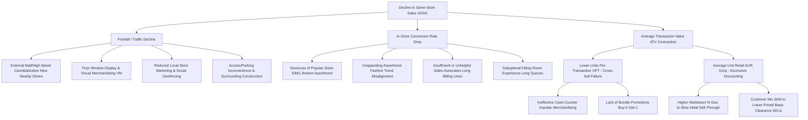
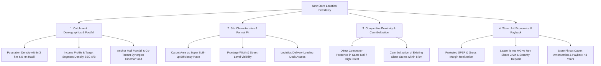

# Retail & Fashion Industry Dossier

## 1. Industry Overview & Macro Dynamics

The retail and fashion industry encompasses the distribution and merchandising of apparel, footwear, accessories, and consumer goods. It is characterized by high fixed operating costs (commercial real estate leases and store personnel), rapid trend obsolescence, working-capital-intensive seasonal inventory cycles, and intense competition across physical and digital channels.

```
                    ┌──────────────────────────────────────────────────┐
                    │          MACRO DRIVERS OF RETAIL VALUE           │
                    └────────────────────────┬─────────────────────────┘
                                             │
         ┌───────────────────┬───────────────┴───────────────┬───────────────────┐
         ▼                   ▼                               ▼                   ▼
┌─────────────────┐ ┌─────────────────┐             ┌─────────────────┐ ┌─────────────────┐
│ Same-Store      │ │ Real Estate     │             │ Merchandising   │ │ Supply Chain    │
│ Sales Growth    │ │ Lease Costs     │             │ Agility & GMROI │ │ Lead Times      │
│ (SSSG / LFL)    │ │ (MG vs Rev-Share│             │ (Full-Price STR)│ │ (3 Wks vs 6 Mos)│
└─────────────────┘ └─────────────────┘             └─────────────────┘ └─────────────────┘
```

### Global Context
- **The Fast Fashion Revolution vs Traditional Apparel Cycles**:
  - *Traditional Apparel*: 6-to-9-month design-to-shelf lead times, large upfront minimum order quantities (MOQs), heavy reliance on pre-season demand forecasting, resulting in massive end-of-season clearance markdowns ($30\text{--}50\%$ of inventory sold at discount).
  - *Agile Fast Fashion (Inditex/Zara, Shein)*: 2-to-4-week design-to-rack turnaround, near-shoring, small initial batch test runs ($15\text{--}25\%$ of total expected demand), reactive mid-season restocking based on real-time POS sell-through data. Result: $>80\%$ full-price sell-through rates.
- **Omnichannel Imperative**: Integration of physical stores with digital commerce via **BOPIS** (Buy Online, Pick Up In Store), **BORIS** (Buy Online, Return In Store), and ship-from-store micro-fulfillment.

### India & Emerging Markets Context
- **Transition from Unorganized to Modern / Value Retail**:
  - Unorganized General Trade (local mom-and-pop apparel shops, standalone tailors) historically accounted for $>75\%$ of the market.
  - Organized Modern Trade (Reliance Retail, Trent/Zudio, Aditya Birla Fashion, Shoppers Stop, Max Fashion) and E-commerce (Myntra, Ajio) are growing rapidly ($15\text{--}20\%\text{ CAGR}$).
- **The "Value Fashion" Explosion**:
  - Players like **Zudio** (Tata/Trent) disrupted the Indian apparel market with ultra-value price points ($₹299\text{--}₹999$), zero marketing spend (relying purely on prime store locations), $100\%$ private label, rapid 15-day inventory cycles, and exceptional Sales per Square Foot ($\sim ₹2,200\text{--}₹2,800/\text{sq. ft./month}$).
- **High Real Estate Cost Pressures**: Top-tier metro mall occupancy costs ($12\text{--}18\%$ of revenue) force retailers to maintain extreme floor space productivity.

---

## 2. Complete End-to-End Value Chain & Margin Capture

```
┌────────────────────────────────────────────────────────────────────────────────────────┐
│                          FASHION & APPAREL VALUE CHAIN                                 │
└────────────────────────────────────────────────────────────────────────────────────────┘

 [Fiber & Fabric Mills] ──► [Garment Manufacturers] ──► [Brand & Design HQ] ──► [Logistics / CDCs] ──► [Retail Stores / Web]
  Cotton, Polyester,        Cut-Make-Trim (CMT) in      Merchandising, Line     Cross-docking,         Flagship Stores,
  Yarn Spinning             India, Bangladesh, Vietnam  Planning, Trend IP      Regional Warehouses    Malls, E-Commerce
 ────────────────────────────────────────────────────────────────────────────────────────────────────────────────────────
  Gross Margin: 15-25%      Gross Margin: 12-18%        Gross Margin: 55-65%    Opex: 4-7% of Sales    Store 4-Wall EBITDA:
  EBITDA: 8-12%             EBITDA: 6-10%               EBITDA: 15-22%          ROIC: 12-16%           18-24%
  Moat: Raw material        Moat: Cheap labor, scale,   Moat: Brand equity,     Moat: Fulfillment      Moat: Prime real estate,
  commodity hedging         turnaround speed            merchandising taste     algorithms, density    visual merchandising
```

### Value Chain Segments & Economics
1. **Raw Material & Fabric Mills (Arvind, Vardhman, Toray)**:
   - Convert raw cotton, wool, or petrochemical polymers into yarn and woven/knitted fabric.
   - **Economic Profile**: Asset-heavy, energy-intensive, commodity price exposure.
2. **Garment Manufacturers / CMT Factories (Shahi Exports, Gokaldas, Brandix)**:
   - Cut, make, trim, stitch, and finish garments based on tech packs provided by global brands.
   - **Economic Profile**: Labor-intensive, low single-digit net profit margins ($4\text{--}7\%$), high volume dependency.
3. **Brand Owner & Merchandising Headquarters (The Core Intellectual Engine)**:
   - Directs trend forecasting, range architecture, fabric sourcing contracts, visual merchandising, and pricing strategy.
   - **Margin Capture**: High initial markup (**IMU**: $3.0\times\text{ to }4.5\times$ over FOB landed manufacturing cost), yielding gross margins of $55\text{--}65\%$.
4. **Distribution Centers (CDCs/RDCs) & Logistics**:
   - Manages automated sorting, barcoding, cross-docking, and replenishment dispatch to retail store networks.
5. **Retail Network & Digital Storefronts**:
   - Executes store-level visual merchandising, customer engagement, POS checkout, and reverse logistics (returns processing).

---

## 3. Revenue Models & Monetization Mechanics

The foundational equation of retail revenue deconstructs sales into store traffic, customer conversion, and basket economics.

```
┌────────────────────────────────────────────────────────────────────────────────────────┐
│                          THE CORE RETAIL REVENUE EQUATION                              │
└────────────────────────────────────────────────────────────────────────────────────────┘

 [TOTAL STORE SALES] = [Footfall / Traffic] 
                     × [Conversion Rate %] 
                     × [Average Transaction Value (ATV)]

                     = [Transactions] 
                     × [Units Per Transaction (UPT)] 
                     × [Average Unit Retail Price (AUR)]
```

### 1. Merchandising Strategy & Assortment Architecture
- **Core / Evergreen SKUs ($\sim 60\text{--}70\%$ of Inventory)**:
  - Basic t-shirts, denim, socks, formal white/black shirts.
  - Predictable, non-perishable demand. Low markdown risk ($<5\%$), high replenishment predictability, stable supplier contracts.
- **Fashion / Trend SKUs ($\sim 30\text{--}40\%$ of Inventory)**:
  - Highly seasonal, trend-driven cuts, colors, and prints.
  - High initial margin ($65\text{--}75\%$), short shelf-life ($6\text{--}8\text{ weeks}$), high markdown exposure if demand is misforecasted.

### 2. Markdown Lifecycle & Discounting Dynamics

```
  [WEEK 1 - 6: FULL PRICE]   ──►  [WEEK 7 - 10: PROMOTION]  ──►  [WEEK 11 - 14: EOSS CLEARANCE]
  100% Original Ticket Price      20% - 30% Mid-Season Promo     40% - 60% End-of-Season Sale
  Gross Margin: 65%               Gross Margin: 50%              Gross Margin: 20% - 30%
  Sell-Through Target: 60-70%     Sell-Through Target: 85%       Clearance to 95%+ / Salvage
```
- **Sell-Through Rate (STR)**: Measures the percentage of initial inventory received that is sold within a given timeframe.
- **The Markdown Landmine**: Every $10\%$ increase in markdown percentage dilutes realized gross margin by $\sim 400\text{--}500\text{ bps}$, directly destroying store 4-wall profitability.

### 3. Private Label Monetization
- Retailers replace third-party branded apparel with private label / in-house brands (e.g., Target’s Cat & Jack, Westside’s exclusive private labels).
- **Economic Spread**: Private label apparel eliminates the third-party brand’s profit margin and wholesale markup, delivering $15\text{--}25\%$ higher gross margins to the retailer at identical consumer price points.

---

## 4. Detailed Unit Economics & Contribution Margin Breakdown

### Store-Level 4-Wall P&L (Fast Fashion Specialty Apparel Store)

**Store Profile**:
- **Location**: Tier 1 Metro Prime Shopping Mall
- **Store Footprint**: 3,000 sq. ft. Carpet Area
- **Sales per Square Foot (SPSF)**: ₹2,500 / sq. ft. / month
- **Annual Gross Revenue**: $3,000\text{ sq. ft.} \times ₹2,500 \times 12\text{ months} = ₹9,00,00,000$ (₹9.0 Crore / ~$1.08M)
- **Annual Footfall**: 300,000 visitors | **Conversion Rate**: $15\%$ (45,000 transactions)
- **Average Basket**: 2.5 units at ₹800/unit $\rightarrow \text{ATV} = ₹2,000$

```
┌────────────────────────────────────────────────────────────────────────────────────────┐
│             STORE-LEVEL 4-WALL P&L (3,000 SQ. FT. FAST FASHION STORE)                  │
├──────────────────────────────────────┬─────────────┬──────────────┬────────────────────┤
│ Financial Line Item                  │ Amount (₹)  │ Per SqFt/Mo  │ % of Net Sales     │
├──────────────────────────────────────┼─────────────┼──────────────┼────────────────────┤
│ **Gross Sales Revenue**              │ 9,45,00,000 │   ₹2,625     │ 105.0%             │
│ Less: Customer Returns & Allowances  │  (45,00,000)│    (₹125)    │  (5.0%)            │
├──────────────────────────────────────┼─────────────┼──────────────┼────────────────────┤
│ **NET SALES REVENUE**                │ 9,00,00,000 │   ₹2,500     │ **100.0%**         │
├──────────────────────────────────────┼─────────────┼──────────────┼────────────────────┤
│ **Cost of Goods Sold (COGS)**        │             │              │                    │
│ 1. Landed Sourcing & Manufacturing   │ 3,42,00,000 │     ₹950     │  38.0%             │
│ 2. Inbound Freight & Warehousing     │   27,00,000 │      ₹75     │   3.0%             │
│ 3. Shrinkage & Inventory Theft (1.5%)│   13,50,000 │      ₹38     │   1.5%             │
├──────────────────────────────────────┼─────────────┼──────────────┼────────────────────┤
│ **TOTAL COGS**                       │ 3,82,50,000 │   ₹1,063     │  42.5%             │
├──────────────────────────────────────┼─────────────┼──────────────┼────────────────────┤
│ **REALIZED GROSS PROFIT**            │ 5,17,50,000 │   ₹1,438     │  **57.5%**         │
├──────────────────────────────────────┼─────────────┼──────────────┼────────────────────┤
│ **Direct Store Operating Opex**      │             │              │                    │
│ 4. Store Lease (MG + Rev Share 11%)  │   99,00,000 │     ₹275     │  11.0% (Rent)      │
│ 5. Common Area Maintenance (CAM)     │   18,00,000 │      ₹50     │   2.0% (Mall fees) │
│ 6. Store Payroll (15 Staff + Mgr)    │   63,00,000 │     ₹175     │   7.0% (Wages)     │
│ 7. Electricity, Power & HVAC         │   27,00,000 │      ₹75     │   3.0% (Energy)    │
│ 8. POS, Card Interchange & Payment   │   16,20,000 │      ₹45     │   1.8% (Credit)    │
│ 9. Visual Merchandising & Store Maint│   13,50,000 │      ₹38     │   1.5% (Display)   │
├──────────────────────────────────────┼─────────────┼──────────────┼────────────────────┤
│ **TOTAL STORE 4-WALL OPEX**          │ 2,36,70,000 │     ₹658     │  26.3%             │
├──────────────────────────────────────┼─────────────┼──────────────┼────────────────────┤
│ **STORE 4-WALL EBITDA**              │ 2,80,80,000 │     ₹780     │  **31.2%**         │
├──────────────────────────────────────┼─────────────┼──────────────┼────────────────────┤
│ **Store Fit-out Capex Depreciation** │   36,00,000 │     ₹100     │   4.0% (Fit-outs)  │
│ **Allocated Corporate Overhead & Mktg│   72,00,000 │     ₹200     │   8.0% (HQ/Brand)  │
├──────────────────────────────────────┼─────────────┼──────────────┼────────────────────┤
│ **STORE OPERATING PROFIT (EBIT)**    │ **1,72,80,000**│  **₹480**   │  **19.2%**         │
└──────────────────────────────────────┴─────────────┴──────────────┴────────────────────┘
```

---

## 5. Comprehensive Cost Structure

```
┌────────────────────────────────────────────────────────────────────────────────────────┐
│                         RETAIL STORE COST VARIABILITY                                  │
└────────────────────────────────────────────────────────────────────────────────────────┘

 [Fixed Store Overhead]      ──► [Semi-Variable Store Costs] ──► [Directly Variable Costs]
  - Minimum Guaranteed Rent       - Floor Staff Base + Incentive  - COGS / Garment Sourcing
  - Store Fit-out Depreciation    - Store Electricity & HVAC      - Revenue-Share Lease Top-up
  - Common Area Maint. (CAM)      - Visual Display Changes        - Credit Card Interchange (1.5-2%)
  - POS Software Base License     - Store Maintenance & Cleaning  - Shopping Bags & Packaging
  (Zero variance with sales)      (Step-fixed with store hours)   (Scales directly with volume)
```

### Cost Breakdown Table

| Cost Category | % of Net Sales | Behavior | Strategic Levers & Management Practices |
|---|---|---|---|
| **Cost of Goods Sold (COGS)** | $40\%\text{--}50\%$ | Variable with units sold | Direct vendor sourcing, fabric consolidation, bulk order commitments for core basics, nearshoring. |
| **Store Occupancy / Rent** | $10\%\text{--}15\%$ | Hybrid (Fixed MG vs % Rev Share) | Structuring leases with pure revenue share in new malls; negotiating rent caps in high-traffic anchor locations. |
| **Store Personnel & Wages** | $6\%\text{--}10\%$ | Semi-fixed / Step-variable | Cross-training floor staff, flex-scheduling during peak footfall hours (Friday evening–Sunday night), productivity incentives. |
| **Common Area Maint. & Power**| $4\%\text{--}7\%$ | Fixed / Semi-variable | LED lighting upgrades, smart HVAC thermostats, auditing mall CAM pass-through utility charges. |
| **Marketing & Advertising** | $3\%\text{--}6\%$ | Discretionary corporate overhead | Shifting budget from broad TV/print to hyper-local geofenced social ads targeting footfall within a 3 km store radius. |
| **Shrinkage & Breakage** | $1.0\%\text{--}2.5\%$ | Variable / Loss | RFID tagging on every garment, EAS security gates at entrance, automated cycle-count inventory audits. |
| **Credit Card Processing** | $1.5\%\text{--}2.0\%$ | Variable (% of electronic transactions)| UPI / QR-code payment adoption (zero or lower interchange), routing via unified payment aggregators. |

### Commercial Real Estate Lease Models

```
┌────────────────────────────────────────────────────────────────────────────────────────┐
│                        RETAIL STORE LEASE STRUCTURES                                   │
├────────────────────────┬───────────────────────────────────────────────────────────────┤
│ Lease Model            │ Mechanism & Strategic Risk/Reward Profile                     │
├────────────────────────┼───────────────────────────────────────────────────────────────┤
│ **Fixed Rent**         │ • Fixed monthly rent per sq. ft. (e.g., ₹200/sq. ft./month).  │
│                        │ • *Pros*: Full margin expansion upside as store sales scale.  │
│                        │ • *Cons*: High operating leverage; lethal during downturns.   │
├────────────────────────┼───────────────────────────────────────────────────────────────┤
│ **Pure Revenue Share** │ • Mall landlord takes a fixed % of net sales (e.g., 12%).     │
│                        │ • *Pros*: Zero downside risk during slow periods/lockdowns.   │
│                        │ • *Cons*: Landlord captures a massive slice of success.       │
├────────────────────────┼───────────────────────────────────────────────────────────────┤
│ **Minimum Guarantee**  │ • Retailer pays **Higher of [Fixed Minimum Rent vs X% of Net  │
│ **(MG) + Rev-Share**   │   Sales]** (e.g., Higher of ₹6 Lakhs or 10% of revenue).      │
│ *(Standard Mall Model)*│ • *Reality*: Landlord has protected floor and captures upside.│
└────────────────────────┴───────────────────────────────────────────────────────────────┘
```

---

## 6. Essential KPI Formulas & Benchmark Ranges

```
┌────────────────────────────────────────────────────────────────────────────────────────┐
│                                CORE RETAIL KPI FORMULAS                                │
└────────────────────────────────────────────────────────────────────────────────────────┘

      [Sales per Sq. Ft. (SPSF)] = Total Net Sales / Carpet Selling Area (Sq. Ft.)
      [SSSG / LFL Growth %] = [(Comp Store Sales Year t - Comp Store Sales Year t-1) / t-1] × 100
      [Inventory Turnover Ratio (ITR)] = Annual COGS / Average Inventory at Cost
      [Days of Inventory Outstanding (DIO)] = 365 / Inventory Turnover Ratio
      [GMROI] = Gross Margin ($) / Average Inventory Cost ($)
      [Sell-Through Rate (STR %)] = (Units Sold / Total Inventory Received) × 100
      [Conversion Rate %] = (Number of Transactions / Total Store Footfall) × 100
      [Average Transaction Value (ATV)] = Total Net Sales / Total Transactions
      [Units per Transaction (UPT)] = Total Units Sold / Total Transactions
      [Average Unit Retail (AUR)] = Total Net Sales / Total Units Sold
      [Shrinkage %] = (Book Inventory Value - Physical Audit Value) / Total Net Sales
```

### Mathematical Formulations

1. **Sales per Square Foot (SPSF)**:
   $$\text{SPSF} = \frac{\text{Net Sales in Period}}{\text{Total Carpet Selling Square Footage}}$$

2. **Same-Store Sales Growth (SSSG / Like-for-Like LFL)**:
   $$\text{SSSG} = \frac{\sum \text{Sales of Stores Open } >12\text{ Months in Year } t - \sum \text{Sales of Same Stores in Year } t-1}{\sum \text{Sales of Same Stores in Year } t-1} \times 100$$
   *Crucial for stripping out the illusion of growth driven purely by opening new stores.*

3. **Inventory Turnover Ratio (ITR)**:
   $$\text{ITR} = \frac{\text{Annual COGS}}{\text{Average Inventory at Cost}} = \frac{\text{Annual COGS}}{\frac{1}{2} (\text{Beginning Inventory} + \text{Ending Inventory})}$$

4. **Gross Margin Return on Inventory Investment (GMROI)**:
   $$\text{GMROI} = \frac{\text{Gross Margin } (\$)}{\text{Average Inventory at Cost } (\$)} = \text{Gross Margin } \% \times \frac{\text{Sales}}{\text{Average Inventory at Cost}} = \frac{\text{Gross Margin } \% \times \text{ITR}}{1 - \text{Gross Margin } \%}$$
   *GMROI reveals the actual cash return generated per dollar invested in inventory.*

5. **Sell-Through Rate (STR %)**:
   $$\text{STR} = \frac{\text{Units Sold in Period}}{\text{Beginning On-Hand Units} + \text{Inbound Receipts}} \times 100$$

6. **Gross-to-Net Sales Waterfall (Markdown Impact)**:
   $$\text{Realized Gross Margin } \% = \text{Initial Markup (IMU) } \% - \left[ \text{Markdown } \% \times (1 - \text{IMU } \%) \right] - \text{Shrinkage } \%$$

### Industry Benchmark Ranges

| Metric | Fast Fashion (Zara, Zudio) | Department Stores | Luxury Apparel | Value Grocery (D-Mart) |
|---|---|---|---|---|
| **Gross Margin (%)** | $55\%\text{--}62\%$ | $38\%\text{--}45\%$ | $70\%\text{--}80\%$ | $14\%\text{--}17\%$ |
| **Inventory Turn (ITR)** | $5.0\times\text{--}8.0\times$ | $2.5\times\text{--}3.5\times$ | $1.5\times\text{--}2.2\times$ | $12.0\times\text{--}16.0\times$ |
| **Days of Inventory (DIO)** | $45\text{--}70\text{ days}$ | $105\text{--}145\text{ days}$ | $165\text{--}240\text{ days}$ | $22\text{--}30\text{ days}$ |
| **GMROI ($ return per $ inv)**| $\$2.20\text{--}\$3.50$ | $\$1.30\text{--}\$1.80$ | $\$1.50\text{--}\$2.20$ | $\$2.50\text{--}\$3.80$ |
| **Store Conversion Rate** | $12\%\text{--}18\%$ | $8\%\text{--}14\%$ | $4\%\text{--}8\%$ | $85\%\text{--}95\%$ |
| **Store 4-Wall EBITDA Margin**| $20\%\text{--}28\%$ | $10\%\text{--}15\%$ | $25\%\text{--}35\%$ | $8\%\text{--}10\%$ |
| **Occupancy Cost (% Sales)**| $10\%\text{--}14\%$ | $12\%\text{--}16\%$ | $15\%\text{--}22\%$ | $3\%\text{--}5\%$ |

---

## 7. Typical Case Scenarios & Diagnostic Issue Trees

### Issue Tree 1: Retail Same-Store Sales Growth (SSSG) Decline Diagnostic



### Issue Tree 2: New Store Network Expansion & Location Feasibility



### Typical Case Archetypes in Consulting Interviews
1. **SSSG Profitability Turnaround (e.g., IIMA Cases 020, 023)**:
   - *Problem*: A 200-store apparel retailer reports that revenues are growing $15\%$ due to new store openings, but EBITDA margins have dropped from $16\%$ to $9\%$.
   - *Diagnostic*: Strip out new stores. SSSG on mature stores is $-8\%$. Investigate the root cause: broken size curves causing stockouts in size M/L while XS/XXL pile up, triggering massive clearance markdowns.
2. **Omnichannel Fulfillment & Returns Optimization**:
   - *Problem*: E-commerce expansion has increased online sales to $30\%$ of total revenue, but return rates are $35\%$, wiping out e-commerce contribution margin.
   - *Solutions*: Implement BORIS (encourage returns to store, driving footfall and $20\%$ immediate store repurchase conversion), standardize digital size-recommendation tools.
3. **Inventory Glut & Markdown Optimization**:
   - *Problem*: Unsold seasonal fashion inventory is occupying 40% of shelf space at the start of a new season.
   - *Analysis*: Calculate the opportunity cost of holding old inventory (depressing new-season SPSF) versus aggressive dynamic markdown liquidation.

---

## 8. Common Pitfalls & Candidate "Landmines"

1. **Confusing Headline Revenue Growth with Same-Store Sales Growth (SSSG)**:
   - *The Landmine*: Assuming a retail chain opening 30 new stores a year is healthy because total revenue grew $20\%$.
   - *The Reality*: A retailer can mask dying, unprofitable legacy stores by opening new stores. Always demand **SSSG / Like-for-Like (LFL)** data.
2. **Treating Initial Markup (IMU) as Realized Gross Margin**:
   - *The Landmine*: Hearing that a garment costs ₹400 to make and retails for ₹1,000, and assuming the gross margin is $60\%$.
   - *The Reality*: After factoring in $25\%$ end-of-season markdown discounts, $2\%$ shrinkage theft, and $3\%$ customer returns, the realized gross margin is often only $42\text{--}48\%$.
3. **Ignoring GMROI in Product Mix Decisions**:
   - *The Landmine*: Recommending a retailer drop a $20\%$ margin item in favor of a $50\%$ margin item.
   - *The Reality*: If the $20\%$ margin item turns 15 times a year ($\text{GMROI} = \$3.75$) and the $50\%$ item turns only 1.5 times ($\text{GMROI} = \$1.50$), the lower-margin item generates vastly superior cash returns per dollar of working capital!
4. **Overlooking Minimum Guaranteed (MG) Rent in Downside Scenarios**:
   - *The Landmine*: Assuming store rent decreases proportionally if sales drop by $40\%$.
   - *The Reality*: Retail leases have **Minimum Guarantee floors**. If store sales drop below the MG threshold, rent becomes a 100% fixed cost, causing store EBITDA to collapse into heavy losses.
5. **Neglecting Size-Curve and Color-Level Stockouts**:
   - *The Landmine*: Looking at aggregate store inventory and concluding stock levels are adequate.
   - *The Reality*: A store can be overstocked in total units while simultaneously stocked out of the $3$ fastest-selling sizes (e.g., Medium/Large in Navy Blue), killing conversion.
