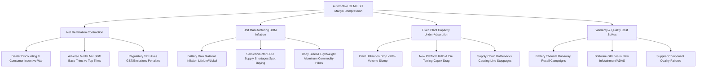

# Automotive & Electric Vehicles (EV) Industry Dossier

## 1. Industry Overview & Macro Dynamics

The automotive industry is among the largest global manufacturing sectors, defined by extreme capital intensity, deep multi-tier supply chains (20,000+ parts per vehicle), strict safety and emissions regulations, cyclical demand tied to consumer financing/interest rates, and significant operational leverage. The industry is currently undergoing its most profound transformation in a century: the shift from Internal Combustion Engine (ICE) vehicles to Battery Electric Vehicles (BEVs), accompanied by the rise of Software-Defined Vehicles (SDVs) and autonomous driving architectures.

```
                    ┌──────────────────────────────────────────────────┐
                    │          MACRO DRIVERS OF AUTOMOTIVE ROI         │
                    └────────────────────────┬─────────────────────────┘
                                             │
         ┌───────────────────┬───────────────┴───────────────┬───────────────────┐
         ▼                   ▼                               ▼                   ▼
┌─────────────────┐ ┌─────────────────┐             ┌─────────────────┐ ┌─────────────────┐
│ Plant Capacity  │ │ Battery Pack    │             │ Regulatory CAFE │ │ Financing Rates │
│ Utilization     │ │ Cost ($/kWh)    │             │ & Zero-Emission │ │ & Consumer TCO  │
│ (75-80% B/E)    │ │ & Chem (LFP/NMC)│             │ Mandates        │ │ Sensitivity     │
└─────────────────┘ └─────────────────┘             └─────────────────┘ └─────────────────┘
```

### Global Context
- **The ICE-to-BEV Transition**:
  - Legacy OEMs (Volkswagen, Toyota, GM, Stellantis) are managing a complex dual-operating model: generating cash flows from legacy ICE and hybrid platforms to fund multi-billion-dollar R&D, gigafactory joint ventures, and dedicated EV skateboard architectures.
  - Pure-play EV disruptors (Tesla, BYD) have redefined manufacturing efficiency via mega-castings (gigapressing), cell-to-chassis structural battery packs, software-first electronics, and vertically integrated supply chains.
- **China’s EV Hegemony**: Chinese players (BYD, CATL) dominate raw material refining (Lithium, Graphite) and cell manufacturing, delivering BEVs at a $30\%\text{--}40\%$ cost discount compared to Western and Japanese legacy OEMs.

### India & Emerging Markets Context
- **Segmented Electrification Curve**:
  - **2-Wheelers (2W) & 3-Wheelers (3W)**: Rapid electrification ($15\text{--}25\%\text{ penetration}$), driven by lower upfront battery pack costs ($1.5\text{--}4\text{ kWh}$), dense urban commuting, commercial gig-worker fleet adoption, and rapid Total Cost of Ownership (TCO) breakeven within 12–18 months (e.g., Ola Electric, TVS, Ather, Bajaj).
  - **Passenger Cars (4W)**: Slower EV penetration ($2\text{--}5\%$), constrained by consumer price sensitivity in the $<\$15,000$ (sub-₹12 Lakh) segment, limited public fast-charging infrastructure on highways, and battery cost premiums.
- **Regulatory Framework**:
  - **FAME (Faster Adoption and Manufacturing of EVs)**: Government subsidies per kWh to bridge the upfront purchase price gap.
  - **Production-Linked Incentives (PLI)**: Multi-billion-dollar incentives for local manufacturing of Advanced Chemistry Cell (ACC) batteries and specialized auto components.
  - **CAFE-II (Corporate Average Fuel Economy)** & **BS-VI Real Driving Emissions (RDE)**: Stringent fleet-wide $\text{CO}_2$ emissions caps that impose heavy financial penalties on OEMs failing to electrify.

---

## 2. Complete End-to-End Value Chain & Margin Capture

```
┌────────────────────────────────────────────────────────────────────────────────────────┐
│                          AUTOMOTIVE & EV VALUE CHAIN                                   │
└────────────────────────────────────────────────────────────────────────────────────────┘

 [Raw Materials / Mining] ──► [Tier-1 Component Suppliers] ──► [Auto OEMs] ──► [Dealerships] ──► [Aftermarket]
  Lithium, Nickel, Cobalt,     Bosch, Continental, Magna,       Toyota, Tata,   Franchise 3S     Spares, Service,
  Graphite, Steel, Aluminum    CATL, LG Energy (Batteries)      Tesla, BYD      Showrooms / D2C  Battery Recycling
 ─────────────────────────────────────────────────────────────────────────────────────────────────────────────────
  EBITDA: 25-40% (Mining)      EBIT: 6-10% (Components)         EBIT: 6-9%      Net Margin: 2-4% Spares Margin: 35%
  High commodity volatility    Battery Cells: 15-22% Gross      ROIC: 8-14%     Service: 50%     Recycling EBITDA:
  Geopolitical bottleneck      Moat: Tier-1 integration IP      Moat: Assembly, F&I: 70% Comm.   15-25% (Black mass)
                                                                Brand & Scale
```

### Value Chain Segments & Economics
1. **Upstream Raw Materials & Refining (Albemarle, Ganfeng, SQM, POSCO)**:
   - Extract and refine battery-grade Lithium Hydroxide/Carbonate, battery-grade Nickel, Cobalt, synthetic Graphite, and rare earth magnets (Neodymium).
   - **Economic Impact**: Captures substantial cyclical profit pools during raw material price spikes.
2. **Tier-1 Suppliers & Battery Gigafactories (CATL, LG Energy, Bosch, Denso, Magna)**:
   - **Battery Manufacturers**: Build battery cells, modules, and battery management systems (BMS). Represents $30\text{--}40\%$ of a BEV’s total Bill of Materials (BOM).
   - **Traditional Tier-1s**: Supply braking systems, steering racks, seating, lighting, and body panels.
   - **Margin Capture**: Battery cell makers achieve $15\text{--}22\%$ gross margins; component Tier-1s earn $6\text{--}10\%$ operating margins.
3. **Automotive OEMs (The Core Integrator & Brand Owner)**:
   - Responsible for vehicle design, crash-safety homologation, platform stamping, body-in-white (BIW) robotic welding, paint shop, powertrain integration, and final assembly.
   - **Margin Profile**: $6\text{--}9\%$ EBIT margins for mass-market OEMs; $12\text{--}18\%$ for luxury players (Porsche, BMW, Mercedes-Benz); highly negative EBIT for sub-scale EV startups.
4. **Dealership Networks (The Franchise 3S Model)**:
   - Execute **Sales, Service, and Spares (3S)**. Generates thin margins on new car sales ($2\text{--}4\%$) but extracts massive margins on workshop labor ($50\%+$), OEM spare parts ($30\text{--}40\%$), and Finance & Insurance (F&I) commissions ($70\%+$).

---

## 3. Revenue Models & Monetization Mechanics

```
┌────────────────────────────────────────────────────────────────────────────────────────┐
│                              TOTAL OEM REVENUE STREAMS                                 │
└──────────────────────────────────────────┬─────────────────────────────────────────────┘
                                           │
         ┌─────────────────────────────────┼─────────────────────────────────┐
         ▼                                 ▼                                 ▼
┌───────────────────────────────┐ ┌───────────────────────────────┐ ┌───────────────────────────────┐
│  Wholesale Vehicle Invoicing  │ │  Aftermarket & Spare Parts    │ │  Connected Software & Svcs    │
│  - Base Vehicle Ex-Factory    │ │  - OEM Genuine Spares Markup  │ │  - ADAS & Autonomous Subs     │
│  - Optional Trims & Sunroof   │ │  - Extended Warranties        │ │  - OTA Performance Unlocks    │
│  - Fleet Volume Discounts     │ │  - Proprietary Tooling Supply │ │  - Regulatory ZEV Credits     │
└───────────────────────────────┘ └───────────────────────────────┘ └───────────────────────────────┘
```

### 1. Vehicle Wholesale & Trim Level Realization
- **Option Packaging & Feature Gating**: OEMs earn exceptional contribution margins ($60\text{--}80\%$) on higher trim levels (leather seats, panoramic sunroof, 360-degree cameras, ADAS radar packages, premium alloy wheels).
- **The Wholesale Model**: In traditional franchised auto retail, the OEM invoices the vehicle to the independent dealership on dispatch (ex-factory), immediately recognizing revenue and shifting inventory carrying costs to the dealer floor-plan credit line.

### 2. Dealership Economics: The "3S" Model & Service Absorption

```
┌────────────────────────────────────────────────────────────────────────────────────────┐
│                        DEALERSHIP 3S PROFITABILITY ENGINE                              │
├───────────────────────────────┬─────────────────┬─────────────────┬────────────────────┤
│ Revenue Stream                │ % of Dealer Rev │ Gross Margin %  │ Strategic Role     │
├───────────────────────────────┼─────────────────┼─────────────────┼────────────────────┤
│ **1. New Vehicle Sales (S)**  │ $80\%\text{--}85\%$ | $3.0\%\text{--}5.0\%$ | Customer acquisition & volume |
│ **2. Service & Labor (S)**    │ $8\%\text{--}12\%$  │ $45\%\text{--}60\%$ | Stable, high-margin cash flow |
│ **3. Genuine Spares (S)**     │ $5\%\text{--}8\%$   │ $25\%\text{--}35\%$ | Recurring maintenance pull |
│ **4. F&I Commissions**        │ $2\%\text{--}4\%$   │ $70\%\text{--}85\%$ | Pure margin on loan/insurance orig. |
└───────────────────────────────┴─────────────────┴─────────────────┴────────────────────┘
```
- **Service Absorption Ratio**: A premier operational metric for dealerships.
  $$\text{Absorption Ratio} = \frac{\text{Gross Profit from Service} + \text{Spares} + \text{F\&I}}{\text{Total Dealership Operating Overhead}} \times 100$$
  *Target*: $>100\%$. An absorption ratio $>100\%$ means the dealership covers $100\%$ of its fixed operating costs (rent, utilities, technician salaries) strictly through its service bays and spares, meaning every single new vehicle sold produces pure profit.

### 3. The EV Threat to Dealership Profitability
- BEVs have $\sim 70\%$ fewer moving parts than ICE vehicles (no motor oil, spark plugs, timing belts, fuel filters, exhaust catalytic converters, or multi-speed transmissions).
- **Impact**: EV dealership service revenue drops by $40\text{--}50\%$ over the vehicle lifecycle. Dealerships must adapt by monetizing tire wear (EVs are heavier and consume tires faster), battery health certifications, ADAS calibrations, and collision repairs.

---

## 4. Detailed Unit Economics & Contribution Margin Breakdown

### Comparative Vehicle Manufacturing P&L: Mid-Size ICE SUV vs Battery Electric Vehicle (BEV)

**Vehicle Class**: C-Segment Mid-Size SUV (4.3 meters) | **Annual OEM Plant Production**: 100,000 Units
- **ICE SUV**: 1.5L Turbo Petrol, 7-Speed Automatic
- **BEV SUV**: 50 kWh LFP Battery Pack, 150 kW Permanent Magnet Synchronous Motor

```
┌────────────────────────────────────────────────────────────────────────────────────────┐
│           VEHICLE MANUFACTURING UNIT ECONOMICS (ICE SUV VS 50 kWh BEV SUV)             │
├──────────────────────────────────────┬────────────────────┬────────────────────────────┤
│ Financial Line Item                  │ ICE Mid-SUV (₹)    │ BEV Mid-SUV (50 kWh) (₹)   │
├──────────────────────────────────────┼────────────────────┼────────────────────────────┤
│ **Ex-Showroom / Retail Price (MSRP)**│  16,00,000         │  19,50,000                 │
│ Less: Dealer Commission & Discounts  │    (80,000) (5.0%) │    (78,000) (4.0%)         │
│ Less: GST / State Taxes              │  (4,00,000) (28+17%)│   (92,857) (5% EV GST)     │
├──────────────────────────────────────┼────────────────────┼────────────────────────────┤
│ **NET OEM FACTORY REALIZATION**      │ **11,20,000**      │ **17,79,143**              │
├──────────────────────────────────────┼────────────────────┼────────────────────────────┤
│ **Bill of Materials (BOM) Costs**    │                    │                            │
│ 1. Powertrain:                       │                    │                            │
│    - ICE: Engine + Transmission + Exh│   2,80,000         │         —                  │
│    - BEV: Battery Pack ($95/kWh)     │         —          │   4,00,000 (50 kWh Pack)   │
│    - BEV: e-Motor + Inverter + OBC   │         —          │   1,45,000 (Drive Unit)    │
│ 2. Body-in-White (Steel/Aluminum)    │   1,85,000         │   2,10,000 (Reinforced)    │
│ 3. Chassis, Suspension, Steering     │   1,20,000         │   1,35,000                 │
│ 4. Electronics, Wiring, Infotainment │   1,10,000         │   1,60,000 (High Compute)  │
│ 5. Interior Trim, Seats, HVAC        │   1,35,000         │   1,45,000 (Thermal Heat)  │
│ 6. Exterior Lights, Glass, Paint     │     75,000         │     80,000                 │
├──────────────────────────────────────┼────────────────────┼────────────────────────────┤
│ **TOTAL BILL OF MATERIALS (BOM)**    │   9,05,000 (80.8%) │  12,75,000 (71.7%)         │
├──────────────────────────────────────┼────────────────────┼────────────────────────────┤
│ **Direct Plant Manufacturing Costs** │                    │                            │
│ 7. Direct Assembly Labor             │     35,000         │     28,000 (Fewer parts)   │
│ 8. Plant Energy, Consumables & Opex  │     30,000         │     32,000                 │
│ 9. Inbound & Outbound Logistics      │     25,000         │     28,000                 │
│ 10. Warranty & Field Campaign Reserve│     22,000 (2.0%)  │     45,000 (Battery risk)  │
├──────────────────────────────────────┼────────────────────┼────────────────────────────┤
│ **TOTAL VARIABLE MANUFACTURING COST**│  10,17,000         │  14,08,000                 │
├──────────────────────────────────────┼────────────────────┼────────────────────────────┤
│ **UNIT CONTRIBUTION MARGIN**         │  **1,03,000 (9.2%)**│  **3,71,143 (20.9%)**     │
├──────────────────────────────────────┼────────────────────┼────────────────────────────┤
│ **Fixed Capital Charges (Amort.)**   │                    │                            │
│ 11. Tooling, R&D & Die Depreciation  │     45,000         │   1,80,000 (New EV Platf.) │
│ 12. Corporate SG&A, Launch Marketing │     30,000         │     75,000                 │
├──────────────────────────────────────┼────────────────────┼────────────────────────────┤
│ **OEM OPERATING PROFIT (EBIT/UNIT)** │   **28,000 (2.5%)**│  **1,16,143 (6.5%)**      │
└──────────────────────────────────────┴────────────────────┴────────────────────────────┘
```

---

## 5. Comprehensive Cost Structure

```
┌────────────────────────────────────────────────────────────────────────────────────────┐
│                        AUTOMOTIVE OEM COST ARCHITECTURE                                │
└────────────────────────────────────────────────────────────────────────────────────────┘

 [Fixed Plant & Tooling Capex] ──► [Semi-Variable Assembly]   ──► [Direct Material / BOM]
  - Stamping Dies & Tooling       - Plant Maintenance & Energy    - Battery Pack ($/kWh)
  - Robotic Weld & Paint Lines    - Shift-based Direct Labor      - Electric Drive Units (e-Motors)
  - Crash Homologation & R&D      - Plant Floor Supervision       - Body Steel & Aluminum Stampings
  - Enterprise ERP & Corporate    - Finished Vehicle Yard Rent    - Semiconductor ECUs & Wiring
  (Breakeven requires 70-75% cap) (Step-fixed with shift volume)  (Directly variable per unit built)
```

### Cost Dynamics & Levers

| Cost Bucket | % of Net Realization | Nature of Cost | Strategic Optimization Levers |
|---|---|---|---|
| **Bill of Materials (BOM)** | $68\%\text{--}78\%$ | Directly Variable | Value Analysis / Value Engineering (VAVE), dual-sourcing semiconductors, standardization of battery cell form factors, mega-casting. |
| **Plant Capex Depreciation** | $5\%\text{--}12\%$ | Fixed Capital Amortization | Shared platform architectures (building multiple body styles—sedan, SUV, hatchback—on one platform), maximizing plant capacity utilization ($>85\%$). |
| **Warranty & Recalls** | $1.5\%\text{--}3.5\%$ | Variable / Contingent Loss | Accelerated stress testing, battery pack thermal management telemetry, over-the-air (OTA) software patches vs physical dealer recalls. |
| **Direct Assembly Labor** | $2.5\%\text{--}5.0\%$ | Semi-variable (Union/Shift) | Robotic automation in body and paint shops, line balancing, reducing vehicle assembly hours per unit (HPV target: $<15\text{ hours}$). |
| **Logistics & Freight** | $2.0\%\text{--}4.0\%$ | Variable | Co-locating Tier-1 suppliers within an adjacent auto-cluster supplier park, double-decker rail transport for finished cars. |
| **Sales, Marketing & Incentives**| $3.0\%\text{--}6.0\%$ | Variable / Discretionary | Tailoring dealer discount schemes based on regional inventory days of supply (DOS), digital direct sales. |

### Battery Pack Economics: LFP vs NMC Chemistries

```
┌────────────────────────────────────────────────────────────────────────────────────────┐
│                        BATTERY CHEMISTRY & PACK METRICS                                │
├─────────────────────────┬─────────────────────────────┬────────────────────────────────┤
│ Parameter               │ LFP (Lithium Iron Phos.)    │ NMC (Nickel Manganese Cobalt)  │
├─────────────────────────┼─────────────────────────────┼────────────────────────────────┤
│ **Pack Cost ($/kWh)**   │ $\$75\text{--}\$90/\text{kWh}$ │ $\$105\text{--}\$125/\text{kWh}$  │
│ **Cell-Level Chemistry**│ No Cobalt, No Nickel        │ High Nickel (NMC 811)          │
│ **Energy Density**      │ $140\text{--}180\text{ Wh/kg}$ (Heavier)│ $220\text{--}280\text{ Wh/kg}$ (Lighter)  │
│ **Cycle Life**          │ $3,000\text{--}5,000\text{ cycles}$ │ $1,200\text{--}2,000\text{ cycles}$ │
│ **Thermal Runaway Temp**│ $\sim 270^\circ\text{C}$ (Ultra-safe) │ $\sim 210^\circ\text{C}$ (Requires active cooling)│
│ **Optimal Target Use**  │ Mass-market EVs, 2W/3W, Commercial│ Luxury EVs, Long-Range, Cold climates │
└─────────────────────────┴─────────────────────────────┴────────────────────────────────┘
```
- **Cell vs Pack Economics**: Battery cells account for $\sim 75\text{--}80\%$ of total pack cost. The remaining $20\text{--}25\%$ consists of the Battery Management System (BMS), liquid cooling chill plates, high-voltage contactors, wiring harnesses, and structural aluminum casing.
- **Cell-to-Pack (CTP) & Cell-to-Chassis (CTC)**: Eliminates intermediate module housings, boosting volumetric efficiency by $15\text{--}20\%$ and cutting pack manufacturing costs by $\$10\text{--}\$15/\text{kWh}$.

---

## 6. Essential KPI Formulas & Benchmark Ranges

```
┌────────────────────────────────────────────────────────────────────────────────────────┐
│                              CORE AUTOMOTIVE KPI FORMULAS                              │
└────────────────────────────────────────────────────────────────────────────────────────┘

      [Plant Capacity Utilization %] = (Actual Units Produced / Nameplate Capacity) × 100
      [Contribution Margin per Unit] = Net Factory Realization - Variable Manufacturing BOM
      [Dealership Service Absorption %] = [(Service GP + Spares GP + F&I GP) / Dealer Overhead] × 100
      [Days of Supply (DOS)] = (Dealer Finished Inventory / 30-Day Retail Sales Run-Rate) × 30
      [Warranty Expense %] = (Total Warranty Claims Incurred / Total Automotive Revenue) × 100
      [Hours Per Vehicle (HPV)] = Total Direct Labor Hours / Total Vehicles Produced
      [EV Total Cost of Ownership (TCO/km)] = [Upfront Net Price - Residual Value + Lifetime Fuel/Elec
                                              + Lifetime Maint. + Insurance] / Total Lifetime Km
      [CPO Charger Utilization %] = [Total kWh Dispensed / (Rated Power kW × 24 hrs × Days)] × 100
```

### Mathematical Formulations

1. **Plant Capacity Utilization & Breakeven Volume**:
   $$\text{Capacity Utilization } \% = \frac{\text{Actual Production Volume}}{\text{Annual Nameplate Capacity}} \times 100$$
   $$\text{Breakeven Volume} = \frac{\text{Fixed Plant Depreciation} + \text{Tooling Amortization} + \text{Fixed Overhead}}{\text{Net Realization per Unit} - \text{Variable BOM Cost per Unit}}$$

2. **EV Total Cost of Ownership (TCO per km)**:
   $$\text{TCO}_{\text{per km}} = \frac{P_{\text{net}} - \frac{\text{Salvage}}{(1+r)^N} + \sum_{t=1}^{N} \frac{\text{Energy}_t + \text{Maintenance}_t + \text{Insurance}_t}{(1+r)^t}}{\text{Total Lifetime Kilometers Flown/Driven}}$$
   *Where $P_{\text{net}}$ is the upfront purchase price minus subsidies, $r$ is the discount rate, and $N$ is the vehicle ownership lifespan in years.*

3. **Charging Point Operator (CPO) Utilization Rate**:
   $$\text{Charger Utilization } \% = \frac{\text{Total Energy Dispensed (kWh)}}{\text{Charger Rated Power (kW)} \times 24\text{ Hours} \times 365\text{ Days}} \times 100$$
   *A 60 kW DC fast charger dispensing 180 kWh/day operates at: $\frac{180}{60 \times 24} = \mathbf{12.5\%}$ utilization.*

4. **Dealership Floor-Plan Carrying Cost**:
   $$\text{Carrying Cost per Vehicle} = \text{Dealer Invoice Price} \times \text{Floor-Plan Interest Rate} \times \frac{\text{Days of Supply (DOS)}}{365}$$

### Industry Benchmark Ranges

| Metric | Mass Market ICE (e.g., Maruti, Hyundai) | Pure-Play EV (e.g., Tesla, BYD) | Luxury OEM (e.g., Mercedes, BMW) |
|---|---|---|---|
| **EBIT Margin (%)** | $6.5\%\text{--}9.5\%$ | $10.0\%\text{--}16.0\%$ (At Scale) | $12.0\%\text{--}18.0\%$ |
| **Plant Capacity Utilization** | $80\%\text{--}92\%$ | $85\%\text{--}95\%$ | $75\%\text{--}85\%$ |
| **Breakeven Capacity Util.** | $70\%\text{--}74\%$ | $65\%\text{--}70\%$ | $60\%\text{--}65\%$ |
| **Assembly Hours/Vehicle (HPV)**| $14\text{--}18\text{ hrs}$ | $9\text{--}12\text{ hrs}$ | $24\text{--}35\text{ hrs}$ |
| **Warranty Provision (% Rev)** | $1.5\%\text{--}2.2\%$ | $2.5\%\text{--}4.0\%$ | $2.0\%\text{--}3.0\%$ |
| **Dealer Days of Supply (DOS)**| $25\text{--}40\text{ days}$ | $10\text{--}20\text{ days}$ (Direct D2C) | $35\text{--}55\text{ days}$ |
| **Battery Pack Cost ($/kWh)** | N/A | $\$75\text{--}\$95$ (LFP) / $\$115$ (NMC) | $\$110\text{--}\$135$ (NMC) |

---

## 7. Typical Case Scenarios & Diagnostic Issue Trees

### Issue Tree 1: Automotive OEM Profitability Compression Diagnostic



### Issue Tree 2: OEM Electric Vehicle (EV) Transition & Portfolio Strategy

```mermaid
flowchart TD
    Root[OEM EV Portfolio Transition Strategy] --> Plat[1. Platform Architecture Strategy]
    Root --> Batt[2. Battery Sourcing & Supply Chain]
    Root --> Retail[3. Distribution & Dealership Channel]
    Root --> Econ[4. Financial Feasibility & TCO Parity]

    Plat --> Plat1[Dedicated EV Skateboard vs Multi-Energy ICE Conversion]
    Plat --> Plat2[Software Architecture Central Compute vs Distributed ECUs]
    Plat --> Plat3[Mega-Casting vs Traditional Multi-Piece Stamping]

    Batt --> Batt1[Chemistry Selection LFP Mass-Market vs NMC Long-Range]
    Batt --> Batt2[Make vs Buy Cell Sourcing JV Gigafactory vs Pure Vendor]
    Batt --> Batt3[Raw Material Offtake Contracts Direct Lithium Hedging]

    Retail --> Retail1[Traditional Franchise 3S vs Direct-to-Consumer D2C]
    Retail --> Retail2[Dealership Service Revenue Replacement Strategy]
    Retail --> Retail3[Public Fast-Charging CPO Partnerships]

    Econ --> Econ1[BOM Cost Gap vs ICE Counterpart]
    Econ --> Econ2[TCO Breakeven Mileage for Commercial vs Retail Buyers]
    Econ --> Econ3[Regulatory CAFE Penalty Avoidance Value]
```



### Typical Case Archetypes in Consulting Interviews
1. **The EV Platform Make-vs-Buy Decision (e.g., IIMA Case 027)**:
   - *Problem*: An established auto OEM must decide whether to develop a ground-up bespoke EV skateboard platform ($3\text{B capex, 4 years}$) or adapt an existing ICE vehicle architecture ($600\text{M capex, 18 months}$).
   - *Analysis*: Trade-off between structural packaging (dedicated skateboard allows larger battery pack, flat floor, superior aerodynamics, and $15\%$ lower BOM cost at scale) versus capital risk if EV adoption rates decelerate.
2. **Dealership Network Profitability Restructuring**:
   - *Problem*: Dealerships are refusing to invest in EV charging points and battery diagnostic tools because lower EV maintenance is threatening their service workshop margins.
   - *Solutions*: Restructure dealer remuneration: introduce agency sales commissions (eliminating dealer inventory risk), assign warranty repair labor subsidies, and authorize dealers as regional battery refurbishment centers.
3. **Battery Pack Sourcing & Gigafactory Joint Venture**:
   - *Problem*: An OEM producing 200,000 EVs annually must decide whether to build a $2\text{B JV gigafactory}$ with a battery maker or purchase cells on long-term contracts.
   - *Analysis*: Calculate minimum scale for gigafactory efficiency ($>15\text{--}20\text{ GWh/year}$, equivalent to 300,000 cars with 60 kWh packs), technology obsolescence risk (solid-state vs liquid electrolyte), and raw material pass-through clauses.

---

## 8. Common Pitfalls & Candidate "Landmines"

1. **Ignoring Operating Leverage and Capacity Utilization**:
   - *The Landmine*: Assuming that an auto plant's cost per vehicle is fixed regardless of volume.
   - *The Reality*: Auto manufacturing is the ultimate fixed-cost game. If a plant designed for 250,000 units drops to 120,000 units ($48\%$ utilization), unallocated tooling and facility depreciation will wipe out all gross profit, swinging the plant into massive losses.
2. **Confusing Battery Cell Cost with Finished Battery Pack Cost**:
   - *The Landmine*: A candidate notes that battery cells cost $\$80/\text{kWh}$ and assumes the total battery pack cost is $\$80/\text{kWh}$.
   - *The Reality*: The finished battery pack includes module enclosures, thermal cooling plates, high-voltage wiring harnesses, contactors, and the Battery Management System (BMS), adding $20\text{--}30\%$ over cell-level costs (e.g., $\$80/\text{kWh cell} \rightarrow \$100/\text{kWh pack}$).
3. **Overlooking the Dealership 3S Model in D2C Proposals**:
   - *The Landmine*: Flippantly recommending that a legacy OEM immediately fire all franchise dealers and switch to a Tesla-style Direct-to-Consumer (D2C) website.
   - *The Reality*: Franchise dealers carry billions in inventory working capital on their balance sheets and provide localized service/spares. A full D2C pivot requires the OEM to absorb massive balance-sheet floor-plan debt, buy prime retail real estate, and build out nationwide service centers from scratch.
4. **Treating EV and ICE Total Cost of Ownership (TCO) as Purely Fuel vs Electricity**:
   - *The Landmine*: Comparing only petrol cost per km vs electricity cost per km.
   - *The Reality*: Full TCO must account for upfront vehicle price spread, government subsidies, differential insurance premiums (EV insurance is $15\text{--}25\%$ higher due to battery replacement risks), scheduled maintenance savings ($-40\%$), and **resale/residual value depreciation**.
5. **Neglecting Product Mix & Trim Gating in Profitability Turnarounds**:
   - *The Landmine*: Recommending an OEM cut prices on all base models to recover lost profitability.
   - *The Reality*: Auto OEMs make virtually zero margin on entry-level "stripper" base trims; all economic profit is concentrated in top-tier feature-loaded trims. The winning move is often repackaging high-margin optional packages (sunroof, connected screens, ADAS) into mid-tier editions.
